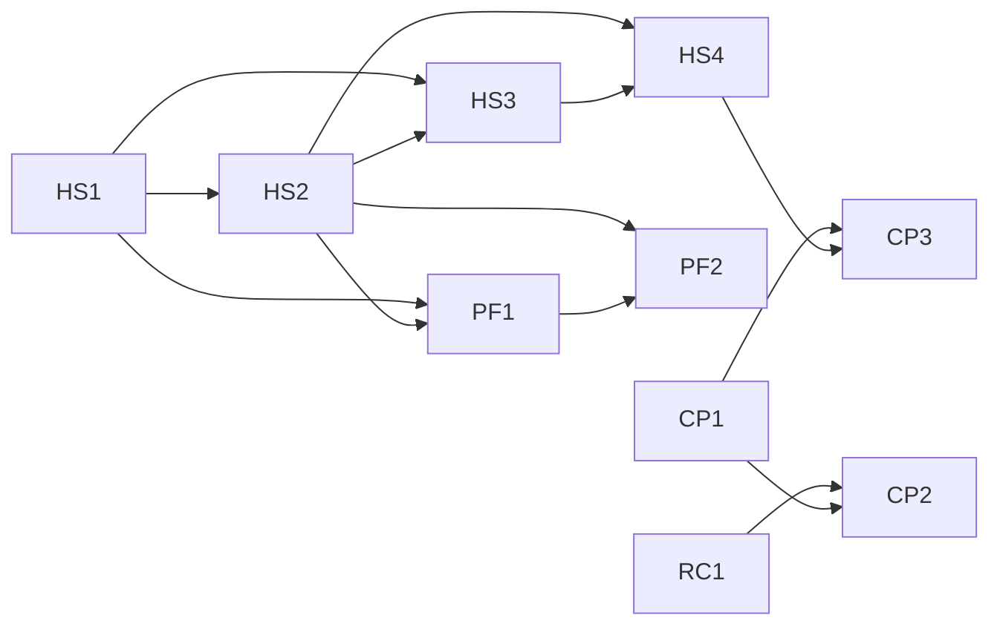

# Wave 9 — harness sources, `prove`, profiles as a list: Umbrella Plan

> **For agentic workers:** this plan is not dispatched. It coordinates the wave's lanes, each of
> which has its own plan, its own worktree and its own session; it fixes what crosses a lane: the
> launch graph, the release checkpoints, file ownership and hot spots, the lane-plan items the wave's
> reviews left, the execution contract every lane plan copies into its header, and the wave's
> exit. Its own tasks (Release train and Exit, below) are controller-run with the owner, step by
> step. A lane plan's REQUIRED SUB-SKILL line is superpowers:subagent-driven-development, and its
> header carries the wave-dispatch rule and the section "Execution contract" here, verbatim.

**Goal:** land wave 9 of the extraction design in three releases — `0.4.0` (the value floor,
layered preferences, one trust record, `prove`), `0.5.0` (delivery from the overlay with no trace
in the checkout, memory by layers, onboarding), `0.6.0` (regressions, the `adopt` skill, profile
context) — and check P6's exit on the installed `0.6.0`.

**Architecture:** five lanes in parallel sessions. Harness-sources (HS) is the critical path and
its four pull requests run in order; core-proof (CP) starts with the register engine's list field
(RC1) and `prove`; profiles (PF) follows HS1, HS2 and CP1; the benchmark (BM) and the matcher
spike (SP) touch nothing the plugin ships. Every pull request merges into `dev` when its checks
are green and the launch graph allows, and each release is the owner's checkpoint, cut when its
lanes are on `dev`; HS2, HS3 and HS4 merge into `dev` in that order (amended 2026-10-18 by the owner:
there are no users besides the owner, so no window holds a merge and no integration branch exists).

**Tech Stack:** Python ≥ 3.11 standard library at runtime; `uv`, pytest (`-n auto`), ruff, mypy,
the mutation oracle (`scripts/mutation_oracle.py`), towncrier fragments in `changelog.d/`,
`scripts/release.py`, `scripts/plugin_tree.py`, `scripts/check_artifacts.py`.

**Spec:** the agent-harness extraction design, in a private repository this one cannot link to:
§15.8 (wave 9's decisions 1–45 and C7, settled with the owner on 2026-10-15 in a brainstorm and a
final review, and amended on 2026-10-16 with a second review's rulings), §15.1 (P6's exit), §15.2
(the packages), §15.4 (plans in parallel sessions), §15.5 (the re-plan and its deferred list). A
decision is cited here as "d" and its number. A lane plan's implementer cannot open the spec, so
every value a task needs from it is written into the lane plan itself.

**Scope:** wave 9 as d1 cuts it — packages harness-sources, core-proof (with the slice of
project-record its `regression` field needs) and the profiles row of §15.2, the benchmark's part 1
and final run, and the matcher measurement. A change belongs to this plan iff it fixes something
that crosses lanes: an edge of the launch graph, a release checkpoint, the owner of a file two lanes
touch, a lane-plan item, the execution contract, or the wave's exit. Every change to code belongs
to a lane plan. Out: the `debt` register and the rest of project-record, the TypeScript profile,
the JavaScript and Go profiles' rules and `assess` checks, a mode for a machine holding old copies
(after launch, d1); Codex parity, the metrics report, the visual roadmap and the owner's harness
map (wave 10, d20, d39, d42).

**Premise:** measured on 2026-10-15 at `dev` = `22a9cad` (after `v0.3.0`). 33 commands registered;
`hooks/hooks.json` with 10 entries — 7 `SessionStart` and one each on `PreToolUse`, `PostToolUse`
and `PostToolUseFailure`, all three matching `Bash`; no `Stop` and no `Read` matcher;
`[defaults.memory] mode = "local-only"` in `src/stayfixed/presets/recommended.toml`; a
`stayfixed.toml` the loader refuses makes every `PreToolUse` `Bash` call exit 2
(`src/stayfixed/hooks/commands.py` `_unloadable`); `stayfixed doctor` in a repository with no
`stayfixed.toml` reports `not-initialised` red, and the smoke workflow (`.github/workflows/smoke.yml`)
asserts no red row and the report's row count; `stayfixed upgrade` refuses a checkout with no
manifest (`src/stayfixed/project/upgrade.py`); every CI job runs on GitHub-hosted runners. This is
the tree before HS1, kept as history: HS1 changed three of these (36 commands; a refused
`stayfixed.toml` is a warning, not a refusal; `not-initialised` warns, and `doctor` reports eighteen
rows). Each lane plan measures its own premise against the tree it starts from and stops on a
mismatch there.

---

## Lanes

| Lane | Pull request | Branch | Targets | Plan | Release |
|---|---|---|---|---|---|
| HS | HS1 — the value floor (d4, D-2), key classes and who sets them (d12), layered preferences (d13), the owner's guard switch (d5), budgets (d5, d12), the ratchet rows (d15), one trust record and `stayfixed trust` (d11) | `wp/hs1-floor-layers-trust` | `dev` | `docs/plans/2026-10-15-wave-9-hs1-floor-layers-trust.md` | `0.4.0` |
| HS | HS2 — the overlay's two scopes (d7, no `machines/<name>/`), the binding id (d8, with no `checkout` approval), the rendered plugin's names (d17, layers 1–2), Codex and worktrees (d20), `attach`/`detach` (d22); pins, the `overlay` approval kind, the node-id allowlist (d9, d10, d19), `doctor --footprint` (d21) and overlay tightening (d16) are cut (owner, 2026-10-19) | `wp/hs2-delivery` | `dev` | `docs/plans/2026-10-24-wave-9-delivery.md`, one plan for HS2, HS3 and HS4, written after HS2's measurements (d18); merged as PR 119 | `0.5.0` |
| HS | HS3 — `harness` by default (d14), the composed store (d23), in-repo notes (d24), `local-only` (d25), the reviewed record (d26), the index (d27), the durable-note guard (d28), the memory doctor (d29) | `wp/hs3-memory` | `dev` | the same plan; merged as PR 120 | `0.5.0` |
| HS | HS4 — scopes in the template (d7), `setup --overlay` (d30, with no machine-file migration), the guided `init` (d33), the scaffold rename (d21); migration code (d31, d32) is cut (owner, 2026-10-19) | `wp/hs4-onboarding` | `dev` | the same plan; merged as PR 121 | `0.5.0` |
| CP | RC1 — the list field with quoted items, read-only (d39) | `wp/rc1-list-field` | `dev` | `docs/plans/2026-10-18-wave-9-cp-proof.md`, one plan for RC1, CP1 and SP; merged as PR 105 | `0.5.0` |
| CP | CP1 — the report readers, the five runner adapters, `prove` (d34); merged as PR 106. The evidence records (d35) are deferred until a report reads them (owner, 2026-10-19) | `wp/cp1-prove` | `dev` | the same plan | `0.5.0` |
| CP | CP2 — regressions (d36) | `wp/cp2-regressions` | `dev` | `docs/plans/2026-10-26-wave-9-release-0-6.md`, one plan for CP2 and CP3, written once HS4 had merged into `dev` | `0.6.0` |
| CP | CP3 — the `adopt` skill and BR-010 (d37) | `wp/cp3-adopt` | `dev` | the same plan | `0.6.0` |
| PF | PF1 — committed rules files released from the manifest (d38); the list, its union merge and the `profiles` rename wait until a second profile ships rules; **deferred with PF2** (owner, 2026-10-26) | `wp/pf1-profiles` | `dev` | none yet | after `0.6.0` |
| PF | PF2 — profile context delivered (d38); **deferred** (owner, 2026-10-26): no checkout lacks its committed rules while `init` writes them, so PF1 and PF2 return with an `init` that does not write them for an attached checkout | `wp/pf2-profile-context` | `dev` | none yet | after `0.6.0` |
| BM | benchmark part 1, then the final run (d40) | `wp/bench` | `dev` | the wave-7 side-lanes plan's Lane 2, rewritten in place against the tree | any |
| SP | the matcher measurement (d41); merged as PR 103 | `wp/matcher-spike` | `dev` | the RC1 and CP1 plan, Wave J | any |
| CL | the cleanup lane: deletion-only pull requests against what earlier waves shipped (`prove`'s residue, CL1 the hook wrapper, CL2 the guards, CL3 the user's own home, CL4 `assess`'s CODEOWNERS probe, and the redundancies); CL5, the conventions, waits for HS3 | `cleanup/*` | `dev` | none: each pull request states its cut and its net size | any |

A lane plan is written in its lane's session from §15.8, this plan and the section "Lane-plan
items" below, and it cites the decisions by number. The delivery plan is written only after HS2's
four measurements (d18) are recorded, because two of them choose a mechanism.

**Amended 2026-10-18 by the owner:** the remaining lanes share three plans instead of six — RC1, CP1
and SP in one; HS2, HS3 and HS4 in one, since they reach `dev` one after another for one release; CP2,
CP3, PF1 and PF2 in one, since they land in one release and share `src/stayfixed/config/`,
`src/stayfixed/doctor/` and `src/stayfixed/assess/rule.py`. A plan still dispatches by waves and
opens one pull request per row; the pull requests and branches are unchanged.

## Launch graph

Drawn over the imports and the Interfaces blocks each lane plan names, never over file lists
alone. An edge means "merged into `dev`".



What each edge carries:

- **HS1 → HS2, HS3, PF1.** `stayfixed.trust` (the record, `ApprovalKind`, the `approvals.py`
  discovery convention, the `trust` commands), `stayfixed.config.classes` (`KeyClass`, `ALLOWED`,
  `class_of`, `resolve`), `stayfixed.config.owner` (`Owner`, `resolve_owner`) and
  `stayfixed.config.session` (`SessionConfig`, `session_config`). HS2 wires the overlay's two
  layers (`common/`, `projects/<name>/`) into `resolve`, with no approval kind of its own; HS3
  rewrites the `memory` kind into the reviewed record and removes the `memory trust` alias; PF1
  keeps `profile` a scalar preference resolved through the layers. As HS1 shipped, `resolve` decides who
  may set a key and gives doctor's `preferences` row its provenance, while the loader still builds
  `Config`'s values: HS2's first task builds the preference and session values from a `Resolution`
  and carries the provenance on `SessionConfig`, so doctor stops deriving it a second time. HS1 also
  ships `stayfixed.config.reading` (the names both loaders share), `ApprovalKind.flags` as a mapping
  of flag to help text, the layer names `OVERLAY_COMMON`, `OVERLAY_PROJECT`, `OVERLAY_MACHINE`, and
  `stayfixed.trust.boundary` (amended 2026-10-17: after the narrowing, the sandboxed-write refusal
  and the spellings `setup --approval-boundary` prints; doctor reads no settings for it).
- **HS2 → HS3.** The binding id and the machine data directory's layout;
  HS3's pointer to the composed store is whatever HS2's measurement of an absolute
  `autoMemoryDirectory` chose.
- **HS2 → PF1.** The overlay's layers, in which a profile may be enabled.
- **HS2, HS3 → HS4.** `attach` and the reviewed record, which `init`'s guided walk runs.
- **CP1 → CP2, CP3.** `prove`, whose verdicts CP2 requires of a regression and the `adopt` skill
  offers.
- **RC1 → CP2.** `regression`'s list grammar.
- **HS4 → CP3.** `init`'s guided walk, whose last step offers the `adopt` skill.
- **HS2, PF1 → PF2.** The `paths:` handler on `PostToolUse` for `Read`, `Edit` and `Write`, and
  active profiles.

## Release train

A release is cut on `origin/main` from `dev` by `RELEASING.md`, so whatever is on `dev` when it is
cut ships. Amended 2026-10-18 by the owner: there are no users besides the owner, so no window holds
a merge. Each pull request merges into `dev` when its checks are green and the launch graph allows;
the releases are the owner's checkpoints, each cut once its lanes are on `dev`.

| Release | Cut once these are on `dev` | Then |
|---|---|---|
| `0.4.0` | skipped (owner, 2026-10-26): no release was cut before HS4 merged | — |
| `0.5.0` | RC1, CP1, HS1, HS2, HS3, HS4 | Tasks 1–2 |
| `0.6.0` | CP2, CP3 | Task 3, then Tasks 4–5 |

A lane of a later release that lands first ships in the earlier release cut after it, which is
harmless with no users; BM and SP touch nothing `scripts/plugin_tree.py` puts in the plugin. A pull
request's checks are read with `gh pr checks` on its own head after the latest `dev` has come into it
by `git merge origin/dev`, since a push to `dev` re-runs no open pull request's checks and `ci.yml`
runs on `push` to `main` only.

## File ownership and hot spots

A file two lanes touch has one owner at a time, in merge order; the other lane rebases on it. Every lane writes
its own changelog fragments, its own `docs/cli.md` sections and its own mutation entries, appended
to the group file `scripts/mutation_oracle.py` `GROUP_OF` routes them to.

| File or area | Owner, in order | Note |
|---|---|---|
| `hooks/hooks.json`, `hooks/hashes.json` | CL1 (the wrapper's policy words), then HS2 (the `PostToolUse` `Read\|Edit\|Write` handler) | no other lane registers an entry |
| `hooks/run-hook.sh` | CL1 (shrunk to its minimal form; owner, 2026-10-19), then the release tasks | |
| `pyproject.toml`, `.claude-plugin/`, `.codex-plugin/` | the release tasks only | |
| `src/stayfixed/hooks/commands.py`, `src/stayfixed/hooks/dispatch.py` | HS1, then HS2 | |
| `src/stayfixed/config/` (`schema.py`, `loader.py`, `session.py`, `classes.py`, `machine.py`) | HS1, then CL3 (the home follows `HOME`), HS2 (overlay layers), HS3 (`harness`), CP2 (the `regressions` gate name) | each rebases on the last; the class-table test fails a field added without its class |
| `src/stayfixed/presets/recommended.toml` | HS1 (budgets), HS3 (drops `[defaults.memory] mode`), HS4 (`attribution_check` default) | |
| `src/stayfixed/assess/rule.py` | HS1, then CP2 | |
| `src/stayfixed/trust/` | HS1, then HS2 (`trust approve` without the terminal check), HS3 (`memory`) | |
| `src/stayfixed/memory/trust.py` | HS1 (the record moves to core), HS3 (the reviewed record) | |
| `src/stayfixed/ledger/` | RC1, then CP2 | |
| `src/stayfixed/profiles/` | CP1 (adapters under `profiles/python/`, `profiles/javascript/`, `profiles/go/`), PF1 (rules files released from the manifest) | per pull request (§15.4) |
| `src/stayfixed/project/`, `skills/init/` | HS3 (`upgrade`'s memory defaults), HS4 (the walk), PF1 (the profile step; rules released from the manifest), CP3 (the adopt step) | a chain: each quotes the previous lane's text it rewrites |
| `src/stayfixed/setup/` | HS1 (`--approval-boundary`, advice only), HS4 | |
| `src/stayfixed/templates/overlay/`, `scripts/check_artifacts.py`, `ci.yml`'s overlay-render step | CP1 (the adapters in `WHEEL_MUST`), then HS4 | `overlay create` and `overlay init` retire into `setup --overlay` |
| `src/stayfixed/doctor/`, `tests/doctor/test_command.py`, `.github/workflows/smoke.yml`, `scripts/smoke_hooks.py` | HS1 → HS2 → HS3 → HS4 → CP2 → PF1 | **hot spot**: each lane that adds or renames a `doctor` row or a hook entry updates the smoke workflow's row and entry counts and quotes the previous lane's numbers in its plan |
| `.github/workflows/ci.yml` | CP1 (the `runners` job), HS4 (the overlay-render step) | |
| `src/stayfixed/assess/commands.py`, `src/stayfixed/assess/gates.py` | CP1 (`kill_group` moves to `src/stayfixed/processes.py` (create)), then CP2 | |
| `docs/cli.md`'s `gate` section | CP2 (regressions) | |
| `README.md`'s machine-files table | HS1, HS2, HS3 | **hot spot**: each lane quotes the previous lane's rows |
| `tests/boundaries/test_delivery.py`, `tests/test_language_neutral.py` | CP1 (the adapter discovery, `xml.parsers.expat`), then PF1 | |
| `README.md` network table, `tests/outbound/policy.py` | CP1 (`prove`'s launches), HS2 (`claude plugin install`), HS4 (`gh`) | |
| `README.md`, `docs/cli.md`: "footprint" → "scaffold" | HS4 | one mechanical commit inside HS4's pull request; the `footprint` category goes with no alias |
| `skills/` | each skill's lane: `trust`-related wording HS1, `attach` HS2, `init` HS4, `adopt` CP3 | |

**Old spellings** (amended 2026-10-18 by the owner, against d3's one release of aliases: there are
no users besides the owner): a pull request that renames a command, a flag or a configuration key
removes the old spelling in the same pull request. `memory trust`, which HS1 kept and no release has
shipped, goes in HS3; `overlay create`, `overlay init` and the `footprint` category go in HS4, which
replaces them. The `profile` → `profiles` rename waits with PF1's list.

## Design rule (owner, 2026-10-18)

stayfixed is a tool developers install, set up quickly and then shape to their own work, usually
through their own agents; it leaves them room rather than covering every branch for them. So every
control a lane plan adds or keeps names **the adversary it stops and the anchor it trusts** (the
bytes or state the decision rests on, and who can write them). Where the adversary can write the
anchor, the control is a convenience, and a convenience never refuses a legitimate user and never
asks again about what has not changed. Each lane plan's final review applies the rule to every
control its diff adds or keeps.

Controls with a real anchor, kept: the gates' ratchet against a pull request in CI; the binding id
in the git common directory and the random-id plugin names; path containment and symlink refusal on
repository-controlled paths; the `.git/info/exclude` block written before `plugin install`; the
refusal of a tracked `settings.local.json`; tracked notes as data; the value floor and the NOTE
mode; `harness` memory, the guided `init` with the skip first and the attribution check off, by
default. `CONTRIBUTING.md` states the rule for every later change. The machine's home from the
password database and the pins left this list on 2026-10-19 (rows below).

Applied on 2026-10-18 (the owner's review "locks and redundancy"), as lane-plan items below:

| Control | Why it is a convenience | Becomes | Lane |
|---|---|---|---|
| `trust approve regressions` before a local regressions run, its digest holding the commit | a local `stayfixed gate` already runs the base's `[gates.custom]` with no approval, and the test runner executes the tree's own `conftest.py` | regressions run locally as custom gates do, with no approval and no `regressions` kind (d36 amended) | CP2 |
| the digest approval before in-repo notes reach the model, and the digest approval of local-only and overlay stores with the harness-link gate that withdraws the link when the digest lapses | the harness loads the same repository's `CLAUDE.md` and `.claude/rules/` with no approval, and any commit to a shared note would unapprove every teammate; one note the agent writes withdraws the link, and the approval passes under `script -q` | in-repo notes are delivered as the harness delivers `CLAUDE.md`, still as data; the store digest approval and the harness-link gate are cut (d24 and d26 amended) | HS3 |
| the terminal check in `trust approve` and in `memory promote` | an agent passes it through `script -q`, `pty.fork` or `expect`, as the HS1 plan records; it refuses only legitimate automation (a second machine's bootstrap, a devcontainer, P6's second computer) | removed, with no flag in its place: `approve` and `promote` record and print what they recorded (2026-10-19: with the sandbox on, the agent cannot write the trust record at all, and with it off it passes any bump) | HS2 (`trust approve`), HS3 (`memory promote`) |
| `guards.*` as `MACHINE_ONLY` | a repository can already switch a plugin's hooks off through its own settings | a preference: a repository may set the default, the machine owner's layers have the last word (d5 amended) | HS2 |
| the overlay's node id, re-checked through `gh` (d9, D-1) | the anchor (`[overlay]` in the machine file) is as writable as the remote URL | cut (owner, 2026-10-19): the allowlist is the `[overlay] root` that `setup` recorded | HS2 |
| pins and an `overlay` approval kind, one subject per pinned part plus the rule set, re-approved per machine (d10, d19, N-21, U-17) | the owner and the owner's agents write the overlay, and Claude Code itself never re-asks when a pulled repository changes its committed hooks | cut (owner, 2026-10-19): what runs is what the last `attach` rendered; `attach` shows the executable diff on one screen; `doctor` reports drift between the overlay and the last render | HS2 |
| a `checkout` approval kind ("confirmed"), and `attach`'s remote-identity refusals (a mismatch, `--trust-remote`, no `origin`) | `origin` is the agent's to set, and the binding id in `.git` already separates a reused path | cut (owner, 2026-10-19): `attach` writes the binding id; an `origin` that no longer matches the recorded one is a `doctor` warning and a `SessionStart` hint | HS2 |
| `attach` refusing a `settings.local.json` with allow rules it did not write | the merge goes by stayfixed's marker, so no foreign entry is at risk; Claude Code may write its own "don't ask again" answers there, which HS2 measures first | merged by marker; foreign entries are left alone and shown in `attach`'s one-screen diff; only a tracked `settings.local.json` is refused | HS2 |
| `prove`'s per-adapter refusal lists and `-I` beside a `PYTHON*` scrub | measured: nine bypasses through every list, and refusals of TypeScript, Plug'n'Play and `PYTHONPATH=src` | CP1: run as typed; only the honest-mistake guards remain (PR 106's final review) | CP1 (done) |
| the evidence records (d35) and the evidence artifact uploaded in every caller's CI | a log nothing reads; its one consumer is the wave-10 metrics report | deferred until a report reads them (owner, 2026-10-19) | CP1 follow-up |
| the local suite on 3.11.4 before every push | CI runs it on every pull request | dropped from the execution contract; the local run before a push stays on 3.13 | all lanes |
| the approvals' three bumps (the terminal check, the `ask` rules, the honest boundary) | the `ask` rules were cut in HS1 and the terminal check goes above, so the honest boundary remains | nothing to add | HS2 |
| the rendered plugin's four layers against a committed `enabledPlugins` in a hostile clone (names carrying the binding id, the marketplace only in the checkout's excluded settings, the checkout's confirmation, each rendered hook checking the binding, an MCP pin launcher) | the first two already make the plugin unreachable from a hostile clone | the random-id names and the excluded marketplace (layers 1–2) are the whole stack; layers 3–4 and the O-7 measurement are cut | HS2 |
| the lifecycle matrix multiplied by every layer, for every command | a command that reads no configuration (`prove`) has no layer to walk | the execution contract's item 5 crosses only the keys a pull request adds with the layers their class admits | all lanes |
| a mandatory security seat on every pull request | its findings were bypasses through anchors the agent writes, and each became a refusal | one correctness seat and one "who does this refuse, and what can be deleted" seat; a security seat only for a diff that touches an anchor repository bytes cannot move (CI's base read, the binding id in the git common directory, repository-path containment, the exclude ordering) | all lanes |
| the sibling enumeration in fix briefs | it grew `prove`'s Node and pytest tables | siblings are enumerated only to delete them or fold them into one rule, never to extend a refusal list | all lanes |
| one mutation entry, or a "why none" sentence, per assertion | it makes every refusal and message constant sticky: deleting one later costs three edits | new entries only for branches that decide a verdict, a containment or a data-loss path; other assertions need neither an entry nor a "why none" sentence; the entries of every removed control go with it (owner, 2026-10-19; `CONTRIBUTING.md` says the same) | all lanes |
| the machine's home from the password database, and the `O_NOFOLLOW` refusals rooted at the home | its adversary, a committed `env` block setting `HOME`, already holds every anchor; scratch-`HOME` isolation does not isolate, and a stow- or chezmoi-managed `~/.claude` is refused | the home follows `HOME` as the harness does, and writes go through links under the home; `doctor` reports a database/`HOME` mismatch as information (owner, 2026-10-19); CL3 amends `CONTRIBUTING.md`'s anchor sentence and the README's machine-files row in the same pull request | CL3 |
| migration code (d14's sniff and N-4, d30–d32, C-41, P-HS-19) and Task 2's migration seat | there is one user | cut (owner, 2026-10-19): the `0.5.0` upgrading section lists the owner's manual steps; Task 2 Step 1 is one controller run of `attach` on copies under an isolated home | HS3, HS4 |

## Lane-plan items

What the wave's two reviews found that a lane plan must carry and §15.8 does not spell out. Each
lane plan cites the ids it takes.

| Lane | Items |
|---|---|
| HS1 | Carried in the HS1 plan. |
| HS2 | The Design rule's HS2 rows: no pins, no `overlay` or `checkout` approval kind and no node-id allowlist (what runs is what the last `attach` rendered, `attach` shows the executable diff on one screen, `doctor` reports drift); the binding id with an `origin` mismatch as a warning; `trust approve` records and prints what it recorded, with no terminal check and no `--digest`; `guards.*` a preference; `attach` merging by marker; the plugin names' layers 1–2 only. Three layers above the repository: `common/`, `projects/<name>/`, the machine file; overlay layers carry no gate parameter (as HS1 shipped). Measure before fixing tasks: whether Claude Code writes its own allow rules into `settings.local.json`; copy or in place [P-HS-1]; an absolute `autoMemoryDirectory` in a main checkout and its worktrees [F5, N4]; worktree and desktop worktree sessions [P-HS-22]. Then: `attach` refuses a `settings.local.json` only when it is tracked [B-7, narrowed by the Design rule]; everything `attach` keeps out of git goes in the `.git/info/exclude` block, written before `plugin install`, never `.gitignore` [P-HS-15, C-40]; `detach` versus a shared slug [BR-027, P-HS-21]; the path-rule handler on `Read\|Edit\|Write`, once per file per session, registered only in the rendered plugin and only when the overlay holds a `paths:` rule [U-9]; `attach` shows the binding and the executable diff on one screen, and asks nothing again per machine [U-17, narrowed by the owner's cut of the approvals]; `attach --store` is derived, never required; no terminal check on `attach`/`detach --machine`; `doctor --footprint` (d21) folds into the `attached` row; doctor's skill-frontmatter hooks stack becomes an info line, the forged-marker provenance lists each entry's file and position (red only for marked entries in files stayfixed writes), and the rows that never clear (`ignored-env`, the `harness-link` `HOME` warning, `codex-hooks`, `approval-boundary` after the first promote) become information, `codex-hooks` moving to the README reach table. |
| HS3 | In-repo notes delivered with no digest approval, and no digest approval of local-only or overlay stores and no harness-link gate (Design rule); `memory promote` records and prints what it recorded, with no terminal check and no `--digest`; in-repo notes delivered as the harness delivers `CLAUDE.md`, the wrap kept only for unreviewed notes in session bundles, and `UnsafeNote`'s delimiter check dropped; the reviewed record [d26] kept, its noise one count line at `SessionStart`, only when the set changed; no durable-note guard (d28 cut); the composed store's pointer is `projects/<name>/memory`, `common/memory` reaches the session as context, native lines stay outside stayfixed's marked region (d23, d27 narrowed); "the notes `SessionStart` delivers equal the notes promote can mark" in place of O-20; worktree-link fixtures with differing stores and the bare-repository "cannot tell" case [O-19]; one fixture with both kinds of index line [O-21]; native top-level topic files indexed and their pointer lines kept [N3]; the reviewed-record tests: a note written through the shell is unreviewed, promote marks it, a killed session leaves it unreviewed [F2, O-22]; the note frontmatter reader skips unknown keys; `store-debris` a count; no migration code (N-4 cut); remove the `memory trust` alias. |
| HS4 | BR-018's three cases and `_populated`'s replacement [P-HS-18]; one user entry for creating an overlay [U-18 of the first review], `create:` needing no `--yes`; `setup --overlay` keeps `require_overlay` and drops its placement refusals; the README outbound row for `gh` [P-HS-20]; the guided walk's four-line texts in `init --questions --json`, `agents` detected, `attribution_check` and commit types asked, `setup`'s plugin installs opt-in, nothing of the user's `pluginConfigs` or comments overwritten [N5]; the skip path's defaults: attribution check off, the conventional commit types, no recommended plugins [N-18]; the scaffold rename [O-8]; `overlay publish-template` moves to `scripts/`; `pre-commit install` only in `setup --overlay`; `uninstall` runs `detach` itself; `refuse_ignored`'s `check-ignore` timeout a warning; `commit strip` gives way to the harness's `attribution` setting, the CI `commit check` opt-in. No migration code: the `0.5.0` upgrading section lists the owner's manual steps (P-HS-19 and C-41 cut). |
| RC1 | Capture literals for `bugs new`'s entry, `bugs check` (text and `--json`) and `renumber` before touching the engine, from the tree rather than the `v0.3.0` tag (owner, 2026-10-18) [O-23]; quoted list items for `regression` [P-CP-17]. |
| CP1 | Done in PR 106: `prove` runs the command as typed, and only the honest-mistake guards remain. The evidence records and their `0.4.0` key are deferred until a report reads them. |
| CP2 | A closed bug's `regression` argv runs through `prove`, naming the entry, locally with no approval and no `regressions` kind (Design rule), where the project's tests already run, `docs/cli.md` showing the one-line step; `regressions` is a gate name in the existing builtin/enforced vocabulary, not a new key, and is not added to the preset's default `builtin`. Cut: the argv read at the merge base and its fixture [N-23], a regressions step and upload in `check.yml` [F9, P-CP-11], overlay-register regressions, the project key for an unbound checkout [C-39], evidence records of its own, `bugs new --regression`. `gate --base` takes a short name and falls back to the local base. **Amended 2026-10-26 by the owner, on the CP plan's review:** `regressions` is a documented `[gates.custom.regressions]` running `stayfixed bugs regressions`, not a built-in gate name, so ordering, the landed wait and the consent before a clone's commands are the custom gates' own; the short `--base` is cut. |
| CP3 | The `adopt` skill as the last step of the full `init` walk [O-3d], made by moving `skills/init/references/adoption.md` into `skills/adopt/SKILL.md`, with no new CLI; BR-010, which depends on nothing and may land on its own. |
| PF1 | Committed rules files released from the manifest, which `upgrade` owns today. Deferred until a second profile ships rules: profiles as a layered list with detection, the union merge in `resolve` [P-CP-20] and the `profile` rename. Cut: the no-drop ratchet (a profile's checks never fail a gate) and the runner-adapter listing beside a profile. |
| PF2 | Profile context through `SessionStart` and the path-rule handler, delivered only where the checkout does not track its own copy. |
| BM | Rewrite the side-lanes plan's stale steps: `scripts/release.py check`; the existing `mutations/repository.toml`; the retired 512-file limit; the existing `tests/test_payload.py`; the final run built with `scripts/plugin_tree.py` [P-CP-22]. Every paid run waits for the owner's yes. The final review's two seats, no lifecycle matrix, mutation entries by item 10 of the contract. |
| SP | Done in PR 103. |

## Execution contract

Every lane plan carries this section in its header, verbatim, and the controller copies the
relevant part into every brief, post-pull-request dispatches included.

1. **The wave is the dispatch unit.** Waves are lettered and own a run of continuously numbered
   tasks; one implementer per dispatched wave, with no review of its own (the pull request's final
   review is the review), every task keeping its own failing test, verification and commit. A
   fix round goes to the same implementer while its context allows, else to a fresh agent with the
   review package. Every subagent runs on Opus (`model: opus`).
2. **Every implementer brief says:** report a mismatch with the tree instead of guessing; run a
   command and paste what it printed before writing any claim about it; focused runs while
   iterating and per commit; before each push, once, a full run of `uv run pytest -n auto --cov
   --cov-fail-under=92` with `uv run python scripts/release.py check`, and the suite again on
   Python 3.13 (`uv run --python 3.13 pytest -n auto`), the oracle's interpreter in CI, since a
   local uv Python is often newer than any CI leg (CI holds 3.11.4 and the rest); a plan's predicted
   mutation outcome is a hypothesis — design your own if it does not redden, and paste the raw
   output either way; no line numbers from the plan; this brief is a message, not a file, so cite
   only the plan; write nothing under the repository but the task's files, use
   `<scratchpad>/<wave>-<role>/`, never run a script you did not write, and read `git diff --stat`
   before committing; the static checks at CI's scope (`uv run ruff check .`,
   `uv run ruff format --check .`, `uv run mypy`); do not use the Agent tool; do not run
   `git checkout`, `restore`, `stash` or `clean`; start a long run in the background and wait on
   its own output, never with `pgrep`.
3. **Every reviewer brief adds:** run every command yourself and never use the Agent tool; do not
   run `git checkout`, `restore`, `stash` or `clean`; what already passed, by sha and suite, and run
   only the test that decides a finding you suspect; no citation may point at a brief, a dispatch
   or a report; what later tasks own.
4. **One final review per pull request**, with two read-only seats: correctness, and "who does
   this refuse, and what can be deleted". A security seat joins only when the diff touches an
   anchor repository bytes cannot move (CI's base read, the binding id in the git common
   directory, repository-path containment, the exclude ordering). Reviewers give findings only, with no replacement text, and a
   separate triage sends on only correctness and requirement gaps. Then one scoped re-review of
   the fixes, and stop: no per-wave reviews, and no minor finding rides a round.
5. **The lifecycle matrix**, walked at pre-flight like a task and again by the correctness seat:
   every configuration key the pull request adds × every change of configuration — set a value,
   change it, unset it, move a path, a step that fails part-way, `uninstall` — × only the layers
   the key's class admits (the class-table test holds where a key may be set); a command that
   reads no configuration walks no layer.
6. **The parallelism map.** Read-only seats run beside each other and beside the implementer;
   writers of one worktree serialise; one heavy local run (the full suite, the mutation oracle) at
   a time per host; no local full run while the same branch's CI runs.
7. **Templates.** A fix brief enumerates the sibling instances of the defect's class only to
   delete them or fold them into one rule, never to extend a refusal list. After a simplification
   ruling it carries a net budget: `src` below zero, tests and mutation entries at zero or less. A
   new defect found during a cut is filed in the ledger, not fixed, unless the fix deletes code. A
   security ruling names its minimal preconditions, its anchor's provenance (who can write the
   bytes it trusts), and one legitimate user it must not refuse.
8. **Verification.** The controller re-verifies only heads it pushes or merges, re-derives the pull
   request's body from the diff before every push, takes the run id from `gh pr checks` and waits
   with `gh run watch <run-id> --exit-status` until every job has ended (never a `head_sha` query,
   which finds no run for a pull request's merge ref) before reporting a pull request done.
9. **Second finding at one seam.** At the second review finding that points at the same function,
   reader or boundary, the next step is a redesign of that seam put to the owner, not a third patch.
   A second bypass of the same refusal list counts as the same seam.
10. **Mutation entries.** A new entry only for a branch that decides a verdict, a containment or a
    data-loss path; other assertions need neither an entry nor a "why none" sentence; deleting a
    control deletes its entries (owner, 2026-10-19).

## Release train tasks

The owner runs every push of a release (the commits, the tags, `scripts/publish_plugin.py`) and
approves the `pypi` deployment in GitHub's web interface. The controller runs only checks,
read-backs and dry runs, and never calls the pending-deployments API.

### Task 1: The release check before `0.5.0` (controller, with the owner)

`0.4.0` is skipped (owner, 2026-10-26), so this task runs once, before `0.5.0`; Steps 2 and 3 read
`0.5.0` for `0.4.0`, and its upgrading section says `0.4.0` was never published.

- [ ] **Step 1:** when RC1, CP1 and HS1 have merged into `dev` and `gh pr checks` read every job
  green on each, run `uv run python scripts/release.py check` on `dev` — `RELEASING.md`'s first
  step, run once over the release — and paste its output into Findings.
- [ ] **Step 2:** the owner follows `RELEASING.md` for `0.4.0`; the changelog's upgrading section
  names `memory trust` → `trust approve memory` (the old spelling stays until HS3 removes it), the guards that run without `stayfixed.toml`, `stayfixed prove`, and
  a session that warns where it refused.
- [ ] **Step 3:** with `0.4.0` installed on the owner's machine, `stayfixed doctor --json` reads
  `0.4.0` for both the CLI and the plugin; paste the two values into Findings.

### Task 2: The delivery set and `0.5.0` (controller, with the owner)

- [ ] **Step 1:** when HS2, HS3 and HS4 have merged into `dev`, the controller runs `attach` once
  on a copy of the owner's overlay and two copies of attached checkouts, under an isolated `HOME`,
  `CLAUDE_CONFIG_DIR`, `XDG_CONFIG_HOME` and `GIT_CONFIG_GLOBAL`, never the owner's real
  installation, and pastes what it printed into Findings.
- [ ] **Step 2:** the owner cuts `0.5.0` by `RELEASING.md`; the upgrading section lists the owner's
  manual steps for an attached checkout and the existing notes (no migration code ships), and the
  spellings that are gone (`memory trust`, `overlay create`, `overlay init`).

### Task 3: Cut `0.6.0` (controller, with the owner)

- [ ] **Step 1:** when CP2, CP3, PF1 and PF2 have merged, the owner cuts `0.6.0` by `RELEASING.md`;
  the upgrading section names the `regressions` gate. The installed versions are Task 4's first
  observable.

## Exit

### Task 4: P6's exit on the installed `0.6.0` (controller, with the owner)

**Files:**
- Create: `tests/fixtures/p6/README.md` (create) — the two repositories below and the commands,
  with no private design id in it, since it lies outside `docs/plans`.

The oracle is fixed now, before HS2 is written, so the subject never chooses it (d44):

- **The public clone:** `anthropics/claude-code` at its commit of 2026-10-15T19:21:45Z
  (`03b5892ee77de289bcd5dfa39f541525ade74aff`), which tracks a `.claude/` directory and has no
  `stayfixed.toml`. At that commit it tracks only `.claude/commands/*.md`, with no `!` negation and
  no tracked settings file, so d44's negation and settings properties live in the fixture below;
  the owner confirms that split in Step 1, or names another public repository.
- **The negation fixture:** a repository the step builds with `git init`, whose tracked
  `.gitignore` holds `.claude/*` then `!.claude/settings.json` and `!.claude/rules/`, with a tracked
  Claude Code project settings file — the `!` negations a public repository may carry, which beat an exclude
  line.

Before any `claude` run in a clone, read its tracked Claude Code files and pin their digests in
Findings: a `claude` session in a clone runs its committed hooks, `env`, `statusLine` and MCP
servers. Where the step needs only a `SessionStart`, it drives one with
`stayfixed hook SessionStart` and a crafted payload instead.

- [ ] **Step 1: The isolated machine.** Set `HOME`, `CLAUDE_CONFIG_DIR`, `XDG_CONFIG_HOME` and
  `GIT_CONFIG_GLOBAL` to directories under the scratchpad and `GIT_CONFIG_NOSYSTEM=1`; install
  `0.6.0` there; create a scratch overlay with `stayfixed setup --overlay <path>`, holding a canary
  rule in `common/` and one in `projects/<name>/`, a canary skill and one hook; record the owner's
  word on the clone and the fixture split above.
- [ ] **Step 2: Each repository.** Run `git status --porcelain=v1 -z -uall` and
  `sha256sum .git/info/exclude` before `attach`; after `attach` and one `SessionStart`; after
  `detach`. Expected: every status empty; the exclude digest after `attach` differs from the
  empty-file digest, and `git check-ignore -v` names `.git/info/exclude` for each placed path; the
  digest after `detach` equals the one before `attach`; `stayfixed doctor`'s `attached` row is
  `ok` after `attach`; the isolated `installed_plugins.json` holds the rendered plugin's row; the
  `SessionStart` output holds both canaries.
- [ ] **Step 3: The control.** Apply a scratch patch, never committed, that makes `attach` write one
  extra untracked file, and run Step 2 again. Expected: the status after `attach` names that file.
- [ ] **Step 4: The observables (d44)**, each with its expected literal, in Findings:

  | Clause | Observable | Expected |
  |---|---|---|
  | On the installed `0.6.0` | the plugin row's `gitCommitSha`; `command -v stayfixed` | the sha `0.6.0`'s marketplace entry pins; a path under the uv tools directory |
  | The harness arrives | `claude -p --debug-file <file>` in the bound checkout, forced offline with `ANTHROPIC_BASE_URL=http://127.0.0.1:9` and an invalid `ANTHROPIC_API_KEY`, since an isolated `HOME` still reached a credential outside it | both canaries in the logged `SessionStart` context; the canary skill listed; no request succeeded in the log |
  | It runs through the overlay | `stayfixed doctor --json`; the checkout tree; `settings.local.json` | no drift from the last render; no `docs/memory` link tree; only entries carrying stayfixed's marker |

  A dogfooding checklist, not exit criteria: on the second computer, the same reviewed notes and
  equal preference tables; in each of the owner's two projects, a session and a worktree session
  show both canaries.

### Task 5: core-proof's acceptance and the record (controller)

- [ ] **Step 1:** the acceptance below is held by CI's `runners` job on the release commit; cite
  that run's id and conclusion. Then two smokes of the installed binary: `stayfixed prove -- pytest
  -q` in a scratch project (Expected: exit 0, `proved`) and `stayfixed prove -- sh -c 'echo 3
  passed'` (Expected: exit 1, `not proven`). Paste the output.

  | Acceptance clause (§15.8, after d37) | Test id |
  |---|---|
  | each reader's genuine passing run is `proved`, exit 0, counts equal a literal | the CP plan's Task 14 table |
  | a stdout-forged run is `not proven` | the same |
  | an empty and an all-skipped run are `failed`, `go test -run NoSuchTest` included | the same |
  | each honest-mistake refusal (snapshot update or rerun of failures, `--setup-plan`/`--setup-only`, an optimised interpreter) is `refused`, exit 2 | the same |
  | a closed entry whose countable regression passes keeps the gate green, and a passing sibling is not named; a failing regression fails the gate and names its entry | named in the CP2 plan |

- [ ] **Step 2:** record in Findings the counts before (at `22a9cad`) and after (at `0.6.0`):
  commands registered, hook entries by event, source lines under `src/stayfixed`, mutation entries,
  skills; and what wave 10 inherits (Codex parity, the metrics
  report, the visual roadmap, the owner's harness map).

---

## Findings

Written by Tasks 1–5 and by each lane's controller when its pull request merges.

### Task 2 Step 1 — `attach` on copies of the owner's overlay, 2026-10-26

Run at `dev` = `11fe104` with the checkout's own `stayfixed` (version string `0.3.1`, the release
not yet cut), on `rsync` copies of the owner's overlay and of two attached checkouts (this repository and
one other, without `.claude/worktrees`, `.git/worktrees` and `.venv`), every link and every path in
the old attach ledgers re-pointed into the copy, under an isolated `HOME`, `CLAUDE_CONFIG_DIR`,
`XDG_CONFIG_HOME` and `GIT_CONFIG_GLOBAL` with `GIT_CONFIG_NOSYSTEM=1` and `env -i`.

First pass, with no manual step: `setup --overlay <copy>` exits 2 with the identity-record refusal
("… carries no stayfixed-overlay.toml, the record that names a tree a stayfixed overlay; add it at
the overlay's root, holding `requires = ">=X.Y.Z"` … and `layout = 1` …"), so both `attach` runs
refuse with "no overlay root is recorded in the machine configuration".

Second pass, after the two manual steps the upgrading fragments name (`stayfixed-overlay.toml`
holding `requires = ">=0.1.0"` and `layout = 1`, the floor the old `.claude-plugin/plugin.json`
declared; the five links under each checkout's `docs/memory` deleted):

```
$ stayfixed setup --overlay <overlay>
machine configuration written to <home>/.config/stayfixed/config.toml; 0 plugin(s) installed; deny rules merged; stayfixed is on PATH; overlay recorded at '<overlay>'; recorded the existing overlay at '<overlay>'; installed the commit-time secret scan with `pre-commit install`
exit=0
$ (in stayfixed) stayfixed attach
attached: 1 Codex rule file(s); settings merged; binding <id> recorded
binding <id>: project stayfixed, origin 'git@github.com:stayfixed/stayfixed.git'
hook entry added: UserPromptSubmit … (three entries) / PreToolUse … (one entry)
exit=0
$ (in stayfixed) stayfixed doctor
17 checks: 0 red, 0 warn, 2 skipped
$ (in the second checkout) stayfixed attach
attached: 1 Codex rule file(s); settings merged; binding <id> recorded
binding <id>: project <second>, origin '<its origin>'
exit=0
$ (in the second checkout) stayfixed doctor
17 checks: 0 red, 1 warn, 2 skipped; warn: versions
```

`git status --porcelain=v1 -uall` was empty before and after each `attach`; the isolated
`installed_plugins.json` holds one `overlay-<id>@stayfixed-delivery-<id>` row per checkout. The second checkout's `versions` warning is its
`stayfixed.toml` declaring an older version (`stayfixed upgrade` is the remedy). The overlay's hook
entries name the overlay by a path under `$HOME`, so under the isolated `HOME` they find no script and
exit 0 by their own `[ -f "$1" ] || exit 0`; on the owner's machine they resolve as before. The
`0.5.0` upgrading section therefore lists, for the owner: add the identity record, delete the old
links under `paths.memory` and `~/.claude/projects/<slug>/memory`, then `setup --overlay <root>`
and `attach` in each checkout. The live desktop worktree session (the delivery plan's D6) is still
to run with the owner before `0.5.0`.
