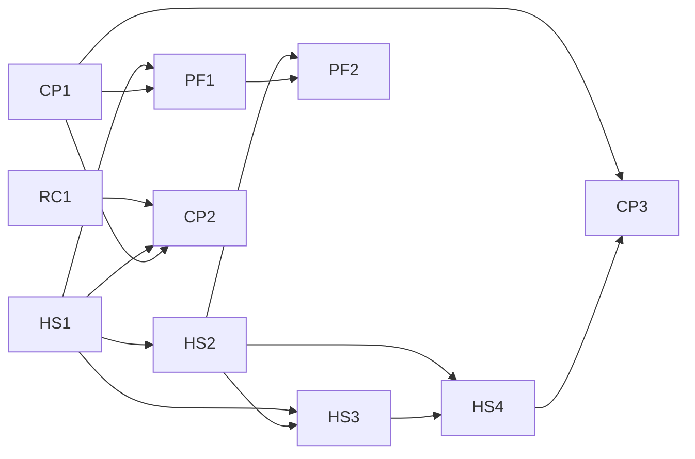

# Wave 9 — harness sources, `prove`, profiles as a list: Umbrella Plan

> **For agentic workers:** this plan is not dispatched. It coordinates the wave's lanes, each of
> which has its own plan, its own worktree and its own session; it fixes what crosses a lane: the
> launch graph, the release windows, file ownership, the execution contract every lane plan
> copies into its header, and the wave's exit. Its own tasks (Release train and Exit, below) are
> controller-run with the owner, step by step. A lane plan's REQUIRED SUB-SKILL line is
> superpowers:subagent-driven-development, and its header carries the wave-dispatch rule and the
> contract of the section "Execution contract" here, verbatim.

**Goal:** land wave 9 of the extraction design in three releases — `0.4.0` (the value floor,
layered preferences, the approval primitive, `prove`), `0.5.0` (delivery from the overlay with no
trace in the checkout, memory by layers, onboarding), `0.6.0` (regressions, the `adopt` skill,
profiles as a list) — and check P6's exit on the installed `0.6.0`.

**Architecture:** five lanes in parallel sessions. Harness-sources (HS) is the critical path and
its four pull requests run in order; core-proof (CP) starts with the register engine's list
field (RC1) and `prove`; profiles (PF) follows HS1 and CP1; the benchmark (BM) and the matcher
spike (SP) touch nothing the plugin ships. Releases are windows on `dev`: a lane may open its pull
request at any time and merges only in its release's window, so a release cut from `dev` carries
exactly its lanes.

**Tech Stack:** Python ≥ 3.11 standard library at runtime; `uv`, pytest (`-n auto`), ruff, mypy,
the mutation oracle (`scripts/mutation_oracle.py`), towncrier fragments in `changelog.d/`,
`scripts/release.py`, `scripts/plugin_tree.py`.

**Spec:** the agent-harness extraction design, in a private repository this one cannot link to:
§15.8 (wave 9's decisions, 1–45, and C7, settled with the owner on 2026-10-15 in a brainstorm and
a final review), §15.1 (P6's exit), §15.2 (the packages), §15.4 (plans in parallel sessions),
§15.5 (the re-plan and its deferred list). A decision is cited here as "d" and its number.

**Scope:** wave 9 as d1 cuts it — packages harness-sources, core-proof (with the slice of
project-record its `regression` field needs) and the profiles row added to §15.2, the benchmark's
part 1 and final run, and the matcher measurement. A change belongs to this plan iff it fixes
something that crosses lanes: an edge of the launch graph, a release window, the owner of a file
two lanes touch, the execution contract, or the wave's exit. Every change to code belongs to a
lane plan. Out: the `debt` register and the rest of project-record, the TypeScript profile, the
JavaScript and Go profiles' rules and `assess` checks (after launch, d1); Codex parity, the
metrics report, the visual roadmap and the owner's harness map (wave 10, d20, d39, d42).

**Premise:** measured on 2026-10-15 at `dev` = `22a9cad` (after `v0.3.0`). 33 commands
registered; `hooks/hooks.json` with 9 entries, 7 of them `SessionStart`; no `Stop`, no `Read`
matcher; `[memory] mode` defaults to `local-only` in `src/stayfixed/presets/recommended.toml`; a
`stayfixed.toml` the loader refuses makes every `PreToolUse` `Bash` call exit 2
(`src/stayfixed/hooks/commands.py` `_unloadable`); `stayfixed upgrade` refuses a checkout with no
manifest (`src/stayfixed/project/upgrade.py`). A lane that finds one no longer holds stops and
reports the mismatch.

---

## Lanes

| Lane | Pull request | Branch | Plan | Release |
|---|---|---|---|---|
| HS | HS1 — the value floor (d4), key classes (d12), layered preferences (d13), the session-guard switch (d5), budgets (d5, d12), the ratchet relation (d15), the approval primitive and `trust` (d11) | `wp/hs1-floor-layers-trust` | `docs/plans/2026-10-15-wave-9-hs1-floor-layers-trust.md` | `0.4.0` |
| HS | HS2 — binding and confirmation (d8), the allowlist record (d9), pins (d10), the rendered plugin (d17), pinned rules (d19), Codex and worktrees (d20), `doctor --footprint` (d21), `attach`/`detach` (d22) | `wp/hs2-delivery` | `docs/plans/<date>-wave-9-hs2-delivery.md` (create), written after its measurements (d18) | `0.5.0` |
| HS | HS3 — `harness` by default (d14), the composed store (d23), in-repo notes (d24), `local-only` (d25), the reviewed record (d26), the index (d27), the durable-note guard (d28), the memory doctor (d29) | `wp/hs3-memory` | `docs/plans/<date>-wave-9-hs3-memory.md` (create) | `0.5.0` |
| HS | HS4 — `setup --overlay` (d30), the overlay's identity (d31), migration through `attach` (d32), the guided `init` (d33), the scaffold rename (d21) | `wp/hs4-onboarding` | `docs/plans/<date>-wave-9-hs4-onboarding.md` (create) | `0.5.0` |
| CP | RC1 — the list field with quoted items, read-only (d39) | `wp/rc1-list-field` | `docs/plans/<date>-wave-9-cp-proof.md` (create), one plan for RC1 and CP1 | `0.4.0` |
| CP | CP1 — the report readers, the five runner adapters, `prove`, evidence records (d34, d35) | `wp/cp1-prove` | the same plan | `0.4.0` |
| CP | CP2 — regressions (d36) | `wp/cp2-regressions` | `docs/plans/<date>-wave-9-cp-regressions.md` (create), one plan for CP2 and CP3 | `0.6.0` |
| CP | CP3 — the `adopt` skill and BR-010 (d37) | `wp/cp3-adopt` | the same plan | `0.6.0` |
| PF | PF1 — profiles as a layered list with detection (d38) | `wp/pf1-profiles` | `docs/plans/<date>-wave-9-profiles.md` (create), one plan for PF1 and PF2 | `0.6.0` |
| PF | PF2 — profile context delivered (d38) | `wp/pf2-profile-context` | the same plan | `0.6.0` |
| BM | benchmark part 1, then the final run (d40) | `wp/bench` | the wave-7 side-lanes plan's Lane 2, rewritten in place against the tree | any window |
| SP | the matcher measurement (d41) | `wp/matcher-spike` | `docs/plans/<date>-wave-9-matcher-spike.md` (create) | any window |

A lane plan is written in its lane's session from §15.8 and this plan, and it cites the decisions
by number. The HS2 plan is written only after its four measurements (d18) are recorded, because
two of them choose a mechanism.

## Launch graph

Drawn last, over the imports and the Interfaces blocks each lane plan names, never over file
lists alone. An edge means "merged into `dev`".

What each edge carries:

- **HS1 → HS2, HS3, CP2, PF1.** `stayfixed.approvals` (the record and `ApprovalKind`), the
  `approvals.py` discovery convention, `stayfixed.config.layers` (`Layer`, `resolve`) and
  `stayfixed.config.classes` (`KeyClass`, `CLASSES`). HS2 adds the `overlay` and `checkout`
  kinds, CP2 the `regressions` kind, HS3 rewrites the `memory` kind; PF1 makes `profiles` a
  layered preference; HS2 wires the overlay's three layers into `resolve`.
- **HS2 → HS3.** The binding id, the confirmed checkout and the machine data directory's
  layout; HS3's pointer to the composed store is whatever HS2's measurement of an absolute
  `autoMemoryDirectory` chose.
- **HS2, HS3 → HS4.** `attach` as the migration's entry and the reviewed record the migration
  promotes into.
- **CP1 → PF1, CP2, CP3.** The runner-adapter protocol PF1's detection lists beside a profile,
  `prove`'s verdicts CP2 requires of a regression, and the evidence records.
- **RC1 → CP2.** `regression`'s list grammar.
- **HS4 → CP3.** `init`'s guided walk, whose last step offers the `adopt` skill.
- **HS2, PF1 → PF2.** The `paths:` handler on `Read`, `Edit` and `Write`, and active profiles.

## Release train

A release is cut on `origin/main` from `dev` by `RELEASING.md`, so whatever is on `dev` when it
is cut ships. Each window opens when the previous release is published.

| Window | Merges into `dev` | Holds | Then |
|---|---|---|---|
| R1 | RC1, CP1, HS1 (HS1 first: N1's fix must reach `0.4.0`) | everything else that touches `src/` | Task 1 cuts `0.4.0` |
| R2 | HS2, HS3, HS4 through the integration branch `wp/delivery`, merged into `dev` once, after HS4 | CP2, CP3, PF1, PF2 | Task 2 cuts `0.5.0` |
| R3 | CP2, CP3, PF1, PF2, in the launch graph's order | — | Task 3 cuts `0.6.0`, then Tasks 4–5 |

BM and SP merge in any window: neither touches a path `scripts/plugin_tree.py` puts in the
plugin. HS2, HS3 and HS4 target `wp/delivery`, not `dev`, so a release can never carry half of
the delivery switch (d3). `wp/delivery` is cut from `dev` when R2 opens and rebased on `dev`
before its one merge.

## File ownership

A file two lanes touch has one owner per window; the other lane rebases on it. Every lane writes
its own changelog fragments, its own `docs/cli.md` sections and its own mutation entries.

| File or area | Owner, in order | Note |
|---|---|---|
| `hooks/hooks.json`, `hooks/hashes.json` | HS2 (the `Read\|Edit\|Write` handler), HS3 (the durable-note guard) | no other lane registers an event |
| `src/stayfixed/hooks/commands.py`, `src/stayfixed/hooks/dispatch.py` | HS1 | the value floor |
| `src/stayfixed/config/schema.py`, `src/stayfixed/config/loader.py` | HS1, then HS3 (`harness`), PF1 (`profiles`), CP2 (`gates.regressions`) | each rebases on the last; d12's table test fails a field added without its class |
| `src/stayfixed/presets/recommended.toml` | HS1 (budgets), HS3 (drops `[defaults.memory] mode`) | |
| `src/stayfixed/assess/rule.py` | HS1, then CP2 | |
| `src/stayfixed/memory/trust.py` | HS1 (the record moves to core), HS3 (the reviewed record) | |
| `src/stayfixed/ledger/` | RC1, then CP2 | |
| `src/stayfixed/profiles/` | CP1 (adapters under `profiles/python/`, `profiles/javascript/`, `profiles/go/`), PF1 (the model and the list) | §15.4: per pull request |
| `src/stayfixed/setup/` | HS1 (the `ask` rule), HS4 | |
| `.github/workflows/check.yml` | CP1 (the evidence upload), CP2 (the regressions step) | |
| `README.md` network table, `tests/outbound/policy.py` | CP1 (`prove`'s launches), CP2 (regressions), HS2 (`claude plugin install`), HS4 (`gh`) | |
| `README.md` and `docs/cli.md` "footprint" → "scaffold" | HS4 | one mechanical commit, with the `footprint` category's alias |
| `skills/` | each skill's lane: `init` and `attach` HS4, `adopt` CP3 | |

## Execution contract

Every lane plan carries this section in its header, verbatim, and the controller copies the
relevant part into every brief, post-pull-request dispatches included.

1. **The wave is the dispatch unit.** Waves are lettered and own a run of continuously numbered
   tasks; one implementer, one review round and one reviewer per dispatched wave, every task
   keeping its own failing test, verification and commit. An implementer's first pass is sized
   for about 200k tokens: at most about 900 plan lines and three tasks per wave. Resume the same
   implementer for a fix round only while its context is under about 300k; past that, the round
   goes to a fresh agent with the review package. The controller records each implementer's
   token total in the plan's Findings. Every subagent runs on Opus (`model: opus`).
2. **Every implementer brief says:** report a mismatch with the tree instead of guessing; run a
   command and paste what it printed before writing any claim about it; focused runs while
   iterating and one full run before the commit; a plan's predicted mutation outcome is a
   hypothesis — design your own if it does not redden, and paste the raw output either way; no
   line numbers from the plan; this brief is a message, not a file, so cite only the plan; write
   nothing under the repository but the task's files, use `<scratchpad>/<wave>-<role>/`, never
   run a script you did not write, and read `git diff --stat` before committing; the static
   checks at CI's scope (`uv run ruff check .`, `uv run ruff format --check .`, `uv run mypy`);
   start a long run in the background and wait on its own output, never with `pgrep`.
3. **Every reviewer brief adds:** run every command yourself and never use the Agent tool; do not
   run `git checkout`, `restore`, `stash` or `clean`; what already passed, by sha and suite, and
   run only the test that decides a finding you suspect; no citation may point at a brief, a
   dispatch or a report; what later tasks own.
4. **The final review** of each pull request is at least four parallel read-only seats:
   correctness, architecture, security, and a lifecycle seat that walks section 5 of this
   contract against the diff.
5. **The lifecycle matrix**, walked at pre-flight like a task and again by the lifecycle seat:
   every command the pull request adds or changes × every change of configuration — set a value,
   change it, unset it, move a path, a step that fails part-way, `uninstall` — and, from HS1 on,
   × every layer that can carry the value (preset, repository, the overlay's three scopes, the
   machine file).
6. **The parallelism map.** Read-only seats run beside each other and beside the implementer;
   writers of one worktree serialise; one mutation oracle runs at a time per host; no local full
   gate runs while a pull request's CI runs on the self-hosted runner.
7. **Templates.** A fix brief enumerates the sibling instances of the defect's class (the
   `sweep-defect-class` skill) and reports the neighbour probes it ran. A security ruling names
   its minimal preconditions, its anchor's provenance (who can write the bytes it trusts), and
   one legitimate user it must not refuse.
8. **Verification.** The controller re-verifies only heads it pushes or merges, re-derives the
   pull request's body from the diff before every push, and reads `gh pr checks` until every job
   has ended before reporting a pull request done.
9. **Second finding at one seam.** At the second review finding that points at the same function,
   reader or boundary, the next step is a redesign of that seam put to the owner, not a third
   patch.

## Release train tasks

### Task 1: Cut `0.4.0` (controller, with the owner)

- [ ] **Step 1:** when RC1, CP1 and HS1 have merged into `dev` and `gh pr checks` reads green on
  each, run `scripts/release.py check` on `dev` and paste its output into Findings.
- [ ] **Step 2:** follow `RELEASING.md` with the owner for `0.4.0`; the changelog's upgrading
  section names `memory trust` → `trust approve memory` (an alias until `0.5.0`), the guards that
  now run without `stayfixed.toml`, and a session that warns where it refused.
- [ ] **Step 3:** install the published `0.4.0` on the owner's machine (`stayfixed doctor` reads
  `0.4.0` for both the CLI and the plugin) and record it in Findings. Window R2 opens.

### Task 2: Integrate delivery and cut `0.5.0` (controller, with the owner)

- [ ] **Step 1:** cut `wp/delivery` from `dev` when R2 opens; HS2, HS3 and HS4 target it.
- [ ] **Step 2:** after HS4 merges into `wp/delivery`, rebase it on `dev`, open one pull request
  into `dev`, and run its final review with the four seats of the execution contract plus a
  migration seat that walks d32 on a copy of the owner's overlay and two attached checkouts.
- [ ] **Step 3:** merge, then cut `0.5.0` by `RELEASING.md`; the changelog's upgrading section
  names the run of `stayfixed attach` that migrates an attached checkout, the one promote of the
  existing notes, and the aliases for `overlay create` and `overlay init`. Window R3 opens.

### Task 3: Cut `0.6.0` (controller, with the owner)

- [ ] **Step 1:** when CP2, CP3, PF1 and PF2 have merged, cut `0.6.0` by `RELEASING.md`; the
  upgrading section names `profile` → `profiles` (an alias until `0.7.0`) and the opt-in
  `[gates] regressions`.
- [ ] **Step 2:** install it on both of the owner's computers and record the versions.

## Exit

### Task 4: P6's exit on the installed `0.6.0` (controller, with the owner)

**Files:**
- Create: `tests/fixtures/p6/README.md` (create) — the pinned public repository and the commands, if
  the oracle runs in CI; otherwise the record lives in this plan's Findings only.

- [ ] **Step 1: The external fixture (d44).** Clone the named public repository at its pinned
  commit (a tracked `.gitignore` with `!` negations over `.claude`, a tracked
  project settings file for Claude Code, no `stayfixed.toml`) with isolated `HOME`, `GIT_CONFIG_GLOBAL` and
  `XDG_CONFIG_HOME` and an empty `.git/info/exclude`; run `git status --porcelain=v1 -z -uall`
  before `attach`, after `attach` and one `SessionStart`, and after `detach`, and `sha256sum
  .git/info/exclude` before `attach` and after `detach`. Expected: every status empty and the two
  digests equal. Then add one file through a deliberately broken `attach` (a scratch patch, never
  committed) and run the same sequence. Expected: the status after `attach` is not empty.
- [ ] **Step 2: The observables (d44).** Record, for the owner's two computers: the plugin's row
  in `installed_plugins.json` with its `gitCommitSha` equal to `0.6.0`'s pinned sha; `command -v
  stayfixed` under the uv tools directory; an offline `claude -p --debug-file <file>` run with no
  credentials in a bound checkout whose overlay holds canaries in `common/` and
  `projects/<name>/`, and the canaries in the logged `SessionStart` context; a canary skill
  listed; the memory pointer's target; `doctor`'s delivery digest; no link tree;
  `settings.local.json` holding only stayfixed's marked entries; the number of approvals on each
  machine; the effective-preference tables, equal but for the `machines/` rows.
- [ ] **Step 3:** the owner's two projects (this repository and the owner's second one) run a
  session each through the overlay; a worktree session in each. Record what arrived.

### Task 5: core-proof's acceptance and the record (controller)

- [ ] **Step 1:** run the acceptance fixtures CP1 and CP2 committed and paste their output.
- [ ] **Step 2:** record in Findings the counts before (at `22a9cad`) and after (at `0.6.0`):
  commands registered, hook entries by event, source lines under `src/stayfixed`, mutation
  entries, skills; each lane's implementer token totals; and what wave 10 inherits (Codex parity,
  the metrics report, the visual roadmap, the owner's harness map, d20, d39, d42).

---

## Findings

Written by Tasks 1–5 and by each lane's controller when its pull request merges.
