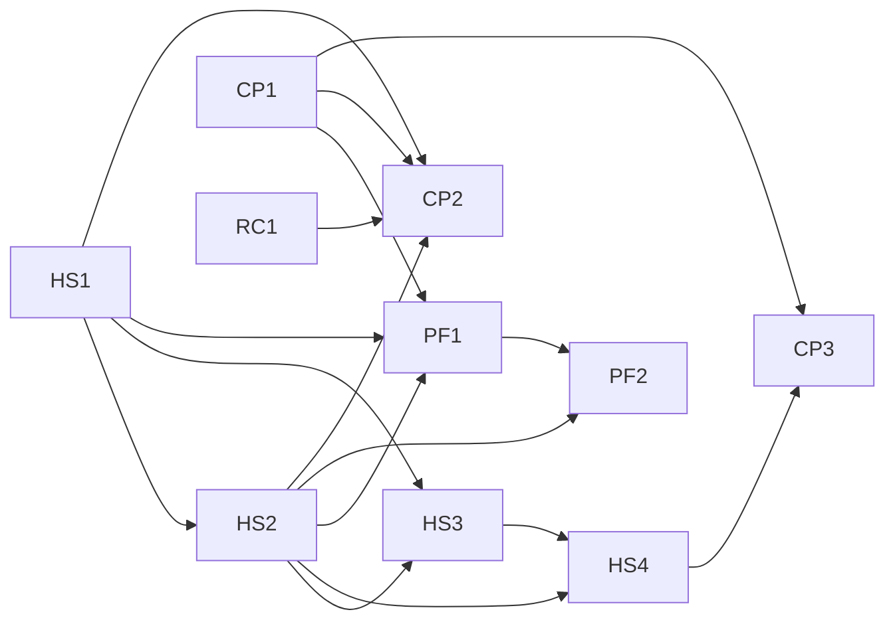

# Wave 9 — harness sources, `prove`, profiles as a list: Umbrella Plan

> **For agentic workers:** this plan is not dispatched. It coordinates the wave's lanes, each of
> which has its own plan, its own worktree and its own session; it fixes what crosses a lane: the
> launch graph, the release windows, file ownership and hot spots, the lane-plan items the wave's
> reviews left, the execution contract every lane plan copies into its header, and the wave's
> exit. Its own tasks (Release train and Exit, below) are controller-run with the owner, step by
> step. A lane plan's REQUIRED SUB-SKILL line is superpowers:subagent-driven-development, and its
> header carries the wave-dispatch rule and the section "Execution contract" here, verbatim.

**Goal:** land wave 9 of the extraction design in three releases — `0.4.0` (the value floor,
layered preferences, one trust record, `prove`), `0.5.0` (delivery from the overlay with no trace
in the checkout, memory by layers, onboarding), `0.6.0` (regressions, the `adopt` skill, profiles
as a list) — and check P6's exit on the installed `0.6.0`.

**Architecture:** five lanes in parallel sessions. Harness-sources (HS) is the critical path and
its four pull requests run in order; core-proof (CP) starts with the register engine's list field
(RC1) and `prove`; profiles (PF) follows HS1, HS2 and CP1; the benchmark (BM) and the matcher
spike (SP) touch nothing the plugin ships. Releases are windows: a lane may open its pull request
at any time and merges only in its release's window, so a release cut from `dev` carries exactly
its lanes. HS2, HS3 and HS4 merge into an integration branch that reaches `dev` once.

**Tech Stack:** Python ≥ 3.11 standard library at runtime; `uv`, pytest (`-n auto`), ruff, mypy,
the mutation oracle (`scripts/mutation_oracle.py`), towncrier fragments in `changelog.d/`,
`scripts/release.py`, `scripts/plugin_tree.py`, `scripts/check_artifacts.py`.

**Spec:** the agent-harness extraction design, in a private repository this one cannot link to:
§15.8 (wave 9's decisions 1–45 and C7, settled with the owner on 2026-10-15 in a brainstorm and a
final review, and amended on 2026-10-16 with a second review's rulings), §15.1 (P6's exit), §15.2
(the packages), §15.4 (plans in parallel sessions), §15.5 (the re-plan and its deferred list). A
decision is cited here as "d" and its number. A lane plan's implementer cannot open the spec, so
every value a task needs from it is written into the lane plan itself.

**Scope:** wave 9 as d1 cuts it — packages harness-sources, core-proof (with the slice of
project-record its `regression` field needs) and the profiles row of §15.2, the benchmark's part 1
and final run, and the matcher measurement. A change belongs to this plan iff it fixes something
that crosses lanes: an edge of the launch graph, a release window, the owner of a file two lanes
touch, a lane-plan item, the execution contract, or the wave's exit. Every change to code belongs
to a lane plan. Out: the `debt` register and the rest of project-record, the TypeScript profile,
the JavaScript and Go profiles' rules and `assess` checks, a mode for a machine holding old copies
(after launch, d1); Codex parity, the metrics report, the visual roadmap and the owner's harness
map (wave 10, d20, d39, d42).

**Premise:** measured on 2026-10-15 at `dev` = `22a9cad` (after `v0.3.0`). 33 commands registered;
`hooks/hooks.json` with 10 entries — 7 `SessionStart` and one each on `PreToolUse`, `PostToolUse`
and `PostToolUseFailure`, all three matching `Bash`; no `Stop` and no `Read` matcher;
`[defaults.memory] mode = "local-only"` in `src/stayfixed/presets/recommended.toml`; a
`stayfixed.toml` the loader refuses makes every `PreToolUse` `Bash` call exit 2
(`src/stayfixed/hooks/commands.py` `_unloadable`); `stayfixed doctor` in a repository with no
`stayfixed.toml` reports `not-initialised` red, and the smoke workflow (`.github/workflows/smoke.yml`)
asserts no red row and the report's row count; `stayfixed upgrade` refuses a checkout with no
manifest (`src/stayfixed/project/upgrade.py`); every CI job runs on GitHub-hosted runners. A lane
that finds one no longer holds stops and reports the mismatch.

---

## Lanes

| Lane | Pull request | Branch | Targets | Plan | Release |
|---|---|---|---|---|---|
| HS | HS1 — the value floor (d4, D-2), key classes and who sets them (d12), layered preferences (d13), the owner's guard switch (d5), budgets (d5, d12), the ratchet rows (d15), one trust record and `stayfixed trust` (d11) | `wp/hs1-floor-layers-trust` | `dev` | `docs/plans/2026-10-15-wave-9-hs1-floor-layers-trust.md` | `0.4.0` |
| HS | HS2 — scopes (d7), binding and confirmation (d8), the allowlist record (d9), pins (d10), the rendered plugin (d17), pinned rules (d19), Codex and worktrees (d20), `doctor --footprint` (d21), `attach`/`detach` (d22), where a tightening applies (d16) | `wp/hs2-delivery` | `wp/delivery` | `docs/plans/<date>-wave-9-hs2-delivery.md` (create), written after its measurements (d18) | `0.5.0` |
| HS | HS3 — `harness` by default (d14), the composed store (d23), in-repo notes (d24), `local-only` (d25), the reviewed record (d26), the index (d27), the durable-note guard (d28), the memory doctor (d29) | `wp/hs3-memory` | `wp/delivery` | `docs/plans/<date>-wave-9-hs3-memory.md` (create) | `0.5.0` |
| HS | HS4 — scopes in the template (d7), `setup --overlay` (d30), the overlay's identity (d31), migration through `attach` (d32), the guided `init` (d33), the scaffold rename (d21) | `wp/hs4-onboarding` | `wp/delivery` | `docs/plans/<date>-wave-9-hs4-onboarding.md` (create) | `0.5.0` |
| CP | RC1 — the list field with quoted items, read-only (d39) | `wp/rc1-list-field` | `dev` | `docs/plans/<date>-wave-9-cp-proof.md` (create), one plan for RC1 and CP1 | `0.4.0` |
| CP | CP1 — the report readers, the five runner adapters, `prove`, evidence records (d34, d35) | `wp/cp1-prove` | `dev` | the same plan | `0.4.0` |
| CP | CP2 — regressions (d36) | `wp/cp2-regressions` | `dev` | `docs/plans/<date>-wave-9-cp-regressions.md` (create), one plan for CP2 and CP3 | `0.6.0` |
| CP | CP3 — the `adopt` skill and BR-010 (d37); the `0.6.0` alias removals | `wp/cp3-adopt` | `dev` | the same plan | `0.6.0` |
| PF | PF1 — profiles as a layered list with detection (d38) | `wp/pf1-profiles` | `dev` | `docs/plans/<date>-wave-9-profiles.md` (create), one plan for PF1 and PF2 | `0.6.0` |
| PF | PF2 — profile context delivered (d38) | `wp/pf2-profile-context` | `dev` | the same plan | `0.6.0` |
| BM | benchmark part 1, then the final run (d40) | `wp/bench` | `dev` | the wave-7 side-lanes plan's Lane 2, rewritten in place against the tree | any window |
| SP | the matcher measurement (d41) | `wp/matcher-spike` | `dev` | `docs/plans/<date>-wave-9-matcher-spike.md` (create) | any window |

A lane plan is written in its lane's session from §15.8, this plan and the section "Lane-plan
items" below, and it cites the decisions by number. The HS2 plan is written only after its four
measurements (d18) are recorded, because two of them choose a mechanism.

## Launch graph

Drawn over the imports and the Interfaces blocks each lane plan names, never over file lists
alone. An edge means "merged into the branch the consumer's pull request targets": `wp/delivery`
for HS2, HS3 and HS4, `dev` for every other lane. An edge from HS2, HS3 or HS4 to a lane that
targets `dev` is therefore satisfied when `wp/delivery` has merged into `dev`.

What each edge carries:

- **HS1 → HS2, HS3, CP2, PF1.** `stayfixed.trust` (the record, `ApprovalKind`, the `approvals.py`
  discovery convention, the `trust` commands), `stayfixed.config.classes` (`KeyClass`, `ALLOWED`,
  `class_of`, `resolve`), `stayfixed.config.owner` (`Owner`, `resolve_owner`) and
  `stayfixed.config.session` (`SessionConfig`, `session_config`). HS2 adds the
  `overlay` and `checkout` kinds and wires the overlay's three layers into `resolve`; HS3 rewrites
  the `memory` kind and removes the `memory trust` alias; CP2 adds the `regressions` kind; PF1
  makes `profiles` a layered preference with a union merge. As HS1 shipped, `resolve` decides who
  may set a key and gives doctor's `preferences` row its provenance, while the loader still builds
  `Config`'s values: HS2's first task builds the preference and session values from a `Resolution`
  and carries the provenance on `SessionConfig`, so doctor stops deriving it a second time. HS1 also
  ships `stayfixed.config.reading` (the names both loaders share), `ApprovalKind.flags` as a mapping
  of flag to help text, the layer names `OVERLAY_COMMON`, `OVERLAY_PROJECT`, `OVERLAY_MACHINE`, and
  `stayfixed.trust.boundary` (the approval boundary's settings reading, shared by doctor and setup).
- **HS2 → HS3.** The binding id, the confirmed checkout and the machine data directory's layout;
  HS3's pointer to the composed store is whatever HS2's measurement of an absolute
  `autoMemoryDirectory` chose.
- **HS2 → CP2.** A confirmed checkout, which a local regressions run requires (d36).
- **HS2 → PF1.** The overlay's layers, in which a profile may be enabled.
- **HS2, HS3 → HS4.** `attach` as the migration's entry and the reviewed record the migration
  promotes into.
- **CP1 → PF1, CP2, CP3.** The runner-adapter protocol PF1 lists beside a profile, `prove`'s
  verdicts CP2 requires of a regression, and the evidence records. In `0.4.0` an evidence record is
  keyed by a digest of the normalised `origin`, else of the checkout's real path; HS2 adds the
  binding id as the first key.
- **RC1 → CP2.** `regression`'s list grammar.
- **HS4 → CP3.** `init`'s guided walk, whose last step offers the `adopt` skill.
- **HS2, PF1 → PF2.** The `paths:` handler on `PostToolUse` for `Read`, `Edit` and `Write`, and
  active profiles.

## Release train

A release is cut on `origin/main` from `dev` by `RELEASING.md`, so whatever is on `dev` when it is
cut ships. Each window opens when the previous release is published.

| Window | Merges | Holds | Then |
|---|---|---|---|
| R1 | RC1, CP1 and HS1 into `dev`, each when its own checks are green, in any order the graph allows | everything else that touches a path `scripts/plugin_tree.py` puts in the plugin | Task 1 cuts `0.4.0` |
| R2 | HS2, HS3, HS4 into `wp/delivery`, then `wp/delivery` into `dev` once, after HS4 | CP2, CP3, PF1, PF2 | Task 2 cuts `0.5.0` |
| R3 | CP2, CP3, PF1, PF2 into `dev`, in the graph's order | — | Task 3 cuts `0.6.0`, then Tasks 4–5 |

BM and SP merge in any window: neither touches a path `scripts/plugin_tree.py` puts in the plugin.
`wp/delivery` is cut from `dev` when R2 opens; it carries no branch protection of its own, so a pull
request merges into it only when `gh pr checks` has read every job green, and `dev` comes into it by
`git merge origin/dev`, never a rebase, so no reviewed head is rewritten.

## File ownership and hot spots

A file two lanes touch has one owner per window; the other lane rebases on it. Every lane writes
its own changelog fragments, its own `docs/cli.md` sections and its own mutation entries, appended
to the group file `scripts/mutation_oracle.py` `GROUP_OF` routes them to.

| File or area | Owner, in order | Note |
|---|---|---|
| `hooks/hooks.json`, `hooks/hashes.json` | HS2 (the `PostToolUse` `Read\|Edit\|Write` handler), HS3 (the durable-note guard) | no other lane registers an entry |
| `hooks/run-hook.sh`, `pyproject.toml`, `.claude-plugin/`, `.codex-plugin/` | the release tasks only | |
| `src/stayfixed/hooks/commands.py`, `src/stayfixed/hooks/dispatch.py` | HS1, then HS2 | |
| `src/stayfixed/config/` (`schema.py`, `loader.py`, `session.py`, `classes.py`) | HS1, then HS2 (overlay layers), HS3 (`harness`), PF1 (`profiles`), CP2 (`gates.regressions`) | each rebases on the last; the class-table test fails a field added without its class |
| `src/stayfixed/presets/recommended.toml` | HS1 (budgets), HS3 (drops `[defaults.memory] mode`), HS4 (`attribution_check` default) | |
| `src/stayfixed/assess/rule.py` | HS1, then PF1 (the `profiles` union row), CP2 | |
| `src/stayfixed/trust/` | HS1, then HS2 (`overlay`, `checkout`), HS3 (`memory`), CP2 (`regressions`) | |
| `src/stayfixed/memory/trust.py` | HS1 (the record moves to core), HS3 (the reviewed record) | |
| `src/stayfixed/ledger/` | RC1, then CP2 | |
| `src/stayfixed/profiles/` | CP1 (adapters under `profiles/python/`, `profiles/javascript/`, `profiles/go/`), PF1 (the model and the list) | per pull request (§15.4) |
| `src/stayfixed/project/`, `skills/init/` | HS3 (`upgrade`'s memory migration), HS4 (the walk), PF1 (the profile step; rules released from the manifest), CP3 (the adopt step) | a chain: each quotes the previous lane's text it rewrites |
| `src/stayfixed/setup/` | HS1 (the `ask` rules), HS4 | |
| `src/stayfixed/templates/overlay/`, `scripts/check_artifacts.py`, `ci.yml`'s overlay-render step | HS4 | `overlay create` and `overlay init` retire into `setup --overlay` |
| `src/stayfixed/doctor/`, `tests/doctor/test_command.py`, `.github/workflows/smoke.yml`, `scripts/smoke_hooks.py` | HS1 → HS2 → HS3 → HS4 → CP2 → PF1 | **hot spot**: each lane that adds or renames a `doctor` row or a hook entry updates the smoke workflow's row and entry counts and quotes the previous lane's numbers in its plan |
| `.github/workflows/check.yml` | CP1 (the evidence upload), CP2 (the regressions step) | |
| `README.md` network table, `tests/outbound/policy.py` | CP1 (`prove`'s launches), CP2 (regressions), HS2 (`claude plugin install`), HS4 (`gh`) | |
| `README.md`, `docs/cli.md`: "footprint" → "scaffold" | HS4 | one mechanical commit inside HS4's pull request, with the `footprint` category's alias |
| `skills/` | each skill's lane: `trust`-related wording HS1, `attach` HS2, `init` HS4, `adopt` CP3 | |

**Aliases and who removes them** (d3: one release each): `memory trust` (from `0.4.0`) — HS3;
`overlay create`, `overlay init` and the `footprint` category (from `0.5.0`) — CP3; `profile` beside
`profiles` (from `0.6.0`) — wave 10.

## Lane-plan items

What the wave's two reviews found that a lane plan must carry and §15.8 does not spell out. Each
lane plan cites the ids it takes.

| Lane | Items |
|---|---|
| HS1 | Carried in the HS1 plan. |
| HS2 | Measure before fixing tasks: copy or in place [P-HS-1]; an absolute `autoMemoryDirectory` in a main checkout and its worktrees [F5, N4]; worktree and desktop worktree sessions [P-HS-22]; a committed `enabledPlugins` for a directory marketplace [O-7]. Then: `attach` refuses a tracked or foreign-written `settings.local.json` [B-7]; the exclusion in `.git/info/exclude`, written before `plugin install` [P-HS-15, C-40]; `detach` versus a shared slug [BR-027, P-HS-21]; the path-rule handler on `Read\|Edit\|Write`, once per file per session [U-9]; `attach` shows the binding and the diff on one screen, and `common/` pins are approved once per machine [U-17]; `attach --trust-remote` retires into `trust approve checkout`, with an alias [X-24]; the `overlay` kind takes one subject per pinned part and one for the rule set [N-21]; the overlay's node id is re-checked by `attach` and `doctor` when its `HEAD` moved, with one `SessionStart` line until then (D-1). |
| HS3 | The expected digest set comes from an independent `os.walk` (nested, non-`.md`, dotfiles, symlinks) [O-20]; worktree-link fixtures with differing stores and the bare-repository "cannot tell" case [O-19]; one fixture with both kinds of index line [O-21]; native top-level topic files indexed and their pointer lines kept [N3]; the reviewed-record tests: a note written through the shell is unreviewed, promote marks it, a killed session leaves it unreviewed [F2, O-22]; the loader keeps `local-only` for a `stayfixed.toml` older than `0.5.0` [N-4]; remove the `memory trust` alias. |
| HS4 | BR-018's three cases and `_populated`'s replacement [P-HS-18]; map the overlay's `machine/` to `machines/<name>/` [P-HS-19]; remove the old overlay plugin and its marketplace [C-41]; one user entry for creating an overlay [U-18 of the first review]; the README outbound row for `gh` [P-HS-20]; the guided walk's four-line texts in `init --questions --json`, `agents` detected, `attribution_check` and commit types asked, `setup`'s plugin installs opt-in, nothing of the user's `pluginConfigs` or comments overwritten [N5]; the skip path's defaults: attribution check off, the conventional commit types, no recommended plugins [N-18]; the scaffold rename [O-8]. |
| RC1 | Capture `v0.3.0` literals for `bugs new`'s entry, `bugs check` (text and `--json`) and `renumber` before touching the engine [O-23]; quoted list items for `regression` [P-CP-17]. |
| CP1 | The JUnit reader counts testcases (the node dialect; predefined entities allowed; `record_xml_attribute`) [P-CP-6]; vitest's default output lies inside the repository, and its configuration-against-CLI precedence is measured [P-CP-7]; recognition of `npx` and `poetry run`, with `npm test` → `not proven` [P-CP-8]; the `jest`/`vitest` words against `tests/test_language_neutral.py` [P-CP-9]; per-reader empty and all-skipped fixtures, including `go test -run NoSuchTest` [O-13]; each forging route as a test (test2json framing, `TestMain` with `os.Exit(0)`, an `atexit` rewrite, an untracked `conftest.py`, `-exec`, environment injection, a realpath that differs); an argv or variable the run's own invocation sets explicitly is `refused`, one merely inherited is scrubbed [N-13]; the evidence record's `0.4.0` key; jest's `--passWithNoTests` and vitest's reporter precedence measured first. |
| CP2 | The evidence upload needs `if: always()`, an explicit exception to the judging step's rule [P-CP-11]; regressions in the project's-own-gates step [F9]; the project key for an unbound checkout [C-39]; the merge-base control fixture commits before the branch point [N-23]; `regressions` is not added to the preset's default `builtin`. |
| CP3 | The `adopt` skill as the last step of the full `init` walk [O-3d]; BR-010; remove the `overlay create`, `overlay init` and `footprint` aliases. |
| PF1 | Profiles as a layered list with detection, the union merge in `resolve`; committed rules files released from the manifest, which `upgrade` owns today; detection picks several, not one [P-CP-20]; `profile` kept as an alias. |
| PF2 | Profile context through `SessionStart` and the path-rule handler. |
| BM | Rewrite the side-lanes plan's stale steps: `scripts/release.py check`; the existing `mutations/repository.toml`; the retired 512-file limit; the existing `tests/test_payload.py`; the final run built with `scripts/plugin_tree.py` [P-CP-22]. Every paid run waits for the owner's yes. |
| SP | Both paths (`PreToolUse` on `Skill`, `UserPromptExpansion` on `/skill`); define a skill invocation on Codex [P-CP-23]. |

## Execution contract

Every lane plan carries this section in its header, verbatim, and the controller copies the
relevant part into every brief, post-pull-request dispatches included.

1. **The wave is the dispatch unit.** Waves are lettered and own a run of continuously numbered
   tasks; one implementer, one review round and one reviewer per dispatched wave, every task
   keeping its own failing test, verification and commit. An implementer's first pass is sized
   for about 200k tokens: at most about 900 plan lines and three tasks per wave. Resume the same
   implementer for a fix round only while its context is under about 300k; past that, the round
   goes to a fresh agent with the review package. The controller records each implementer's token
   total in the plan's Findings. Every subagent runs on Opus (`model: opus`).
2. **Every implementer brief says:** report a mismatch with the tree instead of guessing; run a
   command and paste what it printed before writing any claim about it; focused runs while
   iterating, and before the commit one full run of `uv run pytest -n auto --cov
   --cov-fail-under=92` with `uv run python scripts/release.py check`; before a push, the suite
   again on Python 3.13 and 3.11.4 (`uv run --python <version> pytest -n auto`); a plan's predicted
   mutation outcome is a hypothesis — design your own if it does not redden, and paste the raw
   output either way; no line numbers from the plan; this brief is a message, not a file, so cite
   only the plan; write nothing under the repository but the task's files, use
   `<scratchpad>/<wave>-<role>/`, never run a script you did not write, and read `git diff --stat`
   before committing; the static checks at CI's scope (`uv run ruff check .`,
   `uv run ruff format --check .`, `uv run mypy`); do not use the Agent tool; do not run
   `git checkout`, `restore`, `stash` or `clean`; start a long run in the background and wait on
   its own output, never with `pgrep`.
3. **Every reviewer brief adds:** run every command yourself and never use the Agent tool; do not
   run `git checkout`, `restore`, `stash` or `clean`; what already passed, by sha and suite, and run
   only the test that decides a finding you suspect; no citation may point at a brief, a dispatch
   or a report; what later tasks own.
4. **The final review** of each pull request is at least four parallel read-only seats:
   correctness, architecture, security, and a lifecycle seat that walks section 5 of this contract
   against the diff.
5. **The lifecycle matrix**, walked at pre-flight like a task and again by the lifecycle seat:
   every command the pull request adds or changes × every change of configuration — set a value,
   change it, unset it, move a path, a step that fails part-way, `uninstall` — and, from HS1 on, ×
   every layer that can carry the value (preset, repository, the overlay's three scopes, the
   machine file).
6. **The parallelism map.** Read-only seats run beside each other and beside the implementer;
   writers of one worktree serialise; one heavy local run (the full suite, the mutation oracle) at
   a time per host; no local full run while the same branch's CI runs.
7. **Templates.** A fix brief enumerates the sibling instances of the defect's class (the
   `sweep-defect-class` skill) and reports the neighbour probes it ran. A security ruling names its
   minimal preconditions, its anchor's provenance (who can write the bytes it trusts), and one
   legitimate user it must not refuse.
8. **Verification.** The controller re-verifies only heads it pushes or merges, re-derives the pull
   request's body from the diff before every push, takes the run id from `gh pr checks` and waits
   with `gh run watch <run-id> --exit-status` until every job has ended (never a `head_sha` query,
   which finds no run for a pull request's merge ref) before reporting a pull request done.
9. **Second finding at one seam.** At the second review finding that points at the same function,
   reader or boundary, the next step is a redesign of that seam put to the owner, not a third patch.

## Release train tasks

The owner runs every push of a release (the commits, the tags, `scripts/publish_plugin.py`) and
approves the `pypi` deployment in GitHub's web interface. The controller runs only checks,
read-backs and dry runs, and never calls the pending-deployments API.

### Task 1: Cut `0.4.0` (controller, with the owner)

- [ ] **Step 1:** when RC1, CP1 and HS1 have merged into `dev` and `gh pr checks` read every job
  green on each, run `uv run python scripts/release.py check` on `dev` — `RELEASING.md`'s first
  step, run once over the whole window — and paste its output into Findings.
- [ ] **Step 2:** the owner follows `RELEASING.md` for `0.4.0`; the changelog's upgrading section
  names `memory trust` → `trust approve memory` (an alias until `0.5.0`, now asked of a person at a
  terminal), the guards that run without `stayfixed.toml`, and a session that warns where it
  refused.
- [ ] **Step 3:** with `0.4.0` installed on the owner's machine, `stayfixed doctor --json` reads
  `0.4.0` for both the CLI and the plugin; paste the two values into Findings. Window R2 opens.

### Task 2: Integrate delivery and cut `0.5.0` (controller, with the owner)

- [ ] **Step 1:** cut `wp/delivery` from `dev` when R2 opens; HS2, HS3 and HS4 target it.
- [ ] **Step 2:** after HS4 merges into `wp/delivery`, `git merge origin/dev` into it, open one pull
  request into `dev`, and run its final review with the four seats of the execution contract plus a
  migration seat. The migration seat is a writer: it runs d32's `attach` on a copy of the owner's
  overlay and two copies of attached checkouts, under an isolated `HOME`, `CLAUDE_CONFIG_DIR`,
  `XDG_CONFIG_HOME` and `GIT_CONFIG_GLOBAL`, never the owner's real installation, and no other
  writer runs while it does.
- [ ] **Step 3:** merge; the owner cuts `0.5.0` by `RELEASING.md`; the upgrading section names the
  run of `stayfixed attach` that migrates an attached checkout, the one promote of the existing
  notes, and the aliases for `overlay create` and `overlay init`. Window R3 opens.

### Task 3: Cut `0.6.0` (controller, with the owner)

- [ ] **Step 1:** when CP2, CP3, PF1 and PF2 have merged, the owner cuts `0.6.0` by `RELEASING.md`;
  the upgrading section names `profile` → `profiles` (an alias until `0.7.0`) and the opt-in
  `[gates] regressions`.
- [ ] **Step 2:** with `0.6.0` installed on both of the owner's computers, paste each one's
  `stayfixed doctor --json` versions into Findings.

## Exit

### Task 4: P6's exit on the installed `0.6.0` (controller, with the owner)

**Files:**
- Create: `tests/fixtures/p6/README.md` (create) — the two repositories below and the commands,
  with no private design id in it, since it lies outside `docs/plans`.

The oracle is fixed now, before HS2 is written, so the subject never chooses it (d44):

- **The public clone:** `anthropics/claude-code` at its commit of 2026-10-15T19:21:45Z (`03b5892`),
  which tracks a `.claude/` directory and has no `stayfixed.toml`.
- **The negation fixture:** a repository the step builds with `git init`, whose tracked
  `.gitignore` holds `.claude/*` then `!.claude/settings.json` and `!.claude/rules/`, with a tracked
  Claude Code project settings file — the `!` negations a public repository may carry, which beat an exclude
  line.

Before any `claude` run in a clone, read its tracked Claude Code files and pin their digests in
Findings: a `claude` session in a clone runs its committed hooks, `env`, `statusLine` and MCP
servers. Where the step needs only a `SessionStart`, it drives one with
`stayfixed hook SessionStart` and a crafted payload instead.

- [ ] **Step 1: The isolated machine.** Set `HOME`, `CLAUDE_CONFIG_DIR`, `XDG_CONFIG_HOME` and
  `GIT_CONFIG_GLOBAL` to directories under the scratchpad and `GIT_CONFIG_NOSYSTEM=1`; install
  `0.6.0` there; create a scratch overlay with `stayfixed setup --overlay <path>`, holding a canary
  rule in `common/` and one in `projects/<name>/`, a canary skill and one pinned hook; approve its
  parts and the binding with `stayfixed trust approve` run under a pseudo-terminal by the owner.
- [ ] **Step 2: Each repository.** Run `git status --porcelain=v1 -z -uall` and
  `sha256sum .git/info/exclude` before `attach`; after `attach` and one `SessionStart`; after
  `detach`. Expected: every status empty; the exclude digest after `attach` differs from the
  empty-file digest, and `git check-ignore -v` names `.git/info/exclude` for each placed path; the
  digest after `detach` equals the one before `attach`; `stayfixed doctor --footprint` exits 0
  after `attach`; the isolated `installed_plugins.json` holds the rendered plugin's row; the
  `SessionStart` output holds both canaries.
- [ ] **Step 3: The control.** Apply a scratch patch, never committed, that makes `attach` write one
  extra untracked file, and run Step 2 again. Expected: the status after `attach` names that file.
- [ ] **Step 4: The observables (d44)**, each with its expected literal, in Findings:

  | Clause | Observable | Expected |
  |---|---|---|
  | On the installed `0.6.0` | the plugin row's `gitCommitSha`; `command -v stayfixed` | the sha `0.6.0`'s marketplace entry pins; a path under the uv tools directory |
  | The harness arrives | an offline `claude -p --debug-file <file>` with no credentials in the bound checkout | both canaries in the logged `SessionStart` context; the canary skill listed |
  | It runs through the overlay | `stayfixed doctor --json`; the checkout tree; `settings.local.json` | a delivery digest; no `docs/memory` link tree; only entries carrying stayfixed's marker |
  | The second computer restores | `stayfixed trust list --json` and `stayfixed doctor --json`'s preferences on both computers | the same number of approvals on each; the preference tables equal but for `machines/` rows |
  | The owner's projects | a session and a worktree session in each of the owner's two projects | both canaries in each |

### Task 5: core-proof's acceptance and the record (controller)

- [ ] **Step 1:** run, on the installed `0.6.0` and not on a checkout, the acceptance below by the
  test ids CP1 and CP2 commit, and paste the output.

  | Acceptance clause (§15.8, after d37) | Test id |
  |---|---|
  | each reader's genuine passing run is `proved`, exit 0, counts equal a literal | named in the CP plan |
  | a stdout-forged run is `not proven` | named in the CP plan |
  | an empty and an all-skipped run are `failed` | named in the CP plan |
  | a stand-in runner and each refused forging route are `refused`, exit 2 | named in the CP plan |
  | a passing regression keeps the gate green; a failing one fails it and names its entry | named in the CP2 plan |
  | a pull request editing a regression argv does not change its verdict; the same edit on the base does | named in the CP2 plan |

- [ ] **Step 2:** record in Findings the counts before (at `22a9cad`) and after (at `0.6.0`):
  commands registered, hook entries by event, source lines under `src/stayfixed`, mutation entries,
  skills; each lane's implementer token totals; and what wave 10 inherits (Codex parity, the metrics
  report, the visual roadmap, the owner's harness map, the `profile` alias's removal).

---

## Findings

Written by Tasks 1–5 and by each lane's controller when its pull request merges.
