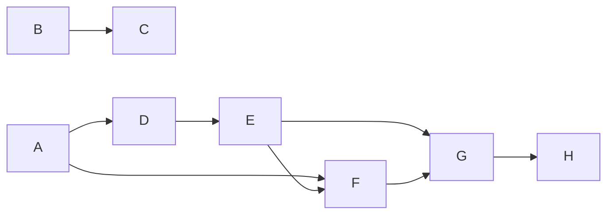

# Wave 9, RC1 and CP1 — the register's list field, `prove`, evidence records: Implementation Plan

> **For agentic workers:** REQUIRED SUB-SKILL: Use superpowers:subagent-driven-development
> (recommended) or superpowers:executing-plans to implement this plan task-by-task. Steps use
> checkbox (`- [ ]`) syntax for tracking.
>
> **The wave is the dispatch unit, not the task.** Waves are lettered (`A`, `B`, …) and own a
> run of the continuously numbered tasks. One implementer, one review round and one reviewer per
> **dispatched** wave; inside a wave every task keeps its own failing test, verification and
> commit. Do not dispatch one subagent per task.
>
> **Waves A, C and H are not dispatched.** A measures the five runners; C and H run the final
> review seats and open a pull request. The controller runs all three.
>
> **Two pull requests, one plan.** RC1 is `wp/rc1-list-field` into `dev` (Waves B and C); CP1 is
> `wp/cp1-prove` into `dev` (Waves A and D–H). Both merge in release window R1 of the umbrella plan
> (`docs/plans/2026-10-15-wave-9-umbrella.md`); neither imports the other, so the two run in
> parallel sessions, each in its own worktree cut from `dev`.
>
> **Tasks 4 and 13 change no code.** Their failing test is Step 1's run on the branch's head (any
> red stops the task), their verification is the review seats and `gh run watch`, and their commit
> is the Findings entry they write.
>
> **Open questions block their tasks, not the plan.** The section "Open questions for the owner"
> names, per question, the task that waits for its answer and the default this plan is written on.

**Goal:** a bug entry may carry a `regression` list that `0.4.0` reads and never writes, with the
bug ledger byte-identical to `v0.3.0`'s; and `stayfixed prove -- <command>` runs a test command,
counts what the runner itself reported, answers `proved`, `failed`, `not proven` or `refused`, and
leaves one evidence record per run on the machine, as `stayfixed gate` does per run.

**Architecture:** RC1 teaches the register engine one more value shape: a `Schema` names its list
keys, `parse_entry` reads each as an inline list of double-quoted items with the escapes titles
already use, and `Entry` carries the parsed lists beside its string fields. Nothing renders or
writes a list. CP1 adds a core area `stayfixed.prove`: three report readers (JUnit XML, the
JSON test-results report jest and vitest write, and `go test -json`'s event stream), a runner
adapter protocol with discovery over `profiles/<stack>/adapters.py`, a launcher unwrap, a scrubbed
environment, a realpath check, the verdict and its receipt, and the evidence record. The five
adapters (pytest; jest, vitest, `node --test`; `go test`) live in their stacks' profile
directories, so the core names no stack. The CLI line prints the receipt; the run's own output
passes through untouched and is never read.

**Tech Stack:** Python ≥ 3.11 standard library at runtime (`xml.parsers.expat`, `json`,
`hashlib`, `subprocess`); `uv`, pytest (`-n auto`), ruff, mypy, the mutation oracle
(`scripts/mutation_oracle.py`), towncrier fragments in `changelog.d/`. Test-only: the pinned
runner versions Task 1 records.

**Spec:** the agent-harness extraction design, in a private repository this one cannot link to —
§15.8 decisions 1 and 3 (scope and releases), 4 (the value floor: `prove` works with no
`stayfixed.toml`), 34 (`prove`, its bound and its verdicts), 35 (evidence records), 36 (what
`regression` will hold, read from `0.4.0`), 39 (the engine's list field, read-only), 43 (the bug
entry's `regression` field and `prove`'s exit 2 as licensed contract changes), 45 (jest's and
vitest's flags measured first), and core-proof's acceptance after decision 37; §5.4 as amended on
2026-10-15 (evidence records under the machine's state directory). The umbrella plan's lane-plan
items for RC1 and CP1 are cited by their ids. Every value a task needs from the spec is written
into the task.

**Scope:** pull requests RC1 and CP1 of package core-proof, with the slice of project-record the
`regression` field needs (umbrella plan, Lanes). They share this plan because the umbrella cut them
together: both land in `0.4.0`, and CP2 consumes both. A change belongs here iff it (a) lets the
register engine read a list of quoted items, keeps the bug ledger's bytes as `v0.3.0` wrote and
printed them, or declares `regression` on the bug ledger; (b) reads a runner's report, recognises,
plans, scrubs, checks or runs a test command for `prove`, or says its verdict; (c) writes, keys or
uploads an evidence record; or (d) restates the documents those changes falsify. Out: writing
`regression` (`bugs new --regression`, `0.6.0`), running regressions and `[gates] regressions`
(CP2), the binding id as the evidence key (HS2), profiles as a list and their context (PF1, PF2),
the JavaScript and Go profiles' rules and `assess` checks (after launch, d1).

**Premise:** measured on 2026-10-17 at `dev` = `9dd5a04` (HS1 and its follow-ups merged). A task
that finds one no longer holds stops and reports the mismatch.

- `src/stayfixed/ledger/entries.py` `parse_entry` reads `key: value` lines; `_unquote` reads a
  double-quoted scalar with exactly two escapes (`\"`, `\\`); `related` is the only list, an
  inline `[A, B]` of bare identifiers (`_parse_related`); `Entry.fields` is `Mapping[str, str]`
  and holds every register key outside `ENGINE_KEYS`. An unknown key is refused
  (`unknown frontmatter key`).
- `src/stayfixed/ledger/register.py` `BUG_SCHEMA.keys` is `id, title, status, severity, area,
  found, source, fixed_in, related`; `Schema.line_keys` is derived from the template's
  placeholders, so a key the template does not name is never written by `bugs new`; `_void_pointer`
  writes only the engine keys and the required dates.
- `bugs check` reports a file `parse_entry` refuses as `unreadable-entry`, with the refusal's text
  as the detail (`src/stayfixed/ledger/check.py` `register_gate`).
- No `prove` command exists; 33 commands are registered. No code reads a JUnit, jest-shaped or
  `go test -json` report. No machine state directory exists: the machine file is
  `<home>/.config/stayfixed/config.toml` (`config.machine.machine_config_path`, the password
  database's home).
- `src/stayfixed/profiles/` lists a profile only where a directory holds `profile.toml` (`shipped`);
  only `python/` exists; `src/stayfixed/profiles/hints.py` imports `profiles.<name>.hygiene` dynamically, pinned in
  `tests/boundaries/test_delivery.py` `DYNAMIC_IMPORTERS`. `guards` imports `profiles`, and
  `tests/boundaries/test_layering.py` refuses the reverse edge.
- `src/stayfixed/guards/uvrun.py` `past_run` reads `uv run`'s option tables and is the one place
  the core may spell `uv` and `python` (`tests/test_language_neutral.py` `STACK_NAMED`); `jest`,
  `vitest`, `npx`, `poetry`, `pytest` and `npm` are `STACK_WORDS` the core may not spell.
- `.github/workflows/check.yml` is one job whose judging steps never use `if: always()`
  (`tests/test_check_workflow.py`); it uploads no artifact.
- `git ls-remote --tags origin` lists `v0.3.0` at `85a1ac5`.

## Global Constraints

- Runtime imports the standard library only; every write goes through `stayfixed.fsops`; a value a
  repository or a run wrote (a path, an argv item, a report's test name) is printed through
  `stayfixed.printed`, never raw (`CONTRIBUTING.md`).
- The core names no stack: every `STACK_WORDS` spelling lives under `src/stayfixed/profiles/<stack>/`.
  The core reads report formats by their own names (JUnit XML, the JSON test-results report, the
  test event stream) and its keys (`numTotalTests`, `assertionResults`, `Action`), never by a
  runner's name [P-CP-9].
- `prove` works with no `stayfixed.toml` and with one the loader refuses (the value floor): it
  reads no configuration at all in `0.4.0`.
- Verdicts and exits: `proved` 0; `failed` 1 (a failing test, no test run, every test skipped);
  `not proven` 1 (a command no adapter recognises, no report, an unreadable report, or a green
  report from a runner that exited non-zero); `refused` 2 (an argv shape, an environment variable
  the invocation sets, or a realpath an adapter refuses). The receipt and `--json` word `failed`
  and `not proven` differently.
- Text a command prints is never counted; only the report file or event stream the adapter asked
  the runner for is read. The run's stdout and stderr pass through to the caller.
- The bound, stated once and copied into `docs/cli.md` word for word: the code under test, any file
  in the runner's load path, tracked or not, and runner-affecting environment can shape the
  report, so `proved` means "the runner reported green on this tree".
- An evidence record is never written under a repository; a failure to write one is a warning on
  stderr and never changes the verdict or the exit code.
- The bug ledger's bytes do not move: `bugs new`'s entry and output, `bugs check`'s text and
  `--json`, and `renumber`'s files and output equal `v0.3.0`'s literals [O-23].
- Every new assertion ships with the mutation that reddens it, in the group file
  `scripts/mutation_oracle.py` `GROUP_OF` routes its source to (`src/stayfixed/ledger/` →
  `records`; `src/stayfixed/profiles/` → `project`; `src/stayfixed/prove/` → `core`; `.github/` →
  `tooling`), or a sentence saying why none exists. A test asserting a refusal asserts its exact
  constant, never a substring the input already contains.
- No design id (a `§`, a decision number, a lane-plan id in brackets) in any file outside
  `docs/plans/`; `tests/test_public_anchors.py` holds it. Each task restates the documents its
  change falsifies and writes its changelog fragment in `changelog.d/` in the same commit.

## Execution contract

Copied verbatim from the umbrella plan, "Execution contract"; the controller copies the relevant
part into every brief.

1. **The wave is the dispatch unit.** Waves are lettered and own a run of continuously numbered
   tasks; one implementer, one review round and one reviewer per dispatched wave, every task
   keeping its own failing test, verification and commit. An implementer's first pass is sized
   for about 200k tokens: at most about 900 plan lines and three tasks per wave. Resume the same
   implementer for a fix round only while its context is under about 300k; past that, the round
   goes to a fresh agent with the review package. The controller records each implementer's token
   total in the plan's Findings. Every subagent runs on Opus (`model: opus`).
2. **Every implementer brief says:** report a mismatch with the tree instead of guessing; run a
   command and paste what it printed before writing any claim about it; focused runs while
   iterating, and before the commit one full run of `uv run pytest -n auto --cov
   --cov-fail-under=92` with `uv run python scripts/release.py check`; before a push, the suite
   again on Python 3.13 and 3.11.4 (`uv run --python <version> pytest -n auto`); a plan's predicted
   mutation outcome is a hypothesis — design your own if it does not redden, and paste the raw
   output either way; no line numbers from the plan; this brief is a message, not a file, so cite
   only the plan; write nothing under the repository but the task's files, use
   `<scratchpad>/<wave>-<role>/`, never run a script you did not write, and read `git diff --stat`
   before committing; the static checks at CI's scope (`uv run ruff check .`,
   `uv run ruff format --check .`, `uv run mypy`); do not use the Agent tool; do not run
   `git checkout`, `restore`, `stash` or `clean`; start a long run in the background and wait on
   its own output, never with `pgrep`.
3. **Every reviewer brief adds:** run every command yourself and never use the Agent tool; do not
   run `git checkout`, `restore`, `stash` or `clean`; what already passed, by sha and suite, and run
   only the test that decides a finding you suspect; no citation may point at a brief, a dispatch
   or a report; what later tasks own.
4. **The final review** of each pull request is at least four parallel read-only seats:
   correctness, architecture, security, and a lifecycle seat that walks section 5 of this contract
   against the diff.
5. **The lifecycle matrix**, walked at pre-flight like a task and again by the lifecycle seat:
   every command the pull request adds or changes × every change of configuration — set a value,
   change it, unset it, move a path, a step that fails part-way, `uninstall` — and, from HS1 on, ×
   every layer that can carry the value (preset, repository, the overlay's three scopes, the
   machine file).
6. **The parallelism map.** Read-only seats run beside each other and beside the implementer;
   writers of one worktree serialise; one heavy local run (the full suite, the mutation oracle) at
   a time per host; no local full run while the same branch's CI runs.
7. **Templates.** A fix brief enumerates the sibling instances of the defect's class (the
   `sweep-defect-class` skill) and reports the neighbour probes it ran. A security ruling names its
   minimal preconditions, its anchor's provenance (who can write the bytes it trusts), and one
   legitimate user it must not refuse.
8. **Verification.** The controller re-verifies only heads it pushes or merges, re-derives the pull
   request's body from the diff before every push, takes the run id from `gh pr checks` and waits
   with `gh run watch <run-id> --exit-status` until every job has ended (never a `head_sha` query,
   which finds no run for a pull request's merge ref) before reporting a pull request done.
9. **Second finding at one seam.** At the second review finding that points at the same function,
   reader or boundary, the next step is a redesign of that seam put to the owner, not a third patch.

## Open questions for the owner

Each is a fork the spec leaves open or that the owner's OSS stance (a tool other developers adopt
through their agents, with room to work their own way) puts against the spec's wording. The plan
is written on the default named; an answer that differs changes only the task named.

1. **Option allowlist or forging-route denylist (Tasks 8–10).** d34 says each adapter "holds an
   allowlist of argv shapes". Read strictly, every pytest plugin's option, every jest flag a
   release adds and every `go test` build flag is `refused`, exit 2, until stayfixed lists it — a
   wall a team meets on its first real command. Read as written in d34's own list, what an adapter
   must refuse is the routes that move, replace or suppress the report or run the tests under
   another program (`-exec`, `-toolexec`, `-overlay`, a reporter or output-file option of the
   runner's own, `--junitxml`, `-p no:junitxml`), and every other option is the code under test's
   business, which the bound already concedes. **Default and recommendation: the adapter's shape
   is fixed (launcher, program, the runner's own subcommand) and its options are free except a
   named refusal list per adapter**, each entry a test. The cost: an unknown option that does steer
   the report counts as green until listed — no more than an untracked `conftest.py` already can.
2. **Where the records live and how long (Task 11).** §5.4 says "the state directory" and names no
   path. **Default:** `<home>/.local/state/stayfixed/evidence/<key>.jsonl`, `<home>` the password
   database's, no `XDG_STATE_HOME` read (the same rule as the machine file), no rotation in
   `0.4.0`. The alternative honours `XDG_STATE_HOME` at a terminal only, as `STAYFIXED_CONFIG`
   would; a team on a managed laptop may want it, and a hook may not.
3. **Freedom for runners stayfixed does not know (no task in this plan).** d34 counts only runners
   with an adapter, so `cargo nextest`, Maven, PHPUnit and `dotnet test` are `not proven` however
   green. A flag `prove --junit PATH -- <command>` that reads a JUnit file the command was asked to
   write — counted only when the file did not exist before the run and is a regular file the run
   created outside the repository — would open `prove` to every stack that writes JUnit, under the
   same bound. **Default: not built** (d34 as written); a yes adds one task to Wave F and a row to
   the outbound table, and needs no change to the readers.
4. **How the real runners run in CI (Tasks 8–10).** pytest is in the dev environment; `node`, `go`,
   jest and vitest are not. **Default and recommendation:** a CI job `runners` in `ci.yml` that
   installs Node and Go at the versions Task 1 records and jest and vitest from a committed
   `tests/fixtures/prove/node/package-lock.json` (create) with `npm ci`, and runs `-m runners`; in
   every other job those tests skip through a `needs_runner(name)` marker, and the `runners` job sets
   `STAYFIXED_REQUIRE_RUNNERS=1`, under which a missing runner fails instead of skipping. The
   alternative — recorded reports and a stand-in program only — never meets a real runner and so
   cannot hold the acceptance's "genuine run" clause.
5. **The evidence upload's owner (Task 12).** The umbrella's file table gives `check.yml`'s
   evidence upload to CP1 and its CP2 items name the same step [P-CP-11]. **Default:** CP1 builds it,
   since `gate` writes records from `0.4.0`; CP2 inherits it and adds only its own step.
6. **Origin normalisation (Task 11).** HS2's binding id will key a confirmed checkout; until then
   the key is a digest of the normalised `origin`. **Default rule:** drop userinfo, a trailing `/`
   and a trailing `.git`; lower-case the scheme and host; read the scp form `user@host:path` as
   `ssh://host/path`; treat `ssh`, `https`, `http` and `git` URLs of one host and path as one. So a
   clone over SSH and one over HTTPS of one repository share their records. Whether HS2 keeps this
   rule for an unbound checkout is HS2's to say.

## Review Focus

Inputs no task would exercise unless told to; each line's test is in the task named.

1. **A suite in a repository with a `conftest.py` or a `jest.config.js` that sets its own reporters
   and output file.** Expected: the adapter's report path wins or the run is `not proven` naming the
   configuration, never a count read from the configured file inside the repository [P-CP-7].
   Tasks 8 and 9.
2. **A run interrupted by Ctrl-C, or a runner that leaves a background child.** Expected: the
   runner's process group is ended, the verdict is `not proven` with the signal named, no record
   says `proved`, and the scratch report directory is removed. Task 7.
3. **A secret in the argv** (`API_TOKEN=x pytest`, `prove -- env API_TOKEN=x jest`). Expected: the
   receipt and the evidence record carry the variable's name and never its value. Tasks 7 and 11.
4. **A report of a hundred thousand testcases, a report past the size cap, and a billion-laughs
   JUnit file.** Expected: the first is counted; the second and third are `not proven` with their
   own constants, in bounded time and memory. Task 5.
5. **A machine where the password database lists no home, or the state directory is not writable.**
   Expected: the verdict and exit code are unchanged, and one warning on stderr names the record not
   written. Task 11.

---

## Waves

| Wave | Tasks | Pull request | Dispatched | Plan lines (approx.) |
|---|---|---|---|---|
| A | 1 | CP1 | no — controller | 50 |
| B | 2–3 | RC1 | yes | 130 |
| C | 4 | RC1 | no — controller | 20 |
| D | 5–6 | CP1 | yes | 120 |
| E | 7 | CP1 | yes | 110 |
| F | 8–10 | CP1 | yes | 165 |
| G | 11–12 | CP1 | yes | 95 |
| H | 13 | CP1 | no — controller | 25 |

Every dispatched wave's brief also carries the header above (about 300 lines), so the largest, F,
is under 500 plan lines in all.

**Launch graph** (drawn over the Interfaces blocks):



- **B → C.** C reviews B's two commits and opens RC1. B and C import nothing CP1 writes and CP1
  imports nothing of theirs, so the RC1 chain runs beside A and D–H in its own session.
- **A → D, F.** Task 1's recorded reports are D's fixtures; its measured flags and versions are F's
  constants and the CI job's pins.
- **D → E.** Task 7 consumes `Counts`, `ReportKind`, `read_report` and `ReportError` (Tasks 5–6).
- **E → F.** Tasks 8–10 implement `RunnerAdapter`, `Plan` and `Refusal` reasons (Task 7).
- **E, F → G.** Task 11 writes `Receipt` (Task 7) and keys runs by the adapter's `name` (Tasks
  8–10); Task 12 documents and wires every command F's adapters made reachable. F and G both edit
  `docs/cli.md`'s `prove` section and `tests/outbound/policy.py`, so G follows F.

---

### Wave A — Task 1 (controller, not dispatched)

#### Task 1: Measure the five runners and record their reports

Record each answer, with the command, the runner's version and what it printed, in Findings under
"Task 1". Every probe runs under `<scratchpad>/a1/`; nothing is installed outside it. npm and the Go
module proxy are the only network reached, and only here and in the `runners` CI job.

**Files:**
- Create: `tests/fixtures/prove/README.md` (create) — each report's runner, version, command and the
  day it was recorded; no design id
- Create: `tests/fixtures/prove/reports/` (create) — the reports Steps 1–5 record, one file each
- Test: `tests/prove/test_fixtures.py` (create)

- [ ] **Step 0: The failing test.** `test_every_recorded_report_is_listed_with_its_version()`: every
  file under `tests/fixtures/prove/reports/` has a README row naming its runner, version and command,
  and every row names a file that exists. Run `uv run pytest tests/prove/test_fixtures.py -q`.
  Expected: FAIL, no `reports/` directory.
- [ ] **Step 1: pytest.** In a scratch project with one passing, one failing and one skipped test,
  record `--junitxml` under `junit_family` `xunit1` and `xunit2`, with and without
  `record_xml_attribute` and `record_property`, a test name holding `&amp;` and a non-ASCII
  character, and a run collecting nothing (`-k no_such_test`). Record whether `-p no:junitxml`
  suppresses the file, and whether a `conftest.py` `pytest_configure` that sets
  `config.option.xmlpath` overrides the command line's path [P-CP-6].
- [ ] **Step 2: `node --test`.** Same three tests; record `--test-reporter=junit
  --test-reporter-destination=<file>` beside `--test-reporter=spec --test-reporter-destination=stdout`
  (the node dialect: nested `testsuite`, `testcase` without `classname`), an empty run, an
  all-skipped run, and whether a test file's own stdout reaches the junit file.
- [ ] **Step 3: jest.** Record `--json --outputFile=<file>`; an empty run with and without
  `--passWithNoTests` (exit code, `numTotalTests`); `test.todo` and `test.skip` statuses; whether a
  `jest.config.js` `reporters` entry or `outputFile` changes either flag's effect [d45].
- [ ] **Step 4: vitest.** Record `--reporter=json --outputFile=<file>`; where the JSON reporter
  writes when `outputFile` is absent (inside the repository, P-CP-7); which wins when
  `vitest.config.*` sets `reporters` and `outputFile` and the command line sets the others; an empty
  run and `--passWithNoTests`; `todo` and `skip` statuses [d45].
- [ ] **Step 5: `go test`.** Record `go test -json ./...` for the three tests; `-run NoSuchTest`;
  a package whose `TestMain` calls `os.Exit(0)` without `m.Run`; a test that prints a line shaped
  like a test2json `pass` event; a package that does not build; and the framing marker the Go
  version prints before a test's own output, if any [O-13].
- [ ] **Step 6: Pins and launchers.** Record the Node, Go, jest and vitest versions to pin, the
  argv `npx jest`, `npx vitest run`, `npx --no-install jest`, `poetry run pytest` and `npm test`
  actually exec (from `strace -f -e trace=execve` or the platform's equivalent), and where each
  runner's entry point resolves (`<project>/node_modules/jest/bin/jest.js`, `<project>/node_modules/vitest/vitest.mjs`,
  `$(go env GOROOT)/bin/go`) [P-CP-8].
- [ ] **Step 7:** copy each report into `tests/fixtures/prove/reports/` under a name that says its
  runner and case, write the README, run `uv run pytest tests/prove/test_fixtures.py -q`
  (Expected: PASS), and commit on `wp/cp1-prove` —
  `test(prove): the reports five runners write, recorded with their versions`.

---

### Wave B — Tasks 2–3 (dispatched; pull request RC1)

#### Task 2: Hold the bug ledger to `v0.3.0`'s bytes before the engine moves

**Files:**
- Create: `tests/fixtures/ledger-v030/` (create) — a project with a `stayfixed.toml` and a bug
  ledger of four entries, and `expected/` holding the literals Step 3 captures
- Test: `tests/ledger/test_v030_literals.py` (create)
- Modify: `mutations/records.toml`

**Interfaces:**
- Consumes: the `bugs` commands as they are on `dev`; `tests/cli.py` `cli`.
- Produces: `LITERALS: Path` (the `expected/` directory) and the helper
  `ledger_copy(tmp_path) -> Path` that copies the fixture into a fresh git repository; Task 3 runs
  this file unchanged and CP2 extends it.

The fixture's four entries are chosen so `bugs check` reports each of `unreadable-entry`,
`dangling-related`, `evidence-boundary` and `stale-index` once in its broken variant, and nothing
in its clean one.

- [ ] **Step 1: Write the failing tests**, each comparing bytes with a file under `expected/`:

```python
CASES = [
    ("new", ["bugs", "new", "A title: with a colon", "--severity", "high", "--area", "ledger",
             "--source", "#12 in the tracker", "--related", "BR-001", "--no-fetch"]),
    ("check-clean", ["bugs", "check"]),
    ("check-broken", ["bugs", "check"]),           # run on the broken variant
    ("renumber", ["bugs", "renumber", "BR-002", "BR-009"]),
]

@pytest.mark.parametrize("case, argv", CASES)
@pytest.mark.parametrize("json_output", [False, True])
def test_the_ledger_prints_what_v0_3_0_printed(tmp_path, case, argv, json_output): ...
    # stdout, stderr and the exit code, each equal to expected/<case>[.json].{out,err,code}

def test_new_writes_the_entry_v0_3_0_wrote(tmp_path): ...       # expected/new.entry.md
def test_renumber_leaves_the_files_v0_3_0_left(tmp_path): ...   # expected/renumber.{moved,void}.md
def test_the_index_is_the_one_v0_3_0_rendered(tmp_path): ...    # expected/index.md after `new`
```

  A captured date is written `{today}` in `expected/` and formatted with `date.today()` read before
  and after the run; when the two differ the test runs the case once more.

- [ ] **Step 2: Run** `uv run pytest tests/ledger/test_v030_literals.py -q`. Expected: every case
  fails with a missing `expected/` file.
- [ ] **Step 3: Capture.** `git worktree add <scratchpad>/b-impl/v030 v0.3.0`, then for each case
  run `uv run --project <scratchpad>/b-impl/v030 stayfixed <argv> --root <copy>` on a fresh
  `ledger_copy`, and write stdout, stderr, the exit code and the files into `expected/` with the
  capture day replaced by `{today}`. Paste each command and its exit code into the report; remove
  the worktree with `git worktree remove`.
- [ ] **Step 4: Run** the file again. Expected: PASS on `dev`. A case that differs is a change
  `dev` already made to the ledger since `v0.3.0`: stop and report it, with the diff, before Task 3.
- [ ] **Step 5: Mutations** in `mutations/records.toml`: `field_line` writing `key: ` for an empty
  value; `scalar` quoting every value; the `stale-index` detail dropping its `run:` remedy.
  Expected: each reddens a case here.
- [ ] **Step 6: Commit** — `test(ledger): hold new, check and renumber to the bytes v0.3.0 wrote`.

#### Task 3: The engine's list field, and `regression` on the bug ledger, read-only

**Files:**
- Modify: `src/stayfixed/ledger/register.py` (`Schema.lists`, its consistency rules, `BUG_SCHEMA`),
  `src/stayfixed/ledger/entries.py` (`Entry.lists`, `_parse_quoted_list`)
- Test: `tests/ledger/test_list_field.py` (create); `tests/ledger/test_register.py` (the
  round-trip test reads a list key back)
- Modify: `docs/cli.md` (the `bugs new` section: the entry's keys), `mutations/records.toml`,
  `changelog.d/+regression-readable.feature.md` (create)

**Interfaces:**
- Consumes: `_unquote`'s escape grammar; Task 2's literals, run unchanged.
- Produces:
  - `Schema.lists: tuple[str, ...] = ()` — keys whose value is an inline list of double-quoted
    items. `_inconsistencies` adds: a list key must be a key; it may not be required, a `level`, a
    date, or a section column; `related` may not be one.
  - `Entry.lists: Mapping[str, tuple[str, ...]]` (`field(default_factory=dict, hash=False)`), every
    list key of the register present, `()` for one the file leaves empty or out; `Entry.fields`
    holds no list key, and `Entry.value(key)` raises `KeyError` for one.
  - `BUG_SCHEMA.keys` gains `regression` after `related`, and `BUG_SCHEMA.lists == ("regression",)`.
    The template names no `{regression}`, so `bugs new`, the index and `renumber`'s void entry are
    unchanged.
  - The grammar, for CP2: `regression: ["pytest", "tests/t.py::test[1,2]"]` — `[`, then zero or
    more items separated by `,` and optional spaces or tabs, each a double-quoted scalar read by
    `_unquote`, then `]`. `regression:` and `regression: []` are the empty list. A bare item, a
    trailing comma, an empty item `""`, text after `]` and an unterminated item are refused with
    `LIST_SHAPE` or `_unquote`'s own constant.
  - `LIST_SHAPE = "{where}: `{key}` must be an inline list of double-quoted items, like
    `[\"a\", \"b\"]`"` and `EMPTY_ITEM = "{where}: `{key}` holds an empty item"` in `entries.py`.

- [ ] **Step 1: Write the failing tests:**

```python
def test_a_regression_reads_as_its_argv(tmp_path):
    entry = parse(ENTRY.format(regression='["pytest", "tests/t.py::test[1,2]", "-k", "a, b"]'))
    assert entry.lists["regression"] == ("pytest", "tests/t.py::test[1,2]", "-k", "a, b")
    assert "regression" not in entry.fields

@pytest.mark.parametrize("raw", ["", "[]", "[ ]"])
def test_an_empty_regression_is_no_regression(tmp_path, raw): ...      # lists["regression"] == ()

def test_escapes_read_as_titles_read_them(tmp_path): ...                # '["a\\"b", "c\\\\"]' → ('a"b', 'c\\')

@pytest.mark.parametrize("raw, constant", [
    ('[pytest]', LIST_SHAPE), ('["a",]', LIST_SHAPE), ('["a"] x', LIST_SHAPE),
    ('"a"', LIST_SHAPE), ('["a"', LIST_SHAPE), ('[""]', EMPTY_ITEM),
])
def test_a_malformed_regression_is_refused_in_its_own_words(tmp_path, raw, constant): ...
    # the exact constant, formatted with the entry's quoted path and `regression`

def test_bugs_check_reports_a_malformed_regression_as_unreadable(tmp_path): ...
    # Finding("unreadable-entry", <path>, None, LIST_SHAPE.format(...)), in text and --json

def test_an_entry_with_a_regression_passes_bugs_check(tmp_path): ...
def test_renumber_carries_a_regression_byte_for_byte(tmp_path): ...    # only the `id:` line moves
def test_a_list_key_may_not_be_a_column_required_or_related(): ...     # Schema(...) raises ValueError
```

- [ ] **Step 2: Run** `uv run pytest tests/ledger/test_list_field.py -q`. Expected: `unknown
  frontmatter key `regression`` for the reading tests, no `Schema.lists` for the rest.
- [ ] **Step 3: Implement.** `parse_entry` routes a list key to `_parse_quoted_list(raw, *, key,
  where) -> tuple[str, ...]`, a scanner over the raw value that hands each quoted run to `_unquote`
  (so the escape rules stay one); never a `split(",")`, which breaks `"a, b"`.
- [ ] **Step 4: Run** `tests/ledger`, then the full suite once. Expected: Task 2's literals PASS
  unchanged.
- [ ] **Step 5: Mutations:** the scanner splitting on every comma; an empty item accepted; a list key
  left in `fields`; `BUG_SCHEMA.lists` empty. Expected: each reddens its test.
- [ ] **Step 6: Documents.** `docs/cli.md`, the `bugs new` section: an entry may carry
  `regression`, an inline list of double-quoted argv items that this release reads and validates and
  never writes. Fragment `changelog.d/+regression-readable.feature.md` (create).
- [ ] **Step 7: Commit** — `feat(ledger): read a list of quoted items, and let a bug entry carry a regression`.

---

### Wave C — Task 4 (controller, not dispatched; pull request RC1)

#### Task 4: RC1's final review and pull request

- [ ] **Step 1:** on the branch's head: `uv run pytest -n auto --cov --cov-fail-under=92`, the
  same suite on `--python 3.13` and `--python 3.11.4`, `uv run ruff check .`,
  `uv run ruff format --check .`, `uv run mypy`, `uv run python scripts/mutation_oracle.py`,
  `uv run python scripts/release.py check`, `uv run stayfixed plan check`. Paste each into Findings.
- [ ] **Step 2:** the four seats of the execution contract, in parallel. The lifecycle seat walks
  `bugs new`, `bugs index`, `bugs check [--base]` and `bugs renumber` × an entry with no
  `regression`, an empty one, a valid one, a malformed one, and a base whose entry has one the tree
  lacks.
- [ ] **Step 3:** open `wp/rc1-list-field` into `dev`; the body says what `0.4.0` reads, what it
  never writes, and the grammar CP2 writes; wait as item 8 says.

---

### Wave D — Tasks 5–6 (dispatched; pull request CP1)

#### Task 5: The JUnit reader

**Files:**
- Create: `src/stayfixed/prove/__init__.py` (create), `src/stayfixed/prove/counts.py` (create),
  `src/stayfixed/prove/junit.py` (create)
- Test: `tests/prove/__init__.py` (create), `tests/prove/test_junit.py` (create)
- Modify: `mutations/core.toml`

**Interfaces:**
- Consumes: Task 1's reports under `tests/fixtures/prove/reports/`.
- Produces:
  - `counts.Counts(passed: int, failed: int, skipped: int)` (frozen) with `total` (the sum).
  - `counts.ReportKind(StrEnum)`: `JUNIT`, `RESULTS_JSON`, `EVENTS`.
  - `counts.ReportError(Exception)` with `reason: str`, one of the module constants
    `REPORT_TOO_LARGE`, `REPORT_NOT_UTF8`, `REPORT_MALFORMED`, `REPORT_DOCTYPE`, `REPORT_ENTITY`.
  - `counts.MAX_REPORT_BYTES = 64 * 1024 * 1024` — a named cap (`CONTRIBUTING.md`, named caps):
    room for a suite of a few hundred thousand cases, far short of exhausting a CI runner.
  - `junit.read_junit(data: bytes) -> Counts` — through `xml.parsers.expat`, never `ElementTree`'s
    default parser: a `StartDoctypeDeclHandler` raises `REPORT_DOCTYPE`, an `EntityDeclHandler` or
    an undefined entity raises `REPORT_ENTITY`, parameter entities are never parsed; the five
    predefined entities and character references read. Every `testcase` element at any depth is
    one test: a `failure` or `error` child is failed, a `skipped` child skipped, otherwise passed.
    A suite's `tests`, `failures` and `skipped` attributes are never read [P-CP-6].

- [ ] **Step 1: Write the failing tests:**

```python
@pytest.mark.parametrize("report, expected", [
    ("pytest-xunit1.xml", Counts(1, 1, 1)), ("pytest-xunit2.xml", Counts(1, 1, 1)),
    ("pytest-record-xml-attribute.xml", Counts(1, 1, 1)), ("node-junit.xml", Counts(1, 1, 1)),
])
def test_each_dialect_counts_its_testcases(report, expected):
    assert read_junit(fixture(report)) == expected

@pytest.mark.parametrize("report", ["pytest-empty.xml", "node-empty.xml"])
def test_an_empty_run_counts_nothing(report): assert read_junit(fixture(report)).total == 0
@pytest.mark.parametrize("report", ["pytest-all-skipped.xml", "node-all-skipped.xml"])
def test_an_all_skipped_run_counts_only_skips(report): ...

def test_suite_attributes_are_never_read(): ...      # tests="99" failures="0" over one failing case
def test_predefined_entities_and_character_references_read(): ...
def test_a_doctype_is_refused(): ...                 # ReportError, reason REPORT_DOCTYPE
def test_a_declared_entity_is_refused(): ...         # billion-laughs body → REPORT_ENTITY
def test_past_the_cap_is_refused_before_parsing(): ...   # MAX_REPORT_BYTES + 1 → REPORT_TOO_LARGE
def test_a_hundred_thousand_cases_count_in_bounded_time(): ...   # a generated report; < 5 s
```

- [ ] **Step 2: Run** `uv run pytest tests/prove/test_junit.py -q`. Expected: import error.
- [ ] **Step 3: Implement** `counts.py` and `junit.py`; the package's `__init__.py` imports nothing.
- [ ] **Step 4: Mutations:** the DOCTYPE handler left unset; a suite's `tests` attribute read; an
  `error` child counted as passed. Expected: each reddens its test.
- [ ] **Step 5: Run** `tests/prove tests/test_language_neutral.py tests/boundaries`, then the full
  suite once.
- [ ] **Step 6: Commit** — `feat(prove): count a JUnit report's testcases, in both dialects, refusing a doctype`.

#### Task 6: The results-JSON reader and the event-stream reader

**Files:**
- Create: `src/stayfixed/prove/results.py` (create), `src/stayfixed/prove/events.py` (create)
- Modify: `src/stayfixed/prove/counts.py` (`read_report`)
- Test: `tests/prove/test_results.py` (create), `tests/prove/test_events.py` (create)
- Modify: `mutations/core.toml`, `tests/test_language_neutral.py` only if the walk finds a word,
  which Step 5 reports

**Interfaces:**
- Consumes: Task 5's `Counts`, `ReportError`, `MAX_REPORT_BYTES`.
- Produces:
  - `results.read_results(data: bytes) -> Counts` — the JSON test-results report: a top-level
    object whose `testResults` is a list of objects each holding `assertionResults`, a list of
    objects with a string `status`. `passed` is passed; `failed` is failed; `pending`, `skipped`,
    `todo` and `disabled` are skipped; any other status, a missing key or a wrong type is
    `REPORT_MALFORMED`. The `num*` totals are never read. Duplicate keys are refused
    (`jsonobject.json_object`'s rule).
  - `events.read_events(data: bytes) -> Counts` — one JSON object per line; an event counts when
    its `Action` is `pass`, `fail` or `skip` and its `Test` is a non-empty string; a subtest
    (`Test` holding `/`) counts as its own test; package-level events (`Test` absent) count nothing,
    except that a package-level `fail` with no failed test adds one failed (a build failure); a line
    that is not a JSON object is `REPORT_MALFORMED`. Lines are read after test2json's framing, as
    the stream gives them; text a test printed arrives inside `output` events and is never counted.
  - `counts.read_report(kind: ReportKind, data: bytes) -> Counts` — the size cap, then the reader.

- [ ] **Step 1: Write the failing tests:**

```python
@pytest.mark.parametrize("report, expected", [
    ("jest.json", Counts(1, 1, 1)), ("vitest.json", Counts(1, 1, 1)),
    ("jest-todo.json", Counts(1, 0, 2)),
])
def test_results_count_assertions_by_status(report, expected): ...
@pytest.mark.parametrize("report", ["jest-empty.json", "vitest-empty.json"])
def test_an_empty_results_report_counts_nothing(report): ...
@pytest.mark.parametrize("report", ["jest-all-skipped.json", "vitest-all-skipped.json"])
def test_an_all_skipped_results_report_counts_only_skips(report): ...
def test_results_totals_are_never_read(): ...         # numPassedTests 99 over one failed assertion
def test_an_unknown_status_is_malformed(): ...

@pytest.mark.parametrize("report, expected", [("go.jsonl", Counts(1, 1, 1))])
def test_events_count_test_level_actions(report, expected): ...
def test_no_such_test_counts_nothing(): ...           # go-run-no-such-test.jsonl → total 0
def test_testmain_exiting_zero_counts_nothing(): ...  # go-testmain-exit0.jsonl → total 0
def test_a_printed_pass_line_is_output_not_a_test(): ...   # go-printed-pass.jsonl → Counts(1, 0, 0)
def test_a_build_failure_is_one_failed(): ...
def test_read_report_caps_every_kind(): ...           # each kind, MAX_REPORT_BYTES + 1
```

  `go-printed-pass.jsonl` is Task 1 Step 5's printed-event case; if Task 1 found that the Go version
  pinned lets the printed line arrive as a top-level `pass` event, this test asserts what Task 1
  recorded and its docstring names the bound instead.

- [ ] **Step 2: Run** both files. Expected: import error.
- [ ] **Step 3: Implement.**
- [ ] **Step 4: Mutations:** `numPassedTests` read; `todo` counted as passed; a package-level `pass`
  counted as a test. Expected: each reddens its test.
- [ ] **Step 5: Run** `tests/prove tests/test_language_neutral.py`, then the full suite once.
- [ ] **Step 6: Commit** — `feat(prove): count the JSON results report and the test event stream`.

---

### Wave E — Task 7 (dispatched; pull request CP1)

#### Task 7: `prove -- <command>`: recognition, the scrubbed run, the verdict and its receipt

**Files:**
- Create: `src/stayfixed/prove/adapters.py` (create)
- Create: `src/stayfixed/prove/run.py` (create)
- Create: `src/stayfixed/prove/tree.py` (create)
- Create: `src/stayfixed/prove/commands.py` (create)
- Create: `src/stayfixed/prove/api.py` (create)
- Test: `tests/prove/test_run.py` (create)
- Test: `tests/prove/test_command.py` (create)
- Test: `tests/prove/stand_in.py` (create) — a test adapter and a stand-in program
- Modify: `tests/boundaries/test_delivery.py` (`DYNAMIC_IMPORTERS`: the discovery in `src/stayfixed/prove/adapters.py`),
  `tests/outbound/policy.py` (the run's launch), `tests/test_surfaces.py` if it lists areas,
  `mutations/core.toml`

**Interfaces:**
- Consumes: Tasks 5–6's `read_report`; `guards.uvrun.past_run`, `uvrun.is_launcher`; `printed`.
- Produces:
  - `adapters.Plan(argv: tuple[str, ...], report: Path, kind: ReportKind, program: Path,
    scrub: frozenset[str], discovery: tuple[str, ...])` (frozen) — the argv to execute, its first
    item absolute; where the report lands (inside the scratch directory the caller hands over);
    the realpath the adapter accepted; the variables to remove; the globs of the runner's discovery
    set.
  - `adapters.Refused(reason: str)` (frozen) — a constant of the adapter's module.
  - `adapters.RunnerAdapter` (Protocol): `name: str`; `recognises(argv: Sequence[str]) -> bool`;
    `plan(argv: Sequence[str], *, root: Path, scratch: Path, path: str) -> Plan | Refused`.
  - `adapters.shipped_adapters() -> tuple[RunnerAdapter, ...]` — every `ADAPTERS` of
    `stayfixed.profiles.<name>.adapters` for a directory under `profiles/` that holds `adapters.py`
    (with or without `profile.toml`), through `importlib.resources`, in name order; a module that
    does not import raises (a defect in stayfixed, exit 2), unlike a hint.
  - `adapters.unwrap(argv) -> Unwrapped(launch: tuple[str, ...], command: tuple[str, ...],
    assigned: tuple[str, ...])` — reads through, in a loop, `NAME=value` words and `env` with its
    `NAME=value` words (`assigned` collects the names), then `uv run` through `past_run`. Every
    other launcher is an adapter's to read.
  - `run.Verdict(StrEnum)`: `PROVED = "proved"`, `FAILED = "failed"`, `NOT_PROVEN = "not proven"`,
    `REFUSED = "refused"`; `run.EXIT = {PROVED: 0, FAILED: 1, NOT_PROVEN: 1, REFUSED: 2}`.
  - `run.Receipt(verdict: Verdict, reason: str, argv: tuple[str, ...], runner: str | None,
    counts: Counts | None, exit_code: int | None, report_digest: str | None, commit: str | None,
    dirty: bool | None, untracked: tuple[str, ...])` (frozen). `argv` is the command as given with
    every assignment's value replaced by `…`.
  - `run.prove(argv: Sequence[str], *, root: Path, environ: Mapping[str, str],
    adapters: Sequence[RunnerAdapter] | None = None) -> Receipt` — unwrap; the first adapter whose
    `recognises` is true plans; none → `NOT_PROVEN`, `UNRECOGNISED`. An assigned name in the plan's
    `scrub` → `REFUSED`, `ASSIGNED_SCRUBBED` naming the variable [N-13]; the same name merely in
    `environ` is removed and the run counted. `Refused` → `REFUSED` with its reason. The run:
    `subprocess.Popen(plan.argv, cwd=root, env=..., start_new_session=True)`, stdin, stdout and
    stderr inherited; on `KeyboardInterrupt` or a signal, the group is ended as
    `assess.gates._kill_group` does and the verdict is `NOT_PROVEN`, `INTERRUPTED`. Then: no report
    → `NO_REPORT`; `ReportError` → its reason; a non-zero exit with zero failures → `NOT_PROVEN`,
    `GREEN_BUT_EXITED`; any failure → `FAILED`, `FAILING`; zero tests → `FAILED`, `NONE_RAN`; every
    test skipped → `FAILED`, `ALL_SKIPPED`; otherwise `PROVED`. The scratch directory is
    `tempfile.mkdtemp()` (mode 0700, outside `root`) and is removed on every path.
  - `tree.state(root: Path, discovery: Sequence[str]) -> tuple[str | None, bool | None,
    tuple[str, ...]]` — `HEAD`'s sha, whether `git status --porcelain=v1 -z` is non-empty, and the
    untracked, unignored paths matching a discovery glob (at most `UNTRACKED_LISTED = 20`, then a
    count); each `None` where git cannot answer, never a refusal.
  - `commands.register`: `stayfixed prove [--root PATH] -- COMMAND …`; the line is the verdict, the
    reason, the counts and the runner; `--json` is `Receipt` as a mapping with `verdict` as its
    string. A command with no `--` and no words is a usage error (2). No configuration is read.
  - `api.py` publishes `prove`, `Receipt`, `Verdict`, `Counts`, `RunnerAdapter`, `Plan`,
    `Refused`, `shipped_adapters` (CP2's and PF1's imports).

- [ ] **Step 1: Write the failing tests** with `tests/prove/stand_in.py`: a `StandIn` adapter
  recognising argv0 `stand-in`, and a program `stand_in_runner.py` that writes a chosen report to
  the path it is handed and exits with a chosen code:

```python
@pytest.mark.parametrize("report, code, verdict, reason", [
    ("pass", 0, Verdict.PROVED, ""), ("fail", 1, Verdict.FAILED, FAILING),
    ("empty", 0, Verdict.FAILED, NONE_RAN), ("all-skipped", 0, Verdict.FAILED, ALL_SKIPPED),
    ("pass", 1, Verdict.NOT_PROVEN, GREEN_BUT_EXITED), (None, 0, Verdict.NOT_PROVEN, NO_REPORT),
    ("doctype", 0, Verdict.NOT_PROVEN, REPORT_DOCTYPE),
])
def test_the_verdict_table(tmp_path, report, code, verdict, reason): ...

def test_printed_text_is_never_counted(tmp_path):                 # the stdout-forged run
    got = prove(["sh", "-c", "echo '3 passed'"], root=tmp_path, environ=floor_env(), adapters=[STAND_IN])
    assert got.verdict is Verdict.NOT_PROVEN and got.reason == UNRECOGNISED

def test_an_assigned_scrubbed_variable_is_refused(tmp_path): ...  # env NODE_OPTIONS=x stand-in → REFUSED
def test_an_inherited_scrubbed_variable_is_removed_and_counted(tmp_path): ...  # the runner sees none
def test_an_assignment_value_never_reaches_the_receipt(tmp_path): ...          # API_TOKEN=s3cr3t
def test_uv_run_is_read_through(tmp_path): ...                    # uv run --locked stand-in → recognised
def test_an_interrupted_run_is_not_proven_and_leaves_no_scratch(tmp_path): ...
def test_the_receipt_names_untracked_files_in_the_discovery_set(tmp_path): ...
def test_prove_needs_no_stayfixed_toml(tmp_path): ...             # and one the loader refuses

@pytest.mark.parametrize("verdict, code", [("proved", 0), ("failed", 1), ("not proven", 1), ("refused", 2)])
def test_the_command_exits_by_verdict_and_words_each_apart(tmp_path, verdict, code): ...
def test_shipped_adapters_reads_a_directory_without_a_profile(tmp_path): ...   # a source seam
```

- [ ] **Step 2: Run** `uv run pytest tests/prove/test_run.py tests/prove/test_command.py -q`.
  Expected: import error.
- [ ] **Step 3: Implement.** The reason constants live in `run.py`, each in stayfixed's words and
  printing no repository byte unescaped. Add the run's launch to `tests/outbound/policy.py` as the
  command `prove --` names, like `test attribute`'s.
- [ ] **Step 4: Mutations:** an assigned scrubbed name removed instead of refused; the exit code
  ignored when the report is green; zero tests read as proved; the scratch directory kept on an
  interrupt. Expected: each reddens its test.
- [ ] **Step 5: Run** `tests/prove tests/boundaries tests/test_outbound.py tests/test_language_neutral.py
  tests/test_surfaces.py`, then the full suite once.
- [ ] **Step 6: Commit** — `feat(prove): run a test command, count only its runner's report, and say what that proves`.

---

### Wave F — Tasks 8–10 (dispatched; pull request CP1)

Each adapter follows open question 1's default: its shape is fixed, its options are free but for a
named refusal list, and each list entry is a test. Each Plan's `scrub` holds the stack's variables
below plus every `*_OPTIONS`-shaped variable the runner reads, as Task 1 measured. The realpath rule
for every adapter: `Plan.program` is the realpath of what will execute; a program inside `root` is
refused (`STAND_IN`) unless it lies under the stack's install directory and is that runner's own
entry point as Task 1 recorded it.

#### Task 8: The pytest adapter

**Files:**
- Create: `src/stayfixed/profiles/python/adapters.py` (create)
- Test: `tests/prove/test_pytest.py` (create), `tests/prove/runners.py` (create) — `needs_runner`
  and the `runners` marker
- Modify: `pyproject.toml` (the `runners` marker, only if the owner's answer to question 4 is the
  default), `mutations/project.toml`

**Interfaces:**
- Consumes: Task 7's `RunnerAdapter`, `Plan`, `Refused`, `unwrap`.
- Produces: `ADAPTERS = (PytestAdapter(),)`, `name = "pytest"`.
  - Recognises `pytest`, `py.test`, `python* -m pytest` (`-mpytest` fused too) and `poetry run`
    before either [P-CP-8].
  - Plans `[<interpreter>, "-I", "-P", "-m", "pytest", *args, f"--junitxml={report}",
    "-o", "junit_family=xunit2"]`, keeping a `uv run` or `poetry run` launch in front, where
    `<interpreter>` is the one the console script's shebang names, or the launch's own `python`.
  - Refuses (`REFUSED_OPTION`, naming the option): `--junitxml`, `--junit-xml`, `--junit-prefix`,
    `-p no:junitxml`, `--result-log`, `-o junit_*`.
  - `scrub`: `PYTEST_ADDOPTS`, `PYTEST_PLUGINS`, `PYTEST_DISABLE_PLUGIN_AUTOLOAD`, `PYTHONPATH`,
    `PYTHONSTARTUP`, `PYTHONHOME`, `PYTHONINSPECT`; `discovery`: `conftest.py`, `**/conftest.py`,
    `test_*.py`, `**/test_*.py`, `*_test.py`, `**/*_test.py`, `pytest.ini`, `pyproject.toml`,
    `setup.cfg`, `tox.ini`.

- [ ] **Step 1: Write the failing tests** (real pytest, in a scratch project `scratch_project`
  writes):

```python
def test_a_genuine_passing_run_is_proved(tmp_path):              # acceptance: proved, exit 0, literal counts
    got = prove(["pytest", "-q"], root=scratch_project(tmp_path, passing=2, skipped=1), environ=floor_env())
    assert (got.verdict, got.counts) == (Verdict.PROVED, Counts(2, 0, 1))
def test_python_m_pytest_and_poetry_run_are_recognised(): ...
def test_an_empty_run_fails(tmp_path): ...                       # -k no_such_test → FAILED, NONE_RAN
def test_an_all_skipped_run_fails(tmp_path): ...
@pytest.mark.parametrize("option", ["--junitxml=x", "-p", "no:junitxml", "-o", "junit_family=xunit1"])
def test_each_report_steering_option_is_refused(tmp_path, option): ...   # REFUSED, exit 2
def test_an_atexit_rewrite_is_what_the_bound_concedes(tmp_path): ...     # PROVED; the docstring says why
def test_an_untracked_conftest_is_counted_and_named(tmp_path): ...       # PROVED; untracked == ("conftest.py",)
def test_an_inherited_pytest_addopts_is_scrubbed(tmp_path): ...          # "-k nothing" inherited → PROVED
def test_an_assigned_pytest_addopts_is_refused(tmp_path): ...            # env PYTEST_ADDOPTS=… pytest → REFUSED
def test_a_stand_in_pytest_on_path_is_refused(tmp_path): ...             # <root>/bin/pytest first on PATH
def test_a_module_named_pytest_in_the_root_is_not_imported(tmp_path): ...   # -P: the real pytest runs
def test_a_conftest_that_moves_the_junit_path_is_not_proven(tmp_path): ...  # Review Focus 1
```

- [ ] **Step 2: Run** `uv run pytest tests/prove/test_pytest.py -q`. Expected: no adapter
  recognises `pytest` (`UNRECOGNISED`).
- [ ] **Step 3: Implement.** The words `pytest`, `poetry` and `python` live only in this module.
- [ ] **Step 4: Mutations:** `-I` dropped; `--junitxml` left off the refusal list; `poetry run` not
  read through. Expected: each reddens its test.
- [ ] **Step 5: Run** `tests/prove tests/profiles tests/test_language_neutral.py`, then the full suite.
- [ ] **Step 6: Commit** — `feat(profiles): prove a pytest run from its JUnit report, run isolated`.

#### Task 9: The jest, vitest and `node --test` adapters

**Files:**
- Create: `src/stayfixed/profiles/javascript/__init__.py` (create),
  `src/stayfixed/profiles/javascript/adapters.py` (create), `tests/fixtures/prove/node/` (create) —
  `package.json`, `package-lock.json` at Task 1's pins, and the three tests in each runner's form
- Test: `tests/prove/test_javascript.py` (create)
- Modify: `.github/workflows/ci.yml` (the `runners` job, question 4), `mutations/project.toml`

**Interfaces:**
- Consumes: Task 7's protocol; Task 1's measured flags, precedence and entry points.
- Produces: `ADAPTERS = (JestAdapter(), VitestAdapter(), NodeTestAdapter())`, names `jest`,
  `vitest`, `node-test`. Each reads `npx` (and `npx --no-install`) through before its program;
  `npm test`, `npm run …`, `yarn …` and `pnpm …` are recognised by none, so they are `not proven`
  [P-CP-8].
  - jest: plans `--json --outputFile=<report>`; refuses `--outputFile`, `--json`, `--reporters`,
    `--testResultsProcessor`; `--passWithNoTests` stays allowed, since a zero count is `failed`
    whatever the exit (Task 1 Step 3 confirms the count).
  - vitest: `vitest run` only (`vitest` alone watches); plans `--reporter=json
    --outputFile=<report>`; refuses `--reporter`, `--outputFile`, `--watch`; when Task 1 found a
    configuration file can win over the command line, the plan reads nothing from that file and the
    run is `not proven`, `CONFIGURED_REPORTER`, whenever the report is absent from the scratch path
    while a JSON file appeared inside `root` [P-CP-7].
  - `node --test`: plans `--test-reporter=junit --test-reporter-destination=<report>
    --test-reporter=spec --test-reporter-destination=stdout`; refuses `--test-reporter*`,
    `--import`, `--require`, `-r`, `--loader`, `--experimental-loader`.
  - `scrub` for all three: `NODE_OPTIONS`, `NODE_PATH`, `NODE_TEST_CONTEXT`, and each variable
    Task 1 Steps 3–4 found to change what jest or vitest reports, listed by name; `discovery`: the runners' default test globs and
    their configuration files (`jest.config.*`, `vitest.config.*`, `package.json`).

- [ ] **Step 1: Write the failing tests**, marked `runners` and gated by `needs_runner("node")`:

```python
@pytest.mark.parametrize("argv, runner", [
    (["npx", "jest"], "jest"), (["npx", "vitest", "run"], "vitest"), (["node", "--test"], "node-test"),
])
def test_a_genuine_passing_run_is_proved(tmp_path, argv, runner): ...   # Counts literal per runner
@pytest.mark.parametrize("argv", [["npx", "jest"], ["npx", "vitest", "run"], ["node", "--test"]])
def test_an_empty_run_fails(tmp_path, argv): ...
@pytest.mark.parametrize("argv", [...the same three...])
def test_an_all_skipped_run_fails(tmp_path, argv): ...
def test_npm_test_is_not_proven(tmp_path): ...                           # UNRECOGNISED, exit 1
def test_a_test_files_stdout_is_never_counted(tmp_path): ...             # node --test, printed TAP
def test_an_assigned_node_options_is_refused(tmp_path): ...              # env NODE_OPTIONS=--require=x node --test
def test_an_inherited_node_options_is_scrubbed(tmp_path): ...
@pytest.mark.parametrize("argv", [["npx", "jest", "--outputFile=x"], ["npx", "vitest", "run", "--reporter=dot"],
                                  ["node", "--test", "--import", "x.mjs"]])
def test_each_report_steering_option_is_refused(tmp_path, argv): ...
def test_a_configured_vitest_reporter_is_not_proven(tmp_path): ...       # Review Focus 1
def test_a_stand_in_jest_in_node_modules_bin_is_refused(tmp_path): ...   # a shell script, not jest.js
def test_vitest_without_run_is_refused(tmp_path): ...                    # watch mode never ends
```

- [ ] **Step 2: Run** `uv run pytest tests/prove/test_javascript.py -q` with Node and the fixture's
  `npm ci` done under `<scratchpad>/f-impl/`. Expected: `UNRECOGNISED` for each.
- [ ] **Step 3: Implement**, and the `runners` CI job per question 4, its actions pinned by sha as
  `ci.yml`'s others are.
- [ ] **Step 4: Mutations:** `npm test` recognised; `--import` allowed; the vitest configured-reporter
  check removed. Expected: each reddens its test.
- [ ] **Step 5: Run** `tests/prove tests/test_language_neutral.py tests/test_workflow_yaml.py`, then
  the full suite.
- [ ] **Step 6: Commit** — `feat(profiles): prove jest, vitest and node --test runs from their own reports`.

#### Task 10: The `go test` adapter

**Files:**
- Create: `src/stayfixed/profiles/go/__init__.py` (create), `src/stayfixed/profiles/go/adapters.py`
  (create), `tests/fixtures/prove/go/` (create) — a module with the three tests, a `TestMain`
  package and a printing test
- Test: `tests/prove/test_go.py` (create)
- Modify: `mutations/project.toml`

**Interfaces:**
- Consumes: Task 7's protocol; Task 1 Step 5.
- Produces: `ADAPTERS = (GoTestAdapter(),)`, `name = "go-test"`. Recognises `go test …`; plans
  `go test -json …` (an existing `-json` kept once); refuses `-exec`, `-toolexec`, `-overlay`,
  and `-c` and `-o`, which build a binary instead of running it; every other flag is the run's.
  `scrub`: `GOFLAGS`, `GOENV`, `GOEXPERIMENT`, `GOTOOLCHAIN`; `discovery`: `**/*_test.go`, `go.mod`, `go.work`.

- [ ] **Step 1: Write the failing tests**, gated by `needs_runner("go")`:

```python
def test_a_genuine_passing_run_is_proved(tmp_path): ...         # Counts literal
def test_run_no_such_test_fails(tmp_path): ...                  # go test -run NoSuchTest ./... → FAILED, NONE_RAN
def test_an_all_skipped_run_fails(tmp_path): ...
def test_testmain_exiting_zero_fails(tmp_path): ...             # no test events → FAILED, NONE_RAN
def test_a_printed_framing_line_is_what_the_bound_concedes(tmp_path): ...   # per Task 1 Step 5
@pytest.mark.parametrize("flag", ["-exec=echo", "-toolexec=x", "-overlay=o.json"])
def test_each_forging_flag_is_refused(tmp_path, flag): ...
def test_an_assigned_goflags_is_refused(tmp_path): ...          # env GOFLAGS=-exec=x go test
def test_an_inherited_goflags_is_scrubbed(tmp_path): ...
def test_a_go_on_path_inside_the_root_is_refused(tmp_path): ... # STAND_IN
```

- [ ] **Step 2: Run** `uv run pytest tests/prove/test_go.py -q`. Expected: `UNRECOGNISED`.
- [ ] **Step 3: Implement.**
- [ ] **Step 4: Mutations:** `-toolexec` allowed; `GOFLAGS` inherited unscrubbed; a package-level
  `ok` with no test events read as proved. Expected: each reddens its test.
- [ ] **Step 5: Run** `tests/prove`, then the full suite.
- [ ] **Step 6: Commit** — `feat(profiles): prove a go test run from its event stream, refusing its exec routes`.

---

### Wave G — Tasks 11–12 (dispatched; pull request CP1)

#### Task 11: Evidence records, from `prove` and from `gate`

**Files:**
- Create: `src/stayfixed/prove/evidence.py` (create)
- Modify: `src/stayfixed/prove/commands.py`, `src/stayfixed/prove/api.py`,
  `src/stayfixed/assess/commands.py` (`run_gate` appends one record per run)
- Test: `tests/prove/test_evidence.py` (create)
- Modify: `mutations/core.toml`, `mutations/assess.toml`

**Interfaces:**
- Consumes: Task 7's `Receipt`; `config.machine.passwd_home`; `gitenv.origin_remote`.
- Produces:
  - `evidence.STATE_DIR = ".local/state/stayfixed"`, `evidence.EVIDENCE = "evidence"`,
    `evidence.VERSION = 1` (question 2).
  - `evidence.normalised_origin(url: str) -> str` (question 6's rule).
  - `evidence.project_key(root: Path) -> str` — `"origin-" + sha256(normalised origin)[:32]`, else
    `"path-" + sha256(realpath of root)[:32]`; HS2 prepends the binding id's form [the `0.4.0` key].
  - `evidence.record_path(root: Path, *, home: Path | None) -> Path | None` —
    `<home>/STATE_DIR/EVIDENCE/<key>.jsonl`; `None` without a home.
  - `evidence.append(path: Path, line: Mapping[str, object]) -> str | None` — one `json.dumps` line,
    `sort_keys`, written with one `O_APPEND` write through `fsops`, the directory made 0700; answers
    `None`, or the warning it printed on stderr (`NOT_RECORDED`, naming the path through
    `printed`).
  - `evidence.prove_line(receipt: Receipt, *, at: datetime, version: str) -> dict[str, object]` —
    `version`, `kind: "prove"`, `at` (UTC, seconds), `stayfixed`, and every `Receipt` field.
  - `evidence.gate_line(gates: Mapping[str, str], *, argv, commit, dirty, at, version)` —
    `kind: "gate"`, each gate's name and its verdict word as `stayfixed gate` prints it.

- [ ] **Step 1: Write the failing tests:**

```python
@pytest.mark.parametrize("url, expected", [
    ("git@github.com:o/r.git", "ssh://github.com/o/r"), ("https://u:t@GitHub.com/o/r/", "ssh://github.com/o/r"),
    ("ssh://git@github.com/o/r", "ssh://github.com/o/r"), ("/srv/r.git", "/srv/r"),
])
def test_one_repository_one_origin(url, expected): assert normalised_origin(url) == expected
def test_no_origin_keys_by_the_real_path(tmp_path): ...        # and a symlinked root keys the same
def test_prove_appends_one_line_per_run(tmp_path): ...          # two runs → two lines, both parse
def test_a_gate_run_appends_one_line(tmp_path): ...
def test_the_record_lives_under_the_database_home_not_home(tmp_path, monkeypatch): ...   # HOME, XDG_STATE_HOME ignored
def test_no_record_under_the_repository(tmp_path): ...
def test_an_unwritable_state_directory_warns_and_keeps_the_verdict(tmp_path): ...   # Review Focus 5
def test_no_home_warns_and_keeps_the_verdict(tmp_path): ...
def test_an_assignment_value_never_reaches_the_record(tmp_path): ...               # Review Focus 3
```

- [ ] **Step 2: Run** `uv run pytest tests/prove/test_evidence.py -q`. Expected: import error.
- [ ] **Step 3: Implement.** `run_gate` appends after its verdict is final, and only once.
- [ ] **Step 4: Mutations:** the key built from `HOME`; a failed append turning the exit 1; the
  origin's userinfo kept. Expected: each reddens its test.
- [ ] **Step 5: Run** `tests/prove tests/assess tests/test_owner_home_seam.py`, then the full suite.
- [ ] **Step 6: Commit** — `feat(prove): keep one evidence record per prove and gate run, on the machine`.

#### Task 12: The upload in CI, and the documents

**Files:**
- Modify: `.github/workflows/check.yml` (one upload step), `tests/test_check_workflow.py`,
  `docs/cli.md` (Contents; a `stayfixed prove [--root PATH] -- COMMAND …` section; `gate`: its
  record), `README.md` ("What stayfixed sends where": the `prove --` row and the upload; the
  machine-files table: the evidence directory), `mutations/tooling.toml`
- Create: `changelog.d/+prove.feature.md` (create), `changelog.d/+evidence-records.feature.md`
  (create)

**Interfaces:**
- Consumes: Task 11's directory; every reason constant of Tasks 7–10.
- Produces: a last step of `check.yml`'s job, `if: always()`, uploading
  `~/.local/state/stayfixed/evidence/` with `actions/upload-artifact` pinned by sha,
  `if-no-files-found: ignore`, `retention-days` the caller's input with a default of 14.

- [ ] **Step 1: Write the failing tests:**

```python
def test_the_evidence_upload_is_the_one_always_step(): ...      # every other judging step keeps `if: success()`
def test_the_upload_runs_no_command_and_reads_no_secret(): ...   # `uses:` only; no `run:`; no secrets context
def test_the_upload_is_pinned_by_sha(): ...
def test_the_prove_section_states_the_bound_word_for_word(): ... # Global Constraints' sentence, in docs/cli.md
def test_every_reason_constant_is_documented(): ...              # each Tasks 7–10 constant in the prove section
```

- [ ] **Step 2: Run** them. Expected: no upload step; no `prove` section.
- [ ] **Step 3: Implement** the step and the documents: the verdict table with exits, the bound,
  the adapters and their refusal lists, `npm test` as `not proven` and why, where the records go
  and what they hold.
- [ ] **Step 4: Mutations:** the upload's `if: always()` dropped; a judging step given `always()`.
  Expected: each reddens its test.
- [ ] **Step 5: Run** `tests/test_check_workflow.py tests/test_documents.py tests/test_outbound.py
  tests/test_public_anchors.py tests/test_neutral.py`, then the full suite.
- [ ] **Step 6: Commit** — `docs(prove): the command, its bound and its records; upload the records in CI`.

---

### Wave H — Task 13 (controller, not dispatched; pull request CP1)

#### Task 13: CP1's final review and pull request

- [ ] **Step 1:** the commands of Task 4 Step 1 on the branch's head, plus the `runners` job's
  marker set locally once (`STAYFIXED_REQUIRE_RUNNERS=1 uv run pytest -m runners`); paste each.
- [ ] **Step 2:** the four seats in parallel. The lifecycle seat walks `prove` and `gate` × no
  `stayfixed.toml`, a refused one, a newer one × an inherited and an assigned scrubbed variable × a
  checkout with and without `origin` × a home and none × an interrupted run × `uninstall` (which
  leaves the records, and the documents say so).
- [ ] **Step 3:** open `wp/cp1-prove` into `dev`; the body names the acceptance test ids below, for
  the umbrella's Task 5, and what CP2 and PF1 import (`api.py`). Wait as item 8 says.

**The acceptance ids** (the umbrella plan's Task 5 runs them on the installed `0.6.0`):

| Clause | Test ids |
|---|---|
| each reader's genuine passing run is `proved`, exit 0, counts equal a literal | `tests/prove/test_pytest.py::test_a_genuine_passing_run_is_proved`, `tests/prove/test_javascript.py::test_a_genuine_passing_run_is_proved`, `tests/prove/test_go.py::test_a_genuine_passing_run_is_proved` |
| a stdout-forged run is `not proven` | `tests/prove/test_run.py::test_printed_text_is_never_counted`, `tests/prove/test_javascript.py::test_npm_test_is_not_proven` |
| an empty and an all-skipped run are `failed` | `test_an_empty_run_fails` and `test_an_all_skipped_run_fails` in each adapter file; `tests/prove/test_go.py::test_run_no_such_test_fails` |
| a stand-in runner and each refused forging route are `refused`, exit 2 | `test_each_report_steering_option_is_refused`, `test_each_forging_flag_is_refused`, every `test_an_assigned_*_is_refused` and `test_a_stand_in_*_is_refused` in the adapter files |
| the same variable merely inherited is scrubbed and the run counted | every `test_an_inherited_*_is_scrubbed` in the adapter files |

---

## Findings

Written by Tasks 1, 4 and 13, and by the controller when a wave's implementer reports (its token
total, its fix rounds) and when the owner answers an open question.
