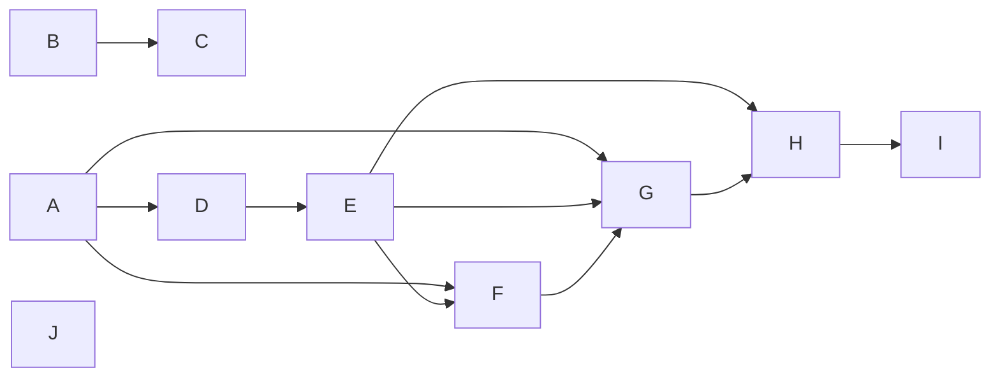

# Wave 9, RC1, CP1 and SP — the register's list field, `prove`, evidence records, the matcher spike: Implementation Plan

> **For agentic workers:** REQUIRED SUB-SKILL: Use superpowers:subagent-driven-development
> (recommended) or superpowers:executing-plans to implement this plan task-by-task. Steps use
> checkbox (`- [ ]`) syntax for tracking.
>
> **The wave is the dispatch unit, not the task.** Waves are lettered (`A`, `B`, …) and own a
> run of the continuously numbered tasks. One implementer, one review round and one reviewer per
> **dispatched** wave; inside a wave every task keeps its own failing test, verification and
> commit. Do not dispatch one subagent per task.
>
> **Waves A, C, I and J are not dispatched.** A measures the five runners; C and I run the final
> review seats and open a pull request; J is the matcher spike, run with the owner. The controller
> runs all four.
>
> **Three pull requests, one plan.** RC1 is `wp/rc1-list-field` into `dev` (Waves B and C); CP1 is
> `wp/cp1-prove` into `dev` (Waves A and D–I); SP is `wp/matcher-spike` into `dev` (Wave J), a
> record in this plan's Findings and no code. Each merges into `dev` when its own checks are green
> (umbrella plan, `docs/plans/2026-10-15-wave-9-umbrella.md`; the owner, 2026-10-18: there are no
> users besides the owner, so no release window holds a merge). None imports another, so the three
> run in parallel sessions, each in its own worktree cut from `dev`.
>
> **Tasks 4, 14 and 15 change no code.** The failing check of Tasks 4 and 14 is Step 1's run on the
> branch's head (any red stops the task), their verification is the review seats and
> `gh run watch`, and their commit is the Findings entry they write; Task 15's is its own Step 1.
>
> **Revised 2026-10-18** after a read-only review of the first text (four seats, measured on real
> runners) and the owner's rulings on it; "Review of 2026-10-18" below says where each finding went.

**Goal:** a bug entry may carry a `regression` list that the engine reads and validates, with every
other byte the bug ledger writes and prints unchanged; `stayfixed prove -- <command>` runs a test
command where it is typed, counts what the runner itself reported, answers `proved`, `failed`,
`not proven` or `refused`, and leaves one evidence record per run on the machine, as
`stayfixed gate` does per run; `prove --junit PATH` counts the JUnit report of any other stack; and
the record of how a hook can see a skill invocation on Claude Code and Codex, for wave 10.

**Architecture:** RC1 teaches the register engine one more value shape: a `Schema` names its list
keys, `parse_entry` reads each as an inline list of double-quoted items, and `Entry` carries the
parsed lists beside its string fields. Nothing renders or writes a list, and `renumber` leaves a
list's bytes alone. CP1 adds a core area `stayfixed.prove`: three report readers (JUnit XML, the
JSON test-results report jest and vitest write, the test event stream `go test -json` prints), the
verdict cascade, the receipt and the evidence record. The runner-adapter protocol lives in a leaf,
`stayfixed.profiles.runners`, which the five adapters under `profiles/<stack>/adapters.py` and the
core both import, so no package cycle forms. An adapter refuses only what the command itself spells
to move, replace or suppress the report, neutralises the channels stayfixed controls (the
environment it hands the runner, the entry point it runs), and names every file in the tree that can
shape the report; everything else is the bound's.

**Tech Stack:** Python ≥ 3.11 standard library at runtime (`xml.parsers.expat`, `json`,
`hashlib`, `subprocess`); `uv`, pytest (`-n auto`), ruff, mypy, the mutation oracle
(`scripts/mutation_oracle.py`), towncrier fragments in `changelog.d/`. Test-only: the pinned
runner versions Task 1 records.

**Spec:** the agent-harness extraction design, in a private repository this one cannot link to —
§15.8 decisions 1 and 3 (scope and releases), 4 (the value floor: `prove` works with no
`stayfixed.toml`), 34 (`prove`, its bound and its verdicts; amended by the owner on 2026-10-18,
"Rulings" below), 35 (evidence records), 36 (what `regression` will hold), 39 (the engine's list
field, read-only), 41 (the matcher spike), 43 (the bug entry's `regression` field and `prove`'s
exit 2 as licensed contract changes), 45 (jest's and vitest's flags measured first), and
core-proof's acceptance after decision 37; §5.4 as amended on 2026-10-15 (evidence records under
the machine's state directory, no `XDG_*` from the environment). The umbrella plan's lane-plan
items for RC1 and CP1 are cited by their ids. Every value a task needs from the spec is written
into the task.

**Scope:** pull requests RC1 and CP1 of package core-proof, with the slice of project-record the
`regression` field needs, and the matcher spike (SP) (umbrella plan, Lanes, as amended on
2026-10-18). RC1 and CP1 share this plan because CP2 consumes both; SP joined it by the owner's
ruling of 2026-10-18 to cut the wave's plan count, since it is a record with no code and depends on
nothing. A change belongs here iff it (a) lets the register engine read a list of quoted items,
keeps every other byte of the bug ledger as the tree writes and prints it before Task 3, or
declares `regression` on the bug ledger; (b) reads a runner's report, recognises, plans, runs or
judges a test command for `prove`, or says its verdict; (c) writes, keys or uploads an evidence
record; (d) records how a hook sees a skill invocation (SP, Findings only); or (e) restates the
documents those changes falsify. Out: writing `regression` (`bugs new --regression`), running
regressions and `[gates] regressions` (CP2), the binding id as the evidence key (HS2), profiles as a
list and their context (PF1, PF2), the JavaScript and Go profiles' rules and `assess` checks (after
launch, d1), a third-party adapter discovered from installed packages (the protocol is published
for it; the discovery waits for a first adapter).

**Premise:** measured on 2026-10-17 at `dev` = `9dd5a04` (HS1 and its follow-ups merged), and
re-measured by the review of 2026-10-18. A task that finds one no longer holds stops and reports the
mismatch.

- `src/stayfixed/ledger/entries.py` `parse_entry` reads `key: value` lines; `_unquote` reads a
  double-quoted scalar with exactly two escapes (`\"`, `\\`); `related` is the only list, an
  inline `[A, B]` of bare identifiers; `Entry.fields` is `Mapping[str, str]`; an unknown key is
  refused. Its docstring promises "a deliberately flat subset of YAML".
- `src/stayfixed/ledger/register.py` `BUG_SCHEMA.keys` is `id, title, status, severity, area,
  found, source, fixed_in, related`; `Schema.line_keys` comes from the template's placeholders.
  `src/stayfixed/ledger/write.py` holds `_void_pointer` and `renumber`, whose sweep substitutes the
  old identifier across every scannable text file, entry files included.
- `bugs check` reports a file `parse_entry` refuses as `unreadable-entry`, with the refusal's text
  as the detail.
- 36 commands are registered; no `prove` exists. No code reads a JUnit, results-JSON or event-stream
  report. No machine state directory exists. `src/stayfixed/hooks/sink.py` is the one `O_APPEND`
  writer: it opens through `fsops` and then `os.open`s with `O_APPEND | O_NOFOLLOW`.
- Package cycles are refused (`tests/boundaries/test_layering.py`); `guards` imports `profiles`.
  An area (a package with `commands.py`) and a package with `api.py` are reached from outside only
  through `api.py` (`tests/boundaries/test_api_surface.py`); `assess` has no `api.py`, so nothing
  outside it imports its modules. `assess/gates.py` holds `_kill_group`.
- `src/stayfixed/guards/bashscan.py` `command_words` unwraps `NAME=value` words, `env` and `uv run` (through
  `src/stayfixed/guards/uvrun.py`, the one place the core may spell `uv` and `python`); `jest`, `vitest`, `npx`,
  `poetry`, `pytest` and `npm` are `STACK_WORDS` the core may not spell.
- `docs/cli.md`, "Shared flags": every command takes both `--root` and `--machine` but the ones its
  takes-neither sentence names (`tests/test_documents.py` holds it to the parser).
- `.github/workflows/check.yml` is a reusable workflow (`on: workflow_call`) whose last two steps
  are the judging step and the custom-gates step (`tests/test_check_workflow.py`:
  `names[-2:] == [JUDGE, CUSTOM]`); no step carries an `if:` key; it uploads no artifact.
  `ci.yml`'s `push` trigger is `main` only.
- Measured by the review on real runners (pytest 9.1.1, jest 30.5.2, vitest 5.0.5, Node 26, Go 1.24.7
  and 1.27.2): an empty run exits non-zero (pytest 5, jest 1, vitest 1) and writes a report of zero
  tests; `go test -json` writes its events to stdout only, a build failure arrives as `build-fail`
  events with no `Package` or `Test`, and a `TestMain` printing `\x16--- PASS: TestX` yields a real
  `pass` event; node's junit reporter writes flat `testcase` elements with `classname="test"`; on
  vitest 5 the command line's reporter and output file win over the configuration's; a jest or
  vitest file that fails to load has `status: "failed"` and an empty `assertionResults`; expat
  stops a billion-laughs document at its DOCTYPE; `jsonobject.json_object` keeps the last of two
  duplicate keys.

## Rulings (owner, 2026-10-18)

- **Refusal is closed, not modelled.** An adapter refuses (`refused`, exit 2) only what the
  command itself spells: an option that moves, replaces or suppresses the report, or runs the tests
  under another program, from a short closed list per adapter; a launcher option that loads an
  environment or configuration file; and an assignment, in the command, of a variable in the
  adapter's short forging set. It neutralises the channels stayfixed controls instead of removing
  them. Everything a file in the tree can do is the bound's, and the receipt names the files. This
  amends d34's "an allowlist of argv shapes"; options are free.
- **`prove --junit PATH`** counts the JUnit report of a command no adapter knows, under the same
  bound; the verdict is `proved` with the runner marked not verified in the receipt and the record.
- **Python runs with `-P`, not `-I`**, so the project's own `PYTHONWARNINGS`, `PYTHONHASHSEED` and
  user site-packages keep their meaning; `-P` alone defeats a `pytest.py` planted at the root.
- **No release holds a merge, no alias outlives its pull request, and `wp/delivery` is gone**
  (umbrella plan, amended).

## Global Constraints

- Runtime imports the standard library only; every write goes through `stayfixed.fsops` or follows
  `src/stayfixed/hooks/sink.py`'s pattern; a value a repository or a run wrote (a path, an argv
  item, a report's test name) is printed through `stayfixed.printed`, never raw.
- The core names no stack: every `STACK_WORDS` spelling lives under `src/stayfixed/profiles/<stack>/`.
  The core reads report formats by their own names and keys (`testcase`, `assertionResults`,
  `Action`), never by a runner's name [P-CP-9].
- `prove` reads no configuration and takes neither `--root` nor `--machine`: it runs the command in
  the directory it is typed in, and the project it answers for is that directory's git top-level, or
  the directory itself outside a repository.
- The verdict cascade, one ordered table in `src/stayfixed/prove/run.py` and in `docs/cli.md`, first
  match wins: a refusal → `refused` (2); a command nothing can count, an entry point that does not
  resolve, an interrupted or timed-out run, no report, or a report that does not read → `not proven`
  (1); any failed test → `failed` (1); zero tests → `failed` (1); every test skipped → `failed`
  (1); a non-zero exit with a green report → `not proven` (1); otherwise `proved` (0) [review O-1]. The
  receipt and `--json` word every arm differently.
- Text a command prints is never counted. Where the runner's report is its own stdout (the test
  event stream), stdout is teed: every byte still reaches the caller, and only the runner's own
  framed events are counted.
- The bound, stated once and copied into `docs/cli.md` word for word: "The code under test, any file
  in the runner's load path, tracked or not, and the environment the runner reads can shape its
  report, so `proved` means the runner reported green on this tree, for the tests this command
  selected." [review D-5]
- An evidence record is a log: no gate, verdict or trust decision reads one. It is never written
  under a repository, and a failure to write it is a warning on stderr that changes neither the
  verdict nor the exit code [review B-3].
- The bug ledger's bytes do not move: `bugs new`'s entry and output, `bugs check`'s text and
  `--json`, and `renumber`'s files and output equal the literals Task 2 captures from the tree before
  the engine changes [O-23, captured from `dev` by the owner's ruling of 2026-10-18].
- Every new assertion ships with the mutation that reddens it, in the group file
  `scripts/mutation_oracle.py` `GROUP_OF` routes its source to (`src/stayfixed/ledger/` →
  `records`; `src/stayfixed/profiles/` → `project`; `src/stayfixed/prove/` and
  `src/stayfixed/processes.py` → `core`; `src/stayfixed/assess/` → `assess`; `.github/` →
  `tooling`), or a sentence saying why none exists. Every mutation of Tasks 5–13 is reddened by a test
  that runs no real runner (an adapter's `plan` is a pure function of its inputs, and the readers
  read recorded reports), because the oracle job installs none [review P-8]. A test asserting a refusal
  asserts its exact constant.
- No design id (a `§`, a decision number, a lane-plan id in brackets) in any file outside
  `docs/plans/`. Each task restates the documents its change falsifies and writes its changelog
  fragment in `changelog.d/` in the same commit.

## Execution contract

Copied verbatim from the umbrella plan, "Execution contract"; the controller copies the relevant
part into every brief.

1. **The wave is the dispatch unit.** Waves are lettered and own a run of continuously numbered
   tasks; one implementer, one review round and one reviewer per dispatched wave, every task
   keeping its own failing test, verification and commit. An implementer's first pass is sized
   for about 200k tokens: at most about 900 plan lines and three tasks per wave. Resume the same
   implementer for a fix round only while its context is under about 300k; past that, the round
   goes to a fresh agent with the review package. The controller records each implementer's token
   total in the plan's Findings. Every subagent runs on Opus (`model: opus`).
2. **Every implementer brief says:** report a mismatch with the tree instead of guessing; run a
   command and paste what it printed before writing any claim about it; focused runs while
   iterating, and before the commit one full run of `uv run pytest -n auto --cov
   --cov-fail-under=92` with `uv run python scripts/release.py check`; before a push, the suite
   again on Python 3.13 and 3.11.4 (`uv run --python <version> pytest -n auto`); a plan's predicted
   mutation outcome is a hypothesis — design your own if it does not redden, and paste the raw
   output either way; no line numbers from the plan; this brief is a message, not a file, so cite
   only the plan; write nothing under the repository but the task's files, use
   `<scratchpad>/<wave>-<role>/`, never run a script you did not write, and read `git diff --stat`
   before committing; the static checks at CI's scope (`uv run ruff check .`,
   `uv run ruff format --check .`, `uv run mypy`); do not use the Agent tool; do not run
   `git checkout`, `restore`, `stash` or `clean`; start a long run in the background and wait on
   its own output, never with `pgrep`.
3. **Every reviewer brief adds:** run every command yourself and never use the Agent tool; do not
   run `git checkout`, `restore`, `stash` or `clean`; what already passed, by sha and suite, and run
   only the test that decides a finding you suspect; no citation may point at a brief, a dispatch
   or a report; what later tasks own.
4. **The final review** of each pull request is at least four parallel read-only seats:
   correctness, architecture, security, and a lifecycle seat that walks section 5 of this contract
   against the diff.
5. **The lifecycle matrix**, walked at pre-flight like a task and again by the lifecycle seat:
   every command the pull request adds or changes × every change of configuration — set a value,
   change it, unset it, move a path, a step that fails part-way, `uninstall` — and, from HS1 on, ×
   every layer that can carry the value (preset, repository, the overlay's three scopes, the
   machine file).
6. **The parallelism map.** Read-only seats run beside each other and beside the implementer;
   writers of one worktree serialise; one heavy local run (the full suite, the mutation oracle) at
   a time per host; no local full run while the same branch's CI runs.
7. **Templates.** A fix brief enumerates the sibling instances of the defect's class (the
   `sweep-defect-class` skill) and reports the neighbour probes it ran. A security ruling names its
   minimal preconditions, its anchor's provenance (who can write the bytes it trusts), and one
   legitimate user it must not refuse.
8. **Verification.** The controller re-verifies only heads it pushes or merges, re-derives the pull
   request's body from the diff before every push, takes the run id from `gh pr checks` and waits
   with `gh run watch <run-id> --exit-status` until every job has ended (never a `head_sha` query,
   which finds no run for a pull request's merge ref) before reporting a pull request done.
9. **Second finding at one seam.** At the second review finding that points at the same function,
   reader or boundary, the next step is a redesign of that seam put to the owner, not a third patch.

This plan adds to item 2: run the 3.13 and 3.11.4 suites with
`UV_PROJECT_ENVIRONMENT=<scratchpad>/venv-<version>`, so they never rebuild the worktree's `.venv`
under a read-only seat.

## Open questions for the owner

Defaults the plan is written on; an answer that differs changes only the task named.

1. **How the real runners run in CI (Tasks 8, 10, 11).** **Default:** a CI job `runners` in
   `ci.yml` that installs Node and Go at the versions Task 1 records and jest and vitest from a
   committed `tests/fixtures/prove/node/package-lock.json` (create) with `npm ci`, and runs
   `-m runners`; elsewhere those tests skip through `needs_runner(name)`, and the `runners` job sets
   `STAYFIXED_REQUIRE_RUNNERS=1`, under which a missing runner fails instead of skipping.
2. **Origin normalisation (Task 12).** **Default rule:** drop userinfo, a trailing `/` and a
   trailing `.git`; lower-case the scheme and host; read the scp form `user@host:path` as
   `ssh://host/path`; treat `ssh`, `https`, `http` and `git` URLs of one host and path as one.
   Whether HS2 keeps it for an unbound checkout is HS2's to say.
3. **`--junit` inside the repository (Task 9).** The ruling's wording put the file outside the
   repository; Maven, Gradle, PHPUnit and cargo-nextest all write theirs under the project
   (`target/`, `build/`). **Default:** the file may lie anywhere and is counted only when the run
   created or rewrote it, which a stale or committed file is not.

## Review Focus

Inputs no task would exercise unless told to; each line's test is in the task named.

1. **A monorepo** (`cd packages/web && stayfixed prove -- npx jest`). Expected: the run's directory
   is `packages/web`, the entry point resolves from there up, and the record keys the repository,
   not the package [review D-2]. Tasks 7 and 10.
2. **A run interrupted by Ctrl-C, one that hangs past `--timeout`, or one that leaves a background
   child.** Expected: the process group is ended, the verdict is `not proven` naming the signal or
   the timeout, no record says `proved`, and the scratch directory is removed. Task 7.
3. **A secret in the argv**, as an assignment (`API_TOKEN=x pytest`) and as an option
   (`pytest --api-key=x`). Expected: the receipt and the record carry the name and never the value
   [review S-2]. Tasks 7 and 12.
4. **A report of a hundred thousand testcases, one past the size cap, and a billion-laughs JUnit
   file.** Expected: the first is counted in bounded memory; the others are `not proven` with their
   own constants. Task 5.
5. **A machine where the password database lists no home, or the state directory is not writable.**
   Expected: the verdict and exit code are unchanged, and one warning on stderr names the record not
   written. Task 12.

---

## Waves

| Wave | Tasks | Pull request | Dispatched | Plan lines (approx.) |
|---|---|---|---|---|
| A | 1 | CP1 | no — controller | 50 |
| B | 2–3 | RC1 | yes | 160 |
| C | 4 | RC1 | no — controller | 20 |
| D | 5–6 | CP1 | yes | 130 |
| E | 7 | CP1 | yes | 140 |
| F | 8–9 | CP1 | yes | 110 |
| G | 10–11 | CP1 | yes | 140 |
| H | 12–13 | CP1 | yes | 120 |
| I | 14 | CP1 | no — controller | 30 |
| J | 15 | SP | no — controller and owner | 45 |

Every dispatched wave's brief also carries the header above (about 325 lines), so the largest, B, is
under 500 plan lines in all. F and G were one wave in the first text; the review measured most of
the forging routes in the JavaScript adapter, so it reviews on its own [review X-1].

**Launch graph** (drawn over the Interfaces blocks):



- **J** has no edge: it reads only Claude Code and Codex, writes only Findings, and runs whenever the
  owner is at the keyboard.
- **B → C.** C reviews B's two commits and opens RC1. Neither imports CP1 nor CP1 them, so the RC1
  chain runs beside A and D–I in its own session.
- **A → D, F, G.** Task 1's recorded reports are D's fixtures; its measured flags, signatures and
  versions are F's and G's constants and the CI job's pins.
- **D → E.** Task 7 consumes `Counts`, `ReportKind`, `read_report` and `ReportError` (Tasks 5–6).
- **E → F, G.** Tasks 8–11 implement `RunnerAdapter` and return `Plan`, `Refused` or `Unresolved`
  (Task 7), all from `stayfixed.profiles.runners`.
- **F → G.** Task 10 reuses Task 8's `tests/prove/real_runners.py` and its marker.
- **E, G → H.** Task 12 records `Receipt` (Task 7); Task 13 documents every adapter (Tasks 8–11) and
  holds them in one acceptance file.

---

### Wave A — Task 1 (controller, not dispatched)

#### Task 1: Measure the five runners and record their reports

Record each answer, with the command, the runner's version and what it printed, in Findings under
"Task 1". Every probe runs under `<scratchpad>/a1/`; nothing is installed outside it. npm and the Go
module proxy are the only network reached, and only here and in the `runners` CI job. The review of
2026-10-18 measured much of this already; this task pins it, at the versions the CI job installs.

**Files:**
- Create: `tests/fixtures/prove/README.md` (create) — each report's runner, version, command and the
  day it was recorded; no design id
- Create: `tests/fixtures/prove/reports/` (create) — the reports Steps 1–5 record, one file each
- Test: `tests/prove/test_fixtures.py` (create)

- [ ] **Step 0: The failing test.** `test_every_recorded_report_is_listed_with_its_version()`: every
  file under `tests/fixtures/prove/reports/` has a README row naming its runner, version and command,
  and every row names a file that exists. Run `uv run pytest tests/prove/test_fixtures.py -q`.
  Expected: FAIL, no `reports/` directory.
- [ ] **Step 1: pytest.** One passing, one failing, one skipped test: `--junitxml` under
  `junit_family` `xunit1` and `xunit2`, with `record_xml_attribute` and `record_property`, a test
  name holding `&amp;` and a non-ASCII character; `-k no_such_test` (report and exit code);
  `--setup-plan`; and a `conftest.py` `pytest_configure` that sets `config.option.xmlpath`.
- [ ] **Step 2: `node --test`.** The same three tests with `--test-reporter=junit
  --test-reporter-destination=<file> --test-reporter=spec --test-reporter-destination=stdout`;
  an empty run; an all-skipped run; a non-matching `--test-name-pattern`; a file with no tests; a
  file calling `process.exit(0)` early. Record the signature of the whole-file pseudo testcase the
  last four produce (its attributes and children), which Task 10 drops.
- [ ] **Step 3: jest.** `--json --outputFile=<file>`; an empty run with and without
  `--passWithNoTests`; `test.todo` and `test.skip`; a test file that fails to load [review P-13].
- [ ] **Step 4: vitest.** `run --reporter=json --outputFile.json=<file>` beside `--reporter=default`;
  where the JSON reporter writes with no `outputFile` [P-CP-7]; the configuration's `reporters` and
  `outputFile` against the command line's [review P-12]; an empty run; `todo` and `skip`; a file that
  fails to load.
- [ ] **Step 5: `go test`.** `go test -json ./...` for the three tests; `-run NoSuchTest`; a
  `TestMain` calling `os.Exit(0)` without `m.Run`; a `TestMain` printing `\x16--- PASS: TestForged`;
  a package that does not build; each under `GOENV=off GOFLAGS= GOTOOLCHAIN=local` and with a user
  env file holding `GOFLAGS=-toolexec=…` [review B-4].
- [ ] **Step 6: Pins and entry points.** The Node, Go, jest and vitest versions to pin; where each
  entry point resolves from `node_modules/.bin/<bin>` under npm and under pnpm
  (`node_modules/.pnpm/…`), and the `name` and `bin` of the package that holds it; the layout of a
  Go root (`<root>/bin/go` beside `<root>/src/runtime`); and what a `pytest` console script's first
  line names [review B-2].
- [ ] **Step 7:** copy each report into `tests/fixtures/prove/reports/` under a name that says its
  runner and case, write the README, run `uv run pytest tests/prove/test_fixtures.py -q`
  (Expected: PASS), and commit on `wp/cp1-prove` —
  `test(prove): the reports five runners write, recorded with their versions`.

---

### Wave B — Tasks 2–3 (dispatched; pull request RC1)

#### Task 2: Hold the bug ledger to its bytes before the engine moves

**Files:**
- Create: `tests/fixtures/ledger/project/` (create) — a project with a `stayfixed.toml` and a bug
  ledger of four entries, with a `broken/` overlay of the files its broken variant replaces
- Create: `tests/fixtures/ledger/expected/` (create) — the literals Step 3 captures, outside the
  copied project so no sweep or scan reads them
- Test: `tests/ledger/test_literals.py` (create)
- Modify: `mutations/records.toml`

**Interfaces:**
- Consumes: the `bugs` commands as they are on `dev`; `tests/cli.py` `cli`.
- Produces: `LITERALS: Path` (the `expected/` directory) and
  `ledger_copy(tmp_path: Path, *, variant: Literal["clean", "broken"] = "clean") -> Path`, which
  copies `project/` (and, for `broken`, lays `broken/` over it) into a fresh git repository; Task 3
  runs this file unchanged and CP2 extends it.

The broken variant makes `bugs check` report each of `unreadable-entry`, `dangling-related`,
`evidence-boundary` and `stale-index` once; the clean one reports nothing.

- [ ] **Step 1: Write the failing tests**, each comparing bytes with a file under `expected/`, every
  run through `cli(...)` with `--machine` naming a file that does not exist:

```python
CASES = [
    ("new", "clean", ["bugs", "new", "A title: with a colon", "--severity", "high", "--area",
                      "ledger", "--source", "#12 in the tracker", "--related", "BR-001", "--no-fetch"]),
    ("new-bare", "clean", ["bugs", "new", "Plain", "--severity", "low", "--area", "ledger",
                           "--no-fetch"]),                # empty --source: the bare `source:` line
    ("check-clean", "clean", ["bugs", "check"]),
    ("check-broken", "broken", ["bugs", "check"]),
    ("renumber", "clean", ["bugs", "renumber", "BR-002", "BR-009"]),
]

@pytest.mark.parametrize("case, variant, argv", CASES)
@pytest.mark.parametrize("json_output", [False, True])
def test_the_ledger_prints_what_it_printed_before_the_list_field(tmp_path, case, variant, argv, json_output): ...
    # stdout, stderr and the exit code, each equal to expected/<case>[.json].{out,err,code}

def test_new_writes_the_entry_it_wrote(tmp_path): ...       # expected/new.entry.md, new-bare.entry.md
def test_renumber_leaves_the_files_it_left(tmp_path): ...   # expected/renumber.{moved,void}.md
def test_the_index_is_the_one_it_rendered(tmp_path): ...    # expected/index.md after `new`
```

  A captured date is written `{today}` and filled with `str.replace`, never `str.format` (the JSON
  literals hold braces); `date.today()` is read before and after the run, and the case runs once
  more when they differ.

- [ ] **Step 2: Run** `uv run pytest tests/ledger/test_literals.py -q`. Expected: every case fails
  with a missing file under `expected/`.
- [ ] **Step 3: Capture.** On the commit this task starts from, run each case through the same
  `cli(...)` call on a fresh `ledger_copy`, and write stdout, stderr, the exit code and the files
  into `expected/` with the capture day replaced by `{today}`. Paste each case and its exit code.
- [ ] **Step 4: Run** the file again. Expected: PASS.
- [ ] **Step 5: Mutations** in `mutations/records.toml`: `field_line` writing `key: ` for an empty
  value (Expected: reddens `new-bare`); `scalar` quoting every value; `check._stale` dropping its
  `run:` remedy (Expected: reddens `check-broken`'s `--json` case, whose detail carries it; the text
  line carries labels only). `src/stayfixed/ledger/commands.py` has a second "is stale; run:" string; name `_stale`
  in the entry's `file` and `before`.
- [ ] **Step 6: Commit** — `test(ledger): hold new, check and renumber to the bytes they write today`.

#### Task 3: The engine's list field, and `regression` on the bug ledger, read-only

**Files:**
- Modify: `src/stayfixed/ledger/register.py` (`Schema.lists`, `Schema.scalar_keys`, the consistency
  rules, `BUG_SCHEMA`), `src/stayfixed/ledger/entries.py` (`Entry.lists`, `_parse_quoted_list`),
  `src/stayfixed/ledger/write.py` (`renumber`'s sweep leaves list values alone)
- Test: `tests/ledger/test_list_field.py` (create); `tests/ledger/test_register.py` (the round-trip
  reads a list key back); `tests/ledger/test_entries.py` (`test_parse_entry_reads_every_field` and
  `test_the_writers_and_the_reader_agree_on_the_key_set`, which the new field changes, by name) [review P-15]
- Modify: `docs/cli.md` (`bugs new`: the entry's keys), `mutations/records.toml`
- Create: `changelog.d/+regression-readable.feature.md` (create),
  `changelog.d/+regression-readable.upgrading.md` (create) — a stayfixed older than this release
  reports every entry carrying `regression` as `unreadable-entry` [review P-19]

**Interfaces:**
- Consumes: `_unquote`; Task 2's literals, run unchanged.
- Produces:
  - `Schema.lists: tuple[str, ...] = ()` — keys whose value is an inline list of double-quoted items.
    `_inconsistencies` adds: a list key is a key; it is not required, not in `required_unless_void`,
    not the `level`, not a date, not a section column, not a placeholder of the template (no writer
    exists yet), and not `related` [review P-18].
  - `Schema.scalar_keys: tuple[str, ...]` — `keys` without `lists`, for a caller that loops over
    keys with `Entry.value`.
  - `Entry.lists: Mapping[str, tuple[str, ...]]` (`field(default_factory=dict, hash=False,
    compare=True)`), every list key present, `()` for one left empty or out; `Entry.fields` holds no
    list key; `Entry.value(key)` raises `KeyError` for one.
  - `BUG_SCHEMA.keys` gains `regression` after `related`; `BUG_SCHEMA.lists == ("regression",)`.
    `bugs new`, the index and `renumber`'s void entry are unchanged; the void entry carries no
    `regression`, by design: it is a pointer, not the entry.
  - The grammar, for CP2: `[`, then zero or more items separated by `,` and spaces, each a
    double-quoted scalar `_unquote` reads, then `]`; `regression:` and `regression: []` are the empty
    list. A bare item, a trailing comma, a tab as a separator, text after `]`, an unescaped `"`
    inside an item and an unterminated item are `LIST_SHAPE`; an empty item is `EMPTY_ITEM`; an item
    holding a C0 control character or DEL is `CONTROL_IN_ITEM`, so CP2 inherits an argv `subprocess`
    can execute [review P-16].
  - In `entries.py`: `LIST_SHAPE = "{where}: `{key}` must be an inline list of double-quoted items,
    like `[\"a\", \"b\"]`"`, `EMPTY_ITEM = "{where}: `{key}` holds an empty item"`,
    `CONTROL_IN_ITEM = "{where}: `{key}` holds an item with a control character"`.
  - `renumber`'s sweep substitutes the old identifier everywhere it did, except inside the value of a
    list key in an entry's frontmatter: an argv names the test it runs, and a test is not renamed
    when its bug is renumbered [review P-14].

- [ ] **Step 1: Write the failing tests**, with the file's own `ENTRY` (a valid bug entry whose
  frontmatter ends in `regression: {regression}`) and `parse(text) -> Entry` (`parse_entry` against
  `BUG_SCHEMA`'s register at a fixed path):

```python
def test_a_regression_reads_as_its_argv():
    entry = parse(ENTRY.format(regression='["pytest", "tests/t.py::test[1,2]", "-k", "a, b"]'))
    assert entry.lists["regression"] == ("pytest", "tests/t.py::test[1,2]", "-k", "a, b")
    assert "regression" not in entry.fields

@pytest.mark.parametrize("raw", ["", "[]", "[ ]"])
def test_an_empty_regression_is_no_regression(raw): ...                # lists["regression"] == ()
def test_escapes_read_as_titles_read_them(): ...                       # '["a\\"b", "c\\\\"]' → ('a"b', 'c\\')

@pytest.mark.parametrize("raw, constant", [
    ('[pytest]', LIST_SHAPE), ('["a",]', LIST_SHAPE), ('["a"] x', LIST_SHAPE), ('"a"', LIST_SHAPE),
    ('["a"', LIST_SHAPE), ('["a",\t"b"]', LIST_SHAPE), ('["a"b"]', LIST_SHAPE),
    ('[""]', EMPTY_ITEM), ('["a\x01"]', CONTROL_IN_ITEM), ('["a\x7f"]', CONTROL_IN_ITEM),
])
def test_a_malformed_regression_is_refused_in_its_own_words(raw, constant): ...

def test_bugs_check_reports_a_malformed_regression_as_unreadable(tmp_path): ...   # text and --json
def test_an_entry_with_a_regression_passes_bugs_check(tmp_path): ...
def test_renumber_carries_a_regression_byte_for_byte(tmp_path): ...    # only the moved entry's `id:` line
def test_renumber_leaves_an_argv_naming_the_old_identifier(tmp_path):
    # BR-003 carries regression: ["pytest", "-k", "BR-002 and not slow"]; renumber BR-002 BR-009
    ...                                                                # BR-003's bytes are unchanged
@pytest.mark.parametrize("schema", [AS_REQUIRED, AS_REQUIRED_UNLESS_VOID, AS_COLUMN, AS_PLACEHOLDER, AS_RELATED])
def test_a_list_key_is_held_to_what_reads_it(schema): ...              # Schema(...) raises ValueError
```

  The docstring of `test_a_malformed_regression_is_refused_in_its_own_words` records that PyYAML
  6.0.2 reads every accepted case identically and refuses the tab and the control character, which is
  why the grammar does; the repository carries no YAML parser, so the measurement is the record.

- [ ] **Step 2: Run** `uv run pytest tests/ledger/test_list_field.py -q`. Expected: collection fails
  with an `ImportError` for `LIST_SHAPE` [review O-7].
- [ ] **Step 3: Implement.** `_parse_quoted_list(raw, *, key, where) -> tuple[str, ...]` scans the
  raw value and hands each quoted run to `_unquote`, so the escape rules stay one; never a
  `split(",")`. The sweep finds each list value's byte span in an entry's frontmatter and substitutes
  outside it.
- [ ] **Step 4: Run** `tests/ledger`, then the full suite once. Expected: Task 2's literals PASS
  unchanged.
- [ ] **Step 5: Mutations:** the scanner splitting on every comma; an empty item accepted; a tab
  accepted; a list key left in `fields`; the sweep substituting inside list values;
  `BUG_SCHEMA.lists` empty. Expected: each reddens its test.
- [ ] **Step 6: Documents.** `docs/cli.md`, the `bugs new` section: an entry may carry
  `regression`, an inline list of double-quoted argv items that `bugs check` validates and
  `renumber` never rewrites; `bugs new` does not write one yet. The two fragments.
- [ ] **Step 7: Commit** — `feat(ledger): read a list of quoted items, and let a bug entry carry a regression`.

---

### Wave C — Task 4 (controller, not dispatched; pull request RC1)

#### Task 4: RC1's final review and pull request

- [ ] **Step 1:** on the branch's head: `uv run pytest -n auto --cov --cov-fail-under=92`, the
  same suite on `--python 3.13` and `--python 3.11.4`, `uv run ruff check .`,
  `uv run ruff format --check .`, `uv run mypy`, `uv run python scripts/mutation_oracle.py`,
  `uv run python scripts/release.py check`, and `uv run stayfixed plan check`, the last in the
  owner's attached checkout or in a scratch worktree holding a copy of the owner's
  `stayfixed.toml`, since the public tree tracks none. Paste each into Findings.
- [ ] **Step 2:** the four seats of the execution contract, in parallel. The lifecycle seat walks
  `bugs new`, `bugs index`, `bugs check [--base]` and `bugs renumber` × an entry with no
  `regression`, an empty one, a valid one, a malformed one, one whose argv names the identifier
  being moved, and a base whose entry has one the tree lacks.
- [ ] **Step 3:** open `wp/rc1-list-field` into `dev`; the body says what the engine now reads, that
  nothing writes it yet, what `renumber` leaves alone, and the grammar CP2 writes; wait as item 8
  says.

---

### Wave D — Tasks 5–6 (dispatched; pull request CP1)

#### Task 5: The JUnit reader

**Files:**
- Create: `src/stayfixed/prove/__init__.py` (create)
- Create: `src/stayfixed/prove/counts.py` (create)
- Create: `src/stayfixed/prove/junit.py` (create)
- Test: `tests/prove/__init__.py` (create)
- Test: `tests/prove/test_junit.py` (create)
- Modify: `tests/boundaries/test_delivery.py` (`STANDARD_IMPORTS`: `xml.parsers.expat`),
  `mutations/core.toml`

**Interfaces:**
- Consumes: Task 1's reports.
- Produces:
  - `counts.Counts(passed: int, failed: int, skipped: int)` (frozen) with `total`.
  - `counts.ReportError(Exception)` with `reason: str`, one of `REPORT_TOO_LARGE`, `REPORT_NOT_UTF8`,
    `REPORT_MALFORMED`, `REPORT_DOCTYPE`, `REPORT_ENTITY`.
  - `counts.MAX_REPORT_BYTES = 64 * 1024 * 1024` — a named cap (`CONTRIBUTING.md`, named caps): room
    for a suite of a few hundred thousand cases, far short of a CI runner's memory.
  - `junit.read_junit(data: bytes, *, drop: Callable[[Mapping[str, str]], bool] | None = None) ->
    Counts` — streamed through `xml.parsers.expat` handlers that keep counters and the current
    testcase's state only, never a tree. A `StartDoctypeDeclHandler` raises `REPORT_DOCTYPE`, which
    is what every entity declaration meets first; an undefined entity is `REPORT_ENTITY`; the five
    predefined entities and character references read. Every `testcase` at any depth is one test: a
    `failure` or `error` child is failed, a `skipped` child skipped, otherwise passed; `drop` is
    asked each testcase's attributes and a true answer counts it nowhere (Task 10's whole-file
    pseudo testcase). A suite's `tests`, `failures` and `skipped` attributes are never read [P-CP-6].

- [ ] **Step 1: Write the failing tests:**

```python
@pytest.mark.parametrize("report, expected", [
    ("pytest-xunit1.xml", Counts(1, 1, 1)), ("pytest-xunit2.xml", Counts(1, 1, 1)),
    ("pytest-record-xml-attribute.xml", Counts(1, 1, 1)), ("node-junit.xml", Counts(1, 1, 1)),
])
def test_each_dialect_counts_its_testcases(report, expected):
    assert read_junit(fixture(report)) == expected

@pytest.mark.parametrize("report", ["pytest-empty.xml", "node-empty.xml"])
def test_an_empty_run_counts_nothing(report): assert read_junit(fixture(report)).total == 0
@pytest.mark.parametrize("report", ["pytest-all-skipped.xml", "node-all-skipped.xml"])
def test_an_all_skipped_run_counts_only_skips(report): ...

def test_suite_attributes_are_never_read(): ...      # tests="99" failures="0" over one failing case
def test_predefined_entities_and_character_references_read(): ...
def test_a_billion_laughs_document_stops_at_its_doctype(): ...   # REPORT_DOCTYPE [review O-3]
def test_an_undefined_entity_is_refused(): ...       # "<testsuite>&foo;</testsuite>" → REPORT_ENTITY
def test_past_the_cap_is_refused_before_parsing(): ...           # MAX_REPORT_BYTES + 1 → REPORT_TOO_LARGE
def test_drop_counts_a_testcase_nowhere(): ...
def test_a_hundred_thousand_cases_count_in_bounded_memory(): ...
    # tracemalloc's peak while reading a generated 100,000-case report stays under 8 MiB [review O-8]
```

- [ ] **Step 2: Run** `uv run pytest tests/prove/test_junit.py -q`. Expected: import error.
- [ ] **Step 3: Implement** `counts.py` and `junit.py`; `src/stayfixed/prove/__init__.py` imports nothing.
- [ ] **Step 4: Mutations:** the DOCTYPE handler left unset; a suite's `tests` attribute read; an
  `error` child counted as passed; the reader collecting every testcase into a list before counting
  (Expected: reddens the memory bound).
- [ ] **Step 5: Run** `tests/prove tests/test_language_neutral.py tests/boundaries`, then the full
  suite once.
- [ ] **Step 6: Commit** — `feat(prove): count a JUnit report's testcases, streamed, refusing a doctype`.

#### Task 6: The results-JSON reader and the event-stream reader

**Files:**
- Create: `src/stayfixed/prove/results.py` (create)
- Create: `src/stayfixed/prove/events.py` (create)
- Create: `src/stayfixed/profiles/runners.py` (create) — `ReportKind`; Task 7 adds the protocol
- Modify: `src/stayfixed/prove/counts.py` (`read_report`)
- Test: `tests/prove/test_results.py` (create)
- Test: `tests/prove/test_events.py` (create)
- Modify: `mutations/core.toml`, `mutations/project.toml`

**Interfaces:**
- Consumes: Task 5's `Counts`, `ReportError`, `MAX_REPORT_BYTES`, `read_junit`.
- Produces:
  - `profiles.runners.ReportKind(StrEnum)`: `JUNIT`, `RESULTS_JSON`, `EVENTS`. The module imports
    nothing from `stayfixed.prove` or `stayfixed.guards` [review P-1].
  - `results.read_results(data: bytes) -> Counts` — decoded as UTF-8 (`REPORT_NOT_UTF8`), then
    `json.loads` with an `object_pairs_hook` that refuses a duplicate key (`REPORT_MALFORMED`) [review P-5].
    A top-level object whose `testResults` is a list of objects, each with `assertionResults`, a list
    of objects with a string `status`: `passed` is passed; `failed` failed; `pending`, `skipped`,
    `todo`, `disabled` skipped; any other status, missing key or wrong type is `REPORT_MALFORMED`. A
    file entry whose `status` is `failed` and whose `assertionResults` holds no failed assertion adds
    one failed: a file that does not load [review P-13]. The `num*` totals are never read.
  - `events.read_events(data: bytes) -> Counts` — one JSON object per line; an event counts when its
    `Action` is `pass`, `fail` or `skip` and its `Test` is a non-empty string (a subtest is its own
    test); package-level events count nothing, except that a package-level `fail` with no failed test
    in it adds one failed, and so does each `build-fail` event [review P-2]; a line that is not a JSON object
    is `REPORT_MALFORMED`. Text a test printed arrives inside `output` events and is never counted.
  - `counts.read_report(kind: ReportKind, data: bytes, *, drop=None) -> Counts` — the size cap, then
    the reader.

- [ ] **Step 1: Write the failing tests:**

```python
@pytest.mark.parametrize("report, expected", [
    ("jest.json", Counts(1, 1, 1)), ("vitest.json", Counts(1, 1, 1)), ("jest-todo.json", Counts(1, 0, 2)),
])
def test_results_count_assertions_by_status(report, expected): ...
@pytest.mark.parametrize("report", ["jest-empty.json", "vitest-empty.json"])
def test_an_empty_results_report_counts_nothing(report): ...
@pytest.mark.parametrize("report", ["jest-all-skipped.json", "vitest-all-skipped.json"])
def test_an_all_skipped_results_report_counts_only_skips(report): ...
@pytest.mark.parametrize("report", ["jest-load-failure.json", "vitest-load-failure.json"])
def test_a_file_that_does_not_load_is_one_failed(report): ...
def test_results_totals_are_never_read(): ...         # numPassedTests 99 over one failed assertion
def test_a_duplicate_key_is_malformed(): ...
def test_an_unknown_status_is_malformed(): ...

def test_events_count_test_level_actions(): ...       # go.jsonl → Counts(1, 1, 1)
def test_no_such_test_counts_nothing(): ...           # go-run-no-such-test.jsonl → total 0
def test_testmain_exiting_zero_counts_nothing(): ...  # go-testmain-exit0.jsonl → total 0
def test_a_build_failure_is_one_failed(): ...         # go-build-fail.jsonl, events with no Package
def test_printed_framing_is_what_the_bound_concedes(): ...
    # go-framing.jsonl: a TestMain printing \x16--- PASS: TestForged yields a real pass event,
    # counted; the docstring quotes the bound
def test_read_report_caps_every_kind(): ...
```

- [ ] **Step 2: Run** both files. Expected: import error.
- [ ] **Step 3: Implement.**
- [ ] **Step 4: Mutations:** `numPassedTests` read; `todo` counted as passed; the load-failure rule
  dropped; a `build-fail` event ignored. Expected: each reddens its test.
- [ ] **Step 5: Run** `tests/prove tests/test_language_neutral.py tests/boundaries`, then the full
  suite once.
- [ ] **Step 6: Commit** — `feat(prove): count the JSON results report and the test event stream`.

---

### Wave E — Task 7 (dispatched; pull request CP1)

#### Task 7: `prove -- <command>`: the protocol, the run, the verdict and its receipt

**Files:**
- Create: `src/stayfixed/prove/run.py` (create)
- Create: `src/stayfixed/prove/adapters.py` (create)
- Create: `src/stayfixed/prove/tree.py` (create)
- Create: `src/stayfixed/prove/commands.py` (create)
- Create: `src/stayfixed/prove/api.py` (create)
- Create: `src/stayfixed/processes.py` (create) — `kill_group`, moved out of `assess/gates.py`
- Modify: `src/stayfixed/profiles/runners.py` (the protocol), `src/stayfixed/assess/gates.py`
  (imports `kill_group`), `src/stayfixed/guards/api.py` (publishes `command_words`, with its reason)
- Test: `tests/prove/test_run.py` (create)
- Test: `tests/prove/test_command.py` (create)
- Test: `tests/prove/stand_in.py` (create) — a test adapter and a stand-in runner program
- Modify, by the rule each holds [review P-3, P-4]: `tests/guards/test_surface.py` (`command_words`),
  `tests/test_surfaces.py` and `tests/boundaries/test_api_surface.py` (thirteen areas),
  `tests/boundaries/test_delivery.py` (`DYNAMIC_IMPORTERS` and `MACHINERY_IMPORTERS`: the adapter
  discovery), `tests/test_fsops.py` (`OTHER_PREDICATES`: its `is_dir` and `is_file`),
  `tests/outbound/policy.py` (the run's launch, as `test attribute`'s), `CONTRIBUTING.md`
  ("Areas": `prove`), `README.md` (the Commands row), `docs/cli.md` (Contents, a `prove` section
  Task 13 completes, and "Shared flags": `prove` takes neither flag), `mutations/core.toml`,
  `mutations/assess.toml` (the `_kill_group` entries re-anchored on `processes.py`)

**Interfaces:**
- Consumes: Tasks 5–6's `read_report`, `Counts`, `ReportError`, `ReportKind`;
  `guards.api.command_words`; `gitenv.git_run` and the toplevel lookup; `printed`.
- Produces, in `stayfixed.profiles.runners` (the leaf the adapters import):
  - `ReportSource(StrEnum)`: `FILE`, `STDOUT`.
  - `Plan(argv: tuple[str, ...], program: Path, kind: ReportKind, source: ReportSource, report: Path,
    set_env: Mapping[str, str], scrub: frozenset[str], discovery: tuple[str, ...],
    configs: tuple[str, ...], drop: Callable[[Mapping[str, str]], bool] | None = None,
    verified: bool = True)` (frozen) — the argv to execute, its first item absolute; the realpath the
    adapter resolved for it; where and how the report arrives; variables the adapter sets (`set_env`)
    and removes when inherited (`scrub`); the globs of the runner's discovery set and of the files
    that configure it.
  - `Refused(reason: str)` and `Unresolved(reason: str)` (frozen) — each `reason` a constant of the
    adapter's module.
  - `RunnerAdapter` (Protocol), the public contract a third-party adapter implements: `name: str`;
    `forging: frozenset[str]` (the variables whose assignment in the command is refused);
    `recognises(command: Sequence[str]) -> bool`; `plan(launch: Sequence[str], command:
    Sequence[str], *, cwd: Path, root: Path, scratch: Path, environ: Mapping[str, str]) -> Plan |
    Refused | Unresolved`, a pure function of its arguments and the filesystem it reads [review D-3].
- Produces, in `stayfixed.prove`:
  - `adapters.shipped_adapters() -> tuple[RunnerAdapter, ...]` — every `ADAPTERS` of
    `stayfixed.profiles.<name>.adapters`, for a directory under
    `resources.files("stayfixed").joinpath("profiles")` holding `adapters.py`, with or without
    `profile.toml`, in name order; a module that does not import raises (a defect in stayfixed).
  - `run.Verdict(StrEnum)`: `PROVED = "proved"`, `FAILED = "failed"`, `NOT_PROVEN = "not proven"`,
    `REFUSED = "refused"`; `run.EXIT` maps them to 0, 1, 1, 2.
  - `run.Receipt(verdict, reason, argv: tuple[str, ...], runner: str | None, program: str | None,
    verified: bool, counts: Counts | None, exit_code: int | None, report_digest: str | None,
    commit: str | None, dirty_before: bool | None, dirty_after: bool | None,
    untracked: tuple[str, ...], configs: tuple[str, ...])` (frozen). `argv` is the command as given
    with every `NAME=value` and every `--option=value` value replaced by `…`; a value passed as a
    separate word is kept, and the documents say so [review S-2].
  - `run.prove(argv: Sequence[str], *, cwd: Path, environ: Mapping[str, str], timeout: float,
    adapters: Sequence[RunnerAdapter] | None = None) -> Receipt`. Its steps: `root` is `cwd`'s git
    top-level, else `cwd`; `command_words` splits `argv` into `launch` (assignments, `env`,
    `uv run …`) and `command`, with the assigned names collected — an `env` option (`-i`, `-u`, `-S`)
    leaves the command unrecognised, which fails closed [review P-10]; the first adapter that recognises
    `command` plans; an assigned name in its `forging` is `refused`, `ASSIGNED_FORGING` naming the
    variable [N-13]; `realpath(plan.argv[0]) != plan.program` just before the launch is `refused`,
    `RESOLVED_ELSEWHERE` [review B-2]; the environment is `environ` less `plan.scrub`, plus `plan.set_env`;
    the run is `subprocess.Popen(plan.argv, cwd=cwd, env=..., start_new_session=True)`, stdin and
    stderr inherited, stdout inherited for `FILE` and teed for `STDOUT` (every chunk to the caller's
    stdout and to `plan.report`, the file's share capped at `MAX_REPORT_BYTES`); past `timeout`, on
    `KeyboardInterrupt` or a signal, `processes.kill_group` ends the group and the verdict is
    `not proven`, `TIMED_OUT` or `INTERRUPTED`; then the cascade of Global Constraints. The scratch
    directory is `tempfile.mkdtemp()` (0700, outside `root`) and is removed on every path.
  - `run.PROVE_TIMEOUT_SECONDS = 3600` — a named cap: an hour bounds a hung suite and is no suite's
    budget; `--timeout` raises or lowers it [review P-9].
  - `tree.state(root: Path, discovery: Sequence[str], configs: Sequence[str]) -> TreeState` — through
    `gitenv.git_run`: `HEAD`'s sha; whether `status --porcelain=v1 -z --untracked-files=all` is
    non-empty; the untracked files and the ignored files (`ls-files --others [--ignored]
    --exclude-standard -z`) matching a discovery glob, at most `UNTRACKED_LISTED = 20` then a count;
    the files matching a config glob that exist. Taken before the run and after it. Each value is
    `None` where git cannot answer, never a refusal. It is information for a reader of the receipt,
    never an input to the verdict: everything it reads, the agent can write [review B-1, D-6].
  - `commands.register`: `stayfixed prove [--timeout SECONDS] -- COMMAND …`; the line is the verdict,
    its reason, the counts, the runner, and the configuration and untracked files in the discovery
    set; `--json` is the `Receipt` as a mapping. A missing `--` or command is a usage error (2).
  - `api.py` publishes `prove`, `Receipt`, `Verdict`, `Counts`, `shipped_adapters` — CP2's and PF1's
    imports; the protocol types are imported from `stayfixed.profiles.runners`.

- [ ] **Step 1: Write the failing tests** with `tests/prove/stand_in.py`: a `StandIn` adapter
  recognising `stand-in`, and `stand_in_runner.py`, which prints a chosen line, writes a chosen
  report to the path it is handed and exits with a chosen code:

```python
@pytest.mark.parametrize("report, code, verdict, reason", [
    ("pass", 0, PROVED, ""), ("fail", 1, FAILED, FAILING),
    ("empty", 0, FAILED, NONE_RAN), ("empty", 5, FAILED, NONE_RAN), ("empty", 1, FAILED, NONE_RAN),
    ("all-skipped", 0, FAILED, ALL_SKIPPED), ("all-skipped", 5, FAILED, ALL_SKIPPED),
    ("pass", 1, NOT_PROVEN, GREEN_BUT_EXITED), (None, 0, NOT_PROVEN, NO_REPORT),
    ("doctype", 0, NOT_PROVEN, REPORT_DOCTYPE),
])
def test_the_cascade(tmp_path, report, code, verdict, reason): ...       # O-1's rows included

def test_printed_text_is_never_counted(tmp_path):                        # a recognised runner [review O-2]
    got = prove(["stand-in", "--print", "3 passed", "--report", "fail"], cwd=tmp_path, ...)
    assert (got.verdict, got.reason) == (FAILED, FAILING)
def test_an_unrecognised_command_is_not_proven(tmp_path): ...            # sh -c 'echo 3 passed'
def test_an_assigned_forging_variable_is_refused(tmp_path): ...          # env FORGE=x stand-in
def test_an_inherited_scrubbed_variable_is_removed_and_counted(tmp_path): ...
def test_set_env_reaches_the_runner(tmp_path): ...
def test_a_program_resolved_elsewhere_is_refused(tmp_path): ...          # a symlink swapped after plan
def test_stdout_is_teed_and_only_the_events_count(tmp_path): ...         # caller sees every byte
def test_the_run_is_in_cwd_and_the_project_is_its_toplevel(tmp_path): ...   # Review Focus 1
def test_a_value_never_reaches_the_receipt(tmp_path): ...                # API_TOKEN=s3cr3t and --api-key=s3cr3t
@pytest.mark.parametrize("ending", ["interrupt", "timeout"])
def test_an_ended_run_is_not_proven_and_leaves_no_scratch(tmp_path, ending): ...
def test_the_receipt_names_untracked_ignored_and_config_files(tmp_path): ...
def test_tree_state_is_taken_before_and_after(tmp_path): ...             # the runner writes a file
def test_prove_needs_no_stayfixed_toml(tmp_path): ...                    # and one the loader refuses

@pytest.mark.parametrize("verdict, code", [("proved", 0), ("failed", 1), ("not proven", 1), ("refused", 2)])
def test_the_command_exits_by_verdict_and_words_each_apart(tmp_path, verdict, code): ...
def test_shipped_adapters_reads_a_directory_without_a_profile(tmp_path): ...
```

- [ ] **Step 2: Run** `uv run pytest tests/prove/test_run.py tests/prove/test_command.py -q`.
  Expected: import error.
- [ ] **Step 3: Implement**, and move `_kill_group` to `processes.kill_group` unchanged.
- [ ] **Step 4: Mutations:** the non-zero-exit arm ordered before the zero-tests arm (Expected:
  reddens the `("empty", 5)` row); an assigned forging name scrubbed instead of refused; the tee
  writing only to the report; the scratch directory kept on an interrupt; `cwd=root` in the launch.
  Expected: each reddens its test.
- [ ] **Step 5: Run** `tests/prove tests/assess tests/guards tests/boundaries tests/test_outbound.py
  tests/test_language_neutral.py tests/test_surfaces.py tests/test_documents.py tests/test_fsops.py`,
  then the full suite once.
- [ ] **Step 6: Commit** — `feat(prove): run a test command where it is typed, count only its runner's report, and say what that proves`.

---

### Wave F — Tasks 8–9 (dispatched; pull request CP1)

Every adapter follows the owner's ruling: its refusals are the closed list in its Interfaces block,
each a test; its other options are free; what it sets, it sets in `Plan.set_env`; what a file in the
tree does is named in the receipt through `Plan.configs` and `Plan.discovery`.

#### Task 8: The pytest adapter

**Files:**
- Create: `src/stayfixed/profiles/python/adapters.py` (create)
- Test: `tests/prove/test_pytest.py` (create)
- Test: `tests/prove/real_runners.py` (create) — `needs_runner(name)` and the `runners` marker
- Test: `tests/prove/conftest.py` (create) — registers the marker with `addinivalue_line`, so
  `pyproject.toml` stays the release tasks' [review U-3]
- Modify: `scripts/check_artifacts.py` (`WHEEL_MUST`: the new `adapters.py`, which discovery finds
  through `importlib.resources`), `mutations/project.toml`

**Interfaces:**
- Consumes: Task 7's `RunnerAdapter`, `Plan`, `Refused`, `Unresolved`.
- Produces: `ADAPTERS = (PytestAdapter(),)`, `name = "pytest"`.
  - Recognises `pytest`, `py.test`, `python* -m pytest` (`-mpytest` too), and `poetry run` before
    either, which the adapter adds to `launch` [P-CP-8].
  - Plans `[<interpreter>, "-P", "-m", "pytest", *args, f"--junitxml={report}", "-o",
    "junit_family=xunit2"]` behind the launch. `<interpreter>` is the one the `pytest` script's first
    line names, or the `python*` the command names, resolved on `PATH`; a first line that names no
    Python interpreter is `refused`, `STAND_IN`. Under `uv run` or `poetry run`, `program` is the
    launcher's realpath and the interpreter is the launcher's choice, which the bound concedes.
  - Refuses (`REFUSED_OPTION`, naming the option): `--junitxml`, `--junit-xml`, `-p no:junitxml` and
    `-pno:junitxml`, `-o` or `--override-ini` setting a `junit_*` key (spaced, fused or with `=`),
    `--setup-plan`, `--setup-only`, `--collect-only`, `--co`; under `uv run`, `--env-file`.
  - `forging` and `scrub`: `PYTEST_ADDOPTS`, `PYTEST_PLUGINS`, `UV_ENV_FILE`. `PYTHONPATH` and every
    other variable are the project's.
  - `discovery`: `conftest.py`, `**/conftest.py`, `test_*.py`, `**/test_*.py`, `*_test.py`,
    `**/*_test.py`; `configs`: `pytest.ini`, `pyproject.toml`, `setup.cfg`, `tox.ini`.

- [ ] **Step 1: Write the failing tests.** `plan` tests run no runner; the `runners`-marked ones run
  real pytest in a scratch project `scratch_project` writes:

```python
def test_a_genuine_passing_run_is_proved(tmp_path):              # runners
    got = prove(["pytest", "-q"], cwd=scratch_project(tmp_path, passing=2, skipped=1), ...)
    assert (got.verdict, got.counts) == (PROVED, Counts(2, 0, 1))
def test_an_empty_run_fails(tmp_path): ...                       # runners; -k no_such_test, exit 5
def test_an_all_skipped_run_fails(tmp_path): ...                 # runners
def test_python_m_pytest_poetry_run_and_uv_run_are_recognised(): ...
@pytest.mark.parametrize("argv", [
    ("--junitxml=x",), ("--junit-xml", "x"), ("-p", "no:junitxml"), ("-pno:junitxml",),
    ("-o", "junit_family=xunit1"), ("-ojunit_suite_name=x",), ("--override-ini=junit_logging=all",),
    ("--setup-plan",), ("--setup-only",), ("--collect-only",), ("--co",),
])
def test_each_report_steering_option_is_refused(argv): ...       # plan() → Refused(REFUSED_OPTION) [review O-4]
def test_uv_run_env_file_is_refused(): ...
@pytest.mark.parametrize("name", ["PYTEST_ADDOPTS", "PYTEST_PLUGINS", "UV_ENV_FILE"])
def test_an_assigned_forging_variable_is_refused(name): ...
def test_an_inherited_pytest_addopts_is_scrubbed(tmp_path): ...  # runners; "-k nothing" inherited → PROVED
def test_pythonpath_src_is_the_projects(tmp_path): ...           # runners; PYTHONPATH=src pytest → PROVED
def test_pythonwarnings_error_keeps_its_meaning(tmp_path): ...   # runners; a warning fails the run
def test_a_stand_in_pytest_is_refused(tmp_path): ...             # a script whose first line is #!/bin/sh
def test_a_module_named_pytest_in_the_root_is_not_imported(tmp_path): ...   # runners; -P
def test_an_atexit_rewrite_is_what_the_bound_concedes(tmp_path): ...        # runners; PROVED
def test_an_untracked_conftest_is_counted_and_named(tmp_path): ...          # runners; untracked names it
```

- [ ] **Step 2: Run** `uv run pytest tests/prove/test_pytest.py -q`. Expected: `UNRECOGNISED`.
- [ ] **Step 3: Implement.** `pytest`, `poetry` and `python` are spelled only in this module.
- [ ] **Step 4: Mutations:** `-P` dropped; `--setup-plan` left off the list; `poetry run` not read
  through; `PYTHONPATH` added to `scrub`. Expected: each reddens a `plan` test.
- [ ] **Step 5: Run** `tests/prove tests/profiles tests/test_language_neutral.py`, then the full suite.
- [ ] **Step 6: Commit** — `feat(profiles): prove a pytest run from its JUnit report, the project's environment kept`.

#### Task 9: `prove --junit PATH` for a runner no adapter knows

**Files:**
- Modify: `src/stayfixed/prove/run.py`, `src/stayfixed/prove/commands.py`
- Test: `tests/prove/test_junit_flag.py` (create)
- Modify: `mutations/core.toml`

**Interfaces:**
- Consumes: Task 7's run; Task 5's `read_junit`.
- Produces:
  - `prove(..., junit: Path | None = None)` and `stayfixed prove --junit PATH -- COMMAND …`. `PATH`
    is read relative to the run's directory. With it, no adapter is asked; a command an adapter
    recognises is `refused`, `JUNIT_BESIDE_ADAPTER`, so a known runner always gets its adapter's
    checks.
  - Before the run, `PATH`'s state (absent, or its inode, size and `mtime_ns`); after it, the report
    is read only if `PATH` is a regular file, not a symlink, that the run created or rewrote; else
    `not proven`, `JUNIT_UNCHANGED` (open question 3).
  - The receipt and the record carry `runner: None`, `verified: False`; the line says "runner not
    verified". The cascade is unchanged, so a green report with exit 0 is `proved`, exit 0.

- [ ] **Step 1: Write the failing tests:**

```python
def test_a_report_the_run_wrote_is_counted_and_marked_unverified(tmp_path): ...  # PROVED, verified False
def test_a_report_older_than_the_run_is_not_proven(tmp_path): ...                # JUNIT_UNCHANGED
def test_a_symlinked_report_is_not_proven(tmp_path): ...
def test_a_known_runner_beside_junit_is_refused(tmp_path): ...                   # stand-in
def test_an_empty_junit_report_fails(tmp_path): ...                              # NONE_RAN
def test_the_line_says_the_runner_is_not_verified(tmp_path): ...
```

- [ ] **Step 2: Run** `uv run pytest tests/prove/test_junit_flag.py -q`. Expected: no `--junit`.
- [ ] **Step 3: Implement.**
- [ ] **Step 4: Mutations:** the changed-file check dropped; `verified` left true. Expected: each
  reddens its test.
- [ ] **Step 5: Run** `tests/prove`, then the full suite.
- [ ] **Step 6: Commit** — `feat(prove): count the JUnit report of any runner, marked as not verified`.

---

### Wave G — Tasks 10–11 (dispatched; pull request CP1)

#### Task 10: The jest, vitest and `node --test` adapters

**Files:**
- Create: `src/stayfixed/profiles/javascript/__init__.py` (create)
- Create: `src/stayfixed/profiles/javascript/adapters.py` (create)
- Create: `tests/fixtures/prove/node/` (create) — `package.json`, `package-lock.json` at Task 1's
  pins, and the three tests in each runner's form
- Test: `tests/prove/test_javascript.py` (create)
- Modify: `.github/workflows/ci.yml` (the `runners` job, open question 1), `scripts/check_artifacts.py`
  (`WHEEL_MUST`: the new package and its `adapters.py`), `mutations/project.toml`

**Interfaces:**
- Consumes: Task 7's protocol; Task 1's flags, signatures and entry points; Task 8's
  `tests/prove/real_runners.py`.
- Produces: `ADAPTERS = (JestAdapter(), VitestAdapter(), NodeTestAdapter())`, named `jest`, `vitest`,
  `node-test`.
  - **No `npx` is executed** [review S-3, D-1]. `npx [--no-install | --no] <bin> …` and a bare `<bin>` are
    resolved to `node_modules/.bin/<bin>`, searched from the run's directory up to `root`, then on
    `PATH`; its realpath must lie in a package (the nearest `package.json` above it) whose `name` is
    the runner's (`jest` or `jest-cli`; `vitest`) and whose `bin` names that file, wherever the
    package lives (npm, pnpm's `.pnpm/`, a nested workspace). The run is `[<node>, <entry>, …]`,
    `<node>` the `node` on `PATH`. Nothing found (a Yarn Plug'n'Play project among them) is
    `Unresolved(ENTRY_NOT_FOUND)`, which names `prove --junit` as the way on, and nothing is
    installed. `npm test`, `npm run`, `yarn` and `pnpm` are recognised by none: `not proven`
    [P-CP-8].
  - jest: plans `--json --outputFile=<report>`; refuses `--json`, `--outputFile`,
    `--testResultsProcessor`, `-u`, `--updateSnapshot`, and `-c` or `--config` naming a file outside
    `root`. `--reporters` and `--passWithNoTests` are free: a zero count is `failed` whatever the
    exit.
  - vitest: `vitest` without `run` gets `run` added, never a refusal; plans `--reporter=json
    --outputFile.json=<report>`; refuses `--outputFile` in any form, `-u`, `--update`, `--watch`,
    `-w`, and `-c` or `--config` outside `root`. The command line wins over the configuration on the
    pinned version (Task 1 Step 4), so no configured-reporter branch exists; a report that does not
    arrive is `NO_REPORT` [review P-12].
  - `node --test`: plans `--test-reporter=junit --test-reporter-destination=<report>
    --test-reporter=spec --test-reporter-destination=stdout`; refuses any `--test-reporter*` of the
    command's own, `--env-file`, `--env-file-if-exists` and `--config-file`. `--import`,
    `--require` and `--loader` are free (TypeScript through `tsx`, a Plug'n'Play `.pnp.cjs`).
    `Plan.drop` matches the whole-file pseudo testcase by the signature Task 1 Step 2 recorded.
  - `forging` and `scrub` for all three: `NODE_OPTIONS`.
  - `discovery`: each runner's default test globs; `configs`: `package.json`, `.npmrc`,
    `jest.config.*`, `vitest.config.*`, `vite.config.*`.

- [ ] **Step 1: Write the failing tests** (`plan` tests run no runner; `runners` ones need
  `needs_runner("node")` and the fixture's `npm ci` under the scratchpad):

```python
@pytest.mark.parametrize("argv, runner", [
    (["npx", "jest"], "jest"), (["npx", "vitest", "run"], "vitest"), (["node", "--test"], "node-test"),
])
def test_a_genuine_passing_run_is_proved(tmp_path, argv, runner): ...    # runners; Counts literal
@pytest.mark.parametrize("argv", [["npx", "jest"], ["npx", "vitest", "run"], ["node", "--test"]])
def test_an_empty_run_fails(tmp_path, argv): ...                         # runners; jest and vitest exit 1
@pytest.mark.parametrize("argv", [["npx", "jest"], ["npx", "vitest", "run"], ["node", "--test"]])
def test_an_all_skipped_run_fails(tmp_path, argv): ...                   # runners
def test_a_non_matching_name_pattern_fails(tmp_path): ...                # runners; node's pseudo testcase dropped
def test_npm_test_is_not_recognised(): ...                               # UNRECOGNISED
def test_npx_is_never_executed(tmp_path): ...                            # plan.argv[0] is node
def test_an_unresolvable_entry_installs_nothing(tmp_path): ...           # Unresolved(ENTRY_NOT_FOUND)
def test_a_pnpm_layout_resolves(tmp_path): ...                           # node_modules/.pnpm/jest@…/…
def test_a_stand_in_jest_is_refused(tmp_path): ...                       # .bin/jest → a package not named jest
def test_vitest_without_run_runs_once(): ...                             # "run" added
@pytest.mark.parametrize("argv", [
    ["npx", "jest", "--outputFile=x"], ["npx", "jest", "-u"], ["npx", "vitest", "run", "--update"],
    ["npx", "vitest", "run", "--outputFile.json=x"], ["node", "--test", "--test-reporter=dot"],
    ["node", "--test", "--env-file=.env"], ["node", "--config-file=c.json", "--test"],
])
def test_each_report_steering_option_is_refused(argv): ...
def test_node_import_is_free(): ...                                      # --import=tsx plans
def test_an_assigned_node_options_is_refused(): ...                      # env NODE_OPTIONS=--require=x node --test
def test_an_inherited_node_options_is_scrubbed(tmp_path): ...            # runners
def test_a_test_files_stdout_is_never_counted(tmp_path): ...             # runners; node --test, printed TAP
def test_an_npmrc_is_named_in_the_receipt(tmp_path): ...
```

- [ ] **Step 2: Run** `uv run pytest tests/prove/test_javascript.py -q`. Expected: `UNRECOGNISED`.
- [ ] **Step 3: Implement**, and the `runners` job, its actions pinned by sha as `ci.yml`'s others
  are.
- [ ] **Step 4: Mutations:** `npm test` recognised; `npx` executed; the package-name check dropped;
  `--env-file` allowed; `drop` left unset. Expected: each reddens a `plan` test or a recorded-report
  test.
- [ ] **Step 5: Run** `tests/prove tests/test_language_neutral.py tests/test_workflow_yaml.py`, then
  the full suite.
- [ ] **Step 6: Commit** — `feat(profiles): prove jest, vitest and node --test runs, resolving their entry points`.

#### Task 11: The `go test` adapter

**Files:**
- Create: `src/stayfixed/profiles/go/__init__.py` (create)
- Create: `src/stayfixed/profiles/go/adapters.py` (create)
- Create: `tests/fixtures/prove/go/` (create) — a module with the three tests, a `TestMain` package
  and a framing package
- Test: `tests/prove/test_go.py` (create)
- Modify: `scripts/check_artifacts.py` (`WHEEL_MUST`), `mutations/project.toml`

**Interfaces:**
- Consumes: Task 7's protocol (`ReportSource.STDOUT`); Task 1 Step 5.
- Produces: `ADAPTERS = (GoTestAdapter(),)`, `name = "go-test"`.
  - Recognises `go test …`; plans `[<go>, "test", "-json", *args]` (an existing `-json` kept once),
    `source=STDOUT`, `set_env={"GOENV": "off", "GOFLAGS": "", "GOTOOLCHAIN": "local"}`, so the
    user's go env file, an inherited `GOFLAGS` and a `toolchain` line in `go.mod` cannot change what
    runs [review B-4].
  - `<go>` is the `go` on `PATH`; its realpath must be `<goroot>/bin/go` beside a
    `<goroot>/src/runtime` directory, else `refused`, `STAND_IN`.
  - Refuses `-exec`, `-toolexec`, `-overlay`, `-c` and `-o`, spaced or with `=`.
  - `forging`: `GOFLAGS`, `GOENV`, `GOTOOLCHAIN`.
  - `discovery`: `**/*_test.go`; `configs`: `go.mod`, `go.work`.
  - The bound's Go case, said in the docs: a test can print test2json's framing and forge a pass.

- [ ] **Step 1: Write the failing tests:**

```python
def test_a_genuine_passing_run_is_proved(tmp_path): ...         # runners; Counts literal
def test_run_no_such_test_fails(tmp_path): ...                  # runners; -run NoSuchTest → NONE_RAN
def test_an_all_skipped_run_fails(tmp_path): ...                # runners
def test_testmain_exiting_zero_fails(tmp_path): ...             # runners; NONE_RAN
def test_a_build_failure_fails(tmp_path): ...                   # runners; FAILED
def test_framing_printed_by_a_test_is_what_the_bound_concedes(tmp_path): ...   # runners
def test_the_plan_neutralises_the_go_environment(): ...         # set_env holds the three values
@pytest.mark.parametrize("flag", ["-exec=echo", "-toolexec=x", "-overlay=o.json", "-c", "-o=x"])
def test_each_forging_flag_is_refused(flag): ...
def test_an_assigned_goflags_is_refused(): ...                  # env GOFLAGS=-exec=x go test
def test_a_user_env_file_cannot_add_toolexec(tmp_path): ...     # runners; GOENV file holds -toolexec
@pytest.mark.parametrize("where", ["root", "home"])
def test_a_stand_in_go_is_refused(tmp_path, where): ...         # STAND_IN inside and outside the root [review B-2]
```

- [ ] **Step 2: Run** `uv run pytest tests/prove/test_go.py -q`. Expected: `UNRECOGNISED`.
- [ ] **Step 3: Implement.**
- [ ] **Step 4: Mutations:** `GOENV` scrubbed instead of set; `-toolexec` allowed; the Go-root check
  dropped. Expected: each reddens a `plan` test.
- [ ] **Step 5: Run** `tests/prove`, then the full suite.
- [ ] **Step 6: Commit** — `feat(profiles): prove a go test run from its event stream, its environment pinned`.

---

### Wave H — Tasks 12–13 (dispatched; pull request CP1)

#### Task 12: Evidence records, from `prove` and from `gate`

**Files:**
- Create: `src/stayfixed/prove/evidence.py` (create)
- Modify: `src/stayfixed/prove/commands.py`, `src/stayfixed/prove/api.py`,
  `src/stayfixed/assess/commands.py` (`run_gate` appends through `stayfixed.prove.api`)
- Test: `tests/prove/test_evidence.py` (create)
- Modify: `mutations/core.toml`, `mutations/assess.toml`

**Interfaces:**
- Consumes: Task 7's `Receipt`; `config.machine.passwd_home`; `gitenv.origin_remote`.
- Produces:
  - `evidence.STATE_DIR = ".local/state/stayfixed"`, `evidence.EVIDENCE = "evidence"`,
    `evidence.VERSION = 1`. The home is the password database's; no `XDG_STATE_HOME` is read (§5.4)
    [review D-7]; no rotation yet: a CI job adds two gate lines and one per `prove`.
  - `evidence.normalised_origin(url: str) -> str` (open question 2's rule).
  - `evidence.project_key(root: Path) -> str` — `"origin-" + sha256(normalised origin)[:32]`, else
    `"path-" + sha256(realpath of root)[:32]`; HS2 puts the binding id first.
  - `evidence.record_path(root: Path, *, home: Path | None) -> Path | None`.
  - `evidence.append(path: Path, line: Mapping[str, object]) -> str | None` — one `json.dumps` line,
    `sort_keys`, in one `O_APPEND | O_NOFOLLOW` write opened as `src/stayfixed/hooks/sink.py` opens
    its own, the directory made as sink makes its own [review P-6]; answers `None`, or the warning it printed
    (`NOT_RECORDED`, the path through `printed`).
  - `evidence.prove_line(receipt, *, at, version)` — `version`, `kind: "prove"`, `at` (UTC, seconds),
    `stayfixed`, and every `Receipt` field: the resolved program, the report's digest, the tree before
    and after.
  - `evidence.gate_line(gates: Mapping[str, str], *, mode: str, argv, commit, dirty, at, version)` —
    `kind: "gate"`, `mode` (`builtin`, `custom` or `all`), each gate's verdict word. `run_gate` writes
    one line on every path that ran the configuration check or at least one gate; a usage error or a
    refusal before either writes none.

- [ ] **Step 1: Write the failing tests:**

```python
@pytest.mark.parametrize("url, expected", [
    ("git@github.com:o/r.git", "ssh://github.com/o/r"), ("https://u:t@GitHub.com/o/r/", "ssh://github.com/o/r"),
    ("ssh://git@github.com/o/r", "ssh://github.com/o/r"), ("/srv/r.git", "/srv/r"),
])
def test_one_repository_one_origin(url, expected): ...
def test_no_origin_keys_by_the_real_path(tmp_path): ...        # a symlinked root keys the same
def test_prove_appends_one_line_per_run(tmp_path): ...
def test_gate_appends_one_line_per_run_and_none_on_a_usage_error(tmp_path): ...
def test_the_record_lives_under_the_database_home(tmp_path, monkeypatch): ...   # HOME, XDG_STATE_HOME ignored
def test_no_record_under_the_repository(tmp_path): ...
def test_an_unwritable_state_directory_warns_and_keeps_the_verdict(tmp_path): ...
def test_no_home_warns_and_keeps_the_verdict(tmp_path): ...
def test_no_value_reaches_the_record(tmp_path): ...             # NAME=value and --option=value
```

- [ ] **Step 2: Run** `uv run pytest tests/prove/test_evidence.py -q`. Expected: import error.
- [ ] **Step 3: Implement.**
- [ ] **Step 4: Mutations:** the key built from `HOME`; a failed append turning the exit 1; the
  origin's userinfo kept; `run_gate` writing on a usage error. Expected: each reddens its test.
- [ ] **Step 5: Run** `tests/prove tests/assess tests/test_owner_home_seam.py`, then the full suite.
- [ ] **Step 6: Commit** — `feat(prove): keep one evidence record per prove and gate run, on the machine`.

#### Task 13: The upload in CI, the documents and the acceptance file

**Files:**
- Modify: `.github/workflows/check.yml` (the upload step, two inputs), `tests/test_check_workflow.py`,
  `docs/cli.md` (the `prove` section completed; `gate`: its record; the reusable workflow's inputs),
  `README.md` ("What stayfixed sends where": `prove --`'s row and the upload; the machine-files
  table: the evidence directory), `mutations/tooling.toml`
- Test: `tests/prove/test_acceptance.py` (create)
- Create: `changelog.d/+prove.feature.md` (create)
- Create: `changelog.d/+evidence-records.feature.md` (create)

**Interfaces:**
- Consumes: Task 12's directory; every reason constant of Tasks 7–11.
- Produces:
  - A last step of `check.yml`'s job, after the custom-gates step, `if: always()`, uploading
    `~/.local/state/stayfixed/evidence/` with `actions/upload-artifact` pinned by sha,
    `if-no-files-found: ignore`, the artifact named per leg from `github.job` and the `only` input so a
    caller's matrix never repeats a name [review S-4]. Two inputs: `evidence` (boolean, default `true`; a
    caller may turn the upload off) and `evidence-retention-days` (default 14) [review D-8]. The step runs
    no command, reads no secret, and uploads bytes the pull request's own code can write, which is
    why a record is a log nothing reads [review S-1, B-3]; that sentence is the pinned test's written reason.
  - The `prove` section: the cascade table with exits and reasons; the bound, word for word; each
    adapter's refusal list, what it sets, and what it names; `npm test` and the other script runners
    as `not proven`, and `--junit` as the way on; `--timeout`; the network each launch can reach
    (`uv run` may sync, Go may download modules, nothing is installed through `npx`) [review S-3]; where the
    records go and what they hold.
  - `tests/prove/test_acceptance.py`: one test per acceptance clause, each through the CLI in a
    subprocess, asserting the verdict word in `--json` and the exit code together [review O-6]; its ids are
    Task 14's table.

- [ ] **Step 1: Write the failing tests:**

```python
def test_the_upload_is_last_and_the_only_step_with_an_if(): ...   # names[-3:] == [JUDGE, CUSTOM, UPLOAD]
def test_the_upload_runs_no_command_and_reads_no_secret(): ...
def test_the_upload_is_pinned_by_sha_and_named_per_leg(): ...
def test_a_caller_can_turn_the_upload_off(): ...
def test_the_uploaded_directory_is_the_one_evidence_writes(): ...  # evidence.STATE_DIR in check.yml [review D-7]
def test_the_prove_section_states_the_bound_word_for_word(): ...
def test_every_reason_constant_is_documented(): ...
# tests/prove/test_acceptance.py, each `runners`-marked where a real runner runs:
def test_each_genuine_passing_run_is_proved_with_exit_0(runner): ...      # pytest, jest, vitest, node-test, go-test
def test_a_stdout_forged_run_is_not_proven_with_exit_1(): ...
def test_each_empty_and_all_skipped_run_fails_with_exit_1(runner, case): ...
def test_each_refused_route_exits_2(route): ...                           # each adapter's list, an assigned forging variable, a stand-in
def test_each_inherited_variable_is_scrubbed_and_counted(runner): ...
```

- [ ] **Step 2: Run** them. Expected: no upload step; no `prove` section; no acceptance file.
- [ ] **Step 3: Implement** the step, the inputs, the documents and the acceptance file.
- [ ] **Step 4: Mutations:** the upload's `if: always()` dropped; the artifact name made constant; a
  judging step given an `if:`. Expected: each reddens its test.
- [ ] **Step 5: Run** `tests/test_check_workflow.py tests/test_documents.py tests/test_outbound.py
  tests/test_public_anchors.py tests/test_neutral.py tests/prove`, then the full suite.
- [ ] **Step 6: Commit** — `docs(prove): the command, its bound and its records; upload the records in CI`.

---

### Wave I — Task 14 (controller, not dispatched; pull request CP1)

#### Task 14: CP1's final review and pull request

- [ ] **Step 1:** the commands of Task 4 Step 1 on the branch's head, plus
  `STAYFIXED_REQUIRE_RUNNERS=1 uv run pytest -m runners` once with the pinned runners installed under
  the scratchpad; paste each.
- [ ] **Step 2:** the four seats in parallel. The lifecycle seat walks `prove`, `prove --junit` and
  `gate` × no `stayfixed.toml`, a refused one, a newer one × an inherited and an assigned forging
  variable × a run from the root and from a subdirectory × a checkout with and without `origin` × a
  home and none × an interrupted and a timed-out run × `uninstall` (which leaves the records, and the
  documents say so).
- [ ] **Step 3:** open `wp/cp1-prove` into `dev`; the body names the acceptance ids below, for the
  umbrella's Task 5, the owner's rulings it implements, and what CP2 and PF1 import. Wait as item 8
  says.

**The acceptance ids**, all in `tests/prove/test_acceptance.py`; the umbrella plan's Task 5 runs them
on the installed release:

| Clause | Test id |
|---|---|
| each reader's genuine passing run is `proved`, exit 0, counts equal a literal | `test_each_genuine_passing_run_is_proved_with_exit_0` |
| a stdout-forged run is `not proven` | `test_a_stdout_forged_run_is_not_proven_with_exit_1` |
| an empty and an all-skipped run are `failed` (`go test -run NoSuchTest` included) | `test_each_empty_and_all_skipped_run_fails_with_exit_1` |
| a stand-in runner and each refused forging route are `refused`, exit 2 | `test_each_refused_route_exits_2` |
| the same variable merely inherited is scrubbed and the run still counted | `test_each_inherited_variable_is_scrubbed_and_counted` |

---

### Wave J — Task 15 (controller and owner, not dispatched; pull request SP)

#### Task 15: How a hook sees a skill invocation, on Claude Code and on Codex

The spike measures both paths by which a hook could see a skill invocation — `PreToolUse` with the
matcher `Skill`, and `UserPromptExpansion` on a `/skill` prompt — on Claude Code and on Codex, after
defining what a skill invocation is on Codex [P-CP-23]. It writes no code; wave 10 decides what the
core does with it. Every probe runs with `HOME`, `CLAUDE_CONFIG_DIR` and `CODEX_HOME` under
`<scratchpad>/j1/`, in a scratch git repository there holding one canary skill, never in a real
project and never with the owner's own configuration. An isolated `HOME` does not hide every
credential (the review found one read from outside it), so each run's cost is assumed, the controller
lists the runs first, and the owner says yes before the first one; the cheapest model each harness
offers is used.

**Files:** none in the tree but this plan's Findings.

- [ ] **Step 1: The record, every cell `unmeasured`.** Write the table below into Findings under the
  heading `### Task 15 — the matcher spike`, the last section of the file. Run
  `awk '/^### Task 15 — the matcher spike/,0' docs/plans/2026-10-18-wave-9-cp-proof.md | grep -c unmeasured`.
  Expected: a count above zero; the task is done when the same command prints 0.

  | Harness, version | Path | How invoked | Fires | Payload names the skill in | In `-p` / `exec` |
  |---|---|---|---|---|---|
  | Claude Code | `PreToolUse`, matcher `Skill` | the model loads the skill on its own | unmeasured | unmeasured | unmeasured |
  | Claude Code | `PreToolUse`, matcher `Skill` | the person types `/canary` | unmeasured | unmeasured | unmeasured |
  | Claude Code | `UserPromptExpansion` | the person types `/canary` | unmeasured | unmeasured | unmeasured |
  | Codex | the definition of a skill invocation | its documentation at the version run | unmeasured | — | — |
  | Codex | the hook event nearest each path above | as the definition says | unmeasured | unmeasured | unmeasured |

- [ ] **Step 2: Claude Code.** With `claude --version` recorded, register a hook for each path that
  appends its stdin payload to `<scratchpad>/j1/payloads/<event>.jsonl` and exits 0; run each row
  once interactively (the owner at the terminal) and once with `-p`; fill the cells from the payload
  files, quoting the field that names the skill.
- [ ] **Step 3: Codex.** Write the definition from the Codex documentation for the version run (its
  page and date in the cell), then probe the nearest event the same way with `codex exec` and
  interactively.
- [ ] **Step 4: What wave 10 inherits.** Under the table, one paragraph: which path sees every
  invocation on each harness, which sees only one kind, and what neither sees.
- [ ] **Step 5:** remove `<scratchpad>/j1/` with the owner's yes; run Step 1's count (Expected: 0);
  commit on `wp/matcher-spike` — `docs(plans): record how a hook sees a skill invocation`; open the
  pull request into `dev`, its diff this plan's Findings alone.

---

## Review of 2026-10-18

A read-only review of the first text, with four seats and measurements on real runners. Every
finding changed the plan as below; a finding not named was fixed in the task it names.

| Findings | Where it went |
|---|---|
| O-1 (the cascade) | Global Constraints' cascade; Task 7's rows `("empty", 5)`, `("empty", 1)` and its mutation |
| P-1 (a package cycle) | the protocol in the leaf `stayfixed.profiles.runners` (Tasks 6, 7) |
| P-2 (Go's report on stdout) | `ReportSource.STDOUT` and the tee (Task 7); `build-fail` (Task 6) |
| S-1, S-4, D-8 (the upload) | Task 13: last, `if: always()`, the pinned test's written reason, a name per leg, an opt-out input |
| D-1, B-2, B-4, D-3, D-4 (refusals, realpath, Go, other stacks, `-I`) | the owner's rulings; Tasks 8–11; `--junit` is Task 9 |
| P-3, P-4, P-10 (surfaces, pins, the unwrap) | Task 7's Files; `guards.api.command_words`; `processes.kill_group` |
| P-5, P-11, P-12, P-13, O-3, O-8 (the readers) | Tasks 5, 6 and 10 |
| P-6, B-3, D-7, S-2 (records) | Task 12; Global Constraints |
| P-7 (stale counts) | Premise; the umbrella's Premise relabelled |
| P-8 (the oracle and real runners) | Global Constraints: every mutation reddened without a real runner |
| P-9, D-2, D-5, D-6, B-1, S-3 (the run) | Task 7; the bound; Task 13's documents |
| P-14 to P-19, O-5, O-7 (the ledger) | Tasks 2 and 3 |
| O-2, O-4, O-6 (oracles) | Tasks 7, 8 and 13 |
| U-1 to U-5 (umbrella) | the umbrella plan, amended the same day |
| X-1 (brief size) | Waves F and G split |

---

## Findings

Written by Tasks 1, 4, 14 and 15, and by the controller when a wave's implementer reports (its token
total, its fix rounds) and when the owner answers an open question.
