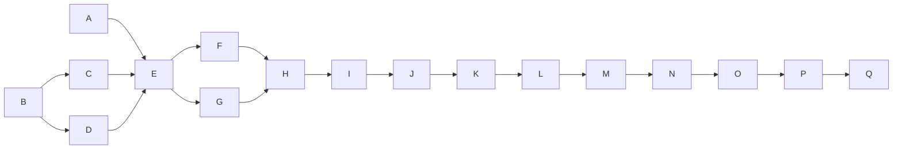

# Wave 9, HS2, HS3 and HS4 — delivery from the overlay, memory by layers, onboarding: Implementation Plan

> **For agentic workers:** REQUIRED SUB-SKILL: Use superpowers:subagent-driven-development
> (recommended) or superpowers:executing-plans to implement this plan task-by-task. Steps use
> checkbox (`- [ ]`) syntax for tracking.
>
> **The wave is the dispatch unit, not the task.** Waves are lettered (`A`, `B`, …) and own a
> run of the continuously numbered tasks. One implementer per **dispatched** wave, with no review
> of its own; inside a wave every task keeps its own failing test, verification and commit. Do not
> dispatch one subagent per task.
>
> **Waves A, I, N and Q are not dispatched.** A records the measurements this plan is cut from; I,
> N and Q run each pull request's final review and open it. The controller runs all four, I with
> the owner at the desktop app.
>
> **Three pull requests, one plan, in order.** HS2 is `wp/hs2-delivery` into `dev` (Waves A–I);
> HS3 is `wp/hs3-memory` into `dev` (Waves J–N), cut from `dev` once HS2 has merged; HS4 is
> `wp/hs4-onboarding` into `dev` (Waves O–Q), cut once HS3 has merged. Each merges when its own
> checks are green (umbrella plan, `docs/plans/2026-10-15-wave-9-umbrella.md`, amended 2026-10-18).
> `0.5.0` is cut after HS4, by the umbrella's Task 2.
>
> **Revised 2026-10-24** after a three-lens review (premise, oracle, boundary) of the first text;
> "Review of 2026-10-24" below says where each finding went.

**Goal:** a checkout attached to the owner's overlay gets the overlay's hooks, skills, agents, rules
and allow-rules through a plugin stayfixed renders on the machine and a merged, excluded
`<checkout>/.claude/settings.local.json`, with nothing tracked changed and nothing to place per
worktree; its memory is one composed store the harness reaches through an absolute
`autoMemoryDirectory`, with repository notes delivered as data and every note counted as the
owner's only once promoted; and a person reaches all of it through one `setup --overlay` and a
guided `init`.

**Architecture:** HS2 adds a core module `stayfixed.binding`: a random id in the git common
directory and, on the machine, a record of what that id is bound to. The project an overlay layer
or a delivery is read for comes from that record, never from a name the repository supplies. A
renderer turns the overlay's hooks, skills and agents into a directory marketplace under the
machine's data directory, named by the id and installed `--scope local` in the main checkout;
every hook entry leaves `settings.local.json`, which keeps only the ledgered allow-rules. The core
plugin's `SessionStart` delivers the overlay's standing rules, and the rendered plugin carries a
`PostToolUse` entry only when a path-scoped rule exists. Preferences are built from one `resolve`
over the preset, the repository, `<overlay>/common/stayfixed.toml`,
`<overlay>/projects/<name>/stayfixed.toml` and the machine file. HS3 points the harness at a
composed store with one settings key, then deletes the link tree, the harness link, the worktree
handler and the store digest approval, and adds the reviewed record with `memory promote`. HS4
folds `overlay create` and `overlay init` into `setup --overlay`, gives the overlay an identity
record in place of plugin manifests, and makes `init` a guided walk whose texts the CLI owns.

**Tech Stack:** Python ≥ 3.11 standard library at runtime; `uv`, pytest (`-n auto`), ruff, mypy,
the mutation oracle (`scripts/mutation_oracle.py`), towncrier fragments in `changelog.d/`. Test-only,
never in CI: the Claude Code binary and the probe in `docs/plans/2026-10-24-delivery-probe/`.

**Spec:** the agent-harness extraction design, in a private repository this one cannot link to —
§15.8 decisions 7 (scopes; `machines/` cut), 8 (the binding id; no `checkout` approval), 11 (the
approval primitive, amended), 13 (layers), 14 (`harness` by default; its sniff cut), 17 (the
rendered delivery; layers 1–2), 18 (these measurements), 19 (allow-rules through
`settings.local.json`, amended by L-6), 20 (Codex and worktrees), 21 (the scaffold rename;
`doctor --footprint` folded into `attached`), 22 (`attach` and `detach`), 23–27 and 29 (memory; 28
cut), 30 (`setup --overlay`), 31 (the overlay's identity, without its migration), 33 (the guided
`init`), and the umbrella plan's Design rule and Lane-plan items for HS2, HS3 and HS4, cited by their
ids. Where this plan departs from a decision, "What they change" or a task says so. Every value a
task needs from the spec is written into the task.

**Scope:** pull requests HS2, HS3 and HS4 of package harness-sources. A change belongs here iff it
(a) binds a checkout to its overlay project, renders or installs the delivery, merges or withdraws
what `settings.local.json` holds, delivers the overlay's rules, or builds a session's preferences
from the overlay's layers (HS2); (b) chooses, composes, points at, delivers, indexes or reviews a
memory store (HS3); (c) creates an overlay, records its identity, or asks `init`'s questions (HS4);
(d) deletes a control the Design rule or a measurement below made a convenience; or (e) restates the
documents those changes falsify. Out: pins, an `overlay` or `checkout` approval kind and the node-id
allowlist (d9, d10, d19; cut by the owner on 2026-10-19); `machines/<name>/` (d7, cut); each rendered
hook checking the binding, the MCP pin launcher (d17's layers 3–4, cut by the Design rule); the
durable-note guard (d28, cut); every migration (d14's sniff, d31's retirement, d32; cut); Codex
parity (wave 10, d20); regressions, the `adopt` skill and profile context (CP2, CP3, PF1, PF2).

**Premise:** measured on 2026-10-24 at `dev` = `3476773` (PR 116 merged), and re-measured by the
review of 2026-10-24. A task that finds one no longer holds stops and reports the mismatch.

- 36 commands are registered under 20 top-level names (`cli.build_parser(discover_registrars())`);
  `hooks/hooks.json` holds 10 entries — 7 `SessionStart` (`hook SessionStart`, and
  `memory session-context --bundle standing-rules|volatile-notes --part 1..3`), and one each on
  `PreToolUse`, `PostToolUse` and `PostToolUseFailure`, all matching `Bash`. `doctor` reports 18
  rows: 13 core (`src/stayfixed/doctor/checks.py` `CHECKS`) and `attached`, `bundles`, `store-debris`,
  `pre-commit`, `overlay-requires`; `.github/workflows/smoke.yml` asserts `len(rows) == 18` and
  `"10 entries, 11 row(s), 0 failure(s)"` from `scripts/smoke_hooks.py` (`EXPECTED_ENTRIES = 10`,
  `EXPECTED_ROWS = 11`). `worktree-link` is a step of `hook SessionStart` (`src/stayfixed/memory/
  hooks.py`), not an entry of `hooks/hooks.json`.
- `attach` (`src/stayfixed/attach/write.py`: `attach()`, `_plan`, `Gates`, `plan_writes`,
  `_carry_out`) refuses unless `memory.mode` is `overlay` (`Gates`, `NOT_OVERLAY` in
  `src/stayfixed/attach/binding.py`), and writes, in order: a `.gitignore` region `stayfixed:ignore`
  (shared with `init`'s managed region: `_footprint_owns_region`); the `.git/info/exclude` region
  `attach`, which lists every placed path but the ledger (`_placed`); `.codex/rules/` copies;
  `<checkout>/.claude/settings.local.json`, merged from `<overlay>/common/claude/{permissions,hooks}.json`
  and `<overlay>/projects/<name>/claude/{…}` (hook entries carry an in-band
  `# stayfixed:overlay-<event>-<n>` marker, allow-rules only the ledger); the ledger
  `<checkout>/.stayfixed/local/attach.json` (`AttachLedger`: `format`, `store`, `allow`, `entries`,
  `rules`, `settings_keys` — only `autoMemoryDirectory`, `directories`, `memory_parents`,
  `memory_created`); the overlay's `projects/<name>/project.toml` (`remote`, `first_attach`); the
  overlay's memory group directories; the link tree under `paths.memory` in every checkout and the
  harness link `~/.claude/projects/<slug>/memory`; `pre-commit install` in the overlay; and, where the
  link cannot be made, an `autoMemoryDirectory` fallback key. A widening (an added allow-rule or hook
  entry) needs `--yes` (`CONFIRMED`).
- No binding id exists: a checkout is bound by the repository's `project.name` and the recorded
  `origin` (`src/stayfixed/memory/store.py` `binding_state`: `unbound`, `bound`, `mismatch`,
  `no-origin`; `_bound` refuses through `_UNBOUND_CAUSES`); `NO_REMOTE`, `NO_ORIGIN_CAUSE` and
  `DIFFERENT_REMOTE` live in `src/stayfixed/memory/store.py`, and `--trust-remote` is `attach`'s flag,
  also named by `src/stayfixed/attach/check.py`, `src/stayfixed/attach/doctor.py` (`_REBIND`) and
  `skills/attach/SKILL.md`. `guards.git_path` resolves through `git rev-parse --git-path`, which maps
  only git's own common-directory names (`hooks`, `info`, `objects`, `refs`, …) to the common
  directory; any other name resolves per worktree (measured: `stayfixed/binding` from a linked
  worktree resolves under `.git/worktrees/<n>/`).
- A path listed in `.git/info/exclude` is re-included by a `!` line in a tracked `.gitignore`
  (measured: `git status` lists it again), since `.gitignore` files outrank `info/exclude`.
- No stayfixed code installs the overlay as a plugin: the overlay template ships
  `.claude-plugin/{plugin,marketplace}.json`, `.codex-plugin/plugin.json` and an empty
  `hooks/hooks.json`, and its README tells the owner to install it by hand at user scope. The only
  `claude plugin` subprocesses are `setup`'s installs of the preset's third-party plugins
  (`src/stayfixed/setup/run.py` `_install_plugins`; preset `[plugins] install = ["superpowers",
  "context7"]`). The owner's own overlay hooks run scripts from the overlay checkout in place.
- `classes.LayerName` has `OVERLAY_COMMON`, `OVERLAY_PROJECT`, `OVERLAY_MACHINE`, which nothing reads;
  `resolve` orders layers by `ORDER`'s rank, not by their place in the stack; `config/` is core and
  imports no area (`tests/boundaries/test_delivery.py`); `Config`'s values are built by
  `src/stayfixed/config/loader.py`; `"guards.*"` is `MACHINE_ONLY`, refused from the repository by
  the key's class (`loader.py`), with no constant of its own; the owner's layer reads only
  `[personal]`, `[guards]` and `[budgets]` from the machine file (`src/stayfixed/config/owner.py`);
  `overlay_root` raises `MachineConfigError` on a broken machine file, while `session_config` never
  raises. `doctor`'s `preferences` row already calls `resolve` over the preset and the repository.
- `stayfixed.trust` has one kind, `memory` (`src/stayfixed/memory/approvals.py`), and registering a
  kind gives it a `trust approve <kind>` command; `trust approve` refuses without a terminal
  (`src/stayfixed/trust/kinds.py` `interactive`, `src/stayfixed/trust/approving.py`
  `NOT_A_TERMINAL`); the record is `trust.json` beside the machine file. `harness_gate`,
  `snapshot` and `approval_recorded` are called from `src/stayfixed/memory/worktree.py`,
  `src/stayfixed/attach/doctor.py` and `src/stayfixed/attach/write.py`.
- Memory modes are `overlay`, `in-repo`, `local-only` (`src/stayfixed/config/schema.py`), with
  `[defaults.memory] mode = "local-only"` in the preset; no `harness` mode, no `memory promote`, no
  reviewed record. Every mode but `overlay` is gated by one digest over the whole store
  (`src/stayfixed/memory/trust.py` `may_inject`); `wrap` draws a fresh `secrets.token_hex(8)` nonce
  per call and refuses a note holding its delimiter (`UnsafeNote`); `memory index` writes
  provisional `index:` lines into notes (`index.reconcile(write=True)`); `refresh_if_trusted` is
  called from `src/stayfixed/memory/commands.py` and `src/stayfixed/memory/worktree.py`.
- `overlay create` (with `--template` or `--local`) and `overlay init` exist
  (`src/stayfixed/overlay/create.py`); `ci.yml`'s overlay-render step and `scripts/check_artifacts.py`
  run `overlay create --local`; `_populated` means "a `.claude-plugin` directory exists";
  `_check_home_usable` (`src/stayfixed/setup/run.py`) checks an existing destination only for `X_OK`
  (BR-018); `pre-commit install` runs from `_install_secret_scan` and from `attach`'s `_secret_scan`.
  `uninstall` refuses an attached checkout (`ATTACHED`). The preset's
  `commit_messages.attribution_check = true`; the project workflow template
  (`src/stayfixed/templates/project/stayfixed.yml`) only calls `check.yml`, where the commit gate reads
  that key; `setup` installs plugins unasked and rewrites `pluginConfigs`.
- The open ledger entries this plan closes by deleting their code: BR-004, BR-022, BR-027, BR-037,
  BR-038, BR-042 (the harness link and the link tree, HS3); BR-018 and BR-039's `--overlay` half
  (HS4).

## Measurements (d18), 2026-10-24, Claude Code 2.1.301, macOS

The four d18 asks and L-6's "what does Claude Code write" were measured before any task was fixed,
at $0 and with no model call, by the probe committed in `docs/plans/2026-10-24-delivery-probe/`:
`fixture.sh` builds the fixture under `$HOME/.cache/stayfixed-spikes/hs2/`, `stub.py` is a local
Messages API that records every request body and answers `OK` or one scripted `tool_use`, `cc.sh`
runs Claude Code with an isolated `CLAUDE_CONFIG_DIR` and `HOME` against it, and `dontask.exp`
drives the permission dialog. The fixture is one plugin `sf-deliv` in a directory marketplace
`sf-hs2` whose `SessionStart` hook logs `$CLAUDE_PLUGIN_ROOT`, the project and a revision file and
returns a canary as `additionalContext`; "reached the model" means the canary is in the recorded
request. Task 1 re-runs it on the version HS2 is reviewed on.

| # | Question | Observed |
|---|---|---|
| D1 | Copy or in place | `plugin install --scope local` writes a cache copy, but the session runs the plugin **in place**: `CLAUDE_PLUGIN_ROOT` is the marketplace's directory, and an edit to the source reached the next session with no reinstall while the cache copy kept the old bytes. With the marketplace directory gone the plugin does not load and nothing says so (exit 0, no hook; `Marketplace … failed to load: cache-miss` in the debug log only); there is no fallback to the cache copy. |
| D2 | A committed `enabledPlugins` with a directory marketplace | In a fresh configuration, a clone committing `extraKnownMarketplaces` (a directory source) and `enabledPlugins` loads nothing headless (`Skipped auto-recording … — enabled only by repo-authored settings`). Where the machine already knows a marketplace of that name, a clone committing `enabledPlugins` alone runs the plugin's hooks, with no install and no prompt, on every run. |
| D2b | Does a local-scope marketplace stay in its checkout | **No.** `plugin marketplace add <dir> --scope local` writes the checkout's `settings.local.json` and also the machine-wide `<CLAUDE_CONFIG_DIR>/plugins/known_marketplaces.json`; another clone committing `enabledPlugins` naming the plugin ran its hook. Only an unguessable name keeps a hostile clone out. |
| D3 | Delivery into a worktree (terminal) | A session in a linked worktree reads its own `settings.local.json` **and the main checkout's**, merged (the debug log's watched-files line lists both), whether or not the worktree has a file of its own. The plugin ran there, and Claude Code added an install record for the worktree's path itself. |
| D4 | Absolute `autoMemoryDirectory` | Set in the main checkout's excluded `settings.local.json`, an absolute `autoMemoryDirectory` is the store the session reads in the main checkout and in a linked worktree (the store's index canary reached the model from both). A clone's committed `settings.json` setting it was honoured too, headless. |
| D5 | What "don't ask again" writes | The answer that allows a `Bash` prefix wrote `"permissions": {"allow": ["Bash(git tag *)"]}` into `settings.local.json` and rewrote the whole file, its keys in another order. From a linked worktree with no file of its own, it went into the **main checkout's** file. |
| D6 | The desktop app's worktree session | Measured in Task 12, with the owner at the desktop app. |

**What they change, against the spec as written:**

1. **The random-id name is the whole defence, so the id is a secret (D2, D2b).** Registering the
   marketplace only in the checkout's excluded settings (d17's layer 2) hides nothing: Claude Code
   records it machine-wide. The names stay as d17 says, `stayfixed-delivery-<id>` and `overlay-<id>`,
   because a hostile clone cannot commit an `enabledPlugins` naming an id it never saw. So the id
   never leaves the machine: it is not written into the overlay (which is pushed and shared), it is
   printed only as its first eight characters, and a placed path that git would not ignore is refused
   (Task 5), since `settings.local.json` holds the `enabledPlugins` entry that names it.
2. **One place per repository, not per worktree (D3, D5).** The main checkout's
   `settings.local.json` reaches every worktree, and Claude Code itself writes the worktree's answers
   there. So `attach` writes the main checkout only; d20's "`attach` places delivery in every
   worktree" and its `SessionStart` notice for a later worktree are cut, and `worktree-link` goes in
   HS3 with the link tree. Where git cannot name the main checkout, `attach` refuses with "cannot
   tell" (d23).
3. **A re-render needs no reinstall, and a missing render is silent (D1).** What runs is the render
   directory's bytes, so `attach` re-renders in place and never reinstalls; `doctor`'s `attached` row
   is red when the render directory or its marketplace file is gone, since nothing else says so.
4. **The pointer is `autoMemoryDirectory` (D4).** d23's condition holds: the harness link, its two
   writers, the link tree and its fallback retire in HS3, closing BR-004, BR-022, BR-027, BR-037,
   BR-038 and BR-042 by deletion.
5. **Claude Code rewrites `settings.local.json` whole and adds its own allow-rules (D5).** No in-band
   marker or key order survives in that file, so stayfixed owns nothing there but the allow-rules its
   ledger names and the one `autoMemoryDirectory` key; every hook entry moves into the rendered
   plugin, and the in-band marking of `settings.local.json` entries is deleted. A foreign allow-rule
   is Claude Code's or the person's and is left alone (L-6).
6. **A committed `autoMemoryDirectory` is the harness's behaviour, not stayfixed's (D4).** A
   repository can point the harness's memory elsewhere; stayfixed cannot stop that and does not try.
   `doctor`'s memory row names the effective `autoMemoryDirectory` and the file that set it, as
   information (Task 20).
7. **The executable diff is a convenience, not a gate.** The overlay is written by the owner and the
   owner's agents, neither of them this delivery's adversary, and its hooks run scripts from the
   overlay checkout in place, so a digest of rendered text would not even cover what runs. `attach`
   prints the binding and the diff on one screen and refuses nothing for it: the `--yes` widening
   gate (`CONFIRMED`) is deleted (Task 7), and `doctor`'s drift line is a warning.
8. **Rules reach the session through the core plugin, path-scoped rules through the render.**
   d17 sends instructions and standing rules through the core plugin's `SessionStart`, and the
   umbrella's HS2 lane item registers the path-rule handler only in the rendered plugin and only
   when the overlay holds a `paths:` rule; both hold (Task 9). The umbrella's File-ownership row that
   gives HS2 an entry in `hooks/hooks.json` is read as the `SessionStart` step, which needs none.

## Open questions for the owner

Defaults the plan is written on; an answer that differs changes only the task named.

1. **The machine's data directory (Tasks 2, 6, 14).** No data directory exists today. **Default:**
   `$HOME/.local/share/stayfixed/` on every platform, following `HOME` as the configuration does
   since PR 115 (CL3's ruling), with no `XDG_*` read from the environment: `bindings/<id>.toml`,
   `delivery/<id>/`, `stores/<id>/`.
2. **Where the overlay's rules live (Task 9).** The template has no rules directory. **Default:**
   `<overlay>/common/claude/rules/*.md` and `<overlay>/projects/<name>/claude/rules/*.md`, beside the
   existing `<overlay>/common/claude/permissions.json` and `<overlay>/common/claude/hooks.json`; a rule with `paths:` frontmatter is
   path-scoped, any other a standing rule.
3. **Where the link tree retires (Task 15).** d17 lists the link tree's retirement under HS2.
   **Default:** HS3, after the pointer that replaces it, so memory works on `dev` between the two
   pull requests.
4. **What is left of `trust` once memory needs no approval (Tasks 11, 16, 18).** After L-7 no store
   is approved by digest, so the `memory` kind has no subject. **Default:** HS3 deletes the kind and
   the `memory trust` alias; the reviewed record is written by `memory promote` into `trust.json`
   under the record kind `reviewed` without registering an `ApprovalKind` (so no
   `trust approve reviewed` appears); `trust list` and `trust revoke` read it; `trust approve` is
   removed once no kind is registered.
5. **`memory promote` with neither a terminal check nor `--digest` (Task 18).** L-7 put `--digest`
   in place of the terminal check; the umbrella's later Design rule dropped both. **Default:** the
   umbrella's text: `promote` records and prints. Against repository bytes the record holds, since
   `trust.json` is outside every tree; against the agent it is a label, as the Design rule accepts.

## Global Constraints

- Runtime imports the standard library only; every write goes through `stayfixed.fsops`; a value a
  repository, an overlay or a run wrote (a path, a name, a rule) is printed through
  `stayfixed.printed`, never raw.
- **No tracked file is written by `attach`, `detach` or a session, and every placed path is
  ignored.** Everything `attach` places is listed in the `.git/info/exclude` region `attach`,
  written before the first `claude plugin` call, and `attach` asks git (`check-ignore`) whether each
  is ignored before it writes the file that names the id.
- **The binding id is the anchor and a secret.** It is 32 lowercase hex characters from
  `secrets.token_hex(16)`, stored in `<git common dir>/stayfixed/binding`, where the common directory
  is `git rev-parse --path-format=absolute --git-common-dir` (never `--git-path`, never an
  environment variable). The id comes from the git common directory, which repository bytes cannot
  write because `.git/` is in no tree, and a hostile clone never reads it because it never leaves the
  machine: not into the overlay, not into a tracked file, and printed only as its first eight
  characters. The agent in a session is not its adversary.
- **The project comes from the machine's binding record, never from the repository.** What an id is
  bound to (the project name, the normalised `origin` at attach time, the checkout's path) is in
  `<data>/bindings/<id>.toml`; every reader of an overlay project layer, a render or a composed store
  finds the project there.
- **Paths a command deletes are derived, never read.** `detach` and `uninstall` remove
  `<data>/delivery/<id>/` and `<data>/stores/<id>/` computed from the id, never a path from the
  checkout's ledger, which a clone can commit.
- The rendered plugin's names are `stayfixed-delivery-<id>` (marketplace) and `overlay-<id>`
  (plugin); no other name of a delivered part is predictable.
- Claude Code subprocesses run through `stayfixed.runner` with argv tables beside
  `src/stayfixed/setup/run.py`'s; every one is a row of the README's network table, held by
  `tests/test_outbound.py` and `tests/outbound/policy.py`.
- A deleted control deletes its constants, its tests, its documentation rows and its mutation entries
  in the same commit; each pull request prints `git diff --shortstat <base> HEAD -- src tests
  mutations docs` in its review package, and HS3's `src` net is negative.
- New mutation entries only for a branch that decides a verdict, a containment or a data-loss path
  (item 10 of the contract), in the group file `scripts/mutation_oracle.py` `GROUP_OF` routes the
  source to (`src/stayfixed/attach/` → `attach`; `src/stayfixed/memory/` → `records`;
  `src/stayfixed/trust/`, `src/stayfixed/config/`, `src/stayfixed/binding.py` → `core`;
  `src/stayfixed/doctor/` → `doctor`; the rest as `GROUP_OF` says). A test asserting a refusal
  asserts its exact constant. A failing test's first red names the behaviour, never an
  `ImportError`: a task that creates a module adds it as a stub first.
- Each lane that adds or renames a `doctor` row or a hook entry updates `smoke.yml`'s row count and
  `scripts/smoke_hooks.py`'s entry and row counts, and quotes the previous lane's numbers (umbrella,
  File ownership); the README's machine-files table is edited the same way.
- No design id (a `§`, a decision number, a lane-plan id in brackets, a `D1`–`D6` above) in any file
  outside `docs/plans/`. Each task restates the documents its change falsifies and writes its
  changelog fragment in `changelog.d/` in the same commit.

## Execution contract

Copied verbatim from the umbrella plan; the controller copies the relevant part into every brief,
post-pull-request dispatches included.

1. **The wave is the dispatch unit.** Waves are lettered and own a run of continuously numbered
   tasks; one implementer per dispatched wave, with no review of its own (the pull request's final
   review is the review), every task keeping its own failing test, verification and commit. A
   fix round goes to the same implementer while its context allows, else to a fresh agent with the
   review package. Every subagent runs on Opus (`model: opus`).
2. **Every implementer brief says:** report a mismatch with the tree instead of guessing; run a
   command and paste what it printed before writing any claim about it; focused runs while
   iterating and per commit; before each push, once, a full run of `uv run pytest -n auto --cov
   --cov-fail-under=92` with `uv run python scripts/release.py check`, and the suite again on
   Python 3.13 (`uv run --python 3.13 pytest -n auto`), the oracle's interpreter in CI, since a
   local uv Python is often newer than any CI leg (CI holds 3.11.4 and the rest); a plan's predicted
   mutation outcome is a hypothesis — design your own if it does not redden, and paste the raw
   output either way; no line numbers from the plan; this brief is a message, not a file, so cite
   only the plan; write nothing under the repository but the task's files, use
   `<scratchpad>/<wave>-<role>/`, never run a script you did not write, and read `git diff --stat`
   before committing; the static checks at CI's scope (`uv run ruff check .`,
   `uv run ruff format --check .`, `uv run mypy`); do not use the Agent tool; do not run
   `git checkout`, `restore`, `stash` or `clean`; start a long run in the background and wait on
   its own output, never with `pgrep`.
3. **Every reviewer brief adds:** run every command yourself and never use the Agent tool; do not
   run `git checkout`, `restore`, `stash` or `clean`; what already passed, by sha and suite, and run
   only the test that decides a finding you suspect; no citation may point at a brief, a dispatch
   or a report; what later tasks own.
4. **One final review per pull request**, with two read-only seats: correctness, and "who does
   this refuse, and what can be deleted". A security seat joins only when the diff touches an
   anchor repository bytes cannot move (CI's base read, the binding id in the git common
   directory, repository-path containment, the exclude ordering). Reviewers give findings only, with no replacement text, and a
   separate triage sends on only correctness and requirement gaps. Then one scoped re-review of
   the fixes, and stop: no per-wave reviews, and no minor finding rides a round.
5. **The lifecycle matrix**, walked at pre-flight like a task and again by the correctness seat:
   every configuration key the pull request adds × every change of configuration — set a value,
   change it, unset it, move a path, a step that fails part-way, `uninstall` — × only the layers
   the key's class admits (the class-table test holds where a key may be set); a command that
   reads no configuration walks no layer.
6. **The parallelism map.** Read-only seats run beside each other and beside the implementer;
   writers of one worktree serialise; one heavy local run (the full suite, the mutation oracle) at
   a time per host; no local full run while the same branch's CI runs.
7. **Templates.** A fix brief enumerates the sibling instances of the defect's class only to
   delete them or fold them into one rule, never to extend a refusal list. After a simplification
   ruling it carries a net budget: `src` below zero, tests and mutation entries at zero or less. A
   new defect found during a cut is filed in the ledger, not fixed, unless the fix deletes code. A
   security ruling names its minimal preconditions, its anchor's provenance (who can write the
   bytes it trusts), and one legitimate user it must not refuse.
8. **Verification.** The controller re-verifies only heads it pushes or merges, re-derives the pull
   request's body from the diff before every push, takes the run id from `gh pr checks` and waits
   with `gh run watch <run-id> --exit-status` until every job has ended (never a `head_sha` query,
   which finds no run for a pull request's merge ref) before reporting a pull request done.
9. **Second finding at one seam.** At the second review finding that points at the same function,
   reader or boundary, the next step is a redesign of that seam put to the owner, not a third patch.
   A second bypass of the same refusal list counts as the same seam.
10. **Mutation entries.** A new entry only for a branch that decides a verdict, a containment or a
    data-loss path; other assertions need neither an entry nor a "why none" sentence; deleting a
    control deletes its entries (owner, 2026-10-19).

## Review Focus

Inputs no task would exercise unless told to; each line's test is in the task named.

1. **A hostile clone on an attached machine**, committing `<checkout>/.claude/settings.json` with
   `enabledPlugins` naming some `overlay-<id>@stayfixed-delivery-<id>`, a `<checkout>/.stayfixed/local/attach.json`
   naming paths outside the checkout, and a `[project] name` equal to one of the owner's projects.
   Expected: no binding record matches it, so no overlay layer, render or store is read for it, and
   `detach` or `uninstall` there deletes nothing outside it. Tasks 2, 3 and 8. That no delivered hook
   runs is Claude Code's behaviour for an unknown id (D2), re-measured in Task 1.
2. **A pull request adding `!.claude/settings.local.json` to the tracked `.gitignore`.** Expected:
   `attach` refuses before writing that file, naming the path git would not ignore; on a checkout
   attached earlier, `doctor`'s `attached` row is red. Tasks 5 and 10.
3. **A worktree created after `attach`, one deleted, and the desktop app's own worktree.** Expected:
   each gets the delivery with no stayfixed step; `doctor` in each reports the binding of the common
   directory. Tasks 2, 6 and 12.
4. **The render directory deleted, or the overlay moved, after `attach`.** Expected: `attached` is red
   naming the missing directory and the remedy; a session still starts. Task 10.
5. **Claude Code rewrites `settings.local.json`** (reordered keys, a "don't ask again" allow-rule
   added) between `attach` and `detach`. Expected: `detach` removes exactly the ledgered allow-rules
   and leaves Claude Code's. Task 8.
6. **Two machines attach the same overlay project.** Expected: each machine keeps its own id and
   binding record; neither turns the other's checkout unbound. Task 2.
7. **An agent writes a note while it works, the owner edits a promoted note, and a pull request adds
   an in-repo note with `startup: 1`.** Expected: the agent's and the pull request's notes arrive
   marked unreviewed and never in `standing-rules`; the edited note is unreviewed again; no other
   note's status moves. Tasks 16 and 18.
8. **`setup --overlay create:<owner>/<name>` with the destination absent, a file, and a directory that
   is not an overlay.** Expected: the last two refuse before any call to GitHub. Task 24.

---

## Waves

| Wave | Tasks | Pull request | Dispatched | Plan lines (approx.) | Code read on the first pass |
|---|---|---|---|---|---|
| A | 1 | HS2 | no — controller | 15 | — |
| B | 2 | HS2 | yes | 70 | `src/stayfixed/attach/binding.py`, `src/stayfixed/memory/store.py`, `src/stayfixed/attach/write.py` (`Gates`) |
| C | 3–4 | HS2 | yes | 80 | `src/stayfixed/config/` |
| D | 5 | HS2 | yes | 50 | `src/stayfixed/attach/write.py`, `src/stayfixed/attach/exclude.py` |
| E | 6 | HS2 | yes | 70 | `src/stayfixed/attach/write.py`, `src/stayfixed/attach/permissions.py`, `src/stayfixed/scaffold/` |
| F | 7–8 | HS2 | yes | 60 | `src/stayfixed/attach/write.py` (`Gates`, `detach`) |
| G | 9 | HS2 | yes | 50 | `hooks/`, `src/stayfixed/attach/render.py` |
| H | 10–11 | HS2 | yes | 70 | `src/stayfixed/attach/doctor.py`, `src/stayfixed/doctor/`, `src/stayfixed/trust/` |
| I | 12 | HS2 | no — controller and owner | 25 | — |
| J | 13–14 | HS3 | yes | 80 | `src/stayfixed/memory/store.py`, `src/stayfixed/attach/write.py` |
| K | 15 | HS3 | yes | 50 | `src/stayfixed/memory/worktree.py`, `src/stayfixed/attach/write.py`, `src/stayfixed/attach/doctor.py` (deletion) |
| L | 16–17 | HS3 | yes | 80 | `src/stayfixed/memory/trust.py`, `src/stayfixed/memory/bundles.py` |
| M | 18–20 | HS3 | yes | 100 | `src/stayfixed/memory/` |
| N | 21 | HS3 | no — controller | 15 | — |
| O | 22–24 | HS4 | yes | 100 | `src/stayfixed/overlay/`, `src/stayfixed/setup/run.py` |
| P | 25–27 | HS4 | yes | 100 | `src/stayfixed/project/`, `src/stayfixed/setup/run.py`, `src/stayfixed/guards/commit.py` |
| Q | 28 | HS4 | no — controller and owner | 20 | — |

Every dispatched wave's brief also carries the header above (about 400 lines). The first text cut
two waves (rendering with the one-screen diff; the pointer with the link tree's retirement) that the
review measured at 250–350k tokens of code to read on the first pass, over the ~200k ceiling; each
is now a wave of its own, and `src/stayfixed/attach/write.py` (2,072 lines) is read by six waves, so each brief
names the functions its tasks touch. Twelve dispatched waves, three final reviews of two seats (HS2's
with a security seat) and one re-review each: about 12 implementer dispatches and 10 review
dispatches, plus fix rounds.

**Launch graph** (drawn over the Interfaces blocks):

- **B → C, D.** Task 3 reads the project name from Task 2's `binding.bound_project`; Task 5 lists the
  binding id's path among what `attach` places.
- **A, C, D → E.** Task 6 names the render by Task 2's id, installs through the measured argv
  (Task 1), reads the overlay's project through Task 3's layers, and writes `settings.local.json` only
  after Task 5's ignore check.
- **E → F, G.** Task 7's screen and Task 8's withdrawal read Task 6's `RenderRecord`; Task 9 adds the
  rules to Task 6's renderer.
- **F, G → H.** Task 10's `attached` reads the render, the rules and the ledger as F and G leave them.
- **I → J.** HS3 is cut from `dev` once HS2 has merged: Task 14's pointer is written into the
  `settings.local.json` Task 5 merges, under the id Task 2 writes.
- **J → K → L.** Task 15 deletes the link code only once Task 14's pointer replaces it, and Task 16
  deletes the digest machinery only once nothing in the link code calls it.
- **N → O.** Task 25's guided walk runs `attach` (HS2) and offers `memory promote` (HS3).

---

### Wave A — Task 1 (controller, not dispatched; pull request HS2)

#### Task 1: Re-run the measurements on the version HS2 is reviewed on

- [ ] **Step 1:** with `claude --version` recorded, run `docs/plans/2026-10-24-delivery-probe/fixture.sh`
  and repeat D1–D5 by the table above, plus one D2 run against a fixture marketplace whose name
  carries an id the clone does not know. Compare each observation with the table. Any difference
  stops the plan before Wave E and goes to the owner with the cell it changes.
- [ ] **Step 2:** write the version and the results into Findings; commit —
  `docs(plans): record the delivery measurements`.

### Wave B — Task 2 (dispatched; pull request HS2)

#### Task 2: The binding id and the machine's binding record

**Files:**
- Create: `src/stayfixed/binding.py` (core), `src/stayfixed/config/paths.py`'s `data_directory`
- Modify: `src/stayfixed/memory/store.py` (`binding_state`, `_bound`, `_UNBOUND_CAUSES`,
  `NO_REMOTE`, `NO_ORIGIN_CAUSE`, `DIFFERENT_REMOTE`, `read_binding_record`),
  `src/stayfixed/attach/binding.py`, `src/stayfixed/attach/write.py` (`Gates`: the remote stops go;
  `ORIGIN_NOT_TEXT` goes), `src/stayfixed/attach/commands.py` (`--trust-remote` goes),
  `src/stayfixed/attach/check.py`, `src/stayfixed/attach/doctor.py` (`_REBIND`),
  `src/stayfixed/attach/hooks.py` (one `SessionStart` hint line), `src/stayfixed/memory/api.py`,
  `skills/attach/SKILL.md`
- Test: `tests/test_binding.py` (create), `tests/attach/test_write.py`, `tests/attach/test_commands.py`,
  `tests/attach/test_hooks.py`, `tests/memory/test_remote_binding.py`
- Modify: `mutations/attach.toml`, `mutations/doctor.toml`, `mutations/records.toml` (the deleted
  constants' entries), `docs/cli.md` (`attach`), `README.md` (machine-files table:
  `.git/stayfixed/binding`, `<data>/bindings/`), `changelog.d/+binding-id.feature.md`,
  `changelog.d/+trust-remote.upgrading.md` (create)

**Interfaces:**
- Produces (all in core, importable from `config/`):
  - `binding.common_directory(root: Path) -> Path` — `git rev-parse --path-format=absolute
    --git-common-dir` through `gitenv`; raises `Failure("cannot tell …")` when git cannot answer.
  - `binding.read_id(root: Path) -> str | None` — the id, or `None` when absent or not exactly 32
    lowercase hex characters.
  - `binding.ensure_id(root: Path) -> str` — reads, or writes a fresh `secrets.token_hex(16)`
    through `fsops`.
  - `binding.Bound(project: str, origin: str | None, checkout: Path)` and
    `binding.bound_project(root: Path) -> Bound | None` — reads `<data>/bindings/<id>.toml`; `None`
    when the checkout has no id or the machine no record for it. Never reads `stayfixed.toml`.
  - `binding.record(root: Path, project: str, origin: str | None) -> Bound` — writes the record
    (`attach` calls it); `binding.short(id: str) -> str` — the first eight characters, the only form
    ever printed.
  - `paths.data_directory() -> Path` — `$HOME/.local/share/stayfixed`.
  - The overlay's `projects/<name>/project.toml` keeps `remote` and `first_attach` and never holds an
    id. `binding_state` answers `bound` when `bound_project` names this project, else `unbound`; a
    differing or missing `origin` is an `origin_note: str | None`, never a refusing state.

- [ ] **Step 1: failing tests:** two worktrees of one repository read the same id from
  `common_directory` (Review Focus 3); a fresh clone at the same path has none; `bound_project` in a
  checkout with no id is `None` even when its `stayfixed.toml` names a bound project (Review Focus
  1); a record written on one machine directory leaves another machine directory's record for the
  same project untouched (Review Focus 6); `attach` with no `origin`, and with an `origin` differing
  from the record, succeeds and prints the note; `SessionStart` in a bound checkout whose `origin`
  differs prints one line naming both URLs through `printed`; `read_id` returns `None` for a
  31-character file; no output of `attach` contains the full id.
- [ ] **Step 2:** run; expect each to fail on its assertion (add `binding.py` as a stub first).
- [ ] **Step 3:** implement; delete `NO_REMOTE`, `NO_ORIGIN_CAUSE`, `DIFFERENT_REMOTE`,
  `ORIGIN_NOT_TEXT`, `_UNBOUND_CAUSES`' remote arms, `--trust-remote`, `_REBIND`, and every test and
  mutation entry that held them.
- [ ] **Step 4:** focused run green.
- [ ] **Step 5:** mutations, in `mutations/core.toml`: `bound_project` falling back to the
  repository's `[project] name` must redden the no-id test; `read_id` accepting a 31-character id must
  redden its test.
- [ ] **Step 6:** commit — `feat(binding): bind a checkout by an id in its git common directory`.

### Wave C — Tasks 3–4 (dispatched; pull request HS2)

#### Task 3: Build a session's preferences from one resolution over the overlay's layers

**Files:**
- Modify: `src/stayfixed/config/classes.py` (`LayerName.OVERLAY_MACHINE` and its `ORDER` entry go),
  `src/stayfixed/config/session.py`, `src/stayfixed/config/loader.py`, `src/stayfixed/doctor/checks.py`
  (`_preferences`)
- Create: `src/stayfixed/config/overlay_layers.py`
- Test: `tests/config/test_overlay_layers.py` (create), `tests/config/test_classes.py`,
  `tests/doctor/test_checks.py`
- Modify: `README.md` (machine-files table: the overlay's two `stayfixed.toml` rows), `docs/cli.md`
  (`doctor`'s `preferences` row), `changelog.d/+overlay-layers.feature.md` (create)

**Interfaces:**
- Consumes: `classes.resolve`, `classes.Layer`, `classes.Resolution` (HS1); `config.overlay.overlay_root`;
  `binding.bound_project` (Task 2).
- Produces:
  - `overlay_layers.read(root: Path) -> tuple[tuple[Layer, ...], tuple[str, ...]]` — for a bound
    checkout, `<overlay>/common/stayfixed.toml` as `OVERLAY_COMMON` and
    `<overlay>/projects/<bound project>/stayfixed.toml` as `OVERLAY_PROJECT`, each read with the
    loader's NOTE semantics, and the notes; an unbound checkout gets the common layer only. A missing
    file, an unrecorded overlay or a machine file `overlay_root` cannot read is no layer and one note,
    never an exception.
  - `SessionConfig.resolution: Resolution` — built once by `session_config` from the preset, the
    repository, the overlay layers and the machine file, in `ORDER`; `Config`'s preference and session
    values come from it. `doctor`'s `preferences` row reads its provenance and derives nothing.

- [ ] **Step 1: failing tests:** `<overlay>/common/stayfixed.toml` and
  `<overlay>/projects/<name>/stayfixed.toml` both set `[budgets] startup_rules_words`, to 700 and 900:
  a bound checkout resolves 900 with provenance `overlay project`, and the machine file's 1100 beats
  both; `[memory] mode = "overlay"` in the common file reaches the session with provenance
  `overlay common`; an unbound checkout whose `stayfixed.toml` names that project gets no project
  layer (Review Focus 1); a `[gates] builtin` in either overlay file never reaches `Config` and is
  reported by the note `resolve` or the NOTE load gives (assert whichever the tree produces, by its
  constant); a broken machine file yields a note and a session, never an exception; the `preferences`
  row prints `overlay project` for the budget set there.
- [ ] **Step 2:** run; expect each to fail on its assertion (add `overlay_layers.py` as a stub first).
- [ ] **Step 3:** implement. `OVERLAY_MACHINE` leaves `LayerName` and `ORDER`; nothing reads it today.
- [ ] **Step 4:** focused run green; the class-table test still holds every field to a row.
- [ ] **Step 5:** mutation: `read` labelling the project file `OVERLAY_COMMON` must redden the
  provenance test (the two layers' values then tie on rank and the common value's label wins); one
  entry in `mutations/core.toml`.
- [ ] **Step 6:** commit — `feat(config): resolve preferences over the overlay's common and project
  files`.

#### Task 4: Let a repository set the guards' default, with the owner's layers last

**Files:**
- Modify: `src/stayfixed/config/classes.py` (`"guards.*"` → `PREFERENCE`), `src/stayfixed/config/owner.py`
- Test: `tests/config/test_loader_note.py`, `tests/config/test_session.py`, `tests/config/test_owner.py`
  (the tests that a repository's `[guards]` is dropped become tests that it is a default the owner's
  layers override)
- Modify: `docs/cli.md`, `README.md` (the `[guards]` row), `changelog.d/+guards-preference.change.md`
  (create)

- [ ] **Step 1: failing test:** a repository's `[guards] bg_cleanup = false` switches the hint off in a
  session with no machine-file `[guards]`; the machine file's `bg_cleanup = true` switches it back on.
- [ ] **Step 2:** run; expect the first to fail (today the repository's key is dropped by its class).
- [ ] **Step 3:** implement.
- [ ] **Step 4:** focused run green.
- [ ] **Step 5:** commit — `refactor(config): make the guards a preference the owner's layers override`.

### Wave D — Task 5 (dispatched; pull request HS2)

#### Task 5: Place nothing in `.gitignore`, and refuse a placed path git would not ignore

**Files:**
- Modify: `src/stayfixed/attach/write.py` (`_write_ignore_region`, its three `.gitignore` refusals
  and `detach`'s region removal go; `_placed` lists the ledger and `.git`-relative paths too; the
  ignore check runs after the exclude block is written and before any later write),
  `src/stayfixed/attach/exclude.py`, `src/stayfixed/attach/permissions.py` (refuse a tracked
  `settings.local.json`; foreign entries are counted, never refused)
- Test: `tests/attach/test_write.py`, `tests/attach/test_detach.py`, `tests/attach/test_commands.py`
- Modify: `docs/cli.md`, `changelog.d/+attach-exclude-only.change.md` (create)

**Interfaces:**
- Produces: `exclude.NOT_IGNORED` — `attach` refuses, naming each placed path for which
  `git check-ignore --no-index` answers "not ignored" (a tracked `.gitignore`'s `!` line, an upstream
  negation); `permissions.TRACKED_LOCAL_SETTINGS` — a tracked `settings.local.json`. `init`'s own
  `stayfixed:ignore` region is `init`'s and is left alone.

- [ ] **Step 1: failing tests:** after `attach` on a repository whose tracked `.gitignore` has no
  `.stayfixed/` line, `git status --porcelain=v1 -z -uall` is empty and `.gitignore` is byte-equal; with
  `!.claude/settings.local.json` in the tracked `.gitignore`, `attach` refuses with `NOT_IGNORED` naming
  that path and writes no `settings.local.json` (Review Focus 2); a tracked `settings.local.json` is
  refused with `TRACKED_LOCAL_SETTINGS` before any write.
- [ ] **Step 2:** run; expect failure on the `.gitignore` bytes and on the two refusals.
- [ ] **Step 3:** implement; delete the region writer, its refusals, `_footprint_owns_region`'s use in
  `detach`, their tests and mutation entries.
- [ ] **Step 4:** focused run green.
- [ ] **Step 5:** mutation: the ignore check skipping `settings.local.json` must redden the negation
  test; one entry in `mutations/attach.toml`.
- [ ] **Step 6:** commit — `refactor(attach): keep placed paths out of git through the exclude block,
  and refuse one git would not ignore`.

### Wave E — Task 6 (dispatched; pull request HS2)

#### Task 6: Render the overlay's executable parts into a local plugin and install it

**Files:**
- Create: `src/stayfixed/attach/render.py`
- Modify: `src/stayfixed/attach/write.py` (`Gates`: `NOT_OVERLAY` goes, since delivery does not
  depend on the memory mode; `_carry_out`: `binding.record`, render, then `marketplace add` and
  `install`; hook entries no longer merged into `settings.local.json`; `AttachLedger` gains `render`),
  `src/stayfixed/attach/binding.py` (`NOT_OVERLAY` goes), `src/stayfixed/attach/permissions.py` (the
  hook half of the diff moves to `render`), `src/stayfixed/scaffold/` (the in-band marking of
  `settings.local.json` entries goes if nothing else uses it)
- Test: `tests/attach/test_render.py` (create), `tests/attach/test_write.py`, `tests/test_outbound.py`
- Modify: `tests/outbound/policy.py`, `README.md` (network table: the two `claude plugin` rows;
  machine-files table: `<data>/delivery/`), `docs/cli.md` (`attach`),
  `changelog.d/+rendered-delivery.feature.md` (create)

**Interfaces:**
- Consumes: `binding.ensure_id`, `binding.record`, `paths.data_directory` (Task 2), the bound project
  (Task 3), Task 1's measured argv.
- Produces:
  - `render.render(overlay: Path, project: str, id: str) -> RenderRecord` — writes, under
    `<data>/delivery/<id>/`, `.claude-plugin/marketplace.json` (name `stayfixed-delivery-<id>`, one
    plugin `overlay-<id>` with source `./plugin`), `<delivery>/plugin/.claude-plugin/plugin.json`,
    `<delivery>/plugin/hooks/hooks.json` (the union of `<overlay>/common/claude/hooks.json` and
    `<overlay>/projects/<project>/claude/hooks.json`, entries in that order), and `skills/` and
    `agents/` copied from `<overlay>/common/claude/` and `<overlay>/projects/<project>/claude/` when
    present; a second call replaces the files in place.
  - `RenderRecord(id: str, digest: str, parts: tuple[str, ...])` — `digest` is sha256 over every
    rendered file's relative path and bytes; the ledger's `render` holds `digest` and `parts`, never a
    path: the directory is always `<data>/delivery/<id>/`.
  - Argv tables `PLUGIN_MARKETPLACE_ADD_LOCAL = ("claude", "plugin", "marketplace", "add", <dir>,
    "--scope", "local")` and `PLUGIN_INSTALL_LOCAL = ("claude", "plugin", "install",
    "overlay-<id>@stayfixed-delivery-<id>", "--scope", "local")`, run with the main checkout as the
    working directory, only when the ledger holds no `render` yet; where git cannot name the main
    checkout, `attach` refuses with "cannot tell".

- [ ] **Step 1: failing tests:** `render` over a fixture overlay writes the four files with the exact
  names `stayfixed-delivery-<id>` and `overlay-<id>`, and the digest; a second `render` after editing
  `<overlay>/common/claude/hooks.json` rewrites the hook file and the digest in the same directory;
  `attach` runs the two argv once on the first attach and none on the second (a `tests/runners.py`
  `Recorder`), from the main checkout's directory; after `attach`, `settings.local.json` holds no hook
  entry; `attach` with `memory.mode = "local-only"` succeeds.
- [ ] **Step 2:** run; expect each to fail on its assertion (add `render.py` as a stub first).
- [ ] **Step 3:** implement; delete the hook half of `settings.local.json`'s merge, its markers,
  `NOT_OVERLAY`, their tests and their mutation entries.
- [ ] **Step 4:** focused run green.
- [ ] **Step 5:** mutation: the marketplace named without the id must redden the exact-name test; one
  entry in `mutations/attach.toml`.
- [ ] **Step 6:** commit — `feat(attach): deliver the overlay's hooks, skills and agents as a local
  plugin named by the binding`.

### Wave F — Tasks 7–8 (dispatched; pull request HS2)

#### Task 7: One screen for the binding and the executable diff, with no gate

**Files:**
- Modify: `src/stayfixed/attach/write.py` (`Gates`: the widening stop and `CONFIRMED` go),
  `src/stayfixed/attach/check.py`, `src/stayfixed/attach/commands.py` (`--yes` goes from `attach`),
  `src/stayfixed/attach/permissions.py` (`widens` goes)
- Test: `tests/attach/test_commands.py`, `tests/attach/test_write.py`
- Modify: `docs/cli.md`, `changelog.d/+attach-one-screen.upgrading.md` (create: `--yes` is gone)

**Interfaces:**
- Produces: `attach` prints the binding (project, `binding.short(id)`, `origin` and its note), then the
  executable diff against the last `RenderRecord` (hook entries, skills, agents added or removed) and
  the allow-rules added, and proceeds.

- [ ] **Step 1: failing tests:** an `attach` after an added hook entry proceeds with no flag and its
  screen names the entry and the short id; `attach --yes` is an unknown option.
- [ ] **Step 2:** run; expect failure (today the widening stops without `--yes`).
- [ ] **Step 3:** implement; delete `CONFIRMED`, `widens`, the flag, their tests and entries.
- [ ] **Step 4:** focused run green.
- [ ] **Step 5:** commit — `refactor(attach): show the binding and what would run, and stop asking`.

#### Task 8: `detach` withdraws the delivery and leaves Claude Code's own entries

**Files:**
- Modify: `src/stayfixed/attach/write.py` (`detach`), `src/stayfixed/attach/permissions.py`
- Test: `tests/attach/test_detach.py`
- Modify: `docs/cli.md`, `changelog.d/+detach-delivery.change.md` (create)

**Interfaces:**
- Produces: argv `PLUGIN_UNINSTALL_LOCAL` and `PLUGIN_MARKETPLACE_REMOVE`; `detach` runs them,
  removes `<data>/delivery/<id>/` derived from the id, the ledgered allow-rules, the exclude block and
  the ledger, and keeps the id, the binding record and the overlay's records.

- [ ] **Step 1: failing tests:** after `detach`, `<data>/delivery/<id>/` is gone and the two argv ran
  once; a ledger whose `render` names any path is ignored for deletion, and a directory outside
  `<data>/delivery/` survives (Review Focus 1); a `settings.local.json` rewritten between `attach` and
  `detach` with reordered keys and an added `Bash(git tag *)` keeps that rule (Review Focus 5).
- [ ] **Step 2:** run; expect failure on the render directory and the argv.
- [ ] **Step 3:** implement.
- [ ] **Step 4:** focused run green.
- [ ] **Step 5:** mutation: `detach` deleting a directory named by the ledger must redden the
  survives test; one entry in `mutations/attach.toml`.
- [ ] **Step 6:** commit — `feat(attach): detach the rendered plugin and only the rules attach wrote`.

### Wave G — Task 9 (dispatched; pull request HS2)

#### Task 9: The overlay's rules: standing through `SessionStart`, path-scoped through the render

**Files:**
- Modify: `src/stayfixed/hooks/dispatch.py` (the `SessionStart` step that prints the bound overlay's
  standing rules), `src/stayfixed/hooks/commands.py` (`hook PostToolUse` handles `Read`, `Edit` and
  `Write` events: a matching path rule, once per file per session), `src/stayfixed/attach/render.py`
  (adds the `PostToolUse` entry only when a `paths:` rule exists)
- Create: `src/stayfixed/attach/rules.py`
- Test: `tests/attach/test_rules.py` (create), `tests/attach/test_render.py`, `tests/hooks/`
- Modify: `docs/cli.md` (`hook`), `README.md` (what the overlay may hold), the overlay template's
  `README.md`, `changelog.d/+overlay-rules.feature.md` (create)

**Interfaces:**
- Produces:
  - Rules read from `<overlay>/common/claude/rules/*.md` and `<overlay>/projects/<project>/claude/rules/*.md`
    (open question 2), for the bound project only; `rules.standing(root) -> str` and
    `rules.scoped_for(root, path, session_id) -> str`, with the once-per-file record under
    `<data>/sessions/<session_id>/` keyed by session and path.
  - The rendered entry: `PostToolUse`, matcher `Read|Edit|Write`, command `<absolute stayfixed
    launcher> hook PostToolUse`, where the launcher is the core plugin's `scripts/stayfixed` path
    `attach` ran from, recorded in the `RenderRecord`; `doctor` warns when it no longer exists
    (Task 10). No core `hooks/hooks.json` entry is added.

- [ ] **Step 1: failing tests:** a bound checkout's `hook SessionStart` prints the standing rule; an
  overlay with a `paths: ["scoped/**"]` rule renders the `PostToolUse` entry and one without renders
  none; `scoped_for` for `<checkout>/scoped/a.txt` prints the rule once in session `s1`, nothing on a
  second read in `s1`, and the rule again in session `s2`; an unbound checkout gets no rule.
- [ ] **Step 2:** run; expect each to fail on its assertion (add `rules.py` as a stub first).
- [ ] **Step 3:** implement.
- [ ] **Step 4:** focused run green.
- [ ] **Step 5:** mutation: the once-per-file record keyed by path alone must redden the `s2` test;
  one entry in `mutations/attach.toml`.
- [ ] **Step 6:** commit — `feat(attach): deliver the overlay's rules, path-scoped ones once per file
  per session`.

### Wave H — Tasks 10–11 (dispatched; pull request HS2)

#### Task 10: The `attached` row reads the delivery; rows that never clear become information

**Files:**
- Modify: `src/stayfixed/attach/doctor.py`, `src/stayfixed/doctor/checks.py` (`ignored-env` as
  information; `codex-hooks` leaves the rows for the README's Codex reach table),
  `src/stayfixed/doctor/entries.py` (skill-frontmatter hooks as one information line; marker
  provenance names each entry's file and position, red only for a marked entry in a file stayfixed
  writes)
- Test: `tests/attach/test_doctor.py`, `tests/doctor/test_checks.py`, `tests/doctor/test_entries.py`
- Modify: `.github/workflows/smoke.yml` (row count: was 18, now 17 without `codex-hooks`),
  `scripts/smoke_hooks.py` (entries and rows: quote 10 and 11), `README.md` (Codex reach table),
  `docs/cli.md`, `changelog.d/+doctor-delivery.change.md` (create)

**Interfaces:**
- Consumes: `RenderRecord` (Task 6), `binding.read_id` (Task 2), the ignore check (Task 5).
- Produces: `attached` — OK when each placed path is ignored and untracked, the render directory, its
  marketplace file and the recorded launcher exist, and the overlay's executable digest equals the
  ledger's; WARN for drift ("run `stayfixed attach`"), a missing launcher and an `origin` note; RED
  when the render directory or its marketplace file is gone (Review Focus 4), a placed path is not
  ignored or is tracked (Review Focus 2), or a tracked file names `stayfixed-delivery-`.

- [ ] **Step 1: failing tests:** each state above by its constant; `ignored-env` with
  `XDG_CONFIG_HOME` set is information; a skill declaring hooks is one information line; a marked
  entry in a file stayfixed does not write is a warning naming its file and position, and in
  `settings.local.json` red; `doctor --json` has no `codex-hooks` row.
- [ ] **Step 2:** run; expect failure.
- [ ] **Step 3:** implement.
- [ ] **Step 4:** focused run green.
- [ ] **Step 5:** mutation: `attached` OK with the render directory missing must redden; one entry in
  `mutations/attach.toml`.
- [ ] **Step 6:** commit — `feat(doctor): judge the delivery from the render, and inform where a row
  never clears`.

#### Task 11: `trust approve` records and prints, with no terminal check; Codex says what it gets

**Files:**
- Modify: `src/stayfixed/trust/approving.py`, `src/stayfixed/trust/kinds.py` (`interactive` goes),
  `skills/attach/SKILL.md`, `README.md` (Codex reach: rules through `.codex/rules/`, skills
  undelivered), `docs/cli.md`
- Test: `tests/trust/test_commands.py`
- Modify: `changelog.d/+approve-without-terminal.change.md` (create)

- [ ] **Step 1: failing test:** `trust approve memory` with stdin not a terminal records the approval
  and prints the kind, subject and digest it recorded.
- [ ] **Step 2:** run; expect `NOT_A_TERMINAL`.
- [ ] **Step 3:** implement; delete `NOT_A_TERMINAL`, `interactive`, their tests and entries.
- [ ] **Step 4:** focused run green.
- [ ] **Step 5:** commit — `refactor(trust): record an approval without asking for a terminal`.

### Wave I — Task 12 (controller and owner, not dispatched; pull request HS2)

#### Task 12: HS2's final review, the desktop session, and the pull request

- [ ] **Step 1:** on the branch's head, `uv run pytest -n auto --cov --cov-fail-under=92`, the static
  checks and `uv run python scripts/mutation_oracle.py`; any red stops the task.
- [ ] **Step 2:** the two seats of item 4, plus a security seat (the diff touches the binding id and
  the exclude ordering); triage; one fix round; one scoped re-review.
- [ ] **Step 3: D6, with the owner.** Attach the owner's overlay to a copy of one of the owner's
  checkouts under the owner's real configuration, with the owner's yes for each item added; open a
  desktop Code-tab session in a new worktree of it; record whether the standing rules and the
  rendered plugin's context arrived and the dialogs seen. Then `detach`, and remove the copy with the
  owner's yes.
- [ ] **Step 4:** open `wp/hs2-delivery` into `dev`; wait with `gh run watch <run-id> --exit-status`;
  write Findings.

### Wave J — Tasks 13–14 (dispatched; pull request HS3)

#### Task 13: `harness` is the default mode

**Files:**
- Modify: `src/stayfixed/config/schema.py` (`HARNESS_MODE = "harness"` in `MEMORY_MODES`),
  `src/stayfixed/presets/recommended.toml` (`[defaults.memory] mode` goes),
  `src/stayfixed/memory/store.py` (`harness` resolves to no store: stayfixed delivers nothing),
  `src/stayfixed/memory/bundles.py`, `src/stayfixed/project/questions.py`
- Test: `tests/memory/test_store.py`, `tests/memory/test_bundles.py`, `tests/config/test_loader.py`
- Modify: `docs/cli.md`, `README.md`, `changelog.d/+harness-default.upgrading.md` (create: a
  repository that relied on `local-only` sets it explicitly; no code migrates it)

- [ ] **Step 1: failing tests:** with no layer setting `[memory] mode`, the resolved mode is
  `harness`, `memory session-context` prints no bundle, and the resolution carries no value for the
  key from the preset (it is absent from the preset's layer, not merely labelled `preset`); an
  explicit `local-only` behaves as today.
- [ ] **Step 2:** run; expect failure.
- [ ] **Step 3:** implement.
- [ ] **Step 4:** focused run green.
- [ ] **Step 5:** commit — `feat(memory): leave memory to the harness unless a layer chooses a store`.

#### Task 14: The composed store and its one pointer

**Files:**
- Create: `src/stayfixed/memory/composed.py`
- Modify: `src/stayfixed/attach/write.py` (`_carry_out` builds the composed store in `overlay` mode
  and writes `autoMemoryDirectory` into the main checkout's `settings.local.json`; `--store` is derived
  and no longer required; `_checked`'s reason for allowing `autoMemoryDirectory` in `settings_keys`
  becomes the pointer), `src/stayfixed/attach/commands.py`
- Test: `tests/memory/test_composed.py` (create), `tests/attach/test_write.py`,
  `tests/attach/test_detach.py`
- Modify: `README.md` (machine-files table: `<data>/stores/`), `docs/cli.md`,
  `changelog.d/+composed-store.feature.md` (create)

**Interfaces:**
- Consumes: `binding.ensure_id`, `binding.bound_project`, `paths.data_directory` (Task 2).
- Produces: `composed.build(overlay: Path, project: str, id: str) -> Path` — `<data>/stores/<id>/`
  holding one symlink per group (`developer` → `<overlay>/common/memory/developer`, each project group
  → `<overlay>/projects/<project>/memory/<group>`) and the rendered `MEMORY.md`; rebuilt by `attach`;
  `autoMemoryDirectory` names it, absolute. `detach` removes the key and the directory derived from
  the id.

- [ ] **Step 1: failing tests:** after `attach` in `overlay` mode, the main checkout's
  `settings.local.json` holds `autoMemoryDirectory` equal to `<data>/stores/<id>/`, whose group links
  resolve into the overlay; `attach` with no `--store` succeeds; `detach` removes the key and the
  directory; a mode other than `overlay` writes no key.
- [ ] **Step 2:** run; expect each to fail on its assertion (add `composed.py` as a stub first).
- [ ] **Step 3:** implement; the link tree and the harness link still run beside the pointer until
  Task 15.
- [ ] **Step 4:** focused run green.
- [ ] **Step 5:** commit — `feat(memory): compose the overlay's store and point the harness at it`.

### Wave K — Task 15 (dispatched; pull request HS3)

#### Task 15: The link tree, the harness link and the worktree step retire

**Files:**
- Modify: `src/stayfixed/attach/write.py` (`_link_everywhere`, `_prepare_store`'s link half,
  `_harness_fallback`, `_fallback_wanted`, `_fallback_possible`, `_harness_waits` and their messages
  go), `src/stayfixed/memory/worktree.py` (deleted, or reduced to what `composed` needs),
  `src/stayfixed/memory/hooks.py` (`worktree-link` goes), `src/stayfixed/attach/hooks.py`,
  `src/stayfixed/attach/doctor.py` (the harness-path verdicts go), `src/stayfixed/harnesses.py`
  (`_claude_memory` goes if unused), `src/stayfixed/memory/api.py`
- Test: `tests/attach/test_write.py`, `tests/attach/test_detach.py`, `tests/attach/test_doctor.py`;
  `tests/memory/test_worktree.py` and `tests/attach/test_links.py` go with their code
- Modify: `scripts/smoke_exfiltration.py` and `scripts/smoke_hooks.py` if `worktree-link` was counted
  (quote HS2's numbers), `README.md` (machine-files table), `docs/cli.md`,
  `changelog.d/+link-tree-gone.upgrading.md` (create: the owner removes the old links by hand)

- [ ] **Step 1: failing tests:** after `attach`, no link exists under `paths.memory` and nothing is
  written under `~/.claude/projects/`; a worktree's `hook SessionStart` runs no link step; the
  `attached` row carries no harness-path verdict.
- [ ] **Step 2:** run; expect failure.
- [ ] **Step 3:** implement; close BR-004, BR-022, BR-027, BR-037, BR-038 and BR-042 in the overlay's
  ledger by `stayfixed:close-bug` (status `fixed`, the commit) once their code is gone, BR-022 with the
  note that a checkout git cannot name refuses "cannot tell" (Task 6).
- [ ] **Step 4:** focused run green; print the net per area (expected well below zero in `src`).
- [ ] **Step 5:** commit — `refactor(memory): retire the link tree, the harness link and the worktree
  step`.

### Wave L — Tasks 16–17 (dispatched; pull request HS3)

#### Task 16: Repository notes are delivered as data, never as standing rules, with no approval

**Files:**
- Modify: `src/stayfixed/memory/trust.py` (`may_inject`, `store_digest`, `state`, `snapshot`,
  `refresh_if_trusted`, `harness_gate`'s remains go; `wrap` drops the `UnsafeNote` delimiter check),
  `src/stayfixed/memory/bundles.py` (a repository store's notes reach `volatile-notes` inside the
  wrap; `standing-rules` takes no repository note until Task 18 lets reviewed ones in),
  `src/stayfixed/memory/approvals.py` (the `memory` kind goes), `src/stayfixed/memory/commands.py`
  (`memory trust` goes; `refresh_if_trusted`'s caller), `src/stayfixed/memory/api.py`,
  `src/stayfixed/trust/commands.py` (`trust approve` goes once no kind is registered)
- Test: `tests/memory/test_trust.py`, `tests/memory/test_bundles.py`, `tests/memory/test_commands.py`,
  `tests/trust/test_commands.py`
- Modify: `docs/cli.md`, `README.md`, `changelog.d/+memory-trust-gone.upgrading.md` (create)

- [ ] **Step 1: failing tests:** a fresh `in-repo` store's notes reach the `volatile-notes` bundle
  inside the repository-data wrap with no approval recorded, and a note with `startup: 1` is not in
  `standing-rules` (Review Focus 7); with `secrets.token_hex` stubbed to return first the value a note
  already contains and then another, `wrap` uses the second (the redraw on collision is what keeps a
  note from closing the region).
- [ ] **Step 2:** run; expect failure.
- [ ] **Step 3:** implement; delete the digest machinery, the `memory` kind, the alias, `trust approve`,
  their tests and their mutation entries (open question 4).
- [ ] **Step 4:** focused run green; print the net per area.
- [ ] **Step 5:** mutation: `wrap` not redrawing on collision must redden the stubbed test; one entry
  in `mutations/records.toml`.
- [ ] **Step 6:** commit — `refactor(memory): deliver repository notes as data with no approval`.

#### Task 17: `local-only` is one store, beside the native writer

**Files:**
- Modify: `src/stayfixed/memory/store.py`, `src/stayfixed/memory/index.py`
- Test: `tests/memory/test_store.py`, `tests/memory/test_index.py`
- Modify: `docs/cli.md`, `changelog.d/+local-only-one-store.change.md` (create)

- [ ] **Step 1: failing tests:** a `local-only` store whose directory the native writer filled with
  top-level topic files is indexed with those files and their pointer lines kept; no session line is
  printed before the store exists. Run them on the tree first and record which already pass; a test
  that passes before the change is kept as a regression guard and named so in the commit.
- [ ] **Step 2:** run; expect the native-file test to fail.
- [ ] **Step 3:** implement.
- [ ] **Step 4:** focused run green.
- [ ] **Step 5:** commit — `fix(memory): keep local-only to one store and index the native writer's
  files`.

### Wave M — Tasks 18–20 (dispatched; pull request HS3)

#### Task 18: The reviewed record and `memory promote`

**Files:**
- Create: `src/stayfixed/memory/reviewed.py`
- Modify: `src/stayfixed/memory/commands.py` (`promote`), `src/stayfixed/memory/bundles.py`,
  `src/stayfixed/memory/index.py` (an unreviewed note's index line labelled),
  `src/stayfixed/trust/commands.py` (`list`, `revoke` read the record kind `reviewed`)
- Test: `tests/memory/test_reviewed.py` (create), `tests/memory/test_bundles.py`,
  `tests/memory/test_commands.py`
- Modify: `docs/cli.md`, `README.md`, `skills/memory-sweep/SKILL.md` if it names approvals,
  `changelog.d/+memory-promote.feature.md`, `changelog.d/+promote-once.upgrading.md` (create: run
  `stayfixed memory promote --changed` once to keep today's notes as standing rules)

**Interfaces:**
- Produces:
  - `reviewed.digest(note: Path) -> str` — sha256 of the note's bytes.
  - `reviewed.status(store, note) -> Literal["reviewed", "unreviewed"]` — `reviewed` iff the note's
    current digest is a `reviewed` entry in `trust.json` for that note's path; the record kind is not
    a registered `ApprovalKind` (open question 4).
  - `memory promote NOTE... | --changed` — records each named (or every unreviewed) note's digest and
    prints each path and digest recorded (open question 5).
  - `standing-rules` takes only reviewed notes with a `startup` rank; an unreviewed note reaches the
    model in `volatile-notes` inside the wrap, labelled "unreviewed"; one count line ("N notes are
    unreviewed; `stayfixed memory promote --changed`") is printed at `SessionStart` only when the set
    differs from the last session's.

- [ ] **Step 1: failing tests:** a note with no record is unreviewed and absent from
  `standing-rules` though it has `startup: 1`; `promote` marks it and it enters `standing-rules`;
  editing it afterwards makes it unreviewed and moves no other note (Review Focus 7); the count line
  appears once for a new set and not again for the same set.
- [ ] **Step 2:** run; expect each to fail on its assertion (add `reviewed.py` as a stub first).
- [ ] **Step 3:** implement.
- [ ] **Step 4:** focused run green.
- [ ] **Step 5:** mutations, in `mutations/records.toml`: `status` answering `reviewed` on a path match
  with a stale digest must redden the edit test; `standing-rules` admitting an unreviewed note must
  redden the absent test.
- [ ] **Step 6:** commit — `feat(memory): a note counts as the owner's only once promoted`.

#### Task 19: The index is a rendering

**Files:**
- Modify: `src/stayfixed/memory/index.py` (`reconcile` writes no `index:` line into a note; a line the
  native writer appended to `MEMORY.md` is still harvested into its note),
  `src/stayfixed/memory/notes.py` (`index_provenance: provisional` is no longer written)
- Test: `tests/memory/test_index.py`, `tests/memory/test_notes.py`
- Modify: `docs/cli.md`, `changelog.d/+index-rendering.change.md` (create)

- [ ] **Step 1: failing test:** `memory index` over notes with no `index:` line leaves every note's
  bytes unchanged and renders their lines from `metadata.index` or the description.
- [ ] **Step 2:** run; expect failure.
- [ ] **Step 3:** implement.
- [ ] **Step 4:** focused run green.
- [ ] **Step 5:** commit — `refactor(memory): render the index without writing into notes`.

#### Task 20: The memory doctor

**Files:**
- Modify: `src/stayfixed/memory/doctor.py` (one row `memory`: the active mode with its layer, the
  store, the effective `autoMemoryDirectory` and the file that set it, unreviewed notes as a count;
  `store-debris` folds into it as a count), `src/stayfixed/doctor/checks.py` (`not-initialised` says
  what works without configuration)
- Test: `tests/memory/test_doctor.py`
- Modify: `.github/workflows/smoke.yml` (row count: quote HS2's 17), `docs/cli.md`,
  `changelog.d/+memory-doctor.feature.md` (create)

- [ ] **Step 1: failing tests:** on a default install (`harness`, no store) the row is OK; a committed
  `<checkout>/.claude/settings.json` setting `autoMemoryDirectory` is named as information with the
  file; `store-debris` is no longer a row.
- [ ] **Step 2:** run; expect failure.
- [ ] **Step 3:** implement.
- [ ] **Step 4:** focused run green.
- [ ] **Step 5:** commit — `feat(doctor): one memory row naming the mode, the store and the pointer`.

### Wave N — Task 21 (controller, not dispatched; pull request HS3)

#### Task 21: HS3's final review and pull request

- [ ] **Step 1:** Task 12's Step 1 on the branch's head.
- [ ] **Step 2:** the two seats; no security seat unless the diff touches the binding id or the
  exclude ordering; triage; one fix round; one scoped re-review.
- [ ] **Step 3:** open `wp/hs3-memory` into `dev`; wait with `gh run watch`; write Findings with the
  net per area.

### Wave O — Tasks 22–24 (dispatched; pull request HS4)

#### Task 22: The overlay's identity record replaces its plugin manifests

**Files:**
- Modify: `src/stayfixed/templates/overlay/` (`.claude-plugin/`, `.codex-plugin/`, `hooks/` go;
  `stayfixed-overlay.toml` added: `owner`, `name`, `requires`, `layout = 1`; the rules directories as
  Task 9 shipped), `src/stayfixed/overlay/identity.py` (`overlay_fault` reads the record),
  `src/stayfixed/overlay/requires.py`, `src/stayfixed/overlay/naming.py` (goes if only the manifests
  used it), `src/stayfixed/overlay/layout.py`, `scripts/check_artifacts.py`
- Test: `tests/overlay/test_template.py`, `tests/overlay/test_requires.py`, `tests/test_manifests.py`
- Modify: the template's `README.md` (no manual plugin install), `docs/cli.md`,
  `changelog.d/+overlay-identity.upgrading.md` (create: the owner adds `stayfixed-overlay.toml` to an
  existing overlay by hand; no code migrates it)

- [ ] **Step 1: failing tests:** a rendered template holds `stayfixed-overlay.toml` and no plugin
  manifest; `overlay_fault` accepts it and refuses a directory without it with a message naming the
  record to add; `require_overlay` reads the floor from it.
- [ ] **Step 2:** run; expect failure.
- [ ] **Step 3:** implement.
- [ ] **Step 4:** focused run green.
- [ ] **Step 5:** commit — `refactor(overlay): name an overlay by its identity record, not plugin
  manifests`.

#### Task 23: `setup --overlay <path>` renders a local overlay; `overlay create` and `init` go

**Files:**
- Modify: `src/stayfixed/setup/run.py` (`--overlay <absent path>` renders the template there with
  `git init`, as `overlay create --local` did), `src/stayfixed/overlay/commands.py` (`create` and
  `init` go), `src/stayfixed/overlay/create.py`, `ci.yml`'s overlay-render step and
  `scripts/check_artifacts.py` (call `setup --overlay <path>` under an isolated `HOME`),
  `skills/setup/SKILL.md`
- Create: `scripts/publish_template.py`, moved from `src/stayfixed/overlay/publish.py`
- Test: `tests/setup/test_setup.py`, `tests/overlay/test_create.py`, `tests/test_install_path.py`,
  `tests/test_runner.py`, `tests/scripts/test_check_artifacts.py`
- Modify: `docs/cli.md`, `changelog.d/+overlay-create-gone.upgrading.md` (create)

- [ ] **Step 1: failing tests:** `setup --overlay <absent path>` leaves an identity-recorded overlay
  there with a git repository and records it; `stayfixed overlay create` is an unknown command; the
  artifacts check renders through `setup`.
- [ ] **Step 2:** run; expect failure.
- [ ] **Step 3:** implement.
- [ ] **Step 4:** focused run green.
- [ ] **Step 5:** commit — `feat(setup): one entry for an overlay, a local one included`.

#### Task 24: `setup --overlay create:` checks the destination before GitHub is called

**Files:**
- Modify: `src/stayfixed/setup/run.py` (`_check_home_usable` decides BR-018's three cases before any
  `gh` call; `create:` needs no `--yes`; `_outside_the_project` goes, by the umbrella's HS4 item: the
  owner chooses where the overlay lives, and `doctor`'s `overlay-requires` row warns when the overlay
  root is inside another repository's work tree), `src/stayfixed/overlay/create.py` (`_populated`
  replaced by `overlay_fault`; `pre-commit install` only here), `src/stayfixed/attach/write.py`
  (`_secret_scan` goes), `src/stayfixed/overlay/doctor.py`, `src/stayfixed/project/ignored.py`
  (`check-ignore` timing out is a warning)
- Test: `tests/setup/test_setup.py`, `tests/overlay/test_create.py`, `tests/overlay/test_doctor.py`,
  `tests/test_outbound.py`
- Modify: `tests/outbound/policy.py`, `README.md` (network table: the `gh` row), `docs/cli.md`,
  `changelog.d/+setup-overlay-checks-first.fix.md` (create)

- [ ] **Step 1: failing tests:** with the destination a file, and with a non-overlay directory, `setup
  --overlay create:o/n` refuses before the `Recorder` sees any `gh` argv (Review Focus 8); absent, it
  creates; an overlay root inside another repository's work tree is a warning in `doctor`.
- [ ] **Step 2:** run; expect failure.
- [ ] **Step 3:** implement; close BR-018 and BR-039's `--overlay` half by `stayfixed:close-bug`.
- [ ] **Step 4:** focused run green.
- [ ] **Step 5:** mutation: checking the destination after `gh repo create` must redden the
  file-destination test; one entry in the group `GROUP_OF` names for `src/stayfixed/setup/`.
- [ ] **Step 6:** commit — `fix(setup): check an overlay's destination before GitHub is called`.

### Wave P — Tasks 25–27 (dispatched; pull request HS4)

#### Task 25: The guided `init`, with the skip offered first

**Files:**
- Modify: `src/stayfixed/project/questions.py` (each question gains its four lines — you get, you
  give up, trace left, how to undo — in `init --questions --json`; `agents` detected from `.claude/`
  and `.codex/`; `attribution_check` and the commit-type vocabulary asked),
  `src/stayfixed/project/init.py`, `src/stayfixed/presets/recommended.toml`
  (`commit_messages.attribution_check = false`; `[plugins] install = []`), `skills/init/SKILL.md`,
  `skills/init/references/asking.md`
- Test: `tests/project/test_questions.py`, `tests/project/test_init.py`
- Modify: `docs/cli.md`, `changelog.d/+guided-init.feature.md`,
  `changelog.d/+attribution-default.upgrading.md` (create)

- [ ] **Step 1: failing tests:** `init --questions --json` carries the four lines for every question in
  the order memory, profiles, CI, attribution and commit types, files kept out of git, agents,
  recommended plugins; `init --yes` prints a "what I picked" list with attribution off, the
  Conventional Commits types and no plugin.
- [ ] **Step 2:** run; expect failure.
- [ ] **Step 3:** implement.
- [ ] **Step 4:** focused run green.
- [ ] **Step 5:** commit — `feat(init): ask feature by feature, each with its trade-off, after offering
  the defaults`.

#### Task 26: `setup` installs plugins only when asked, and overwrites nothing of the user's

**Files:**
- Modify: `src/stayfixed/setup/run.py` (`_install_plugins` runs only for plugins named on the command
  line or in `init`'s answer; `_write_user_settings` stops rewriting `pluginConfigs` the user changed)
- Test: `tests/setup/test_setup.py`
- Modify: `docs/cli.md`, `changelog.d/+setup-plugins-opt-in.upgrading.md` (create)

- [ ] **Step 1: failing tests:** `setup` with no plugin named runs no `claude plugin` argv; a
  `pluginConfigs` value the user set survives `setup`.
- [ ] **Step 2:** run; expect failure.
- [ ] **Step 3:** implement.
- [ ] **Step 4:** focused run green.
- [ ] **Step 5:** commit — `fix(setup): install plugins only when asked and keep the user's plugin
  options`.

#### Task 27: The scaffold rename, `uninstall` detaching itself, and `commit strip` giving way

**Files:**
- Modify: `README.md`, `docs/cli.md`, `skills/init/`, `skills/upgrade/SKILL.md` ("footprint" →
  "scaffold" in prose; the `footprint` key of `init`'s, `upgrade`'s and `uninstall`'s `--json`
  renamed `scaffold` with no alias), `src/stayfixed/project/commands.py`,
  `src/stayfixed/project/uninstall.py` (runs `detach` instead of refusing `ATTACHED`),
  `src/stayfixed/guards/commit.py` (`commit strip` leaves a message alone when the harness's own
  `attribution` setting is set)
- Test: `tests/project/test_uninstall.py`, `tests/project/test_command.py`, `tests/guards/test_commit.py`
- Modify: `changelog.d/+scaffold-rename.upgrading.md` (create)

- [ ] **Step 1: failing tests:** `uninstall` on an attached checkout detaches and then uninstalls;
  `init --json` has `scaffold` and no `footprint`; with the harness's `attribution` setting set,
  `commit strip` leaves a message's trailer as it was.
- [ ] **Step 2:** run; expect failure.
- [ ] **Step 3:** implement; the rename is one mechanical commit, the behaviour changes another. The
  commit gate in CI already follows `commit_messages.attribution_check`, which Task 25 turns off by
  default, so the workflow template does not change.
- [ ] **Step 4:** focused run green.
- [ ] **Step 5:** commits — `docs: call what init commits the scaffold` and `feat(uninstall): detach
  an attached checkout first`.

### Wave Q — Task 28 (controller and owner, not dispatched; pull request HS4)

#### Task 28: HS4's final review, the pull request, and the delivery set

- [ ] **Step 1:** Task 12's Step 1 on the branch's head.
- [ ] **Step 2:** the two seats; triage; one fix round; one scoped re-review.
- [ ] **Step 3:** open `wp/hs4-onboarding` into `dev`; wait with `gh run watch`.
- [ ] **Step 4:** once merged, hand over to the umbrella's Task 2: `attach` once on a copy of the
  owner's overlay and two copies of attached checkouts under an isolated `HOME`, `CLAUDE_CONFIG_DIR`,
  `XDG_CONFIG_HOME` and `GIT_CONFIG_GLOBAL`, pasting what it printed into the umbrella's Findings.

---

## Review of 2026-10-24

Three read-only seats, one per lens (premise, oracle, boundary), read the first text against the tree
at `347ec26`. The controller reproduced the two claims everything else rested on: `git rev-parse
--git-path stayfixed/binding` from a linked worktree resolves under `.git/worktrees/<n>/`, and a `!`
line in a tracked `.gitignore` brings a path listed in `.git/info/exclude` back into `git status`.

| Finding | Where it went |
|---|---|
| The binding id read through `--git-path` would differ per worktree | Global Constraints, Task 2 (`common_directory`) |
| A tracked `.gitignore` negation re-includes what the exclude block hides, and `settings.local.json` names the id | "What they change" 1, Task 5 (`NOT_IGNORED`), Task 10's red rows |
| The id stored in the pushed overlay, one per project, overwritten by a second machine | Task 2: the id stays in `.git`; the machine's `<data>/bindings/<id>.toml` holds the binding |
| The overlay project chosen by the repository's `[project] name` | Global Constraints, Tasks 2–3: the project comes from the machine's record |
| `config/` cannot import `attach`, and B ∥ C shared `Gates` | Task 2 is the core module `stayfixed.binding`, in a wave before Task 3 |
| The executable-diff gate covers rendered text, not the scripts that run, and stops no adversary | "What they change" 7, Task 7: `--yes` and `CONFIRMED` deleted |
| A ledger path as a deletion target | Global Constraints, Tasks 6 and 8: deleted paths derived from the id |
| `attach` refuses unless `memory.mode` is `overlay`, so `harness` by default would stop delivery | Task 6 deletes `NOT_OVERLAY` |
| The rendered plugin has no launcher, and the spec routes rules through the core plugin | "What they change" 8, Task 9 |
| Each rendered hook's binding check dropped without a sentence | Scope (layers 3–4, cut by the Design rule) |
| Task 14's deletions had live callers in the link code | Waves J–L: pointer, then the link code's retirement, then the digest machinery |
| Repository notes would reach `standing-rules` | Task 16 (volatile only), Task 18 (reviewed only) |
| `trust approve reviewed` would appear with a registered kind | Open question 4, Task 18 |
| `promote` without `--digest` departs from L-7 unrecorded; no one-time promote for today's notes | Open question 5, Task 18's upgrading fragment |
| `ci.yml` and `scripts/check_artifacts.py` run `overlay create --local` | Task 23 |
| BR-039's `--store` half closed by no task | Premise: only the `--overlay` half is claimed; Task 14 makes `--store` derived |
| BR-022 closed by deletion while the pointer needs the main checkout | "What they change" 2, Tasks 6 and 15: "cannot tell" |
| Mutations that could not redden (Task 3's stack order; the commit-check template) | Tasks 3 and 27 |
| Tests that already pass, or cannot fail (the nonce, the killed session, the preset label, the worktree file, the hostile clone's ledger) | Tasks 2, 3, 13, 15, 16, 17, 18; Review Focus 1 |
| Missing tests for the anchor comparison, the marker provenance, `codex-hooks`, the session key of the once-per-file record | Tasks 2, 9, 10 |
| Waves of 250–350k tokens of code on the first pass | Waves: rendering and the one-screen diff split; the pointer and the link retirement split |
| The probe existed only on one machine | `docs/plans/2026-10-24-delivery-probe/` |
| `_outside_the_project` deleted without its adversary sentence | Task 24: the owner chooses the path; `doctor` warns |
| The overlay identity refusal would stop the owner's existing overlay | Task 22: the refusal names the record to add; an upgrading fragment |
| A committed `autoMemoryDirectory` honoured, against the reviewer's recollection of the documentation | Kept as measured (D4); Task 1 re-runs it |
| `HOME` from a session's `env` block moves the data directory and `trust.json` | Held by CL3's ruling (the home follows `HOME`); not reopened here |

## Findings

Written by Tasks 1, 12, 21 and 28, and by each wave's controller when its implementer reports.

### Task 1 — the measurements re-run, 2026-10-24

Re-run at $0 with the committed probe (fresh stub on port 8787, isolated `CLAUDE_CONFIG_DIR` and
`HOME`) on the CLI, Claude Code 2.1.301, and on the desktop app's bundled binary, 2.1.304, which the
app launches with `--setting-sources=user,project,local`. Every row matches the table; nothing stops
the plan before Wave E.

| # | 2.1.301 (CLI) | 2.1.304 (desktop's binary, its flags) |
|---|---|---|
| D1 | Same: the session runs the marketplace directory's bytes (an `r2` edit arrived with no reinstall while the cache copy kept `r1`); with the directory gone nothing loads, exit 0, `cache-miss` only in the debug log | not run |
| D2 | Same: a fresh configuration skips a repo-authored marketplace headless; where the machine knows the marketplace, a clone committing only `enabledPlugins` runs the hook on every run | not run |
| D2, unknown id | A clone naming a marketplace id the machine never registered loads nothing (`Skipping orphaned enabledPlugins entry`); the same clone naming the known id runs the hook | not run |
| D2b | Same: `--scope local` also writes the machine-wide `known_marketplaces.json` | not run |
| D3 | Same: a linked worktree reads the main checkout's `settings.local.json`, with or without its own; hooks run; Claude Code adds install records for the worktree paths | Same, in the desktop's layout `<main>/.claude/worktrees/<n>` |
| D4 | Same: an absolute `autoMemoryDirectory` in the main checkout's file is the store from the main checkout and a worktree; a clone's committed `settings.json` setting it is honoured headless | Same |
| D5 | Same: from a worktree with no file of its own, "don't ask again" wrote the allow-rule into the main checkout's file, rewritten whole with its keys reordered | Same |

The 2.1.304 runs are a proxy for D6, not D6: the desktop app draws its own permission dialog and
passes its own `--settings`, which only Task 12 Step 3 sees.

### Task 12 — HS2's final review and pull request, 2026-10-24

**Owner's answers before the first dispatch:** every default of the five open questions. The
controller merges HS2 and HS3 when their checks are green; HS4 is opened and left to the owner.
Live D6 is deferred to after HS4, before 0.5.0 (the 2.1.304 proxy is in Task 1's table). Where
this plan says "go to the owner", the controller rules and records it here; it stops only for a
change a user would see or for an irreversible step.

**Execution.** Waves B–H were dispatched one implementer each. C ran beside D, and F beside G, each
pair in two worktrees with the second merged in. An automated commit-level security review ran on
every commit. Its valid findings went back to the wave's implementer as a fix round: tracked placed
paths, case folding, the main checkout's settings file, bare repositories, and a detach that fails
part-way. Where the plan mandated a deletion, its findings were ruled against, as listed below.

**Final review** at `49ed4de`: three read-only seats (correctness, refusals and deletion,
security). They ran as in-session agents, because the owner's API key answered `claude -p` with
"Credit balance is too low". The triage went to one fix round (`49ed4de..85a5056`), then one
scoped re-review. The re-review found every item addressed and one regression. That regression and
one residual on the same seam were fixed in `dd461ad`, read by the controller, with no further
review round.

**Rulings taken on the owner's behalf** (each costs what is said if wrong):
- *Redesigned seams.* Two seams were redesigned rather than patched, because a second or third
  finding landed on each.
  - Delivery install and withdrawal: `attach` runs `marketplace add` and `install` on every attach
    (measured idempotent). `detach` decides each call from what the main checkout's
    `settings.local.json` names. It keeps the exclude block while that file names any
    `stayfixed-delivery-` marketplace. The render is rebuilt whole on every attach.
  - The tracked check: git's own `:(icase,literal)` view, plus file identity among a parent
    directory's tracked children. Aliasing done by the filesystem alone inside a parent component
    is a documented bound.
- *The first bind takes the project from the repository's `[project] name`, with no stop.* Tasks 2
  and 7 delete `--trust-remote` and `--yes`. The anchor is the owner running `attach` and reading a
  screen that now names the project (quoted), the short id and the origin. This reverses Wave F's
  ruling to omit the name. If wrong: a clone the owner attaches by mistake that names one of their
  projects gets that project's delivery, shown on screen but not refused.
- *Preferences from the overlay's layers* reach `attach`, `detach` and the memory commands as well
  as sessions and `doctor`. This reverses Wave C's ruling.
- *No terminal gate* on `trust approve` or on `attach --machine`. An agent passes it with
  `script -q`.
- *"`attach` writes the main checkout only"* (What they change 2) is partly in place. From a linked
  worktree, the main checkout's `settings.local.json` is checked before anything is installed. The
  rest moves with the link tree's retirement in HS3, since detach's multi-checkout branch and the
  per-worktree `autoMemoryDirectory` fallback retire there.
- `ID_COMMITTED` matches the whole `stayfixed-delivery-<id>` name rather than the bare prefix, since
  stayfixed's own sources spell the prefix.
- The path-rule handlers live in `attach/hooks.py`, not in core `hooks/`, because the delivery
  boundary bars core from importing `attach`. The rendered `PostToolUse` entry runs through the
  launcher that ran `attach`: the core plugin's `hooks/run-hook.sh`, or `<python> -I -m stayfixed`.

**Measured on 2.1.301 at $0** in addition to D1–D5: `marketplace add` and `install` re-run exit 0.
`uninstall` and `marketplace remove` on an absent target exit 1. `marketplace remove` is
machine-wide, uninstalls its plugins, and leaves `"enabledPlugins": {}` and
`"extraKnownMarketplaces": {}` in the local file.

**Follow-ups left out of HS2:**
- A copied checkout shares its binding id, so a detach in the copy removes the machine-wide
  marketplace; a re-attach of the original repairs it, and doctor shows `RENDER_GONE` until then.
- A `.claude` linked in from elsewhere is refused on every run.
- `attach --store` is required, though its only accepted value is computed.
- `attach/rules.py` re-implements the `paths:` rules Claude Code has natively, because the
  overlay's rules cannot be placed where a linked worktree would read them.
- `<data>/sessions/` is never pruned.
- `Bound.checkout` has no reader.
- A crash mid-render can leave a `.<short id>-…` directory under `<data>/delivery/`.

### Task 21 — HS3's final review and pull request, 2026-10-24

**Execution.** Waves J, K, L and M were dispatched one after another, one implementer each, because
each deletes what the one before it replaced. An automated security review ran on every commit.
Two of its findings were valid and went back into the work: the composed store must take its
project from the binding record, and the SessionStart count line must leave promotion to the owner.
It also raised controls the plan deletes on purpose (`--store`, the legacy links, the precedence of
`settings.json`); those were ruled against.

**Final review** at `d500b98`, with three read-only seats (correctness; refusals and deletion;
security), run as in-session agents. The security seat joined because the range moves `attach`'s
writes to the main checkout and writes the pointer that names the id. The controller's full suite
and full oracle on that head were green (all 2701 caught). One triaged fix round followed
(`d500b98..3153738`), then one scoped re-review. The re-review found item 5 only partly addressed
and one regression (`in-repo` labels landing in a committed `MEMORY.md`). Both were fixed in
`3153738..a4d43f2`, which the controller read, with no further review round.

**Rulings taken on the owner's behalf** (each costs what is said if wrong):
- *The reviewed record matches by content.* A note is reviewed when the sha256 of its bytes is a
  `reviewed` entry in `trust.json`; the path is only a label. This departs from Task 18's "entry for
  that note's path": the same note was unreviewed in every linked worktree and after the overlay
  moved. If wrong: identical bytes promoted anywhere on this machine count as reviewed everywhere,
  which is what the owner reviewed. A revoke removes every entry holding that digest.
- *A store with no group directory is an empty store.* An unbound overlay checkout's session-context
  prints nothing and exits 0; `doctor` reports the binding.
- *The index's rendered region* sits between two marker comments, and only lines outside it are
  harvested. The first `memory index` after an upgrade reads a marker-less `MEMORY.md` whole and
  harvests its lines once, into notes that have no `index:` of their own.
- *The `[unreviewed]` label* goes only into a composed store's own `MEMORY.md` on the machine. Where
  that file links to the overlay's index, no label is shown there; `volatile-notes` labels
  unreviewed notes in every mode.
- *Task 14's "developer → `common/memory/developer`"* follows the tree, which uses `common/memory`
  itself. Overlay mode resolves the composed store in `memory/store.py`, outside the Files list, and
  the overlay-mode `--store` override is deleted.
- *The whole approval-kind framework* (`trust/kinds.py`, `trust/approving.py`) went with the
  `memory` kind (open question 4). `trust list` lists everything; `trust revoke` needs `--subject`.
  A 0.3.x flat map is read as holding no approval.
- *Notes the harness writes at the top of the composed store* stay on the machine, as they did in
  the checkout's own memory directory before.

**Follow-ups left out of HS3:**
- A first `attach` where only the overlay's project file sets `overlay` mode can refuse group
  containment after writing files, and `attach --check` does not preview it.
- The memory commands' machine-only topic files reach the overlay's shared index.
- A group added after `attach` stays missing until the next attach.
- `trust list` keeps `reviewed` entries no note holds.
- `<data>/unreviewed/` is never pruned.
- The memory doctor row models settings precedence, and reads neither managed settings nor the
  desktop app's `--settings`.
- `detach --machine` and `trust --root` are read by nothing.
- The count line counts notes whose status changes no delivery.

**Bug ledger** (in the private overlay): BR-004, BR-022, BR-027, BR-037, BR-038 and BR-042 are
closed by the controller after the merge, against the merge commit.

### Task 28 — HS4's final review and pull request, 2026-10-25

**Execution.** Wave O's implementer was stopped by a usage limit part-way through Task 24, after
Tasks 22 and 23 were committed (`00a4109`, `162d611`); the owner committed its tree as it stood
(`a9e7718`) and pushed it, and the controller moved to a cloud session. A fresh implementer
finished Task 24 from that state (`1867760`): 41 mutation entries for deleted controls removed, the
rest re-pointed, one test that still held live code restored. Wave P ran as one implementer
(`b8ecde6..fec2d7b`). The cloud host runs as root, so ten permission tests fail there on `dev` as
well; root-skipped tests were run as an unprivileged user, and the oracle's 58 root-only misses
were set apart from real survivors (none; the one `scripts/plugin_tree.py` survivor predates the
branch). An automated commit-level security review flagged the deletion of `_outside_the_project`
on every commit; it was ruled against, as below.

**Final review** at `fec2d7b`, with three read-only seats (correctness; refusals and deletion;
security), run as in-session agents. The security seat joined because the range deletes the
overlay-root containment check and changes what decides that a checkout is attached. The
controller's full suite, 3.13 suite and full oracle on that head were green against the root
baseline. One triaged fix round followed (`fec2d7b..dfdf2dd`), then one scoped re-review. It
found every triaged item addressed and two regressions of the round (an empty destination this
user cannot write reached `gh repo create`; a ledger left without its render was no longer
finished by `uninstall`, while the documents said it was). Both were fixed in
`dfdf2dd..b01f755`, which the controller read, with no further review round.

**Rulings taken on the owner's behalf** (each costs what is said if wrong):
- *What makes a directory an overlay* (six findings at one seam: a cut-short render recorded next
  run, a cut-short clone with a remedy that could not work, an older template, an empty
  destination refused for a false reason, a typo re-pointing the root). One rule: a directory is
  an overlay exactly when its identity record parses, and every writer writes the record last; a
  vacant destination is absent or an empty, unlinked directory this user can list, search and
  write; every exit after `gh repo create` says the repository may now exist and names the one
  working remedy (clone it there, then `setup --overlay <path>`); `setup` says when it records a
  root other than the recorded one. If wrong: a mistyped `--overlay` path still renders a new
  overlay, now with a note.
- *`_outside_the_project` stays deleted.* The overlay path comes only from the owner's command
  line, so the check stopped no repository-bytes adversary; `doctor` warns when the root lies in
  another work tree.
- *Attachment for `uninstall`* is attach's ledger plus the render under `<data>/delivery/<id>/`,
  which `detach` removes; the binding id alone outlives `detach`, so a ledger a pull request
  commits later detaches nothing. If wrong: after an `attach` or `detach` that stopped part-way,
  `uninstall` refuses and the remedy is `stayfixed detach`, then `uninstall`.
- *`check-ignore`*: any answer but "matched" or "none matched" refuses before any write, as on
  `dev`. Task 24 made a timeout a warning; the owner's review showed a repository can choose a
  timeout (git reads every `.gitignore` along each path), so the warning was reverted.
- *`commit strip`* gives way only to a non-empty `attribution.commit` in the owner's own
  `~/.claude/settings.json`; a repository's settings are never read.
- *The preset's commit types* are the eleven `@commitlint/config-conventional` types; `harden`
  and `guard` are gone, and nothing in the tree used them.
- *`[plugins] recommended`* replaces `[plugins] install = []`: an empty `install` would have had no
  reader; `init` offers the recommended list and `setup --plugin NAME` installs.
- *`pluginConfigs`* values are filled only where none exists, so a value `setup` wrote earlier also
  stays; telling the two apart needs a record with one reader.
- *`uninstall` (core) calls `detach`*: one more pinned core-to-delivery import.
- *Deleted for want of a reader*: the `picked`, `detached` and `unanswered` `--json` keys;
  machine setup now refuses `--root`, as it refuses the other flags it does not read.

**The owner's review** at `0bdf081` found one regression and asked for every fix and improvement
to be made before the merge: the identity record's `owner` and `name` made it a hand-edited file
that `overlay upgrade` never refreshed, so a raised floor could not reach it (fixed by deleting
both keys); a refused `uninstall` claiming a detach; the question order read from a sorted JSON
object (now from `required`); a repository-chosen `check-ignore` timeout (above); the changelog's
contract changes filed as fixes; `commit strip` speaking on every commit; a second machine never
arming the overlay's secret scan. With them went one judging helper for both `--overlay` forms, a
pure `fsops.vacant`, `_Overlay` as an explicit three-way kind, tables derived from their sources,
and the missing mutation entries and tests. Two lanes ran in parallel worktrees
(`0bdf081..d4d9e65`, `0bdf081..3ca8532`) and were merged; the controller verified the merged head.

**Follow-ups left out of HS4:**
- `REPLACED_ROOT` fires when the recorded root is spelled through `~` or a linked home.
- "A clone checks the record out last" rests on git's path order; parallel checkout or a template
  path sorting after the record breaks it (now stated where it is relied on).
- The refusal for a cut-short tree starts with "add the record", which would make it an overlay.
- The `~` refusal for `--overlay` has no mutation entry; nothing pins that `uninstall`'s refusals
  precede its `detach`.
- The nesting warning is hidden while the floor row is WARN or RED.
- `doctor`'s skip row for a manifests-only overlay names no remedy.
- `--commit-type` and `--attribution-check` refuse or omit only what the owner types; their trace
  lines overstate what `init` writes.
- A record added by hand, or a `create:`-generated overlay, has no ledger entry, so `overlay
  upgrade` reads it as not stayfixed's and does not refresh it.
- "footprint" stays the internal name of what the documents now call the scaffold.
- `scripts/publish_template.py` keeps `overlay.api` publishing three names for a maintainer script.
- The clone retry hard-codes `git@github.com:` and ignores `GH_HOST` and `gh`'s protocol.

**Bug ledger** (in the private overlay): BR-018 and BR-039's `--overlay` half are closed by the
owner after the merge, against the merge commit; their Fix sections were handed over with this
pull request.
