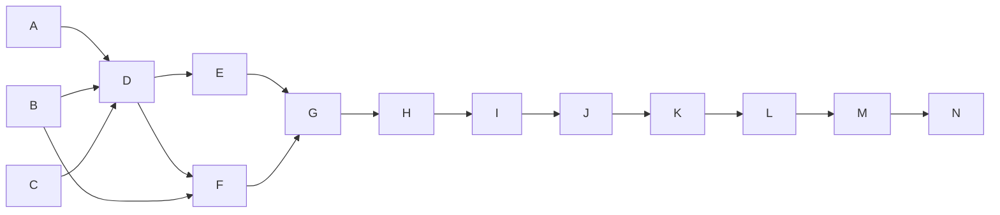

# Wave 9, HS2, HS3 and HS4 — delivery from the overlay, memory by layers, onboarding: Implementation Plan

> **For agentic workers:** REQUIRED SUB-SKILL: Use superpowers:subagent-driven-development
> (recommended) or superpowers:executing-plans to implement this plan task-by-task. Steps use
> checkbox (`- [ ]`) syntax for tracking.
>
> **The wave is the dispatch unit, not the task.** Waves are lettered (`A`, `B`, …) and own a
> run of the continuously numbered tasks. One implementer per **dispatched** wave, with no review
> of its own; inside a wave every task keeps its own failing test, verification and commit. Do not
> dispatch one subagent per task.
>
> **Waves A, G, K and N are not dispatched.** A records the measurements this plan is cut from; G,
> K and N run each pull request's final review and open it. The controller runs all four, G with
> the owner at the desktop app.
>
> **Three pull requests, one plan, in order.** HS2 is `wp/hs2-delivery` into `dev` (Waves A–G);
> HS3 is `wp/hs3-memory` into `dev` (Waves H–K), cut from `dev` once HS2 has merged; HS4 is
> `wp/hs4-onboarding` into `dev` (Waves L–N), cut once HS3 has merged. Each merges when its own
> checks are green (umbrella plan, `docs/plans/2026-10-15-wave-9-umbrella.md`, amended 2026-10-18).
> `0.5.0` is cut after HS4, by the umbrella's Task 2.

**Goal:** a checkout attached to the owner's overlay gets the overlay's hooks, skills, agents, rules
and allow-rules through a plugin stayfixed renders on the machine and a merged, excluded
`.claude/settings.local.json`, with nothing tracked changed and nothing to place per worktree; its
memory is one composed store the harness reaches through an absolute `autoMemoryDirectory`, with
in-repo notes delivered as data and every note an agent wrote marked unreviewed until the owner
promotes it; and a person reaches all of it through one `setup --overlay` and a guided `init`.

**Architecture:** HS2 adds a binding id in the git common directory, a renderer that turns the
overlay's executable parts into a directory marketplace under the machine's data directory, named
by that id and installed `--scope local` in the main checkout, and moves every hook entry out of
`settings.local.json` into that plugin; `settings.local.json` keeps only the ledgered allow-rules.
Preferences are built from one `resolve` over the preset, the repository, `common/stayfixed.toml`,
`projects/<name>/stayfixed.toml` and the machine file. HS3 replaces the link tree, the harness link
and the worktree handler with a composed store and one settings key, deletes the store digest
approval, and adds the reviewed record with `memory promote`. HS4 folds `overlay create` and
`overlay init` into `setup --overlay`, gives the overlay an identity record in place of plugin
manifests, and makes `init` a guided walk whose texts the CLI owns.

**Tech Stack:** Python ≥ 3.11 standard library at runtime; `uv`, pytest (`-n auto`), ruff, mypy,
the mutation oracle (`scripts/mutation_oracle.py`), towncrier fragments in `changelog.d/`. Test-only:
the Claude Code binary for Task 1's recipe, never in CI.

**Spec:** the agent-harness extraction design, in a private repository this one cannot link to —
§15.8 decisions 7 (scopes; `machines/` cut), 8 (the binding id; no `checkout` approval), 11 (the
approval primitive, amended), 13 (layers), 14 (`harness` by default), 17 (the rendered delivery;
layers 1–2), 18 (these measurements), 19 (allow-rules through `settings.local.json`, amended by
L-6), 20 (Codex and worktrees), 21 (the scaffold rename; `doctor --footprint` folded into
`attached`), 22 (`attach` and `detach`), 23–27 and 29 (memory; 28 cut), 30 (`setup --overlay`), 31
(the overlay's identity, without its migration), 33 (the guided `init`), and the umbrella plan's
Design rule and Lane-plan items for HS2, HS3 and HS4, cited by their ids. Every value a task needs
from the spec is written into the task.

**Scope:** pull requests HS2, HS3 and HS4 of package harness-sources. A change belongs here iff it
(a) binds a checkout to its overlay project, renders or installs the delivery, merges or withdraws
what `settings.local.json` holds, or builds a session's preferences from the overlay's layers (HS2);
(b) chooses, composes, points at, delivers, indexes or reviews a memory store (HS3); (c) creates an
overlay, records its identity, or asks `init`'s questions (HS4); (d) deletes a control the Design
rule or a measurement below made a convenience; or (e) restates the documents those changes falsify.
Out: pins, an `overlay` or `checkout` approval kind and the node-id allowlist (d9, d10, d19; cut by
the owner on 2026-10-19); `machines/<name>/` (d7, cut); the durable-note guard (d28, cut); every
migration (d14's sniff, d31's retirement, d32; cut); Codex parity (wave 10, d20); regressions, the
`adopt` skill and profile context (CP2, CP3, PF1, PF2).

**Premise:** measured on 2026-10-24 at `dev` = `3476773` (PR 116 merged). A task that finds one no
longer holds stops and reports the mismatch.

- 36 commands are registered under 20 top-level names (`cli.build_parser(discover_registrars())`);
  `hooks/hooks.json` holds 10 entries — 7 `SessionStart` (`hook SessionStart`, and
  `memory session-context --bundle standing-rules|volatile-notes --part 1..3`), and one each on
  `PreToolUse`, `PostToolUse` and `PostToolUseFailure`, all matching `Bash`. `doctor` reports 18
  rows: 13 core (`doctor/checks.py` `CHECKS`) and `attached`, `bundles`, `store-debris`,
  `pre-commit`, `overlay-requires`; `.github/workflows/smoke.yml` asserts `len(rows) == 18`, and
  `"10 entries, 11 row(s), 0 failure(s)"` from `scripts/smoke_hooks.py` (`EXPECTED_ENTRIES = 10`,
  `EXPECTED_ROWS = 11`).
- `attach` (`src/stayfixed/attach/write.py`, `attach()`, `_plan`, `plan_writes`, `_carry_out`) writes,
  in order: a `.gitignore` region `stayfixed:ignore`; the `.git/info/exclude` region `attach` (in the
  common directory); `.codex/rules/` copies; `.claude/settings.local.json`, merged from
  `<overlay>/common/claude/{permissions,hooks}.json` and `projects/<name>/claude/{…}` (hook entries
  carry an in-band `# stayfixed:overlay-<event>-<n>` marker, allow-rules only the ledger); the ledger
  `.stayfixed/local/attach.json`; the overlay's `projects/<name>/project.toml` (`remote`,
  `first_attach`); the overlay's memory group directories; the link tree under `paths.memory` in
  every checkout and the harness link `~/.claude/projects/<slug>/memory`; `pre-commit install` in the
  overlay; and, where the link cannot be made, an `autoMemoryDirectory` fallback key.
- No binding id exists: a checkout is bound by `project.name` and the recorded `origin`
  (`memory/store.py` `binding_state`: `unbound`, `bound`, `mismatch`, `no-origin`), and `attach`
  refuses `NO_REMOTE`, `DIFFERENT_REMOTE` without `--trust-remote`, and `ORIGIN_NOT_TEXT`.
- No stayfixed code installs the overlay as a plugin: the overlay template ships
  `.claude-plugin/{plugin,marketplace}.json`, `.codex-plugin/plugin.json` and an empty
  `hooks/hooks.json`, and its README tells the owner to install it by hand at user scope. The only
  `claude plugin` subprocesses are `setup`'s installs of the preset's third-party plugins
  (`setup/run.py` `_install_plugins`; preset `[plugins] install = ["superpowers", "context7"]`).
- `classes.LayerName` has `OVERLAY_COMMON`, `OVERLAY_PROJECT`, `OVERLAY_MACHINE`, which nothing reads;
  `Config`'s values are built by `config/loader.py`; `"guards.*"` is `MACHINE_ONLY`.
- `stayfixed.trust` has one kind, `memory` (`memory/approvals.py`); `trust approve` refuses without a
  terminal (`trust/kinds.py` `interactive`, `trust/approving.py` `NOT_A_TERMINAL`); the record is
  `trust.json` beside the machine file.
- Memory modes are `overlay`, `in-repo`, `local-only` (`config/schema.py`), with
  `[defaults.memory] mode = "local-only"` in the preset; no `harness` mode, no `memory promote`, no
  reviewed record. Every mode but `overlay` is gated by one digest over the whole store
  (`memory/trust.py` `may_inject`); `memory index` writes provisional `index:` lines into notes
  (`index.reconcile(write=True)`); `trust.wrap` refuses a note holding its delimiter (`UnsafeNote`).
- `overlay create` and `overlay init` exist (`overlay/create.py`); `_populated` means "a
  `.claude-plugin` directory exists"; `setup`'s `_check_home_usable` checks an existing destination
  only for `X_OK` (BR-018); `pre-commit install` runs from `overlay/create.py` `_install_secret_scan`
  and from `attach`'s `_secret_scan`. `uninstall` refuses an attached checkout (`ATTACHED`). The
  preset's `attribution_check = true` and `setup` installs plugins unasked.
- The open ledger entries this plan closes by deleting their code: BR-004, BR-022, BR-027, BR-037,
  BR-038, BR-042 (the harness link and the link tree, HS3); BR-018 (HS4); BR-039 for `--overlay`
  (HS4) and `--store` (HS3).

## Measurements (d18), 2026-10-24, Claude Code 2.1.301, macOS

The four d18 asks and L-6's "what does Claude Code write" were measured before any task was fixed,
at $0 and with no model call: an isolated `CLAUDE_CONFIG_DIR` and `HOME`, `ANTHROPIC_BASE_URL` at a
local stub of the Messages API that records every request body and answers `OK` or one scripted
`tool_use`, `claude -p … --debug-file <log>` for headless runs and `expect` for the permission
dialog. The fixture is one plugin `sf-deliv` in a directory marketplace `sf-hs2` whose
`SessionStart` hook logs `$CLAUDE_PLUGIN_ROOT`, the project and a revision file and returns a canary
as `additionalContext`; "reached the model" means the canary is in the recorded request. Task 1
re-runs the recipe on the version the pull request is reviewed on.

| # | Question | Observed |
|---|---|---|
| D1 | Copy or in place | `plugin install --scope local` writes a cache copy, but the session runs the plugin **in place**: `CLAUDE_PLUGIN_ROOT` is the marketplace's directory, and an edit to the source reached the next session with no reinstall while the cache copy kept the old bytes. With the marketplace directory gone the plugin does not load and nothing says so (exit 0, no hook; `Marketplace … failed to load: cache-miss` in the debug log only); there is no fallback to the cache copy. |
| D2 | A committed `enabledPlugins` with a directory marketplace | In a fresh configuration, a clone committing `extraKnownMarketplaces` (a directory source) and `enabledPlugins` loads nothing headless (`Skipped auto-recording … — enabled only by repo-authored settings`). Where the machine already knows a marketplace of that name, a clone committing `enabledPlugins` alone runs the plugin's hooks, with no install and no prompt, on every run. |
| D2b | Does a local-scope marketplace stay in its checkout | **No.** `plugin marketplace add <dir> --scope local` writes the checkout's `settings.local.json` and also the machine-wide `plugins/known_marketplaces.json`; another clone committing `enabledPlugins` naming the plugin ran its hook. Only an unguessable name keeps a hostile clone out. |
| D3 | Delivery into a worktree (terminal) | A session in a linked worktree reads its own `.claude/settings.local.json` **and the main checkout's**, merged (the debug log's watched-files line lists both), whether or not the worktree has a file of its own. The plugin ran there, and Claude Code added an install record for the worktree's path itself. |
| D4 | Absolute `autoMemoryDirectory` | Set in the main checkout's excluded `settings.local.json`, an absolute `autoMemoryDirectory` is the store the session reads in the main checkout and in a linked worktree (the store's index canary reached the model from both). A clone's committed `.claude/settings.json` setting it is honoured too, headless. |
| D5 | What "don't ask again" writes | The answer that allows a `Bash` prefix wrote `"permissions": {"allow": ["Bash(git tag *)"]}` into `.claude/settings.local.json` and rewrote the whole file, its keys in another order. From a linked worktree with no file of its own, it went into the **main checkout's** file. |
| D6 | The desktop app's worktree session | Measured in Task 26, with the owner at the desktop app. |

**What they change, against the spec as written:**

1. **The random-id name is the whole defence (D2, D2b).** Registering the marketplace only in the
   checkout's excluded settings (d17's layer 2) hides nothing: Claude Code records it machine-wide.
   The names stay as d17 says, `stayfixed-delivery-<id>` and `overlay-<id>`, because a hostile clone
   cannot commit an `enabledPlugins` naming an id it never saw; the "registered only here" sentence
   leaves every document.
2. **One place per repository, not per worktree (D3, D5).** The main checkout's
   `settings.local.json` reaches every worktree, and Claude Code itself writes the worktree's answers
   there. So `attach` writes the main checkout only; d20's "`attach` places delivery in every
   worktree" and its `SessionStart` notice for a later worktree are cut, and the worktree handler
   `worktree-link` goes in HS3 with the link tree.
3. **A re-render needs no reinstall, and a missing render is silent (D1).** What runs is the render
   directory's bytes, so `attach` re-renders in place and never reinstalls; `doctor`'s `attached` row
   is red when the render directory or its marketplace file is gone, since nothing else says so.
4. **The pointer is `autoMemoryDirectory` (D4).** d23's condition holds: the harness link, its two
   writers, the link tree and its fallback retire in HS3, closing BR-004, BR-022, BR-027, BR-037,
   BR-038 and BR-042 by deletion.
5. **Claude Code rewrites `settings.local.json` whole and adds its own allow-rules (D5).** No in-band
   marker or key order survives in that file, so stayfixed owns nothing there but the allow-rules its
   ledger names; every hook entry moves into the rendered plugin, and the in-band marking of
   `settings.local.json` entries is deleted. A foreign allow-rule is Claude Code's or the person's and
   is left alone (L-6).
6. **A committed `autoMemoryDirectory` is the harness's behaviour, not stayfixed's (D4).** A
   repository can point the harness's memory elsewhere; stayfixed cannot stop that and does not try.
   `doctor`'s memory row names the effective `autoMemoryDirectory` and the file that set it, as
   information (Task 21).

## Open questions for the owner

Defaults the plan is written on; an answer that differs changes only the task named.

1. **The machine's data directory (Tasks 4, 6, 15).** No data directory exists today. **Default:**
   `$HOME/.local/share/stayfixed/` on every platform, following `HOME` as the configuration does
   since PR 115, with no `XDG_*` read from the environment; delivery under `delivery/<id>/`, composed
   stores under `stores/<id>/`.
2. **Where the overlay's rules live (Task 9).** The template has no rules directory. **Default:**
   `common/claude/rules/*.md` and `projects/<name>/claude/rules/*.md`, beside the existing
   `claude/permissions.json` and `claude/hooks.json`; a rule with `paths:` frontmatter is path-scoped,
   any other a standing rule.
3. **Where the link tree retires (Task 15).** d17 lists the link tree's retirement under HS2.
   **Default:** HS3, beside the pointer that replaces it, so memory works on `dev` between the two
   pull requests.
4. **What is left of `trust` once memory needs no approval (Tasks 11, 17).** After L-7 no store is
   approved by digest, so the `memory` kind has no subject. **Default:** HS3 deletes the kind, the
   `memory trust` alias and `trust approve`'s terminal check with it; the reviewed record is written by
   `memory promote` into `trust.json` as kind `reviewed`, one entry per note; `trust list` and
   `trust revoke` read it; `trust approve` is removed when no kind is registered.
5. **"Asks nothing again per machine" (Task 7).** **Default:** `attach --yes` is needed only when the
   rendered executable set differs from the last render this machine recorded; an unchanged overlay
   re-attaches with no flag. The one-screen diff prints either way.

## Global Constraints

- Runtime imports the standard library only; every write goes through `stayfixed.fsops`; a value a
  repository, an overlay or a run wrote (a path, a name, a rule) is printed through
  `stayfixed.printed`, never raw.
- **No tracked file is written by `attach`, `detach` or a session.** Everything `attach` places is
  listed in the `.git/info/exclude` region `attach`, written before the first `claude plugin` call.
- **The binding id is the anchor.** It is 32 lowercase hex characters from `secrets.token_hex(16)`,
  stored in `<git common dir>/stayfixed/binding`, read through `guards.git_path` (never from an
  environment variable); repository bytes cannot write it because `.git/` is not in any tree. Its
  adversary is a hostile clone, which never learns it; the agent in a session is not its adversary.
- The rendered plugin's names are `stayfixed-delivery-<id>` (marketplace) and `overlay-<id>`
  (plugin); no other name of a delivered part is predictable.
- Claude Code subprocesses run through `stayfixed.runner` with argv tables beside `setup/run.py`'s;
  every one is a row of the README's network table, held by `tests/test_outbound.py`.
- A deleted control deletes its constants, its tests, its documentation rows and its mutation entries
  in the same commit; each pull request prints `git diff --shortstat <base> HEAD -- src tests
  mutations docs` in its review package, and HS3's `src` net is negative.
- New mutation entries only for a branch that decides a verdict, a containment or a data-loss path
  (item 10 of the contract), in the group file `scripts/mutation_oracle.py` `GROUP_OF` routes the
  source to (`src/stayfixed/attach/` → `attach`; `src/stayfixed/memory/` → `records`;
  `src/stayfixed/trust/`, `src/stayfixed/config/` → `core`; `src/stayfixed/doctor/` → `doctor`;
  `src/stayfixed/overlay/`, `src/stayfixed/setup/`, `src/stayfixed/project/` as `GROUP_OF` says). A
  test asserting a refusal asserts its exact constant.
- Each lane that adds or renames a `doctor` row or a hook entry updates `smoke.yml`'s row count and
  `scripts/smoke_hooks.py`'s entry and row counts, and quotes the previous lane's numbers (umbrella,
  File ownership); the README's machine-files table is edited the same way.
- No design id (a `§`, a decision number, a lane-plan id in brackets, a `D1`–`D6` above) in any file
  outside `docs/plans/`. Each task restates the documents its change falsifies and writes its
  changelog fragment in `changelog.d/` in the same commit.

## Execution contract

Copied verbatim from the umbrella plan; the controller copies the relevant part into every brief,
post-pull-request dispatches included.

1. **The wave is the dispatch unit.** Waves are lettered and own a run of continuously numbered
   tasks; one implementer per dispatched wave, with no review of its own (the pull request's final
   review is the review), every task keeping its own failing test, verification and commit. A
   fix round goes to the same implementer while its context allows, else to a fresh agent with the
   review package. Every subagent runs on Opus (`model: opus`).
2. **Every implementer brief says:** report a mismatch with the tree instead of guessing; run a
   command and paste what it printed before writing any claim about it; focused runs while
   iterating and per commit; before each push, once, a full run of `uv run pytest -n auto --cov
   --cov-fail-under=92` with `uv run python scripts/release.py check`, and the suite again on
   Python 3.13 (`uv run --python 3.13 pytest -n auto`), the oracle's interpreter in CI, since a
   local uv Python is often newer than any CI leg (CI holds 3.11.4 and the rest); a plan's predicted
   mutation outcome is a hypothesis — design your own if it does not redden, and paste the raw
   output either way; no line numbers from the plan; this brief is a message, not a file, so cite
   only the plan; write nothing under the repository but the task's files, use
   `<scratchpad>/<wave>-<role>/`, never run a script you did not write, and read `git diff --stat`
   before committing; the static checks at CI's scope (`uv run ruff check .`,
   `uv run ruff format --check .`, `uv run mypy`); do not use the Agent tool; do not run
   `git checkout`, `restore`, `stash` or `clean`; start a long run in the background and wait on
   its own output, never with `pgrep`.
3. **Every reviewer brief adds:** run every command yourself and never use the Agent tool; do not
   run `git checkout`, `restore`, `stash` or `clean`; what already passed, by sha and suite, and run
   only the test that decides a finding you suspect; no citation may point at a brief, a dispatch
   or a report; what later tasks own.
4. **One final review per pull request**, with two read-only seats: correctness, and "who does
   this refuse, and what can be deleted". A security seat joins only when the diff touches an
   anchor repository bytes cannot move (CI's base read, the binding id in the git common
   directory, repository-path containment, the exclude ordering). Reviewers give findings only, with no replacement text, and a
   separate triage sends on only correctness and requirement gaps. Then one scoped re-review of
   the fixes, and stop: no per-wave reviews, and no minor finding rides a round.
5. **The lifecycle matrix**, walked at pre-flight like a task and again by the correctness seat:
   every configuration key the pull request adds × every change of configuration — set a value,
   change it, unset it, move a path, a step that fails part-way, `uninstall` — × only the layers
   the key's class admits (the class-table test holds where a key may be set); a command that
   reads no configuration walks no layer.
6. **The parallelism map.** Read-only seats run beside each other and beside the implementer;
   writers of one worktree serialise; one heavy local run (the full suite, the mutation oracle) at
   a time per host; no local full run while the same branch's CI runs.
7. **Templates.** A fix brief enumerates the sibling instances of the defect's class only to
   delete them or fold them into one rule, never to extend a refusal list. After a simplification
   ruling it carries a net budget: `src` below zero, tests and mutation entries at zero or less. A
   new defect found during a cut is filed in the ledger, not fixed, unless the fix deletes code. A
   security ruling names its minimal preconditions, its anchor's provenance (who can write the
   bytes it trusts), and one legitimate user it must not refuse.
8. **Verification.** The controller re-verifies only heads it pushes or merges, re-derives the pull
   request's body from the diff before every push, takes the run id from `gh pr checks` and waits
   with `gh run watch <run-id> --exit-status` until every job has ended (never a `head_sha` query,
   which finds no run for a pull request's merge ref) before reporting a pull request done.
9. **Second finding at one seam.** At the second review finding that points at the same function,
   reader or boundary, the next step is a redesign of that seam put to the owner, not a third patch.
   A second bypass of the same refusal list counts as the same seam.
10. **Mutation entries.** A new entry only for a branch that decides a verdict, a containment or a
    data-loss path; other assertions need neither an entry nor a "why none" sentence; deleting a
    control deletes its entries (owner, 2026-10-19).

## Review Focus

Inputs no task would exercise unless told to; each line's test is in the task named.

1. **A hostile clone on an attached machine**, committing `.claude/settings.json` with
   `enabledPlugins` naming `overlay-<some id>@stayfixed-delivery-<some id>` and with
   `extraKnownMarketplaces` pointing into the owner's data directory. Expected: no delivered hook
   runs, because neither name matches a real id; `doctor` in that clone reports it unattached. Task 6.
2. **A worktree created after `attach`, one deleted, and the desktop app's own worktree.** Expected:
   each gets the delivery with no stayfixed step; `doctor` in each reports the binding of the common
   directory. Tasks 6 and 26.
3. **The render directory deleted, or the overlay moved, after `attach`.** Expected: `attached` is red
   naming the missing directory and the remedy; a session still starts. Task 10.
4. **Claude Code rewrites `settings.local.json`** (reordered keys, a "don't ask again" allow-rule
   added) between `attach` and `detach`. Expected: `detach` removes exactly the ledgered allow-rules
   and leaves Claude Code's. Task 8.
5. **An agent writes a note while it works, the session is killed, and the owner edits a promoted
   note.** Expected: the agent's note arrives at the next `SessionStart` marked unreviewed, never as a
   standing rule; the edited note is unreviewed again; no other note's status moves. Task 17.
6. **`setup --overlay create:<owner>/<name>` with the destination absent, a file, and a directory that
   is not an overlay.** Expected: the last two refuse before any call to GitHub. Task 22.

---

## Waves

| Wave | Tasks | Pull request | Dispatched | Plan lines (approx.) |
|---|---|---|---|---|
| A | 1 | HS2 | no — controller | 20 |
| B | 2–3 | HS2 | yes | 110 |
| C | 4–5 | HS2 | yes | 110 |
| D | 6–7 | HS2 | yes | 130 |
| E | 8–9 | HS2 | yes | 100 |
| F | 10–11 | HS2 | yes | 100 |
| G | 12 | HS2 | no — controller and owner | 25 |
| H | 13–14 | HS3 | yes | 90 |
| I | 15–16 | HS3 | yes | 110 |
| J | 17–19 | HS3 | yes | 120 |
| K | 20 | HS3 | no — controller | 15 |
| L | 21–22 | HS4 | yes | 100 |
| M | 23–25 | HS4 | yes | 110 |
| N | 26 | HS4 | no — controller and owner | 25 |

Every dispatched wave's brief also carries the header above (about 330 lines), so the largest, D, is
under 500 plan lines in all. Ten dispatched waves, three final reviews of two seats and one
re-review each: about 10 implementer dispatches and 9 review dispatches, plus fix rounds.

**Launch graph** (drawn over the Interfaces blocks):

- **B ∥ C.** B touches `config/` and the class table; C touches `attach/binding.py`,
  `attach/exclude.py` and `memory/store.py`'s binding states. Neither imports what the other adds,
  but both write `attach/write.py`'s `Gates`: C goes second in the same worktree.
- **A, B, C → D.** Task 6 names the render by Task 4's `binding_id`, installs through the measured
  argv (Task 1), and reads the overlay's layers through Task 2's `Resolution`.
- **D → E, F.** Tasks 8 and 9 withdraw and extend what Task 6 renders; Task 10's `attached` reads
  Task 6's `RenderRecord`.
- **G → H.** HS3 is cut from `dev` once HS2 has merged: Task 15's pointer is written into the
  `settings.local.json` that Task 5 merges, and Task 15 composes the store under Task 4's id.
- **K → L.** Task 23's guided walk runs `attach` (HS2) and offers `memory promote` (HS3).

---

### Wave A — Task 1 (controller, not dispatched; pull request HS2)

#### Task 1: Re-run the measurements on the version HS2 is reviewed on

- [ ] **Step 1:** with `claude --version` recorded, re-run D1–D5's recipe from the scratch fixture
  (`$HOME/.cache/stayfixed-spikes/hs2/`: `stub.py`, `cc.sh`, `dontask.exp`, the `market/` fixture)
  and compare each observation with the table above. Any difference stops the plan before Wave D and
  goes to the owner with the cell it changes.
- [ ] **Step 2:** write the version and the five results into Findings; commit —
  `docs(plans): record the delivery measurements`.

### Wave B — Tasks 2–3 (dispatched; pull request HS2)

#### Task 2: Build a session's preferences from one resolution over the overlay's layers

**Files:**
- Modify: `src/stayfixed/config/classes.py` (`LayerName.OVERLAY_MACHINE` and its `ORDER` entry go),
  `src/stayfixed/config/session.py`, `src/stayfixed/config/loader.py`,
  `src/stayfixed/config/owner.py`, `src/stayfixed/doctor/checks.py` (`_preferences`)
- Create: `src/stayfixed/config/overlay_layers.py`
- Test: `tests/config/test_overlay_layers.py` (create), `tests/config/test_classes.py`,
  `tests/doctor/test_checks.py`
- Modify: `README.md` (machine-files table: the overlay's two `stayfixed.toml` rows), `docs/cli.md`
  (`doctor`'s `preferences` row), `changelog.d/+overlay-layers.feature.md` (create)

**Interfaces:**
- Consumes: `classes.resolve`, `classes.Layer`, `classes.Resolution` (HS1); `config.overlay.overlay_root`;
  the project name from the repository's `[project] name`, or, with no `stayfixed.toml`, from the
  overlay's binding record (Task 4 supplies it; until then only the named project's layer is read).
- Produces:
  - `overlay_layers.read(root: Path, overlay: Path | None, name: str | None) -> tuple[Layer, ...]` —
    `common/stayfixed.toml` as `OVERLAY_COMMON` and `projects/<name>/stayfixed.toml` as
    `OVERLAY_PROJECT`, each read with the loader's NOTE semantics (a key it cannot use is a note, never
    a refusal); a missing file or an unrecorded overlay is no layer. An overlay layer never carries a
    `GATE_PARAMETER` or `REPOSITORY_ONLY` key: `resolve` already drops it with `REFUSED_LAYER_NOTE`.
  - `SessionConfig.resolution: Resolution` — built once by `session_config` from the preset, the
    repository, the two overlay layers and the machine file, in `ORDER`; `Config`'s preference and
    session values come from it.
  - `doctor`'s `preferences` row reads `SessionConfig.resolution.provenance` and derives nothing
    itself.

- [ ] **Step 1: failing tests.** In `tests/config/test_overlay_layers.py`: an overlay's
  `common/stayfixed.toml` setting `[memory] mode = "overlay"` and `projects/<name>/stayfixed.toml`
  setting `[budgets] startup_rules_words = 900` reach `session_config(...).config` with provenance
  `overlay common` and `overlay project`; the machine file's value beats both; a `[gates] builtin` in
  either overlay file is dropped with the refused-layer note naming the key and the layer; an overlay
  file that is not TOML is one note and no layer. In `tests/doctor/test_checks.py`: the
  `preferences` row prints the layer `resolve` returned.
- [ ] **Step 2:** run them; expect failure for want of `overlay_layers`.
- [ ] **Step 3:** implement. `OVERLAY_MACHINE` leaves `LayerName` and `ORDER`; nothing reads it today.
- [ ] **Step 4:** focused run green; the class-table test still holds every field to a row.
- [ ] **Step 5:** mutation: making `read` return the project layer before the common one (so the
  common value wins) must redden the provenance test; one entry in `mutations/core.toml`.
- [ ] **Step 6:** commit — `feat(config): resolve preferences over the overlay's common and project
  files`.

#### Task 3: Let a repository set the guards' default, with the owner's layers last

**Files:**
- Modify: `src/stayfixed/config/classes.py` (`"guards.*"` → `PREFERENCE`),
  `src/stayfixed/config/owner.py`, `src/stayfixed/config/loader.py` (the NOTE load stops refusing
  `[guards]` from the repository), `src/stayfixed/assess/rule.py` (only if its neutral rows name
  `guards`)
- Test: `tests/config/test_classes.py`, `tests/guards/` (the test that a repository's `[guards]` is
  refused becomes the test that it is a default the machine file overrides)
- Modify: `docs/cli.md`, `README.md` (the `[guards]` row), `CONTRIBUTING.md` only if it states the
  class, `changelog.d/+guards-preference.change.md` (create)

**Interfaces:**
- Consumes: Task 2's `SessionConfig.resolution`.
- Produces: `[guards] bg_cleanup` resolved like any preference: a repository may set it, an overlay
  layer or the machine file overrides it.

- [ ] **Step 1: failing test:** a repository's `[guards] bg_cleanup = false` switches the hint off in a
  session with no machine-file `[guards]`; the machine file's `bg_cleanup = true` switches it back on.
- [ ] **Step 2:** run; expect the first to fail (today the repository's key is refused).
- [ ] **Step 3:** implement; delete the machine-only refusal's constant and its mutation entries if
  nothing else uses them.
- [ ] **Step 4:** focused run green.
- [ ] **Step 5:** commit — `refactor(config): make the guards a preference the owner's layers override`.

### Wave C — Tasks 4–5 (dispatched; pull request HS2)

#### Task 4: The binding id, and `origin` as a warning

**Files:**
- Create: `src/stayfixed/attach/bindingid.py`
- Modify: `src/stayfixed/attach/binding.py`, `src/stayfixed/attach/write.py` (`Gates`: the
  `NO_REMOTE`, `DIFFERENT_REMOTE` and `ORIGIN_NOT_TEXT` stops go), `src/stayfixed/attach/commands.py`
  (`--trust-remote` goes), `src/stayfixed/memory/store.py` (`binding_state`, `read_binding_record`),
  `src/stayfixed/attach/hooks.py` (one `SessionStart` hint line), `src/stayfixed/config/paths.py`
  (the data directory, open question 1)
- Test: `tests/attach/test_bindingid.py` (create), `tests/attach/test_write.py`,
  `tests/attach/test_commands.py`, `tests/attach/test_hooks.py`, `tests/memory/test_remote_binding.py`
- Modify: `docs/cli.md` (`attach`: the binding; the refusals that went), `README.md` (machine-files
  table: `.git/stayfixed/binding`, the data directory), `changelog.d/+binding-id.feature.md`,
  `changelog.d/+trust-remote.upgrading.md` (create)

**Interfaces:**
- Produces:
  - `bindingid.read(root: Path) -> str | None` — the id in `<git common dir>/stayfixed/binding`, or
    `None` when absent; a file that is not 32 lowercase hex characters is `None` and a `doctor` note.
  - `bindingid.ensure(root: Path) -> str` — reads, or writes a new `secrets.token_hex(16)` through
    `fsops`, creating `stayfixed/` under the common directory.
  - `projects/<name>/project.toml` gains `binding = "<id>"` beside `remote`; `binding_state` answers
    `bound` when the checkout's id equals the record's, `unbound` otherwise, and reports a differing or
    missing `origin` as `origin_note: str | None`, never as a state that refuses.
  - `paths.data_directory() -> Path` — `$HOME/.local/share/stayfixed`.

- [ ] **Step 1: failing tests:** two worktrees of one repository read the same id; a fresh clone at
  the same path has none; `attach` on a checkout with no `origin`, and on one whose `origin` differs
  from the record, succeeds and prints the note; `SessionStart` in a bound checkout whose `origin`
  differs prints one line naming both URLs through `printed`.
- [ ] **Step 2:** run; expect failure.
- [ ] **Step 3:** implement; delete `NO_REMOTE`, `NO_ORIGIN_CAUSE`, `DIFFERENT_REMOTE`, `ORIGIN_NOT_TEXT`,
  `--trust-remote` and every test and mutation entry that held them.
- [ ] **Step 4:** focused run green.
- [ ] **Step 5:** mutation: `bindingid.read` accepting a 31-character id must redden its test; one
  entry in `mutations/attach.toml`.
- [ ] **Step 6:** commit — `feat(attach): bind a checkout by an id in its git common directory`.

#### Task 5: Keep everything `attach` places out of git through the exclude block alone

**Files:**
- Modify: `src/stayfixed/attach/write.py` (`_write_ignore_region` and its `.gitignore` refusals go;
  the exclude block is written before any later step), `src/stayfixed/attach/exclude.py`,
  `src/stayfixed/attach/permissions.py` (refuse a tracked `settings.local.json`; foreign entries are
  listed, never refused)
- Test: `tests/attach/test_write.py`, `tests/attach/test_detach.py`, `tests/attach/test_commands.py`
- Modify: `docs/cli.md`, `changelog.d/+attach-exclude-only.change.md` (create)

**Interfaces:**
- Produces: `permissions.TRACKED_LOCAL_SETTINGS` — the one refusal of `settings.local.json`'s state;
  `attach`'s report lists foreign allow-rules by count and never refuses them.

- [ ] **Step 1: failing tests:** after `attach` on a repository whose tracked `.gitignore` has no
  `.stayfixed/` line, `git status --porcelain=v1 -z -uall` is empty and `.gitignore` is byte-equal; a
  tracked `.claude/settings.local.json` is refused with `TRACKED_LOCAL_SETTINGS` before any write; one
  holding an allow-rule stayfixed did not write is merged and the rule kept.
- [ ] **Step 2:** run; expect failure on the `.gitignore` bytes.
- [ ] **Step 3:** implement; delete the `.gitignore` region writer, its three refusals, their tests and
  mutation entries.
- [ ] **Step 4:** focused run green.
- [ ] **Step 5:** commit — `refactor(attach): place nothing in .gitignore and refuse only a tracked
  local settings file`.

### Wave D — Tasks 6–7 (dispatched; pull request HS2)

#### Task 6: Render the overlay's executable parts into a local plugin and install it

**Files:**
- Create: `src/stayfixed/attach/render.py`
- Modify: `src/stayfixed/attach/write.py` (`_carry_out`: render, then `marketplace add` and `install`;
  hook entries no longer merged into `settings.local.json`), `src/stayfixed/attach/permissions.py`
  (the hook half of the diff moves to `render`), `src/stayfixed/scaffold/` (the in-band marking of
  `settings.local.json` entries goes if nothing else uses it), `src/stayfixed/runner.py` callers'
  argv tables
- Test: `tests/attach/test_render.py` (create), `tests/attach/test_write.py`,
  `tests/boundaries/test_delivery.py`, `tests/test_outbound.py`
- Modify: `README.md` (network table: the two `claude plugin` rows; machine-files table: the data
  directory), `docs/cli.md` (`attach`), `changelog.d/+rendered-delivery.feature.md` (create)

**Interfaces:**
- Consumes: `bindingid.ensure` (Task 4), `paths.data_directory` (Task 4), Task 2's layers for the
  project name, Task 1's measured argv.
- Produces:
  - `render.render(overlay: Path, name: str, binding: str, into: Path) -> RenderRecord` — writes
    `into/.claude-plugin/marketplace.json` (name `stayfixed-delivery-<binding>`, one plugin
    `overlay-<binding>` with source `./plugin`), `into/plugin/.claude-plugin/plugin.json`,
    `into/plugin/hooks/hooks.json` (the union of `common/claude/hooks.json` and
    `projects/<name>/claude/hooks.json`, entries in that order), and `skills/` and `agents/` copied
    from `common/claude/` and `projects/<name>/claude/` when present; replaces the previous render in
    place, never through a reinstall.
  - `RenderRecord(path: Path, digest: str, parts: tuple[str, ...])` — `digest` is sha256 over every
    rendered file's relative path and bytes; recorded in the attach ledger as `render`.
  - Argv tables `PLUGIN_MARKETPLACE_ADD_LOCAL = ("claude", "plugin", "marketplace", "add", <dir>,
    "--scope", "local")` and `PLUGIN_INSTALL_LOCAL = ("claude", "plugin", "install",
    "overlay-<id>@stayfixed-delivery-<id>", "--scope", "local")`, run with the main checkout as the
    working directory; run only when the ledger holds no `render` yet.

- [ ] **Step 1: failing tests:** `render` over a fixture overlay writes the four files and the
  digest; a second `render` after editing `common/claude/hooks.json` rewrites the hook file and the
  digest and returns the same path; `attach` runs the two argv once on the first attach and none on
  the second (a `tests/runners.py` `Recorder`); after `attach`, `settings.local.json` holds no hook
  entry; a hostile-clone fixture committing `enabledPlugins` with any other id is reported unattached
  (Review Focus 1).
- [ ] **Step 2:** run; expect failure.
- [ ] **Step 3:** implement; delete the hook half of `settings.local.json`'s merge and its markers,
  their tests and their mutation entries.
- [ ] **Step 4:** focused run green.
- [ ] **Step 5:** mutation: naming the marketplace without the id must redden the name test; one entry
  in `mutations/attach.toml`.
- [ ] **Step 6:** commit — `feat(attach): deliver the overlay's hooks, skills and agents as a local
  plugin named by the binding`.

#### Task 7: One screen for the binding and the executable diff

**Files:**
- Modify: `src/stayfixed/attach/write.py` (`Gates`: the widening stop compares with the last
  `RenderRecord`), `src/stayfixed/attach/check.py`, `src/stayfixed/attach/commands.py`
- Test: `tests/attach/test_commands.py`, `tests/attach/test_write.py`
- Modify: `docs/cli.md`, `changelog.d/+attach-one-screen.change.md` (create)

**Interfaces:**
- Produces: `attach` prints the binding (project, id, `origin` and its note), then the executable diff
  against the last render (hook entries, skills, agents added or removed) and the allow-rules added;
  `--yes` is required only when that diff is not empty (open question 5).

- [ ] **Step 1: failing tests:** a second `attach` with an unchanged overlay needs no `--yes`; one after
  an added hook entry stops without `--yes` and prints that entry; the screen names the id.
- [ ] **Step 2:** run; expect failure on the second.
- [ ] **Step 3:** implement.
- [ ] **Step 4:** focused run green.
- [ ] **Step 5:** commit — `feat(attach): show the binding and what would run on one screen`.

### Wave E — Tasks 8–9 (dispatched; pull request HS2)

#### Task 8: `detach` withdraws the delivery and leaves Claude Code's own entries

**Files:**
- Modify: `src/stayfixed/attach/write.py` (`detach`), `src/stayfixed/attach/permissions.py`
- Test: `tests/attach/test_detach.py`
- Modify: `docs/cli.md`, `changelog.d/+detach-delivery.change.md` (create)

**Interfaces:**
- Produces: argv `PLUGIN_UNINSTALL_LOCAL` and `PLUGIN_MARKETPLACE_REMOVE`; `detach` runs them, removes
  the render directory, the ledgered allow-rules, the exclude block and the ledger, and leaves the
  binding id and the overlay's records.

- [ ] **Step 1: failing tests:** a `settings.local.json` rewritten between `attach` and `detach` with
  reordered keys and an added `Bash(git tag *)` keeps that rule and loses only the ledgered ones
  (Review Focus 4); the render directory is gone; the two argv ran once.
- [ ] **Step 2:** run; expect failure.
- [ ] **Step 3:** implement.
- [ ] **Step 4:** focused run green.
- [ ] **Step 5:** mutation: removing every allow-rule rather than the ledgered ones must redden the
  kept-rule test; one entry in `mutations/attach.toml`.
- [ ] **Step 6:** commit — `feat(attach): detach the rendered plugin and only the rules attach wrote`.

#### Task 9: Rules from the overlay, standing and path-scoped

**Files:**
- Modify: `src/stayfixed/attach/render.py` (rules), `hooks/hooks.json` only if the core plugin's
  `SessionStart` must read the render (it does not: the rendered plugin carries its own entries)
- Create: `src/stayfixed/attach/rules.py` (the two handlers the rendered plugin calls)
- Test: `tests/attach/test_rules.py` (create), `tests/attach/test_render.py`
- Modify: `docs/cli.md`, `README.md` (what the overlay may hold), the overlay template's `README.md`,
  `changelog.d/+overlay-rules.feature.md` (create)

**Interfaces:**
- Produces:
  - Rules read from `common/claude/rules/*.md` and `projects/<name>/claude/rules/*.md` (open
    question 2); `render` copies them under `into/plugin/rules/` and adds two entries to the rendered
    `hooks/hooks.json`: a `SessionStart` entry printing the standing rules (no `paths:`), and, only
    when some rule has `paths:`, a `PostToolUse` entry with matcher `Read|Edit|Write` that prints a
    matching rule once per file per session.
  - `rules.session_start(plugin_root: Path) -> str` and `rules.post_tool_use(plugin_root: Path,
    event: Mapping[str, Any]) -> str`, the once-per-file record under the data directory keyed by
    the hook's `session_id`.

- [ ] **Step 1: failing tests:** an overlay with one standing and one `paths: ["scoped/**"]` rule
  renders both entries; `post_tool_use` for `scoped/a.txt` prints the scoped rule once and nothing on
  a second read in the same session; an overlay with no `paths:` rule renders no `PostToolUse` entry.
- [ ] **Step 2:** run; expect failure.
- [ ] **Step 3:** implement.
- [ ] **Step 4:** focused run green.
- [ ] **Step 5:** commit — `feat(attach): deliver the overlay's rules, path-scoped ones once per file`.

### Wave F — Tasks 10–11 (dispatched; pull request HS2)

#### Task 10: The `attached` row reads the delivery; rows that never clear become information

**Files:**
- Modify: `src/stayfixed/attach/doctor.py`, `src/stayfixed/doctor/checks.py` (`ignored-env`,
  `codex-hooks`), `src/stayfixed/doctor/entries.py` (skill-frontmatter hooks as one information
  line; marker provenance with each entry's file and position, red only for a marked entry in a file
  stayfixed writes)
- Test: `tests/attach/test_doctor.py`, `tests/doctor/test_checks.py`, `tests/doctor/test_entries.py`
- Modify: `.github/workflows/smoke.yml` and `scripts/smoke_hooks.py` (the row count stays 18 if
  `codex-hooks` moves to the README; quote 18 and "10 entries, 11 row(s)" as the previous numbers),
  `README.md` (Codex reach table), `docs/cli.md`, `changelog.d/+doctor-delivery.change.md` (create)

**Interfaces:**
- Consumes: `RenderRecord` (Task 6), `bindingid.read` (Task 4).
- Produces: `attached` — OK when the ledger's paths are each untracked and excluded, the render
  directory and its marketplace file exist, and the overlay's current executable digest equals the
  ledger's `render.digest`; WARN for drift between them ("run `stayfixed attach`") and for an
  `origin` note; RED when the render directory or its marketplace file is gone (Review Focus 3) or a
  placed path is tracked.

- [ ] **Step 1: failing tests:** the four states above, each by its constant; `ignored-env` with
  `XDG_CONFIG_HOME` set is information, not a warning; a skill declaring hooks is one information line.
- [ ] **Step 2:** run; expect failure.
- [ ] **Step 3:** implement; delete the harness-path verdicts that read the link only if HS3 would
  otherwise read them twice (they go in Task 15).
- [ ] **Step 4:** focused run green.
- [ ] **Step 5:** mutation: `attached` OK with the render directory missing must redden; one entry in
  `mutations/attach.toml`.
- [ ] **Step 6:** commit — `feat(doctor): judge the delivery from the render, and inform where a row
  never clears`.

#### Task 11: `trust approve` records and prints, with no terminal check; Codex says what it gets

**Files:**
- Modify: `src/stayfixed/trust/approving.py`, `src/stayfixed/trust/kinds.py` (`interactive` goes),
  `skills/attach/SKILL.md`, `README.md` (Codex reach: rules through `.codex/rules/`, skills
  undelivered), `docs/cli.md`
- Test: `tests/trust/test_commands.py`
- Modify: `changelog.d/+approve-without-terminal.change.md` (create)

- [ ] **Step 1: failing test:** `trust approve memory` with stdin not a terminal records the approval
  and prints the kind, subject and digest it recorded.
- [ ] **Step 2:** run; expect `NOT_A_TERMINAL`.
- [ ] **Step 3:** implement; delete `NOT_A_TERMINAL`, `interactive`, their tests and entries.
- [ ] **Step 4:** focused run green.
- [ ] **Step 5:** commit — `refactor(trust): record an approval without asking for a terminal`.

### Wave G — Task 12 (controller and owner, not dispatched; pull request HS2)

#### Task 12: HS2's final review, the desktop session, and the pull request

- [ ] **Step 1:** on the branch's head, `uv run pytest -n auto --cov --cov-fail-under=92`, the static
  checks and `uv run python scripts/mutation_oracle.py`; any red stops the task.
- [ ] **Step 2:** the two seats of item 4, plus a security seat (the diff touches the binding id and
  the exclude ordering); triage; one fix round; one scoped re-review.
- [ ] **Step 3: D6, with the owner.** Attach the owner's overlay to a copy of one of the owner's
  checkouts under the owner's real configuration, with the owner's yes for each item added; open a
  desktop Code-tab session in a new worktree of it; record whether the rendered `SessionStart` context
  arrived and the dialogs seen. Then remove the plugin, its marketplace and the copy with the owner's
  yes.
- [ ] **Step 4:** open `wp/hs2-delivery` into `dev`; wait with `gh run watch <run-id> --exit-status`;
  write Findings.

### Wave H — Tasks 13–14 (dispatched; pull request HS3)

#### Task 13: `harness` is the default mode

**Files:**
- Modify: `src/stayfixed/config/schema.py` (`HARNESS_MODE = "harness"` in `MEMORY_MODES`),
  `src/stayfixed/presets/recommended.toml` (`[defaults.memory] mode` goes),
  `src/stayfixed/memory/store.py` (`harness` resolves to no store: stayfixed delivers nothing),
  `src/stayfixed/memory/bundles.py`, `src/stayfixed/project/questions.py`
- Test: `tests/memory/test_store.py`, `tests/memory/test_bundles.py`, `tests/config/test_loader.py`
- Modify: `docs/cli.md`, `README.md`, `changelog.d/+harness-default.upgrading.md` (create: a
  repository that relied on `local-only` sets it explicitly; no code migrates it)

- [ ] **Step 1: failing tests:** with no layer setting `[memory] mode`, the mode is `harness`, no
  bundle is printed and `doctor`'s `preferences` row names the preset as the layer; an explicit
  `local-only` behaves as today.
- [ ] **Step 2:** run; expect failure.
- [ ] **Step 3:** implement.
- [ ] **Step 4:** focused run green.
- [ ] **Step 5:** commit — `feat(memory): leave memory to the harness unless a layer chooses a store`.

#### Task 14: In-repo and local-only notes are delivered as data, with no digest approval

**Files:**
- Modify: `src/stayfixed/memory/trust.py` (`may_inject`, `store_digest`, `state`, `snapshot`,
  `refresh_if_trusted` go; `wrap` drops the `UnsafeNote` delimiter check and draws a fresh nonce per
  call instead), `src/stayfixed/memory/bundles.py`, `src/stayfixed/memory/approvals.py` (the `memory`
  kind goes), `src/stayfixed/memory/commands.py` (`memory trust` goes), `src/stayfixed/memory/index.py`
  (`trust.refresh_if_trusted` callers)
- Test: `tests/memory/test_trust.py`, `tests/memory/test_bundles.py`, `tests/memory/test_commands.py`,
  `tests/trust/test_commands.py`
- Modify: `docs/cli.md`, `README.md`, `changelog.d/+memory-trust-gone.upgrading.md` (create)

- [ ] **Step 1: failing tests:** a fresh `in-repo` store's notes reach the `standing-rules` bundle
  inside the repository-data wrap with no approval recorded; a note containing the delimiter is still
  wrapped and cannot close the region (the nonce differs from any text in it).
- [ ] **Step 2:** run; expect failure.
- [ ] **Step 3:** implement; delete the digest machinery, the `memory` kind, the alias, their tests and
  their mutation entries; `trust approve` is removed when no kind is registered (open question 4).
- [ ] **Step 4:** focused run green; print the net per area.
- [ ] **Step 5:** commit — `refactor(memory): deliver repository notes as data with no approval`.

### Wave I — Tasks 15–16 (dispatched; pull request HS3)

#### Task 15: The composed store and its one pointer; the link tree and the harness link retire

**Files:**
- Create: `src/stayfixed/memory/composed.py`
- Modify: `src/stayfixed/attach/write.py` (`_link_everywhere`, `_harness_fallback`, `_secret_scan`'s
  link half, and the link-tree steps go; `attach` writes `autoMemoryDirectory` into the main
  checkout's `settings.local.json` and records it in the ledger's `settings_keys`),
  `src/stayfixed/memory/worktree.py` (deleted, or reduced to what `composed` needs),
  `src/stayfixed/memory/hooks.py` (`worktree-link` goes), `hooks/hooks.json` only if it registers
  `worktree-link`, `src/stayfixed/attach/doctor.py` (the harness-path verdicts go),
  `src/stayfixed/harnesses.py` (`_claude_memory` goes if unused)
- Test: `tests/memory/test_composed.py` (create), `tests/attach/test_write.py`,
  `tests/attach/test_detach.py`, `tests/attach/test_doctor.py`; `tests/memory/test_worktree.py` and
  `tests/attach/test_links.py` go with their code
- Modify: `README.md` (machine-files table), `docs/cli.md`, `.github/workflows/smoke.yml` and
  `scripts/smoke_hooks.py` if a hook entry or row moved (quote HS2's numbers),
  `changelog.d/+composed-store.feature.md`, `changelog.d/+link-tree-gone.upgrading.md` (create)

**Interfaces:**
- Consumes: `bindingid.ensure`, `paths.data_directory` (Task 4), the ledger's `settings_keys`.
- Produces: `composed.build(overlay: Path, name: str, binding: str) -> Path` — the directory
  `<data>/stores/<binding>/` holding one symlink per group (`developer` → `common/memory/developer`,
  each project group → `projects/<name>/memory/<group>`) and the rendered `MEMORY.md`; rebuilt by
  `attach`; `autoMemoryDirectory` names it, absolute.

- [ ] **Step 1: failing tests:** after `attach`, the main checkout's `settings.local.json` holds
  `autoMemoryDirectory` equal to the composed path, no link tree exists under `paths.memory`, nothing
  is written under `~/.claude/projects/`; a worktree created afterwards needs no step (its session
  reads the main checkout's file); `detach` removes the key and the composed directory.
- [ ] **Step 2:** run; expect failure.
- [ ] **Step 3:** implement; close BR-004, BR-022, BR-027, BR-037, BR-038 and BR-042 in the overlay's
  ledger by `stayfixed:close-bug` (status `fixed`, the commit) once the code is gone.
- [ ] **Step 4:** focused run green; print the net per area (expected well below zero in `src`).
- [ ] **Step 5:** commit — `refactor(memory): point the harness at a composed store and retire the
  link tree`.

#### Task 16: `local-only` is one store, beside the native writer

**Files:**
- Modify: `src/stayfixed/memory/store.py`, `src/stayfixed/memory/index.py`
- Test: `tests/memory/test_store.py`, `tests/memory/test_index.py`
- Modify: `docs/cli.md`, `changelog.d/+local-only-one-store.change.md` (create)

- [ ] **Step 1: failing tests:** a `local-only` store whose directory the native writer filled with
  top-level topic files is indexed with those files and their pointer lines kept; no session line is
  printed before the store exists.
- [ ] **Step 2:** run; expect failure.
- [ ] **Step 3:** implement.
- [ ] **Step 4:** focused run green.
- [ ] **Step 5:** commit — `fix(memory): keep local-only to one store and index the native writer's
  files`.

### Wave J — Tasks 17–19 (dispatched; pull request HS3)

#### Task 17: The reviewed record and `memory promote`

**Files:**
- Create: `src/stayfixed/memory/reviewed.py`
- Modify: `src/stayfixed/memory/commands.py` (`promote`), `src/stayfixed/memory/bundles.py`,
  `src/stayfixed/memory/index.py` (an unreviewed note's index line labelled), `src/stayfixed/memory/
  approvals.py` (kind `reviewed`), `src/stayfixed/trust/commands.py` (`list`, `revoke` read it)
- Test: `tests/memory/test_reviewed.py` (create), `tests/memory/test_bundles.py`,
  `tests/memory/test_commands.py`
- Modify: `docs/cli.md`, `README.md`, `skills/memory-sweep/SKILL.md` if it names approvals,
  `changelog.d/+memory-promote.feature.md` (create)

**Interfaces:**
- Produces:
  - `reviewed.digest(note: Path) -> str` — sha256 of the note's bytes.
  - `reviewed.status(store, note) -> Literal["reviewed", "unreviewed"]` — `reviewed` iff the note's
    current digest is a `reviewed` entry in `trust.json` for that note's path.
  - `memory promote NOTE... | --changed` — records each named (or every unreviewed) note's digest and
    prints each path and digest recorded; no terminal check, no `--digest`.
  - At `SessionStart`, an unreviewed note reaches the model inside the wrap labelled "unreviewed",
    never in `standing-rules` whatever its `startup` rank; one count line ("N notes are unreviewed;
    `stayfixed memory promote --changed`") is printed only when the set differs from the last
    session's.

- [ ] **Step 1: failing tests:** an agent-written note is unreviewed; `promote` marks it; editing it
  afterwards makes it unreviewed and no other note moves; a session killed mid-turn leaves the note
  unreviewed (status needs no `Stop` handler) (Review Focus 5).
- [ ] **Step 2:** run; expect failure.
- [ ] **Step 3:** implement.
- [ ] **Step 4:** focused run green.
- [ ] **Step 5:** mutations: `status` answering `reviewed` for a path match with a stale digest must
  redden; an unreviewed note in `standing-rules` must redden; two entries in `mutations/records.toml`.
- [ ] **Step 6:** commit — `feat(memory): a note counts as the owner's only once promoted`.

#### Task 18: The index is a rendering

**Files:**
- Modify: `src/stayfixed/memory/index.py` (`reconcile` writes no `index:` line into a note; a line the
  native writer appended to `MEMORY.md` is still harvested into its note), `src/stayfixed/memory/
  notes.py` (`index_provenance: provisional` is no longer written)
- Test: `tests/memory/test_index.py`, `tests/memory/test_notes.py`
- Modify: `docs/cli.md`, `changelog.d/+index-rendering.change.md` (create)

- [ ] **Step 1: failing test:** `memory index` over notes with no `index:` line leaves every note's
  bytes unchanged and renders their lines from `metadata.index` or the description.
- [ ] **Step 2:** run; expect failure.
- [ ] **Step 3:** implement.
- [ ] **Step 4:** focused run green.
- [ ] **Step 5:** commit — `refactor(memory): render the index without writing into notes`.

#### Task 19: The memory doctor

**Files:**
- Modify: `src/stayfixed/memory/doctor.py` (one row `memory`: the active mode with its layer, the
  store, the effective `autoMemoryDirectory` and the file that set it, unreviewed notes as a count;
  `store-debris` folds into it as a count), `src/stayfixed/doctor/checks.py` (`not-initialised` says
  what works without configuration)
- Test: `tests/memory/test_doctor.py`
- Modify: `.github/workflows/smoke.yml` (row count: quote HS2's), `docs/cli.md`,
  `changelog.d/+memory-doctor.feature.md` (create)

- [ ] **Step 1: failing tests:** on a default install (`harness`, no store) the row is OK; a committed
  `.claude/settings.json` setting `autoMemoryDirectory` is named as information.
- [ ] **Step 2:** run; expect failure.
- [ ] **Step 3:** implement.
- [ ] **Step 4:** focused run green.
- [ ] **Step 5:** commit — `feat(doctor): one memory row naming the mode, the store and the pointer`.

### Wave K — Task 20 (controller, not dispatched; pull request HS3)

#### Task 20: HS3's final review and pull request

- [ ] **Step 1:** Task 12's Step 1 on the branch's head.
- [ ] **Step 2:** the two seats; no security seat unless the diff touches the binding id or the
  exclude ordering; triage; one fix round; one scoped re-review.
- [ ] **Step 3:** open `wp/hs3-memory` into `dev`; wait with `gh run watch`; write Findings with the
  net per area.

### Wave L — Tasks 21–22 (dispatched; pull request HS4)

#### Task 21: The overlay's identity record replaces its plugin manifests

**Files:**
- Modify: `src/stayfixed/templates/overlay/` (`.claude-plugin/`, `.codex-plugin/`, `hooks/` go;
  `stayfixed-overlay.toml` added: `owner`, `name`, `requires`, `layout = 1`; `common/claude/rules/`
  and `projects/README.md` lines as Task 9 shipped), `src/stayfixed/overlay/identity.py`
  (`overlay_fault` reads the record), `src/stayfixed/overlay/requires.py`,
  `src/stayfixed/overlay/naming.py` (goes if only the manifests used it), `src/stayfixed/overlay/
  layout.py`, `scripts/check_artifacts.py`, `ci.yml`'s overlay-render step
- Test: `tests/overlay/test_template.py`, `tests/overlay/test_requires.py`, `tests/test_manifests.py`
- Modify: the template's `README.md` (no manual plugin install), `docs/cli.md`,
  `changelog.d/+overlay-identity.upgrading.md` (create: the owner's manual steps for an existing
  overlay; no code migrates it)

- [ ] **Step 1: failing tests:** a rendered template holds `stayfixed-overlay.toml` and no plugin
  manifest; `overlay_fault` accepts it and refuses a directory without it; `require_overlay` reads the
  floor from it.
- [ ] **Step 2:** run; expect failure.
- [ ] **Step 3:** implement.
- [ ] **Step 4:** focused run green.
- [ ] **Step 5:** commit — `refactor(overlay): name an overlay by its identity record, not plugin
  manifests`.

#### Task 22: `setup --overlay` is the one entry, and checks the destination first

**Files:**
- Modify: `src/stayfixed/setup/run.py` (`_check_home_usable` decides BR-018's three cases before any
  `gh` call; the placement refusals in `_outside_the_project` go; `create:` needs no `--yes`),
  `src/stayfixed/overlay/create.py` (`_populated` replaced by `overlay_fault`; `pre-commit install`
  only here), `src/stayfixed/attach/write.py` (`_secret_scan` goes), `src/stayfixed/overlay/
  commands.py` (`create` and `init` go), `scripts/publish_template.py` (create, from
  `overlay/publish.py`), `src/stayfixed/project/ignored.py` (`check-ignore` timing out is a warning)
- Test: `tests/setup/test_setup.py`, `tests/overlay/test_create.py`, `tests/test_outbound.py`
- Modify: `README.md` (network table: the `gh` row), `docs/cli.md`,
  `changelog.d/+setup-overlay-one-entry.upgrading.md` (create)

- [ ] **Step 1: failing tests:** with the destination a file, and with a non-overlay directory, `setup
  --overlay create:o/n` refuses before the `Recorder` sees any `gh` argv (Review Focus 6); absent, it
  creates; `overlay create` is no longer a command.
- [ ] **Step 2:** run; expect failure.
- [ ] **Step 3:** implement; close BR-018 and BR-039's `--overlay` half by `stayfixed:close-bug`.
- [ ] **Step 4:** focused run green.
- [ ] **Step 5:** mutation: checking the destination after `gh repo create` must redden the
  file-destination test; one entry in the group `GROUP_OF` names for `setup/`.
- [ ] **Step 6:** commit — `feat(setup): one entry for an overlay, checked before GitHub is called`.

### Wave M — Tasks 23–25 (dispatched; pull request HS4)

#### Task 23: The guided `init`, with the skip offered first

**Files:**
- Modify: `src/stayfixed/project/questions.py` (each question gains its four lines — you get, you
  give up, trace left, how to undo — in `init --questions --json`; `agents` detected from `.claude/`
  and `.codex/`; `attribution_check` and the commit-type vocabulary asked), `src/stayfixed/project/
  init.py`, `src/stayfixed/presets/recommended.toml` (`attribution_check = false`; `[plugins]
  install = []`), `skills/init/SKILL.md`, `skills/init/references/asking.md`
- Test: `tests/project/test_questions.py`, `tests/project/test_init.py`
- Modify: `docs/cli.md`, `changelog.d/+guided-init.feature.md`,
  `changelog.d/+attribution-default.upgrading.md` (create)

- [ ] **Step 1: failing tests:** `init --questions --json` carries the four lines for every question in
  the order memory, profiles, CI, attribution and commit types, files kept out of git, agents,
  recommended plugins; `init --yes` prints a "what I picked" list with attribution off, the
  Conventional Commits types and no plugin.
- [ ] **Step 2:** run; expect failure.
- [ ] **Step 3:** implement.
- [ ] **Step 4:** focused run green.
- [ ] **Step 5:** commit — `feat(init): ask feature by feature, each with its trade-off, after offering
  the defaults`.

#### Task 24: `setup` installs plugins only when asked, and overwrites nothing of the user's

**Files:**
- Modify: `src/stayfixed/setup/run.py` (`_install_plugins` runs only for plugins named on the command
  line or in `init`'s answer; `_write_user_settings` stops rewriting `pluginConfigs` the user changed)
- Test: `tests/setup/test_setup.py`
- Modify: `docs/cli.md`, `changelog.d/+setup-plugins-opt-in.upgrading.md` (create)

- [ ] **Step 1: failing tests:** `setup` with no plugin named runs no `claude plugin` argv; a
  `pluginConfigs` value the user set survives `setup`.
- [ ] **Step 2:** run; expect failure.
- [ ] **Step 3:** implement.
- [ ] **Step 4:** focused run green.
- [ ] **Step 5:** commit — `fix(setup): install plugins only when asked and keep the user's plugin
  options`.

#### Task 25: The scaffold rename, `uninstall` detaching itself, and the commit check opt-in

**Files:**
- Modify: `README.md`, `docs/cli.md`, `skills/init/`, `skills/upgrade/SKILL.md` ("footprint" →
  "scaffold" in prose; the `footprint` key of `init`'s `--json` renamed `scaffold` with no alias),
  `src/stayfixed/project/uninstall.py` (runs `detach` instead of refusing `ATTACHED`),
  `src/stayfixed/guards/commit.py` (`commit strip` gives way when the harness's own `attribution`
  setting is set), `.github/workflows/stayfixed.yml`'s template (`commit check` opt-in)
- Test: `tests/project/test_uninstall.py`, `tests/project/test_command.py`, `tests/guards/test_commit.py`
- Modify: `changelog.d/+scaffold-rename.upgrading.md` (create)

- [ ] **Step 1: failing tests:** `uninstall` on an attached checkout detaches and then uninstalls;
  `init --json` has `scaffold` and no `footprint`.
- [ ] **Step 2:** run; expect failure.
- [ ] **Step 3:** implement; the rename is one mechanical commit, the behaviour changes another.
- [ ] **Step 4:** focused run green.
- [ ] **Step 5:** commits — `docs: call what init commits the scaffold` and `feat(uninstall): detach
  an attached checkout first`.

### Wave N — Task 26 (controller and owner, not dispatched; pull request HS4)

#### Task 26: HS4's final review, the pull request, and the delivery set

- [ ] **Step 1:** Task 12's Step 1 on the branch's head.
- [ ] **Step 2:** the two seats; triage; one fix round; one scoped re-review.
- [ ] **Step 3:** open `wp/hs4-onboarding` into `dev`; wait with `gh run watch`.
- [ ] **Step 4:** once merged, hand over to the umbrella's Task 2: `attach` once on a copy of the
  owner's overlay and two copies of attached checkouts under an isolated `HOME`, `CLAUDE_CONFIG_DIR`,
  `XDG_CONFIG_HOME` and `GIT_CONFIG_GLOBAL`, pasting what it printed into the umbrella's Findings.

---

## Findings

Written by Tasks 1, 12, 20 and 26, and by each wave's controller when its implementer reports.
