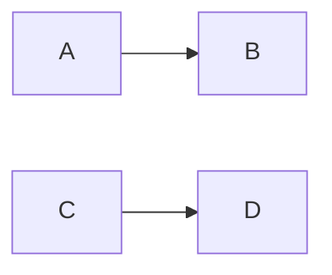

# Wave 9, CP2 and CP3 — regressions as a gate, the `adopt` skill: Implementation Plan

> **For agentic workers:** REQUIRED SUB-SKILL: Use superpowers:subagent-driven-development
> (recommended) or superpowers:executing-plans to implement this plan task-by-task. Steps use
> checkbox (`- [ ]`) syntax for tracking.
>
> **The wave is the dispatch unit, not the task.** One implementer per dispatched wave (A and C),
> every task keeping its own failing test, verification and commit; Waves B and D are the
> controller's final review and pull request. Do not dispatch one subagent per task.
>
> **Two pull requests, in parallel sessions.** CP2 is `wp/cp2-regressions` (Waves A–B), CP3 is
> `wp/cp3-adopt` (Waves C–D), each cut from `dev` and merged into it when its own checks are green.
> `0.6.0` is cut once both have merged, by the umbrella plan's Task 3
> (`docs/plans/2026-10-15-wave-9-umbrella.md`).
>
> **Revised 2026-10-26** after a three-seat review of the first text (premise and oracle;
> simplicity; boundary and security): its Task 2 (`regressions` as a built-in gate that counts as
> repository code) met the review at seven sites and two consent surfaces, and the owner chose to
> make it a custom gate instead; its Task 3 (a short `--base`) was cut by the owner. "Review of
> 2026-10-26" below says where each finding went.

**Goal:** a closed bug whose entry names the test that proves its fix keeps that test passing, run
as one of the project's own gates; a project that has run `init` is offered the adoption as a skill
of its own, whose consent step holds wherever it is invoked; and a `code_roots` entry the walks
cannot use is reported instead of dropped without a word.

**Architecture:** CP2 adds `stayfixed bugs regressions`: it runs each `fixed` entry's `regression`
argv through `stayfixed.prove.api.prove` in-process, one after another, prints one line per entry
and exits non-zero when any is not proved. It becomes a gate the documented way a project adds
one, `[gates.custom.regressions] run = [...]`, so ordering, the base-landed wait, the stop after a
failure, the consent before a clone's commands run, the disclosure row and process-group ending
are the custom gates' own. CP3 moves `skills/init/references/adoption.md` to
`skills/adopt/SKILL.md`, makes `init`'s last step offer it, makes its first step find the custom
gates itself through `assess --builtin`, and reports dropped `code_roots` entries in `assess` and
in `stayfixed test hygiene`.

**Tech Stack:** Python ≥ 3.11 standard library at runtime; `uv`, pytest (`-n auto`), ruff, mypy,
the mutation oracle (`scripts/mutation_oracle.py`), towncrier fragments in `changelog.d/`.

**Spec:** the agent-harness extraction design, in a private repository this one cannot link to:
§15.8 decisions 36 (regressions, amended by L-10: locally they run as custom gates do, with no
approval) and 37 (the `adopt` skill, offered as `init`'s last step, and BR-010), and the umbrella
plan's Design rule and its CP2 and CP3 Lane-plan items, which this revision departs from where
"Owner's rulings" says so.

**Scope:** a change belongs here iff it (a) reads or runs a bug entry's `regression` (CP2); (b)
moves the adoption into its own skill, rewords `init`'s walk around it, or makes its consent step
independent of `init`'s output (CP3); (c) reports a dropped `code_roots` entry (CP3); or (d)
restates the documents those changes falsify. Out, by the umbrella's CP2 item: the argv read at the
merge base, a regressions step in `check.yml`, overlay-register regressions, evidence records,
`bugs new --regression`. Out, by the owner on 2026-10-26: PF1 and PF2, a built-in `regressions`
gate, a short `--base`.

## Owner's rulings of 2026-10-26

- **`regressions` is a documented custom gate, not a built-in** (review F-1, shape b). The umbrella's
  CP2 item ("a gate name in the existing builtin/enforced vocabulary, not a new key") is amended:
  no name is added to `BUILTIN_GATES`, so nothing is reserved and the preset is unchanged.
- **No short `--base`** (review M-9): the umbrella's "`gate --base` takes a short name" is cut; the
  default is already `refs/remotes/origin/<base_branch>` and CI passes a full commit id.
- **PF1 and PF2 are deferred together**, with an `init` that does not write a profile's rules files
  for an attached checkout: the one profiled repository the owner has tracks both files, so PF2
  would never fire, and PF1 alone would only stop rule updates reaching it.

## Rulings this plan takes for the owner

Each costs what is said if wrong.

- **A closed entry is `status: fixed`.** `rejected` has no fix to regress, `partial` is still open
  and `void` is a renumber's pointer; those may carry `regression` (the parser allows it) and are
  not run. If wrong: a partial fix's proven half goes unguarded until the entry is closed.
- **Adversary and anchor of the regressions gate.** The argv is read from the tree a pull request
  wrote, so a hostile pull request can rewrite it as it can rewrite the test: the gate catches an
  honest regression, never a hostile edit, and is a convenience — it fails only a run whose named
  test is not proved and asks nothing. Who runs it is decided where every custom gate's is: the
  base-landed `run`, and the person's yes before a clone's commands run.
- **Each regression gets `[gates] custom_timeout_seconds`; the gate's own bound is the same value
  for the whole set.** A project with many slow regressions raises it. If wrong: a long set ends
  `could not run` at the gate's bound, never silently.
- **BR-010 is reported, never refused** (review I-8): `ledger.code_roots` is written by the preset
  and the repository only, and a slow walk hurts only that repository's own sessions, so a refusal
  stops no adversary. One rule covers every entry `contained_roots` drops (`.`, `..`, an absolute
  path, a link on the way, a missing directory): `assess` names each, and `stayfixed test hygiene`
  stops calling a tree with no usable root clean. Measured on 2026-10-26: taking `.` as the root,
  the entry's own suggestion, returned `None` from the stale-bytecode walk on the owner's checkout
  (its walk ran past `fsops.WALK_ENTRIES` through 68 directories under `.claude/worktrees/`) after
  about 5.8 s of a hook's 10 s timeout.

## Premise

Measured at `dev` = `11fe104` (after HS4). Each wave re-measures its own premise and stops on a
mismatch.

- **The `regression` field.** `src/stayfixed/ledger/register.py` `BUG_SCHEMA` declares
  `lists=("regression",)`; `src/stayfixed/ledger/entries.py` `parse_entry` builds `Entry.lists`, so
  `entry.lists["regression"]` is a `tuple[str, ...]`, `()` when absent, and an item holding a
  control character makes the whole ledger a `LedgerError` (`CONTROL_IN_ITEM`). `Entry.path` is a
  `Path` relative to the root. `src/stayfixed/ledger/api.py` exports `load_entries(root, register)`
  and `bug_register(config)`.
- **`prove`.** `src/stayfixed/prove/api.py` exports `prove`, `Receipt`, `Verdict`; `prove(argv, *,
  cwd, environ, timeout, adapters=None, echo=None, junit=None) -> Receipt`; `Verdict` is `proved`,
  `failed`, `not proven`, `refused`. It runs the runner in a session of its own with `/dev/null` as
  stdin and ends its process group on timeout. A Ctrl-C, SIGTERM or SIGHUP during a run returns a
  receipt whose reason is `INTERRUPTED` instead of raising (`src/stayfixed/prove/run.py`). `line`
  in `src/stayfixed/prove/run.py` is the one-line text and is not exported; `stayfixed prove`
  echoes the runner to stderr under `--json` (`src/stayfixed/prove/commands.py`).
- **Custom gates.** `[gates.custom.<name>] run` is an argv run from the project root, never through
  a shell, with both streams on stayfixed's stderr, in a session of its own whose group gets
  SIGTERM past `custom_timeout_seconds` and SIGKILL 5 s later (`src/stayfixed/assess/gates.py`
  `_custom`). In the reusable workflow it runs in the second step with `PYTHONPATH:
  stayfixed/src` and only the runner image and the step's interpreter
  (`.github/workflows/check.yml`, "The project's own gates").
- **Consent.** `init` prints a `note:` naming the custom gates of a `stayfixed.toml` it kept
  (`src/stayfixed/project/init.py`, `src/stayfixed/project/commands.py`); the adoption's step 1
  asks before running them only when that note was printed, and otherwise runs `stayfixed assess`
  (`skills/init/references/adoption.md`). `assess --builtin` runs no custom gate and prints
  `NOT_RUN` (`src/stayfixed/assess/commands.py`), naming the gates it left out.
- **The init walk.** `skills/init/SKILL.md` (64 lines) ends with "9. Start the adoption:
  [references/adoption.md](references/adoption.md).", reached on every path. There is no `adopt`
  skill yet. `tests/skills/test_skills.py` holds `SKILL_MAX_LINES = 80`, a required-names subset,
  and `test_the_init_skill_asks_before_it_runs_a_kept_file_s_custom_gates` and
  `test_the_init_skill_keeps_a_no_to_the_clone_s_commands_through_the_whole_adoption`, which read
  the adoption file; `mutations/repository.toml` has the entry "the init skill hands over adopt
  promote without --builtin after a no" on that file. `skills/README.md` says "The six authored
  skills" and defines one as naming its commands and reference and ending with what it does not do;
  `README.md` says "The adoption skill that walks a plan with the agent ships in a later package".
- **BR-010.** `src/stayfixed/guards/roots.py` `contained_roots` folds an entry with `PurePosixPath`
  and drops whatever `contained()` refuses (`except PathEscape: continue`) or is no directory.
  `stayfixed test hygiene` (`src/stayfixed/guards/commands.py`) prints only counts and fixed
  sentences, never a `code_roots` entry, and says "tree is clean" over an empty root list.
  `tests/ledger/test_scan.py` pins that `bugs check`'s sweep skips `..` without a word.
- **Counts left alone:** 10 hook entries and 11 smoke rows (`scripts/smoke_hooks.py`), 17 `doctor`
  rows, five built-in gates.

## Global Constraints

- Runtime imports the standard library only; every write goes through `stayfixed.fsops`; a value a
  repository wrote (an entry id, a `code_roots` entry, a path) is printed through
  `stayfixed.printed`, never raw.
- Cross-area imports go through each area's `api.py` (`tests/boundaries/test_api_surface.py`); a
  name is exported there only for a caller outside the area, and that `api.py`'s docstring lists it
  in the same commit.
- A refusal or fixed sentence is a named constant, and a test asserting it asserts the constant.
- No design id (a `§`, a decision number, a review id) and no BR id in any tracked file outside
  `docs/plans/`; the ledger lives in a private overlay.
- Each task restates the documents its change falsifies and writes one changelog fragment per
  user-visible change in the same commit.

## Execution contract

Copied verbatim from the umbrella plan, whose rule is that every lane plan carries it: the
executing session receives this plan alone. The controller copies the relevant part into every
brief, post-pull-request dispatches included.

1. **The wave is the dispatch unit.** Waves are lettered and own a run of continuously numbered
   tasks; one implementer per dispatched wave, with no review of its own (the pull request's final
   review is the review), every task keeping its own failing test, verification and commit. A
   fix round goes to the same implementer while its context allows, else to a fresh agent with the
   review package. Every subagent runs on Opus (`model: opus`).
2. **Every implementer brief says:** report a mismatch with the tree instead of guessing; run a
   command and paste what it printed before writing any claim about it; focused runs while
   iterating and per commit; before each push, once, a full run of `uv run pytest -n auto --cov
   --cov-fail-under=92` with `uv run python scripts/release.py check`, and the suite again on
   Python 3.13 (`uv run --python 3.13 pytest -n auto`), the oracle's interpreter in CI, since a
   local uv Python is often newer than any CI leg (CI holds 3.11.4 and the rest); a plan's predicted
   mutation outcome is a hypothesis — design your own if it does not redden, and paste the raw
   output either way; no line numbers from the plan; this brief is a message, not a file, so cite
   only the plan; write nothing under the repository but the task's files, use
   `<scratchpad>/<wave>-<role>/`, never run a script you did not write, and read `git diff --stat`
   before committing; the static checks at CI's scope (`uv run ruff check .`,
   `uv run ruff format --check .`, `uv run mypy`); do not use the Agent tool; do not run
   `git checkout`, `restore`, `stash` or `clean`; start a long run in the background and wait on
   its own output, never with `pgrep`.
3. **Every reviewer brief adds:** run every command yourself and never use the Agent tool; do not
   run `git checkout`, `restore`, `stash` or `clean`; what already passed, by sha and suite, and run
   only the test that decides a finding you suspect; no citation may point at a brief, a dispatch
   or a report; what later tasks own.
4. **One final review per pull request**, with two read-only seats: correctness, and "who does
   this refuse, and what can be deleted". A security seat joins only when the diff touches an
   anchor repository bytes cannot move (CI's base read, the binding id in the git common
   directory, repository-path containment, the exclude ordering). Reviewers give findings only, with no replacement text, and a
   separate triage sends on only correctness and requirement gaps. Then one scoped re-review of
   the fixes, and stop: no per-wave reviews, and no minor finding rides a round.
5. **The lifecycle matrix**, walked at pre-flight like a task and again by the correctness seat:
   every configuration key the pull request adds × every change of configuration — set a value,
   change it, unset it, move a path, a step that fails part-way, `uninstall` — × only the layers
   the key's class admits (the class-table test holds where a key may be set); a command that
   reads no configuration walks no layer.
6. **The parallelism map.** Read-only seats run beside each other and beside the implementer;
   writers of one worktree serialise; one heavy local run (the full suite, the mutation oracle) at
   a time per host; no local full run while the same branch's CI runs.
7. **Templates.** A fix brief enumerates the sibling instances of the defect's class only to
   delete them or fold them into one rule, never to extend a refusal list. After a simplification
   ruling it carries a net budget: `src` below zero, tests and mutation entries at zero or less. A
   new defect found during a cut is filed in the ledger, not fixed, unless the fix deletes code. A
   security ruling names its minimal preconditions, its anchor's provenance (who can write the
   bytes it trusts), and one legitimate user it must not refuse.
8. **Verification.** The controller re-verifies only heads it pushes or merges, re-derives the pull
   request's body from the diff before every push, takes the run id from `gh pr checks` and waits
   with `gh run watch <run-id> --exit-status` until every job has ended (never a `head_sha` query,
   which finds no run for a pull request's merge ref) before reporting a pull request done.
9. **Second finding at one seam.** At the second review finding that points at the same function,
   reader or boundary, the next step is a redesign of that seam put to the owner, not a third patch.
   A second bypass of the same refusal list counts as the same seam.
10. **Mutation entries.** A new entry only for a branch that decides a verdict, a containment or a
    data-loss path; other assertions need neither an entry nor a "why none" sentence; deleting a
    control deletes its entries (owner, 2026-10-19).

## Review Focus

1. **A regression set interrupted part-way** — Ctrl-C locally, or the custom gate's SIGTERM at its
   bound in CI. `prove` returns an `INTERRUPTED` receipt rather than raising, so a loop that goes on
   would start the next runner after the signal. Task 1 pins that an interrupted receipt ends the
   run with no further regression started.
2. **`bugs regressions --json` with a runner that prints.** stdout must stay one JSON object; the
   runner's output belongs on stderr, as a custom gate's and `prove --json`'s do. Task 1 pins it
   under `capfd`, which sees file descriptors a runner inherits.
3. **`adopt` invoked on its own** — a later session, or a clone of an adopted repository — where no
   `init` output precedes it. Its first step must still ask before any custom gate runs. Task 2
   pins it in the skill's text and its test.
4. **A `code_roots` entry a person cannot see dropped**: `["."]`, `["src", "lib"]` with `lib`
   missing, `["../shared"]`. `assess` names each and why; `test hygiene` with no usable root does
   not say clean. Task 3 pins all three.
5. **The documented recipe in both places it runs.** The `run` argv must reach a stayfixed and the
   regression's runner locally and in the reusable workflow's second step. Task 1 runs the recipe
   in both shapes before writing it down.

## Waves

| Wave | Tasks | Pull request | Who |
|---|---|---|---|
| A | 1 | CP2 | one implementer |
| B | — | CP2 | controller: final review, pull request |
| C | 2–3 | CP3 | one implementer |
| D | — | CP3 | controller: final review with a security seat, pull request |

CP3's final review adds a security seat: Task 2 rewrites the step that asks a person before a
clone's commands run. CP2 adds no path a command reaches that a custom gate does not already have.
The waves share no import; both touch `docs/cli.md` (different sections) and `README.md`
(different rows), so whichever pull request merges second merges `origin/dev` first.

### Wave A — Task 1 (dispatched; pull request CP2)

#### Task 1: `stayfixed bugs regressions`, and the gate that runs it

**Files:**
- Create: `src/stayfixed/ledger/regressions.py`
- Modify: `src/stayfixed/ledger/commands.py`, `src/stayfixed/prove/api.py` (export `line`; its
  docstring names the ledger as an importer), `docs/cli.md` (a `bugs regressions` section after
  `bugs check`; the `regression` paragraph; a recipe under the custom gates' paragraph),
  `README.md` ("What stayfixed sends where": the prove row's launchers), `mutations/records.toml`
- Create: `changelog.d/+bugs-regressions.feature.md`
- Test: `tests/ledger/test_regressions.py` (create)

**Interfaces:**
- Consumes: `prove`, `Receipt`, `Verdict` and `line` from `src/stayfixed/prove/api.py`; `Entry`,
  `load_entries` and `bug_register` from inside the ledger area.
- Produces: `regressions(root: Path, config: Config, *, echo: TextIO) -> list[tuple[Entry,
  Receipt]]` in `src/stayfixed/ledger/regressions.py` — every entry with `status == "fixed"` and a
  non-empty `lists["regression"]`, in id order, each run through `prove(argv, cwd=root,
  environ=os.environ, timeout=config.gates.custom_timeout_seconds, echo=echo)`; it stops after the
  first receipt whose reason is `INTERRUPTED` and returns what it has. Not exported: its one caller
  is in the area.
- Produces: the command `stayfixed bugs regressions [--root PATH]`. Text: one line per entry,
  `<id>: <line(receipt)>`, then `<n> regression(s), <m> not proved`, or one fixed sentence when no
  fixed entry carries one. `--json` (the CLI frame's): `{"regressions": [{"id", "path",
  "verdict", "line"}], "not_proved": <m>}` with `path` as a POSIX string. Exit 0 when every one is
  proved or there are none, 1 otherwise, 130 after an interrupt. The runner's output goes to
  stderr (`echo=sys.stderr`) in both forms.

- [ ] **Step 1: Write the failing tests** in `tests/ledger/test_regressions.py`, over a scratch
  repository with a ledger and a one-test pytest project, each calling the command through
  `tests/cli.py`:
  - `test_a_fixed_entry_whose_regression_passes_is_proved`: exit 0; the entry's line carries
    `proved`.
  - `test_a_failing_regression_exits_1_and_names_its_entry`: exit 1; the line starts with the id.
  - `test_a_passing_sibling_is_not_counted_as_not_proved`: two fixed entries, one failing;
    `not_proved == 1` in `--json`.
  - `test_only_fixed_entries_run`: `open`, `partial`, `rejected` and `void` entries carrying an argv
    that would fail; none appears.
  - `test_an_argv_no_adapter_recognises_is_not_proved`: argv `["sh", "-c", "echo 3 passed"]`;
    verdict `not proven`.
  - `test_an_interrupted_regression_starts_no_further_one`: monkeypatch `prove` to return an
    `INTERRUPTED` receipt for the first of two entries; one result, exit 130. Mutation: drop the
    stop.
  - `test_json_stays_one_object_while_the_runner_prints`: under `capfd`, stdout parses as one JSON
    object and the runner's summary line is on stderr.
  - The status test and the verdict test each get a mutation entry in `mutations/records.toml`
    (`== "fixed"` → any status; `is Verdict.PROVED` → always true). The timeout is `prove`'s, held by
    `tests/prove/test_run.py`; no wall-clock test here.
- [ ] **Step 2:** run `uv run pytest tests/ledger/test_regressions.py -q`. Expected: every test
  fails on the behaviour (add the module as a stub first, so the first red is not an
  `ImportError`).
- [ ] **Step 3: Implement** `regressions` and the command.
- [ ] **Step 4:** run the file again; expected all pass. Run each new mutation entry with
  `uv run python scripts/mutation_oracle.py <a substring of its name>` and paste the output.
- [ ] **Step 5: The recipe, measured before it is written.** In a scratch project with a fixed
  entry and a passing regression, run `stayfixed gate --only regressions` with
  `[gates.custom.regressions] run = ["stayfixed", "bugs", "regressions"]` and an installed
  `stayfixed` on `PATH`; then, in a shell with `PYTHONPATH=<this checkout>/src` and no `stayfixed`
  on `PATH`, the reusable workflow's spelling `["python3", "-m", "stayfixed", "bugs",
  "regressions"]`. Paste both outputs. `docs/cli.md` then gives both spellings, says the regression's
  runner must be on `PATH` where the gate runs (a project whose runner lives in its own environment
  wraps the argv in the command that provides it), and that `[stayfixed] enforced` naming it makes a
  failing regression fail the run. The README's prove row names `stayfixed bugs regressions` beside
  `stayfixed prove --`. Commit: `feat(ledger): run each fixed entry's regression through prove`.

### Wave B — controller (pull request CP2)

- [ ] Final review by item 4 of the contract at the wave's head (two seats); triage; one fix round;
  one scoped re-review. No configuration key is added, so the lifecycle matrix walks only
  `[gates.custom.regressions]` added, its `run` changed and removed, and `[stayfixed] enforced`
  naming it.
- [ ] Open `wp/cp2-regressions` into `dev`; wait for the checks as item 8 says; write Findings.

### Wave C — Tasks 2–3 (dispatched; pull request CP3)

#### Task 2: The `adopt` skill, offered last, asking first wherever it runs

**Files:**
- Create: `skills/adopt/SKILL.md`, by `git mv` of `skills/init/references/adoption.md`, so its
  history follows
- Modify: `skills/init/SKILL.md`, `skills/README.md`, `README.md` (the adoption sentence and the
  skills paragraph), `tests/skills/test_skills.py`, `mutations/repository.toml`
- Create: `changelog.d/+adopt-skill.feature.md`

**Interfaces:**
- Produces: a skill named `adopt`, in the authored skills' shape (`skills/README.md`): it names
  the commands it runs, and ends by saying what it does not do. Its step 1 no longer reads `init`'s
  output: it runs `stayfixed assess --builtin` first; when that prints `NOT_RUN`, it names the gates
  left out, says the next command runs their commands on this machine, and asks for an explicit
  yes (silence, a timeout or an empty answer is a no); on a yes it runs `stayfixed assess`, on a no
  it keeps the `--builtin` result, and a no holds for every later command. Steps 2–5 are the
  adoption file's, unchanged but for links.

- [ ] **Step 1: Write the failing tests** in `tests/skills/test_skills.py`: `"adopt"` joins the
  required-names subset; the two tests that read the adoption file are renamed
  `test_the_adopt_skill_asks_before_it_runs_the_custom_gates` and
  `test_the_adopt_skill_keeps_a_no_to_the_clone_s_commands_through_the_whole_adoption` and read the
  moved file; the first asserts that step 1 runs `stayfixed assess --builtin` before any plain
  `stayfixed assess` and that no sentence of the skill conditions the question on an `init` note;
  `test_init_offers_the_adopt_skill_as_its_last_step`: `skills/init/SKILL.md` no longer
  links `skills/init/references/adoption.md`, and its last walk step names the `adopt` skill.
- [ ] **Step 2:** run `uv run pytest tests/skills -q`. Expected: the new and renamed tests fail.
- [ ] **Step 3: Implement.** The `git mv`; the frontmatter (`name: adopt`, a description saying it
  takes a repository that has run `init` to its gates enforced, and when to use it); step 1 as the
  Interfaces block says; a closing line on what it does not do (it writes no gate and edits no
  `stayfixed.toml`). `init`'s step 9 becomes "Offer the `adopt` skill", on every path that reaches
  it, and the rule on a user-written `stayfixed.toml` says its custom gates are asked about by the
  `adopt` skill's first step. `skills/README.md`: seven authored skills, `adopt` among them;
  `README.md`: the "later package" sentence goes, and the skills paragraph lists `adopt`. The
  mutation entry follows the file: its `file` is the moved path, its name says the adopt skill, its
  `reddens` the renamed test.
- [ ] **Step 4:** run `uv run pytest tests/skills tests/test_documents.py -q` and the moved mutation
  entry; paste both. Commit: `feat(skills): make the adoption a skill init offers, asking first`.

#### Task 3: Dropped `code_roots` entries are reported

**Files:**
- Modify: `src/stayfixed/guards/roots.py`, `src/stayfixed/guards/api.py`,
  `src/stayfixed/assess/probes.py`, `src/stayfixed/guards/commands.py`, `docs/cli.md` (the
  `ledger.code_roots` row; `assess`'s probe list; `test hygiene`'s output), `mutations/guards.toml`,
  `mutations/assess.toml`
- Create: `changelog.d/+code-roots-reported.fix.md`
- Test: `tests/guards/test_hygiene.py` (where `contained_roots` is tested),
  `tests/assess/test_probes.py`, `tests/guards/test_commands.py`

**Interfaces:**
- Produces: `dropped_roots(root: Path, config: Config) -> list[tuple[str, str]]` in
  `src/stayfixed/guards/roots.py`, exported from `src/stayfixed/guards/api.py` — each
  `ledger.code_roots` entry `contained_roots` leaves out, in config order, with one of three fixed
  reasons: `ROOT_ITSELF` ("names the repository root, so a walk would take in every environment and
  worktree under it"), `NOT_CONTAINED` (outside the tree, or through a link) and `NOT_A_DIRECTORY`.
  `contained_roots` is unchanged and both share one loop.
- Produces: an `assess` probe `code-roots` whose item names each dropped entry through
  `stayfixed.printed` with its reason; and `NO_ROOTS = "no [ledger] code_roots entry names a
  directory here, so there was nothing to check"`, which `stayfixed test hygiene` prints in place of
  "tree is clean" when `contained_roots` is empty.

- [ ] **Step 1: Write the failing tests:** `dropped_roots` for `["."]`, `["./"]`, `["src", "lib"]`
  with `lib` missing and `["../shared"]`, each reason asserted by its constant; a folded spelling
  (`"src/"`, `"./src"`) is not dropped
  (`tests/guards/test_hygiene.py::test_a_code_root_spelled_with_a_trailing_or_leading_slash_is_still_walked`
  stays green); the `assess` probe's item for `["."]`; `stayfixed test hygiene` with
  `code_roots = ["."]` prints `NO_ROOTS` and no "clean".
- [ ] **Step 2:** run them. Expected: fail.
- [ ] **Step 3: Implement.** No refusal anywhere; `bugs check`'s sweep keeps skipping silently (its
  `..` test stays), since `assess` now names the entry.
- [ ] **Step 4:** run the touched test files; mutation entries for the `NO_ROOTS` branch (print
  "clean" over an empty list) and the probe's report (drop it); paste the oracle's output. Then the
  full run item 2 names. Commit: `fix(guards): say which code roots are dropped, and never call an
  unwalked tree clean`.

### Wave D — controller (pull request CP3)

- [ ] Final review by item 4 with three seats (correctness; who does this refuse and what can be
  deleted; security, for Task 2's consent step); triage; one fix round; one scoped re-review.
- [ ] Open `wp/cp3-adopt` into `dev`; wait as item 8 says; write Findings. After the merge the owner
  closes BR-010 in the overlay's ledger against the merge commit.

---

## Review of 2026-10-26

Three read-only seats and the controller, at `a283260`. Where each finding went:

| Finding | Where it went |
|---|---|
| C-1, C-2, I-1, I-5b, I-6, I-7, M-7 (a built-in `regressions` keyed on `name in custom` at seven sites and two consent surfaces) | the owner's F-1 ruling: a custom gate; the old Task 2 is deleted |
| C-3 (the adoption's consent step keyed on `init`'s note) | Task 2's step 1 runs `assess --builtin` first |
| H-1 (the security-seat decision) | Waves: CP3's review gets one; CP2 adds no new path |
| H-2 (the pull requests share the adoption file) | moot: CP2 no longer touches it |
| I-2 (no toolchain in CI's second step) | Task 1 Step 5 measures both spellings and documents the bound |
| I-3 (an interrupt does not stop the loop) | Task 1's Interfaces and its interrupt test; Review Focus 1 |
| I-4 (where the echo goes) | Task 1: stderr in both forms, tested under `capfd` |
| I-5a (the README's disclosure row) | Task 1 Step 5 |
| I-8 (the `.` refusal names no adversary) | ruling: reported, never refused; Task 3 |
| I-9 (the loader never reads `code_roots` by name) | moot: no loader change |
| I-10 (the timeout test) | dropped: the timeout is `prove`'s, held by its own tests |
| I-11 (an advisory gate exits 0) | Task 1 Step 5's docs say `enforced` makes it fail |
| I-12, I-13, M-9 (the short `--base`) | the owner cut the task |
| I-14 (the control-byte test cannot fail) | dropped: the parser refuses the item |
| M-1 (`Path` against `str`) | Task 1's `--json` `path` is a POSIX string |
| M-2 (the ledger api surface) | `regressions` is not exported |
| M-3 (`--json` is the frame's) | Task 1 specifies the data's shape instead |
| M-4 (the prose test), M-5 (the falsified texts) | Task 2's tests and Step 3 |
| M-6 (two fragments for one feature) | one fragment |
| M-8 (the refusal's length) | moot: no refusal |
| M-10 (no total bound) | ruling: the custom gate's bound is the set's |
| M-11 (the reason token is invisible) | holds: `line()`'s words are what a person reads |
| T-1 (the copied contract) | kept: the umbrella requires it, and the executing session has only this plan |
| T-2 to T-7 (restated text, bookkeeping, decision 38 cited) | trimmed |
| T-8 (`plan check`'s dead references) | full paths for what exists; `plan check` run before the commit |

## Findings

Written by Waves B and D when their pull requests merge.
