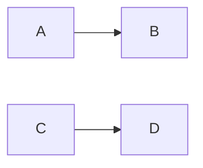

# Wave 9, CP2 and CP3 — regressions in the gate, the `adopt` skill: Implementation Plan

> **For agentic workers:** REQUIRED SUB-SKILL: Use superpowers:subagent-driven-development
> (recommended) or superpowers:executing-plans to implement this plan task-by-task. Steps use
> checkbox (`- [ ]`) syntax for tracking.
>
> **The wave is the dispatch unit, not the task.** Waves are lettered (`A`, `B`, …) and own a
> run of the continuously numbered tasks. One implementer per **dispatched** wave, with no review
> of its own; inside a wave every task keeps its own failing test, verification and commit. Do not
> dispatch one subagent per task.
>
> **Waves B and D are not dispatched.** Each runs its pull request's final review and opens it;
> the controller runs both.
>
> **Two pull requests, one plan, independent of each other.** CP2 is `wp/cp2-regressions` into
> `dev` (Waves A–B); CP3 is `wp/cp3-adopt` into `dev` (Waves C–D). Neither imports what the other
> writes, so they run in parallel sessions, each cut from `dev`; each merges when its own checks are
> green (umbrella plan, `docs/plans/2026-10-15-wave-9-umbrella.md`, amended 2026-10-18). `0.6.0` is
> cut once both have merged, by the umbrella's Task 3.

**Goal:** a closed bug whose entry names the test that proves its fix keeps that test passing, as a
gate a project opts into; and a project that has just run `init`'s full walk is offered the
adoption as a skill of its own, while a `code_roots` entry the walks cannot use is said out loud
instead of dropped.

**Architecture:** CP2 adds one ledger function that runs each `fixed` entry's `regression` argv
through `stayfixed.prove.api.prove` in-process and turns every verdict but `proved` into a finding
that names the entry; a command, `stayfixed bugs regressions`, prints it, and a gate named
`regressions` in `BUILTIN_GATES` runs it. The gate executes commands the repository wrote, so every
place that keeps such commands out of a run (`gate --builtin`, `assess --builtin`, `adopt promote
--builtin`) asks one predicate that now counts it beside the custom gates. `gate --base` and `adopt
promote --base` also take a branch's short name, resolved by stayfixed to a full ref before git
sees it. CP3 moves `skills/init/references/adoption.md` to `skills/adopt/SKILL.md`, makes `init`'s
last step offer it on the full walk only, and has the loader refuse a `ledger.code_roots` entry
that names the repository root.

**Tech Stack:** Python ≥ 3.11 standard library at runtime; `uv`, pytest (`-n auto`), ruff, mypy,
the mutation oracle (`scripts/mutation_oracle.py`), towncrier fragments in `changelog.d/`.

**Spec:** the agent-harness extraction design, in a private repository this one cannot link to —
§15.8 decisions 36 (regressions, amended by L-10), 37 (the `adopt` skill and BR-010) and 38
(profiles), and the umbrella plan's Design rule and Lane-plan items for CP2 and CP3, cited by their
ids. Every value a task needs from the spec is written into the task.

**Scope:** pull requests CP2 and CP3 of package core-proof. A change belongs here iff it (a) reads
or runs a bug entry's `regression`, or names `regressions` as a gate (CP2); (b) resolves a short
`--base` (CP2); (c) moves the adoption into its own skill or rewords `init`'s walk around it (CP3);
(d) fixes BR-010 (CP3); or (e) restates the documents those changes falsify. Out, by the CP2 item
of the umbrella: the argv read at the merge base and its fixture [N-23], a regressions step or
upload in `check.yml` [F9, P-CP-11], overlay-register regressions, a project key for an unbound
checkout [C-39], evidence records, `bugs new --regression`. Out, by the owner on 2026-10-26: PF1
and PF2 (below).

## Owner's rulings of 2026-10-26

- **`0.5.0` skips `0.4.0`.** No release was cut between `0.3.1` and HS4's merge, so `0.5.0` carries
  RC1, CP1 and HS1–HS4; `0.6.0` (P6's exit) and `0.7.0` (launch) keep their numbers.
- **PF1 and PF2 are deferred together.** Decision 38 has `init` record only the profile choice and
  release the rules files a project committed, because PF2 delivers those rules as context. Measured
  on 2026-10-26: the only one of the owner's repositories with a profile tracks both rules files
  (`docs/stayfixed/rules/python.md` and `.claude/rules/stayfixed-python.md`), and `init` writes
  them for every profiled repository, so PF2 would never fire and PF1 alone would only stop rule
  updates reaching it. Both return with an `init` that does not write the files for an attached
  checkout. The launch graph's `HS1, HS2 → PF1 → PF2` edges are dropped from this release.
- **A ledger sweep came first** (ledger only): BR-002, BR-003, BR-006, BR-009, BR-016, BR-020 and
  BR-021 closed by HS2–HS4's deletions; BR-007, BR-008, BR-013, BR-024 and BR-026 partial. BR-010
  is open and is CP3's.

## Rulings this plan takes for the owner

Each costs what is said if wrong.

- **A closed entry is `status: fixed`.** `rejected` has no fix to regress, `partial` is still
  open work and `void` is a renumber's pointer; an entry of those statuses may carry `regression`
  (the parser allows it) and is not run. If wrong: a partial fix's proven half goes unguarded until
  the entry is closed.
- **`regressions` runs where custom gates run.** It executes commands the repository wrote, so it
  is the project's-own-gates class: skipped by `gate --builtin` (the judging step), `assess
  --builtin` and `adopt promote --builtin`, run by `gate --custom` and by a run with no part. CI
  needs no step of its own: `check.yml`'s second step runs `gate --custom`. Adversary and anchor:
  the argv is read from the tree a pull request wrote, so a hostile pull request can rewrite it as
  it can rewrite the test; the gate catches an honest regression, never a hostile edit, which makes
  it a convenience — it fails only a run whose named test is not proved, and asks nothing.
- **Not in the preset's default `[defaults.gates] builtin`.** A project opts in by listing it.
- **A regression the runner adapters do not recognise fails** with `prove`'s own verdict (`not
  proven`, reason `not-recognised`): an argv that cannot be proved proves nothing.
- **A short `--base` resolves `refs/remotes/origin/<name>` first, then `refs/heads/<name>`**, each
  asked with `git show-ref --verify`, never git's own resolution, which would let a tag of the same
  spelling win (the reason `BASE_SHAPE` exists). Neither there is a refusal naming both.
- **BR-010: `.` is refused, not walked.** The entry's suggested fix (take `.` as the root) was
  measured on 2026-10-26 on the owner's checkout with a populated `.venv` and 34 agent worktrees among 68 under
  `.claude/worktrees/`: `_stale_bytecode([<root>])` returned `None` (its walk ran past
  `fsops.WALK_ENTRIES`) after about 5.8 s of a hook's 10 s timeout, against `31` for `src` and
  `tests`. So the loader refuses an entry that folds to `.` and names the directories to list.

## Premise

Measured at `dev` = `11fe104` (after HS4). Each wave re-measures its own premise and stops on a
mismatch.

- **The `regression` field.** `src/stayfixed/ledger/register.py` `BUG_SCHEMA` declares
  `lists=("regression",)`; `src/stayfixed/ledger/entries.py` `parse_entry` builds `Entry.lists`,
  so `entry.lists["regression"]` is a `tuple[str, ...]`, `()` when absent. Statuses are
  `open`, `partial`, `fixed`, `rejected`, `void`. `bugs check` reports a malformed list as
  `unreadable-entry`. `stayfixed.ledger.api` exports `load_entries(root, register)` and
  `bug_register(config)`; its docstring lists every outside importer.
- **`prove`.** `stayfixed.prove.api` exports `prove`, `Receipt`, `Verdict`; `prove(argv, *, cwd,
  environ, timeout, adapters=None, echo=None, junit=None) -> Receipt`; `Verdict` is `proved`,
  `failed`, `not proven`, `refused`; `stayfixed.prove.run.line(receipt)` is the one-line text. No
  module outside `prove/` imports it today.
- **Gates.** `BUILTIN_GATES = ("docs", "bugs", "plan", "commit", "trail")` in
  `src/stayfixed/config/schema.py`; `BUILTIN` in `src/stayfixed/assess/gates.py` holds one `Gate`
  per name in that order, and `tests/assess/test_gates.py` asserts the order and parses every
  `Gate.command` with the real parser. The loader refuses a `builtin` name outside the tuple. The
  three places that keep repository commands out of a run test `name in config.gates.custom`:
  `run_gate` for `--part builtin` (`src/stayfixed/assess/commands.py`), `assess` with `builtin`
  (`src/stayfixed/assess/assessment.py`) and `adopt promote --builtin`
  (`src/stayfixed/assess/state.py`).
- **The preset.** `src/stayfixed/presets/recommended.toml` `[defaults.gates]` has
  `builtin = ["docs", "bugs", "plan", "commit", "trail"]` and `custom_timeout_seconds = 600`.
  Tests that read the default as the whole tuple: `tests/config/test_loader.py` ("preset runs every
  built-in gate"), `tests/assess/test_gates.py`, `tests/assess/test_assessment.py`,
  `tests/assess/test_neutral_rows.py`, and `tests/test_documents.py`'s check of `docs/cli.md`'s
  Configuration block.
- **`--base`.** `BASE_REF = r"\A(?:[0-9a-f]{40}|refs/[A-Za-z0-9._/-]+)\Z"` and `BASE_SHAPE` in
  `src/stayfixed/assess/rule.py`; `gate` and `adopt promote` take `--base` through
  `grammar(BASE_REF, BASE_SHAPE)`, so `--base dev` is refused at the parser; the default is
  `config.layout.local_base(config)`, `refs/remotes/origin/<base_branch>`.
- **The init walk.** `skills/init/SKILL.md` (64 lines) ends its walk with "9. Start the adoption:
  [references/adoption.md](references/adoption.md).", which runs on the skip path too;
  `skills/init/references/adoption.md` is 50 lines; `skills/adopt/` does not exist; the CLI has
  `adopt promote` and no `adopt begin`. `tests/skills/test_skills.py` holds `SKILL_MAX_LINES = 80`,
  a subset of required skill names, and two tests that read the adoption file by path;
  `mutations/repository.toml` has one entry whose `file` is that path. `skills/README.md` says
  "The six authored skills".
- **BR-010.** `src/stayfixed/guards/roots.py` `contained_roots` folds an entry with
  `PurePosixPath`, which turns `.` and `./` into `.`, and `contained()` refuses `.`
  (`fsops.checked_components`), so the entry is dropped with `except PathEscape: continue`. Its
  callers — test hygiene's notice and `stayfixed test hygiene`, `bugs check`'s mention sweep,
  `memory/refs.py`, `assess`'s TODO probe — then see no roots. `ledger.code_roots` is a
  `GATE_PARAMETER` (`src/stayfixed/config/classes.py`), default `["src", "tests", "scripts"]`.
- **Counts this plan leaves alone:** 10 hook entries and 11 smoke rows
  (`scripts/smoke_hooks.py`), 17 `doctor` rows. Neither pull request adds a hook entry or a row.

## Global Constraints

- Runtime imports the standard library only; every write goes through `stayfixed.fsops`; a value a
  repository wrote (an argv, an entry id, a path) is printed through `stayfixed.printed`, never raw.
- Cross-area imports go through each area's `api.py` (`tests/boundaries/test_api_surface.py`); a
  new importer is added to that `api.py`'s docstring list in the same commit.
- A refusal is a named constant, and a test asserting it asserts the constant.
- New mutation entries only for a branch that decides a verdict, a containment or a data-loss path,
  in the group file `scripts/mutation_oracle.py` `GROUP_OF` routes the source to
  (`src/stayfixed/assess/` → `assess`; `src/stayfixed/ledger/` → `records`;
  `src/stayfixed/config/` → `core`; `skills/` → `repository`).
- Each task restates the documents its change falsifies (`docs/cli.md`, `README.md`,
  `skills/README.md`) and writes its changelog fragment in `changelog.d/` in the same commit.
- No design id (a `§`, a decision number, a lane-plan id in brackets) in any file outside
  `docs/plans/`. BR ids appear only here and in commit messages, never in tracked code or docs:
  the ledger lives in a private overlay.
- Each pull request prints `git diff --shortstat <base> HEAD -- src tests mutations docs` in its
  review package.

## Execution contract

Copied verbatim from the umbrella plan; the controller copies the relevant part into every brief,
post-pull-request dispatches included.

1. **The wave is the dispatch unit.** Waves are lettered and own a run of continuously numbered
   tasks; one implementer per dispatched wave, with no review of its own (the pull request's final
   review is the review), every task keeping its own failing test, verification and commit. A
   fix round goes to the same implementer while its context allows, else to a fresh agent with the
   review package. Every subagent runs on Opus (`model: opus`).
2. **Every implementer brief says:** report a mismatch with the tree instead of guessing; run a
   command and paste what it printed before writing any claim about it; focused runs while
   iterating and per commit; before each push, once, a full run of `uv run pytest -n auto --cov
   --cov-fail-under=92` with `uv run python scripts/release.py check`, and the suite again on
   Python 3.13 (`uv run --python 3.13 pytest -n auto`), the oracle's interpreter in CI, since a
   local uv Python is often newer than any CI leg (CI holds 3.11.4 and the rest); a plan's predicted
   mutation outcome is a hypothesis — design your own if it does not redden, and paste the raw
   output either way; no line numbers from the plan; this brief is a message, not a file, so cite
   only the plan; write nothing under the repository but the task's files, use
   `<scratchpad>/<wave>-<role>/`, never run a script you did not write, and read `git diff --stat`
   before committing; the static checks at CI's scope (`uv run ruff check .`,
   `uv run ruff format --check .`, `uv run mypy`); do not use the Agent tool; do not run
   `git checkout`, `restore`, `stash` or `clean`; start a long run in the background and wait on
   its own output, never with `pgrep`.
3. **Every reviewer brief adds:** run every command yourself and never use the Agent tool; do not
   run `git checkout`, `restore`, `stash` or `clean`; what already passed, by sha and suite, and run
   only the test that decides a finding you suspect; no citation may point at a brief, a dispatch
   or a report; what later tasks own.
4. **One final review per pull request**, with two read-only seats: correctness, and "who does
   this refuse, and what can be deleted". A security seat joins only when the diff touches an
   anchor repository bytes cannot move (CI's base read, the binding id in the git common
   directory, repository-path containment, the exclude ordering). Reviewers give findings only, with no replacement text, and a
   separate triage sends on only correctness and requirement gaps. Then one scoped re-review of
   the fixes, and stop: no per-wave reviews, and no minor finding rides a round.
5. **The lifecycle matrix**, walked at pre-flight like a task and again by the correctness seat:
   every configuration key the pull request adds × every change of configuration — set a value,
   change it, unset it, move a path, a step that fails part-way, `uninstall` — × only the layers
   the key's class admits (the class-table test holds where a key may be set); a command that
   reads no configuration walks no layer.
6. **The parallelism map.** Read-only seats run beside each other and beside the implementer;
   writers of one worktree serialise; one heavy local run (the full suite, the mutation oracle) at
   a time per host; no local full run while the same branch's CI runs.
7. **Templates.** A fix brief enumerates the sibling instances of the defect's class only to
   delete them or fold them into one rule, never to extend a refusal list. After a simplification
   ruling it carries a net budget: `src` below zero, tests and mutation entries at zero or less. A
   new defect found during a cut is filed in the ledger, not fixed, unless the fix deletes code. A
   security ruling names its minimal preconditions, its anchor's provenance (who can write the
   bytes it trusts), and one legitimate user it must not refuse.
8. **Verification.** The controller re-verifies only heads it pushes or merges, re-derives the pull
   request's body from the diff before every push, takes the run id from `gh pr checks` and waits
   with `gh run watch <run-id> --exit-status` until every job has ended (never a `head_sha` query,
   which finds no run for a pull request's merge ref) before reporting a pull request done.
9. **Second finding at one seam.** At the second review finding that points at the same function,
   reader or boundary, the next step is a redesign of that seam put to the owner, not a third patch.
   A second bypass of the same refusal list counts as the same seam.
10. **Mutation entries.** A new entry only for a branch that decides a verdict, a containment or a
    data-loss path; other assertions need neither an entry nor a "why none" sentence; deleting a
    control deletes its entries (owner, 2026-10-19).

## Review Focus

1. **A regression whose runner hangs or forks.** The gate runs in the same process as `stayfixed
   gate`; a regression past `[gates] custom_timeout_seconds` must end with its process group, as a
   custom gate does, and the next regression must still run. Task 1 pins it with a regression whose
   argv sleeps past a 1-second timeout.
2. **Output of a passing regression in a gate run.** `prove` echoes the runner's output to stdout
   by default; inside `stayfixed gate` that would bury the gate's own lines and break `--json`.
   Task 1 pins that the gate run echoes nothing and `bugs regressions` echoes the runner's output.
3. **An entry id or argv carrying control bytes.** Both are repository bytes; the finding and the
   command's lines print them through `stayfixed.printed`. Task 1 pins an argv item holding `\x1b`.
4. **`--base` naming a branch that is also a tag.** The resolved ref must be the branch's, never
   the tag's. Task 3 pins it with a tag and a branch of one name pointing at different commits.
5. **`code_roots = ["."]` under NOTE mode** (a session hook, not a command): the refusal must
   reach the session as the loader's per-key warning with the preset's default in its place, not
   end the hook. Task 5 pins it through the hook path's loader entry point.

## Waves

| Wave | Tasks | Pull request | Dispatched | Plan lines (approx.) |
|---|---|---|---|---|
| A | 1–3 | CP2 | yes, one implementer | 140 |
| B | — | CP2 | no: final review, pull request | 20 |
| C | 4–5 | CP3 | yes, one implementer | 90 |
| D | — | CP3 | no: final review, pull request | 20 |

Expected dispatches: two implementers, two seats per final review (correctness; who does this
refuse and what can be deleted), one scoped re-review each — about eight. Neither diff touches an
anchor repository bytes cannot move, so no security seat: CP2 runs repository commands only in the
part that already runs them.

Launch graph, drawn over the imports in each task's Interfaces block:

A and C share no import and no file but `docs/cli.md` (different sections) and `changelog.d/`
(different fragments); whichever merges second merges `origin/dev` first.

### Wave A — Tasks 1–3 (dispatched; pull request CP2)

#### Task 1: The ledger's regressions and `stayfixed bugs regressions`

**Files:**
- Create: `src/stayfixed/ledger/regressions.py`
- Modify: `src/stayfixed/ledger/api.py`, `src/stayfixed/ledger/commands.py`,
  `src/stayfixed/prove/api.py` (docstring's importer list), `docs/cli.md` (a `bugs regressions`
  section after `bugs check`), `mutations/records.toml`
- Create: `changelog.d/+bugs-regressions.feature.md`
- Test: `tests/ledger/test_regressions.py` (create)

**Interfaces:**
- Consumes: `stayfixed.prove.api.prove`, `Receipt`, `Verdict`; `stayfixed.prove.run.line` (export
  it through `prove/api.py` if it is not there); `stayfixed.ledger.entries.Entry`,
  `load_entries`, `bug_register`.
- Produces: `regressions(root: Path, config: Config, *, echo: TextIO | None) ->
  list[tuple[Entry, Receipt]]` — every entry with `status == "fixed"` and a non-empty
  `lists["regression"]`, in id order, each run through `prove(argv, cwd=root, environ=os.environ,
  timeout=config.gates.custom_timeout_seconds, echo=echo)`; `regressions_gate(root: Path, config:
  Config, base: str = "") -> list[Finding]` — one `Finding("regression", entry.path, None,
  line(receipt))` per receipt whose verdict is not `Verdict.PROVED`, run with an `echo` that
  discards; both exported from `stayfixed.ledger.api`.

- [ ] **Step 1: Write the failing tests** in `tests/ledger/test_regressions.py`, each over a
  scratch repository with a ledger and a one-test pytest project:
  - `test_a_fixed_entry_whose_regression_passes_is_proved_and_the_gate_is_green`: `regressions`
    returns one receipt with `Verdict.PROVED`; `regressions_gate` returns `[]`.
  - `test_a_failing_regression_fails_the_gate_and_names_its_entry`: the test fails; the gate's one
    finding has `rule == "regression"` and `path` equal to the entry's path.
  - `test_a_passing_sibling_is_not_named`: two fixed entries, one failing; one finding, the failing
    entry's.
  - `test_only_fixed_entries_run`: entries with `open`, `partial`, `rejected` and `void` carrying a
    regression whose argv would fail; no receipts.
  - `test_an_argv_no_adapter_recognises_fails_as_not_proven`: argv `["sh", "-c", "echo 3 passed"]`;
    one finding whose detail carries `not proven`.
  - `test_a_regression_past_the_timeout_ends_and_the_next_still_runs`: `custom_timeout_seconds = 1`,
    the first argv sleeps 5 s, the second passes; two receipts, the first not proved, and the run
    took under 5 s.
  - `test_the_gate_echoes_nothing_and_the_command_echoes_the_runner`: capture stdout; empty for
    `regressions_gate`, the runner's summary line for `stayfixed bugs regressions`.
  - `test_an_argv_item_with_a_control_byte_is_printed_through_printed`: an item holding `\x1b`;
    the command's output holds no raw `\x1b`.
- [ ] **Step 2:** run `uv run pytest tests/ledger/test_regressions.py -q`. Expected: every test
  fails on the missing module (add a stub module first, so the first red names the behaviour).
- [ ] **Step 3: Implement** `regressions` and `regressions_gate` in
  `src/stayfixed/ledger/regressions.py`, and `stayfixed bugs regressions [--root PATH] [--json]` in
  `src/stayfixed/ledger/commands.py`: one line per entry, `<id>: <line(receipt)>`, then
  `N regression(s), M not proved`; exit 0 when every one is proved or none exists, 1 otherwise.
  If `prove` in-process does
  not end a timed-out runner's process group (read `src/stayfixed/prove/run.py`), report the mismatch
  rather than wrapping it.
- [ ] **Step 4:** run the file again. Expected: all pass. Add mutation entries for the `status ==
  "fixed"` test and the `is not Verdict.PROVED` test, each naming the test that reddens; run each
  with `uv run python scripts/mutation_oracle.py <substring of its name>` and paste the output.
- [ ] **Step 5:** `docs/cli.md`: the `bugs regressions` section (what it reads, what it runs, exit
  codes, that the argv comes from the tree), and the `regression` field's paragraph says a `fixed`
  entry's argv is run by it. Commit: `feat(ledger): run a fixed entry's regression through prove`.

#### Task 2: `regressions` as a gate that runs where custom gates run

**Files:**
- Modify: `src/stayfixed/config/schema.py` (`BUILTIN_GATES`), `src/stayfixed/assess/gates.py`
  (`BUILTIN`, one predicate), `src/stayfixed/assess/commands.py`, `src/stayfixed/assess/assessment.py`,
  `src/stayfixed/assess/state.py`, `docs/cli.md` (the `gate` section and the Configuration block),
  `mutations/assess.toml`
- Create: `changelog.d/+regressions-gate.feature.md`
- Test: `tests/assess/test_gates.py`, `tests/assess/test_assessment.py`,
  `tests/config/test_loader.py`, `tests/assess/test_neutral_rows.py`, `tests/test_documents.py`

**Interfaces:**
- Consumes: `stayfixed.ledger.api.regressions_gate` (Task 1).
- Produces: `BUILTIN_GATES` ending in `"regressions"`; `PRESET_GATES: tuple[str, ...] = ("docs",
  "bugs", "plan", "commit", "trail")` in `schema.py`, the preset default the tests compare with;
  `runs_repository_code(config: Config, name: str) -> bool` in `src/stayfixed/assess/gates.py` —
  true for a custom gate and for `regressions`.

- [ ] **Step 1: Write the failing tests:**
  - `tests/assess/test_gates.py::test_the_judging_part_skips_regressions_and_the_custom_part_runs_it`:
    a project listing `regressions` with a failing regression; `gate --builtin` exits 0 and names no
    `regressions` row; `gate --custom` fails naming it.
  - `tests/assess/test_assessment.py::test_assess_builtin_skips_regressions`: listed and failing;
    `assess --builtin` lists it as skipped, as a custom gate is.
  - `tests/assess/test_state.py::test_adopt_promote_builtin_does_not_promote_regressions`.
  - `tests/config/test_loader.py`: the "preset runs every built-in gate" test becomes "the preset
    runs `PRESET_GATES`", and a new test asserts `builtin = ["regressions"]` loads.
  - The tests that compare a default run with `BUILTIN_GATES` compare with `PRESET_GATES`;
    `tests/test_documents.py`'s Configuration-block check reads the preset's list.
- [ ] **Step 2:** run them. Expected: the new tests fail; the rewritten comparisons fail on the
  missing `PRESET_GATES`.
- [ ] **Step 3: Implement.** Append `"regressions"` to `BUILTIN_GATES`; add
  `Gate("regressions", None, "run `stayfixed bugs regressions` and fix each test it names, or
  reopen the entry", "bugs regressions", regressions_gate)` to `BUILTIN` in tuple order; replace the
  three `name in custom` tests with `runs_repository_code(config, name)`; the judging part's comment
  says it keeps every repository-authored command out. The `landed` wait for custom gates stays
  custom-only.
- [ ] **Step 4:** run the touched test files, then the mutation entry "the judging part runs
  regressions" (drop `regressions` from `runs_repository_code`), which the first test must redden;
  paste the output.
- [ ] **Step 5:** `docs/cli.md`: the `gate` section's `--builtin`/`--custom` paragraph names
  `regressions` with the custom gates, and the Configuration block keeps the preset's five. Commit:
  `feat(gate): add regressions, run with the project's own gates`.

#### Task 3: A short `--base`

**Files:**
- Modify: `src/stayfixed/assess/rule.py`, `src/stayfixed/assess/commands.py`, `docs/cli.md`
  (`gate` and `adopt promote`), `mutations/assess.toml`
- Create: `changelog.d/+gate-base-short.change.md`
- Test: `tests/assess/test_rule.py`, `tests/assess/test_gate_command.py`

**Interfaces:**
- Produces: `BRANCH_NAME = re.compile(r"\A(?!refs/)(?!-)[A-Za-z0-9._/-]+\Z")`;
  `resolve_base(root: Path, value: str) -> str` in `src/stayfixed/assess/rule.py` — `value` when it
  matches `BASE_REF`, else `refs/remotes/origin/<value>` or `refs/heads/<value>`, the first that
  `git show-ref --verify --quiet` finds; else `Refusal(BASE_NAME_NOT_FOUND.format(name=…))`, the
  name printed through `stayfixed.printed`.

- [ ] **Step 1: Write the failing tests:**
  - `test_a_short_base_resolves_the_remote_tracking_branch_first`;
  - `test_a_short_base_falls_back_to_the_local_branch`;
  - `test_a_tag_of_the_same_name_never_wins`: a tag `dev` and a branch `dev` at different commits;
    the resolved ref is the branch's;
  - `test_a_short_base_that_names_nothing_is_refused`: asserts `BASE_NAME_NOT_FOUND`;
  - `test_gate_and_adopt_promote_take_a_short_base`: both parsers accept `--base dev`; a
    40-hex id and a `refs/` name still pass through unchanged.
- [ ] **Step 2:** run them. Expected: fail.
- [ ] **Step 3: Implement.** The parser type for both `--base` flags accepts `BASE_REF` or
  `BRANCH_NAME` (else `BASE_SHAPE`, reworded to say a short name is resolved by stayfixed, remote
  first); `run_gate` and `run_adopt_promote` call `resolve_base` once root is known, before
  anything reads the base. `read_base` keeps its own `BASE_REF` check.
- [ ] **Step 4:** run the files; add the mutation entry "resolve_base asks git to resolve the
  name" (replace the two `show-ref --verify` calls with `rev-parse <name>`), which the tag test
  must redden; paste the output. Then, before the push, the full run the contract's item 2 names.
- [ ] **Step 5:** `docs/cli.md`: both `--base` descriptions. Commit:
  `feat(gate): resolve a short --base to the branch, never a tag`.

### Wave B — Task-free (controller; pull request CP2)

- [ ] Final review by item 4 of the contract at the wave's head; triage; one fix round; one
  scoped re-review. The lifecycle matrix walks `[gates] builtin` gaining and losing `regressions`
  and `[stayfixed] enforced` naming it, in the layers `gates.builtin`'s class admits.
- [ ] Open `wp/cp2-regressions` into `dev`; wait for the checks as item 8 says; write Findings.

### Wave C — Tasks 4–5 (dispatched; pull request CP3)

#### Task 4: The `adopt` skill, offered at the end of the full walk

**Files:**
- Move: `skills/init/references/adoption.md` → `skills/adopt/SKILL.md` (`git mv`, so its history
  follows)
- Modify: `skills/adopt/SKILL.md` (frontmatter), `skills/init/SKILL.md`, `skills/README.md`,
  `README.md` (the skills paragraph), `tests/skills/test_skills.py`, `mutations/repository.toml`
- Create: `changelog.d/+adopt-skill.feature.md`

**Interfaces:**
- Produces: a skill named `adopt` whose description starts "Adopt stayfixed's gates in a repository
  that has run init"; its five steps are adoption.md's, unchanged but for the links that moved.

- [ ] **Step 1: Write the failing tests** in `tests/skills/test_skills.py`: add `"adopt"` to the
  required-names subset; repoint the two tests that read the adoption file to `skills/adopt/SKILL.md`
  (the "keeps a no" test globs `init/SKILL.md`, `init/references/*.md` and `adopt/SKILL.md`); add
  `test_init_offers_the_adopt_skill_only_on_the_full_walk`: `skills/init/SKILL.md` no longer links
  `references/adoption.md`, names the `adopt` skill in its last walk step, and its skip step (step 2)
  says the skip ends after the write.
- [ ] **Step 2:** run `uv run pytest tests/skills -q`. Expected: the new and repointed tests fail.
- [ ] **Step 3: Implement.** `git mv`; give the moved file `name: adopt` and a description (over
  40 characters, under the line cap); rewrite `init`'s step 9 as "On the full walk, offer the
  `adopt` skill; on the skip, say it is there when the gates should be enforced, and stop", and the
  description and the custom-gates rule ("their commands run from the adoption's first step")
  accordingly; `skills/README.md` "seven authored skills"; `README.md`'s skills paragraph lists
  `adopt`. Repoint the `mutations/repository.toml` entry's `file`.
- [ ] **Step 4:** run `uv run pytest tests/skills tests/test_documents.py -q` and the repointed
  mutation entry; paste both. Commit: `feat(skills): make the adoption a skill init offers last`.

#### Task 5: A `code_roots` entry naming the root is refused (BR-010)

**Files:**
- Modify: the loader function that builds `Ledger` (find it from `src/stayfixed/config/loader.py`'s
  `[ledger]` section; report a mismatch if `code_roots` is not read there), `docs/cli.md` (the
  `ledger.code_roots` row), `mutations/core.toml`
- Create: `changelog.d/+code-root-dot.fix.md`
- Test: `tests/config/test_loader.py`, `tests/guards/test_hygiene.py`

**Interfaces:**
- Produces: `CODE_ROOT_IS_ROOT = "ledger.code_roots lists {entry}, the repository root itself; list
  the directories that hold code instead, since a walk from the root takes in every virtual
  environment, dependency tree and worktree under it"` in the loader module.

- [ ] **Step 1: Write the failing tests:** `test_a_code_root_that_names_the_root_is_refused` for
  `"."`, `"./"` and `".//"`, asserting `CODE_ROOT_IS_ROOT` with the entry quoted;
  `test_a_code_root_naming_the_root_warns_under_note_mode_and_keeps_the_default` through the
  session's loader entry point; `src/`, `./src` and `.//tests` still load (the existing hygiene test
  `test_a_code_root_spelled_with_a_trailing_or_leading_slash_is_still_walked` stays green).
- [ ] **Step 2:** run them. Expected: fail.
- [ ] **Step 3: Implement** the refusal on an entry whose `PurePosixPath(entry).as_posix() == "."`,
  in the loader, where NOTE mode's per-key fallback applies. `contained_roots` is unchanged.
- [ ] **Step 4:** run `tests/config/test_loader.py` and `tests/guards`; add the mutation entry
  "the loader takes `.` as a code root" (drop the check), which the first test reddens; paste the
  output. Then the full run of item 2. Commit: `fix(config): refuse a code root that names the
  repository root`.

### Wave D — Task-free (controller; pull request CP3)

- [ ] Final review by item 4; triage; one fix round; one scoped re-review. The lifecycle matrix
  walks `ledger.code_roots` set to `.` in each layer `GATE_PARAMETER` admits.
- [ ] Open `wp/cp3-adopt` into `dev`; wait as item 8 says; write Findings. After the merge the
  owner closes BR-010 in the overlay's ledger against the merge commit.

---

## Findings

Written by Waves B and D when their pull requests merge.
