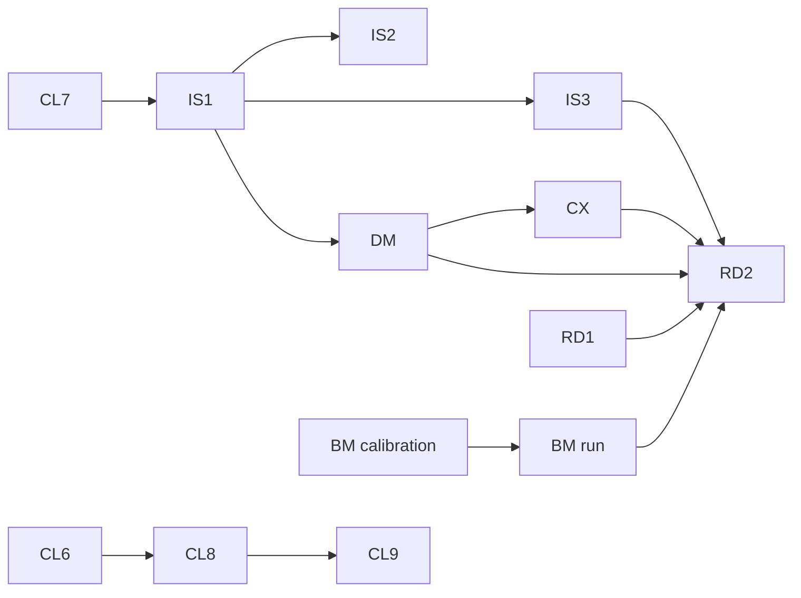

# Wave 10 — launch readiness, `v0.7.0`: Umbrella Plan

> **For agentic workers:** this plan is not dispatched. It coordinates the wave's lanes, each of
> which has its own plan, its own worktree and its own session. It fixes what crosses a lane: the
> launch graph, the two releases, file ownership and hot spots, the lane-plan items, the execution
> contract every lane plan cites in its header, and the wave's exit. Its own tasks (Releases and
> Exit, below) are controller-run with the owner, step by step. A lane plan's REQUIRED SUB-SKILL
> line is superpowers:subagent-driven-development, and its header carries the wave-dispatch rule and
> cites the section "Execution contract" here by path, without copying it.

**Goal:** launch stayfixed as `v0.7.0` and file the Anthropic directory submission with it. Wave 10
delivers:

- a first screen that says what stayfixed counts and what it cannot stop, released early as a
  docs-only `0.6.2` so readers see it;
- a deterministic demo fixture, with its recording and a `Stop`-hook recipe;
- a small with/without benchmark run in CI;
- Codex parity of the core, as measured;
- four deletion-only cuts;
- every open GitHub issue resolved.

**Architecture:** seven lanes in parallel sessions, and two releases. RD1 rewrites the first screen
and the storefront descriptions, and `0.6.2` ships them before the first article. The other lanes:

- **IS** resolves the seven issues in three pull requests.
- **CL** makes four deletion-only cuts.
- **DM** builds the fixture and the recipe.
- **CX** measures Codex against what DM ships.
- **BM** calibrates early and runs last, in GitHub Actions.
- **IC** adds the icon and the policy-hold restatements.
- **RD2** writes the launch README over everything the others shipped.

Every pull request merges into `dev` when its checks are green and the launch graph allows. `v0.7.0`
is cut once every lane is on `dev`.

**Tech Stack:** Python ≥ 3.11 standard library at runtime; `uv`, pytest (`-n auto`), ruff, mypy,
the mutation oracle (`scripts/mutation_oracle.py`), towncrier fragments in `changelog.d/`,
`scripts/release.py`, `scripts/plugin_tree.py`, `claude plugin eval`.

**Spec:** the agent-harness extraction design, in a private repository this one cannot link to.
- **§15.10:** wave 10's decisions 1–11, settled with the owner on 2026-10-28 in a brainstorm and
  revised the same day on two independent final reviews.
- **§15.1:** P7's exit.
- **§15.8:** wave 9's decisions, where §15.10 leans on them.
- **§15.5:** the deferred list.

A wave-10 decision is cited here as "w" and its number, a wave-9 one as "d" and its number. A lane
plan's implementer cannot open the spec, so every value a task needs from it is written into the
lane plan itself.

**Scope:** wave 10 as w1–w8 and w11 cut it. A change belongs to this plan iff it fixes something
that crosses lanes:

- an edge of the launch graph;
- a release;
- the owner of a file two lanes touch;
- a lane-plan item;
- the execution contract;
- the wave's exit.

Every change to code belongs to a lane plan.

**Out of scope (w1, w8):**
- the overlay's subset sharing, re-sorted by hand by the owner instead, with no code;
- folding `trust` into the reviewed record;
- the metrics report and the visual roadmap;
- the pull-request verdict comment;
- per-gate precision, the false-block label and the evidence records;
- PF1 and PF2;
- the MCP server;
- the design's rewrite.

Event bundles stay in the overlay and never reach the core. The articles are the owner's own text
(w9) and no task of this plan; the controller's support for them is the section "Launch writing".

**Premise:** measured on 2026-10-28 at `dev` = `9d8492c` (`0.6.0` cut as `003af80`, then #128 and
#130).

- **Hooks.** `hooks/hooks.json` holds 10 entries: 7 `SessionStart`, and one each on `PreToolUse`,
  `PostToolUse` and `PostToolUseFailure`, all three matching `Bash`. There is no `Stop` entry.
- **Smoke.** The smoke workflow greps `10 entries, 11 row(s), 0 failure(s)` and asserts `doctor`'s 17
  rows (`.github/workflows/smoke.yml`). The 17 is also pinned in `tests/doctor/test_checks.py`,
  `tests/test_install_path.py`, `tests/test_documents.py`, `README.md`, `docs/cli.md` and
  `skills/doctor/SKILL.md`, and the smoke literal in `tests/scripts/test_smoke_scripts.py`.
- **Storefront.** "fail closed" stands in `pyproject.toml`, `.claude-plugin/plugin.json`,
  `.claude-plugin/marketplace.json`, `.codex-plugin/plugin.json` and `README.md`.
  `tests/test_manifests.py` `_storefront` reads them as one.
- **README.** It says "Released as 0.6.0" and opens on a 40-line paragraph. The default branch is
  `main`, which moves only to release commits.
- **Plugin tree.** `scripts/plugin_tree.py` `PLUGIN_PATHS` names nine paths and no icon, and
  `tests/plugintree.py` pins them as `NINE`.
- **Binaries.** `tests/test_neutral.py` holds `UNDECODABLE = 0`. `tests/test_payload.py` already
  admits a signature-checked PNG or JPEG.
- **The timeout bound.** `check.yml` takes a `timeout-minutes` input bounded 5–60, with a failing
  step for anything outside.
- **`hooks/hashes.json`** exists, beside `release.py hashes` and `doctor`'s `files` row.
- **The frontmatter walk.** `src/stayfixed/doctor/frontmatter.py` and
  `src/stayfixed/doctor/hooked.py` hold 966 lines.
- **Mutations.** The oracle holds 2,670 entries. `scripts/mutation_oracle.py` `GROUP_OF` routes
  `scripts/` and `.github/` to `tooling` and the rest of the root to `repository`.
- **Issues.** Seven are open: #31 (retitled to the adoption-stage decision), #32, #33, #34, #37, #43
  and #47.

**Drift since, at `dev` = `7f24fb5` (wave 9 closed, #141).** `0.6.1` is released (`54b5d5c`,
tag `v0.6.1`): it carries `attach`'s fix (#137) and not RD1, and the README says "Released as
0.6.1". `hooks/hashes.json` changed again (#135, the `run-hook.sh` digest), and `docs/cli.md`,
`mutations/doctor.toml`, `mutations/repository.toml`, `mutations/attach.toml`,
`src/stayfixed/doctor/model.py` and `src/stayfixed/attach/write.py` moved with wave 9's last pull
requests, so the 2,670 entries above no longer hold. The smoke literal and `doctor`'s 17 rows still
do, and the seven issues are still open.

Each lane plan measures its own premise against the tree it starts from and stops on a mismatch
there.

**Size, before the first dispatch:**
- about 11 pull requests and about 12 implementer waves, most of them small: CL's four are
  deletions, and RD1, RD2 and IC are controller-written;
- two read-only review seats per pull request, plus one scoped re-review;
- controller-run measurements: #32 on GitHub, CX on Codex, BM's probe and calibration;
- the expected net size of the wave's `src`: negative (CL deletes about 1,000 lines, and the issues
  move rather than add).

---

## Lanes

| Lane | Pull request | Branch | Plan |
|---|---|---|---|
| RD | RD1: the first screen on w7's headline and bound; the four storefront descriptions; the methodology principle that still calls the overlay a plugin | `docs/launch-first-screen` | none: controller-written with the owner; it touches manifests, so `scripts/ci_scope.py` runs the full matrix |
| IS | IS1: #33's placement moves, then #31's decision, then #34 | `wp/issues-assess` | `docs/plans/<date>-wave-10-issues.md`, one plan for IS1–IS3 |
| IS | IS2: #32's four checks on GitHub, and what they find | `wp/issues-workflow-verify` | the same plan |
| IS | IS3: #37 and #47, then #43 within the tracked-files contract | `wp/issues-gates` | the same plan |
| CL | CL6: `hooks/hashes.json`, `release.py hashes` and the hash half of `doctor`'s `files` row (w4a) | `cleanup/hashes` | `docs/plans/<date>-wave-10-cleanup.md`, one plan for CL6–CL9 |
| CL | CL7: the `timeout-minutes` bound and its failing step (w4b) | `cleanup/timeout-bound` | the same plan |
| CL | CL8: the skill-frontmatter hooks walk and the marker-provenance red (w4c) | `cleanup/frontmatter-walk` | the same plan |
| CL | CL9: compatibility code for releases only the owner ran (w4d) | `cleanup/back-compat` | the same plan |
| DM | the demo fixture and the `Stop`-hook recipe (w5, w3) | `wp/demo-fixture` | `docs/plans/<date>-wave-10-demo.md` |
| CX | Codex parity of the core, as measured (w6), with BR-014 | `wp/codex-parity` | `docs/plans/<date>-wave-10-codex-parity.md`, written after DM merges |
| BM | the benchmark: the instrument, the probe, the calibration, the run, in CI (w5) | `wp/bench` | the wave-7 side-lanes plan's Lane 2, rewritten in place against the tree |
| IC | the owner's icon and the policy-hold restatements (w11) | `wp/directory-icon` | none: controller-written once the owner delivers the artwork |
| RD | RD2: the launch README over what shipped | `docs/launch-readme` | none: controller-written with the owner, last |

All branches target `dev`. CL continues the cleanup lane's numbering (CL1–CL5 were wave 9's). A lane
plan is written in its lane's session from §15.10, this plan and the section "Lane-plan items", and it
cites the decisions by number.

## Launch graph

Drawn over the imports and the Interfaces blocks each lane plan names, never over file lists
alone. An edge means "merged into `dev`".

What each edge carries:

- **CL7 → IS1 → IS2.** CL7 removes the `timeout-minutes` bound from `check.yml` and its tests, and is
  ready first. #34 then rewrites the same file's base step and the tests' YAML reader. #32 verifies
  the workflow as both leave it, never the one they replace.
- **IS1 → IS3.** #33 splits `src/stayfixed/assess/rule.py`, moves `run_gate` into the domain and
  edits `src/stayfixed/docs/trail.py`. IS3's #37 changes `src/stayfixed/assess/gates.py` and #47 the
  tracked-file walk, so they build on the moved modules.
- **IS1 → DM.** #31 may change how a gate's adoption stage is spelt, removing the old spelling in
  the same pull request (d3 as amended). DM's regression act writes and asserts that configuration.
- **CL6 → CL8 → CL9.** All three edit `src/stayfixed/doctor/`, `tests/doctor/test_checks.py`,
  `src/stayfixed/harnesses.py`, `docs/cli.md`'s `doctor` section and `mutations/doctor.toml`. CL9
  removes the `retired-deny` row and folds the `files` row into `wrapper`, moving `doctor`'s count
  from 17 to 15 in one change, which about fifteen places pin.
- **DM → CX.** CX measures the `Stop`-hook recipe and the fixture's acts on Codex.
- **BM calibration → BM run.** The run's ceiling comes from the calibration's measured cost per run.
- **DM, CX, BM run, IS3, RD1 → RD2.** RD2 describes what shipped:
  - the fixture and the recording;
  - the recipe;
  - the capability table as CX measured it;
  - the benchmark's cases and raw result;
  - the `docs`/`trail` contract as IS3 left it for #43.

The remaining lanes need no edge:
- **RD1** depends on nothing and goes first.
- **IC** depends only on the owner's artwork. It merges before `v0.7.0`, and its README edit
  rebases on RD1.

## Releases

Two releases, each cut on `origin/main` from `dev` by `RELEASING.md`, which also runs
`scripts/publish_template.py`.

- **`0.6.2`, docs only (w11).** Cut as soon as RD1 has merged, and before the first article is
  published. It carries the first screen and the storefront descriptions, and nothing that changes
  behaviour. A lane pull request that merged into `dev` before the cut ships in it too, so the
  controller reads `git log v0.6.1..origin/dev` at the cut. Any behaviour change found there is the
  owner's call: wait, or ship.

  `0.6.1` is wave 9's: P6's exit check on `0.6.0` found that `attach` refused a repository with no
  `stayfixed.toml`, and the fix (the project found by its remote, else named from the remote's path)
  shipped as `0.6.1` on 2026-10-28, before RD1 merged.
- **`v0.7.0`.** Cut once every lane has merged. It carries the icon, and the directory submission
  goes in with it.

A pull request's checks are read with `gh pr checks` on its own head, after the latest `dev` has
come into it by `git merge origin/dev`. A push to `dev` re-runs no open pull request's checks, and
`ci.yml` runs on `push` to `main` only.

## File ownership and hot spots

A file two lanes touch has one owner at a time, in merge order; the other lane rebases on it. Every
lane writes its own changelog fragments, its own `docs/cli.md` sections and its own mutation entries,
appended to the group file `scripts/mutation_oracle.py` `GROUP_OF` routes them to.

| File or area | Owner, in order | Note |
|---|---|---|
| `README.md` | RD1 (the first screen), IC (the restated text a hold matched), CL6, CL8 and CL9 (their rows and the 17), CX (the capability table), IS3 (the `docs`/`trail` contract, if #43 changes it), then RD2 | **hot spot**: each lane quotes the previous lane's text it rewrites |
| `pyproject.toml`, `.claude-plugin/plugin.json`, `.claude-plugin/marketplace.json`, `.codex-plugin/plugin.json` | RD1 (the descriptions), IC (the icon in `.claude-plugin/plugin.json`), then the release tasks (the versions) | `tests/test_manifests.py` `_storefront` holds them as one |
| `.github/workflows/check.yml`, `tests/test_check_workflow.py` and its YAML reader | CL7, IS1 (#34), then IS2 | |
| `.github/workflows/smoke.yml`, `scripts/smoke_hooks.py`, `tests/scripts/test_smoke_scripts.py`, `src/stayfixed/doctor/`, `tests/doctor/` and the files that pin `doctor`'s 17 rows | CL6, CL8, CL9 (17 → 15), then CX (if it adds a Codex row) | **hot spot**: each quotes the previous lane's count in its plan |
| `hooks/` | CL6 (removes `hashes.json`) | no lane adds a hook entry |
| `src/stayfixed/assess/`, `src/stayfixed/docs/trail.py` | IS1, then IS3 | |
| `src/stayfixed/config/` | IS1 (#31's format, if it changes), CL9 (the preset's `[deny] retired`) | |
| `src/stayfixed/harnesses.py` | CL6 (a comment), CL8 (`Hooked` and `Harness.hooked`), then CX (BR-014) | |
| `src/stayfixed/guards/` | IC (comment restatements in `src/stayfixed/guards/bgcleanup.py` and `src/stayfixed/guards/commit.py`), then CX (BR-014) | |
| `src/stayfixed/config/loader.py` | IC (a restatement, only if the match is located), then IS1 | |
| `src/stayfixed/trust/record.py`, `src/stayfixed/overlay/template.py`, `src/stayfixed/presets/recommended.toml` | CL9 | |
| `src/stayfixed/release/`, `scripts/release.py` | CL6 | |
| `examples/` (create), its CI job in `.github/workflows/ci.yml` | DM | `GROUP_OF` routes `examples/` to `mutations/repository.toml` |
| `scripts/bench/` (create), `tests/scripts/test_bench.py` (create), its workflow (create) | BM | `GROUP_OF` routes both to `mutations/tooling.toml` |
| `scripts/plugin_tree.py` `PLUGIN_PATHS`, `tests/plugintree.py` `NINE`, `tests/test_neutral.py` `UNDECODABLE`, `.claude-plugin/icon.png` (create) | IC | the icon is the repository's first binary; `tests/test_payload.py` already admits it, and is not loosened |
| `skills/` | IC (the `attribute-failure` phrasing a hold matched), CL8 (the `doctor` skill's row count) | |
| `docs/methodology/principles.md` | RD1 | |

**Old spellings** (d3 as amended): there are no users besides the owner, so a pull request that
renames a key, a command or a flag removes the old spelling in the same pull request, with no alias
and no migration code.

## Design rule

`CONTRIBUTING.md` states the rule, and this plan cites it rather than restating it: every control
names the adversary it stops and the anchor it trusts. The owner's constraint for wave 10 is w10: no
redundancy and no security theater. Wave 10 adds no control to the core. The one refusal it ships, DM's `Stop`-hook
recipe, is an example a user installs, and it carries its adversary-and-anchor sentence in the DM
row below. The cuts (w4) remove four controls that failed the
rule, and each cut's pull request says which adversary the removed control named and why that
adversary reaches the anchor or is already stopped. A lane that finds it must add a control stops
and puts it to the owner with that sentence written.

## Lane-plan items

These are what the brainstorm and the two final reviews found that a lane plan must carry and §15.10
does not spell out. Each lane plan cites the items it takes.

| Lane | Items |
|---|---|
| RD1 | **First screen.** At most about 20 lines: three commands and the headline (w7). `prove` reads only the runner's own report, so a printed summary or the agent's prose is never counted. The gate reads its policy from the base branch, key by key, and stays advisory until earned. The overlay leaves no trace in `git status`. **Said plainly:** the agent can still weaken the tests; `proved` means "the runner reported green on this tree, for the tests this command selected"; the project's own CI test job runs the tests on the merged tree, and one line runs them through `prove`. **Wording:** "finer-grained", never "first"; superpowers named as an ally. **Dropped:** "fail closed" in the five storefront files; the undated count of about 2,300 plugins; Codex behaviour beyond the current table; any traction; mutation counts and lane counts. The methodology principle that calls the overlay a plugin is corrected (d31 retired that). Human-written with the owner. |
| IS1 | **#33 first**, as pure moves with no behaviour change: `base.py` split out of `src/stayfixed/assess/rule.py`; `run_gate` into the domain, returning a `GateRun`; one `GateFn`; `trail_gate` drops its unread `base` and raises instead of returning a sentinel finding; the lifecycle states as a `StrEnum` (this touches `src/stayfixed/config/schema.py`); the four items the issue "kept" each closed or written into `docs/cli.md`. **#31:** put to the owner at the lane's start, with both shapes priced: two coupled keys whose disagreements the loader refuses, or one value per gate naming its stage. Then implemented, the old spelling removed. **#34:** `check.yml` passes the raw platform values to `stayfixed gate` as one-argv `--name=value` flags, and Python checks them. Every shell guard moves intact, each with a Python test: the newline refusal, the base-mismatch refusal, the qualified ref, `check-ref-format`. `head_ref` is never passed. The Python step runs `-P -s` from the workflow-sha checkout. No test of a guard is deleted before its Python replacement holds the same case. |
| IS2 | #32's four checks run on GitHub, each with a stated expected value and a positive control. **1.** A merge queue on another branch neither runs nor skips the required check. **2.** A pull request retargeted to another base keeps no passing check from the old base. **3.** What the custom-gate step can reach: workflow commands (`::stop-commands::`, `::error::`), `$GITHUB_STEP_SUMMARY` and the runner environment (both checkouts use `persist-credentials: false`). **4.** How GitHub parses a `CODEOWNERS` line holding a non-breaking space, and whether `codeowners-scope` agrees. **Scratch repositories:** created with the owner's yes and **deleted by the owner**; the controller never takes `gh`'s `delete_repo` scope. Each result goes into the plan's Findings, and each that contradicts `docs/cli.md` is fixed in this pull request. |
| IS3 | **#37:** measure first whether cgroup v2's `cgroup.procs` and `cgroup.kill`, plain file writes under a delegated slice, end a descendant that left the gate's process group, on a Linux runner. If they do, implement it for Linux, with the macOS limitation in `docs/cli.md`. If not, the measurement goes to the owner, not a closure. **#47:** on an exact miss inside the walk, continue with git's case-folded spelling of that prefix when it names the same file; report `case-differs` only when the rest of the walk finds everything tracked, and `untracked` otherwise; each of the issue's three shapes is a test. The NFC/NFD case the issue lists as related is filed, not fixed. **#43:** resolved within the tracked-files contract (`docs/cli.md`): a project that keeps `AGENTS.md` or its roadmap private keeps them in the overlay's `projects/<name>/`, delivered as the overlay already delivers its rules; the `docs` and `trail` gates do not judge them, and `docs/cli.md` says so. No new delivery path; the closing comment states this. |
| CL | **One plan, four deletion-only pull requests (w4).** Each deletes its tests, `docs/cli.md` rows, README rows, changelog references and mutation entries in the same pull request, prints its net size, and says which adversary the removed control named and why it reaches the anchor or is already stopped. **CL6:** `hooks/hashes.json`, `release.py hashes`, `src/stayfixed/release/hashes.py`, the hash half of `doctor`'s `files` row; first confirm that the `wrapper` row reports a partially updated plugin, and if not, say so in the pull request. What is left of `files` (the executable bit) folds into `wrapper` in CL9, so the count changes once (the owner's ruling on this plan's final review). **CL7:** the 5–60 expression and the failing step; the input passes through. **CL8:** `src/stayfixed/doctor/frontmatter.py`, `src/stayfixed/doctor/hooked.py`, the marker-provenance red and the info line. **CL9:** the 0.3.x reader in `src/stayfixed/trust/record.py`, the `retired-deny` row and the preset's `[deny] retired`, `src/stayfixed/overlay/template.py`'s retired-files table. No pull request adds a line to `src` that is not a caller's adaptation to a removal. |
| DM | **`examples/`:** a script that builds a small repository from scratch, takes the `stayfixed` binary as an argument, prints `command -v` and `--version` first, and needs no model call and no network beyond a pinned, pre-installed pytest. Each act asserts the product's own exit code and its `--json` or stdout, never a line the script echoes. **1.** `prove` on a genuine run (`proved`, exit 0). **2.** `prove -- sh -c 'echo "42 passed"'` (`not proven`, exit 1). **3.** An all-skipped suite (`failed`, exit 1). **4.** A forging spelling (`refused`, exit 2). **5.** A closed bug whose regression fails an **enforced** gate (the gate's state set and asserted, then the verdict and the exit). **6.** `attach` under an isolated `HOME` over a scratch overlay holding one canary addressed to the project and one to another: the first arrives, the second does not, and `git status --porcelain` is empty before and after. **7.** The `Stop`-hook recipe (w3): a shipped example hook that runs `stayfixed prove -- <tests>` and exits 2 on anything but `proved`, with a stated cost per turn (a turn with no edit pays the run too), driven once on a red tree (exit 2), once on a green one (exit 0), and once on a red tree with `stop_hook_active: true` in its input (exit 0). The recipe reads its stdin JSON and lets the stop through when `stop_hook_active` is true, so a tree the agent cannot make green (an unrecognised runner, a time-out, a `refused`) costs one continuation, not an unbounded loop. Its sentence: the adversary is the agent's "done"; the agent in the session can edit the hook's settings file or weaken the tests, so the anchor is the user's own install and the harness's sandbox, and the recipe says so where it is shipped. **CI:** a job in `ci.yml` runs the script against the checkout's binary; act 6 needs `claude` on the runner, or that act is skipped and the skip is printed, never counted as a pass. "Under a minute" is a goal printed with the measured time, not an assertion. The recording (about 90 seconds) is made by the owner from the script on the `v0.7.0` candidate. |
| CX | **Measure first, on the Codex version current at the lane's start, before fixing tasks** (w6): whether stayfixed's hooks run once trusted and how a person trusts them; what Codex's `PostToolUse` carries for the red-run note (BR-014), which speaks on a signal Codex gives or stays documented as silent; how skills reach a Codex session; DM's `Stop`-hook recipe on Codex, whose `Stop` documents only a block. Nothing emulates Codex. The README's capability table and `doctor` say exactly what was measured, with the version and the date. Done when the table is filled; a fix it finds beyond BR-014 is filed. Every Codex run is the owner's to start where it needs a signed-in session. |
| BM | Rewrite the side-lanes plan's Lane 2 against the tree: `scripts/release.py check`; entries in `mutations/tooling.toml`; the plugin built with `scripts/plugin_tree.py`; the 512-file limit, which still stands at release (`scripts/release.py` `PLUGIN_FILES_MAX`). **Cases:** `control`, `fabricated-done`, `all-skipped`, `outside-plan`, `stale-green` (a test run, an edit, "done"); the calibration must show a non-zero failure rate *without* the plugin on `stale-green` and `fabricated-done`, or those cases measure nothing. **Isolation:** each repetition gets its own `HOME`, so the baseline arm loads none of the owner's user-scope plugins. **Where:** a GitHub Actions job, the isolated environment the plugin-eval documentation names. **The key** is the repository's first secret, so the job states its anchor: the adversary is a pull request that edits `scripts/bench/` or the workflow and gets it run; the job triggers on `workflow_dispatch` only (never `pull_request` or `pull_request_target`), the secret lives in a GitHub environment whose required reviewer is the owner and whose deployment branches are `dev` only, the job holds `permissions: contents: read`, and the key carries a spend limit at the provider, since `--max-cost-usd` is a flag the run's own code can drop. **Cost:** `--max-cost-usd` on every run; the probe, then the calibration, then the run, each after the owner's yes with its ceiling stated. **Published:** the cases, the raw JSON, the version, the cost and n; no comparison against neighbouring tools. |
| IC | `.claude-plugin/icon.png` (create) from the owner's artwork: square PNG or JPEG, 512 to 2,048 px, under 2 MB. It is named in `.claude-plugin/plugin.json` (the portal's "No icon" warning reads the manifest). It is the tenth path in `PLUGIN_PATHS` and in `tests/plugintree.py`, and `UNDECODABLE` goes 0 → 1 with its reason. **The 2026-10-15 holds:** four `MCP_FORWARDS_CREDENTIAL_ENV` findings, which were pattern hits on text: `README.md` (a remote host beside the word `env`), a comment's example URL in `src/stayfixed/guards/bgcleanup.py`, the `claude.com` link in `src/stayfixed/guards/commit.py`'s comment, and the `attribute-failure` skill's "pass `--base`" read beside `hooks/run-hook.sh`. Restate each where a restatement clears the match with no loss of meaning. `COMMAND_SCRIPT_NOT_FOLLOWED` on `hooks/run-hook.sh` waits for the reviewer, as the portal allows. The `RUNTIME_FETCH_EXEC` warning's `src/stayfixed/config/loader.py` match was never located: restate nothing there unless the portal names the line. |
| RD2 | Written over what shipped: the verdict table; the bound; the gate's base read; the `Stop`-hook recipe with its cost; the capability table as CX measured it; a factual neighbours-and-native table (prior art named, "finer-grained"); "What stayfixed sends where" re-read against `tests/outbound/policy.py`; the fixture's commands and the recording; the benchmark's cases and raw result. Human-written with the owner. |

## Execution contract

Every lane plan cites this section by path in its header and does not copy it, so there is one
text to amend. The controller copies the relevant part into every brief, post-pull-request
dispatches included.

1. **The wave is the dispatch unit.**
   - Waves are lettered and own a run of continuously numbered tasks.
   - Each dispatched wave gets one implementer and no review of its own: the pull request's final
     review is the review.
   - Every task keeps its own failing test, verification and commit.
   - A fix round goes to the same implementer while its context allows, else to a fresh agent with
     the review package.
   - Every subagent runs on Opus (`model: opus`).
2. **Every implementer brief says:**
   - Report a mismatch with the tree instead of guessing.
   - Run a command and paste what it printed before writing any claim about it.
   - Run focused tests while iterating and at each commit. Before each push, run once:
     - `uv run pytest -n auto --cov --cov-fail-under=92`, with `uv run python scripts/release.py check`;
     - the suite again on Python 3.13 (`uv run --python 3.13 pytest -n auto`), the oracle's
       interpreter in CI, since a local uv Python is often newer than any CI leg (CI holds 3.11.4
       and the rest).
   - A plan's predicted mutation outcome is a hypothesis: design your own if it does not redden,
     and paste the raw output either way.
   - Take no line numbers from the plan.
   - This brief is a message, not a file, so cite only the plan.
   - Write nothing under the repository but the task's files; use `<scratchpad>/<wave>-<role>/`.
   - Never run a script you did not write, and read `git diff --stat` before committing.
   - Run the static checks at CI's scope: `uv run ruff check .`, `uv run ruff format --check .`,
     `uv run mypy`.
   - Do not use the Agent tool, and do not run `git checkout`, `restore`, `stash` or `clean`.
   - Start a long run in the background and wait on its own output, never with `pgrep`.
3. **Every reviewer brief adds:**
   - Run every command yourself, and never use the Agent tool.
   - Do not run `git checkout`, `restore`, `stash` or `clean`.
   - What already passed, by sha and suite; run only the test that decides a finding you suspect.
   - No citation may point at a brief, a dispatch or a report.
   - What later tasks own.
4. **One final review per pull request**, with two read-only seats: correctness, and "who does this
   refuse, and what can be deleted".
   - A security seat joins only when the diff touches an anchor repository bytes cannot move (CI's
     base read, the binding id in the git common directory, repository-path containment, the exclude
     ordering).
   - Reviewers give findings only, with no replacement text. A separate triage sends on only
     correctness and requirement gaps.
   - Then one scoped re-review of the fixes, and stop: no per-wave reviews, and no minor finding
     rides a round.
5. **The lifecycle matrix**, walked at pre-flight like a task and again by the correctness seat:
   every configuration key the pull request adds or removes × every change of configuration (set a
   value, change it, unset it, move a path, a step that fails part-way, `uninstall`) × only the
   layers the key's class admits. Each cell states its expected outcome. The class-table test holds
   where a key may be set, and a command that reads no configuration walks no layer.
6. **The parallelism map.**
   - Read-only seats run beside each other and beside the implementer.
   - Writers of one worktree serialise.
   - One heavy local run (the full suite, the mutation oracle) at a time per host.
   - No local full run while the same branch's CI runs.
7. **Templates.**
   - A fix brief enumerates the sibling instances of the defect's class only to delete them or fold
     them into one rule, never to extend a refusal list.
   - After a simplification ruling, it carries a net budget: `src` below zero, tests and mutation
     entries at zero or less, never met by deleting a test that holds behaviour.
   - A new defect found during a cut is filed in the ledger, not fixed, unless the fix deletes code.
   - A security ruling names its minimal preconditions, its anchor's provenance (who can write the
     bytes it trusts), and one legitimate user it must not refuse.
8. **Verification.**
   - The controller re-verifies only heads it pushes or merges.
   - It re-derives the pull request's body from the diff before every push.
   - It takes the run id from `gh pr checks` and waits with `gh run watch <run-id> --exit-status`
     until every job has ended, before reporting a pull request done. Never a `head_sha` query,
     which finds no run for a pull request's merge ref.
9. **Second finding at one seam.** At the second review finding that points at the same function,
   reader or boundary, the next step is a redesign of that seam put to the owner, not a third patch.
   A second bypass of the same refusal list counts as the same seam.
10. **Mutation entries.** A new entry only for a branch that decides a verdict, a containment or a
    data-loss path. Other assertions need neither an entry nor a "why none" sentence. Deleting a
    control deletes its entries.
11. **Net size in every report.** Every review package and every lane report prints
    `git diff --shortstat <base> HEAD -- src tests mutations docs`. A lane plan states its expected
    dispatch count and size before its first dispatch.

## Launch writing

The owner writes the Habr (Russian) and LinkedIn (English) texts by hand (w9). Neither is a task of
this plan, and nothing generated goes into them. The controller supplies, outside the repository:

- [ ] **A fact pack:** every number and link the texts may use, re-checked at its source on the day
  it is handed over, each with the command or URL that produced it. Quote #104504 as one team's
  sessions, with its 36-claim development set and "`tail` or `head`". Quote prusik as parsing the
  runner's printed summary. Add the claims to avoid: RD1's list, and that the recipe is a real check
  only where the user installs it.
- [ ] **An outline** on the angle the research found:
  1. The agent said "done".
  2. Why prose is not evidence.
  3. `prove` reads the runner's own report, `refused` included.
  4. The honest bound, test weakening named.
  5. The base-branch gate and the ledger.
  6. A question to readers.
- [ ] **Commands:** `prove`'s own commands on a scratch project, then the fixture's once DM merges.
- [ ] **A factual check of the draft** against the fact pack and the claims to avoid. No rewrite of
  its prose.

`0.6.2` is released before the first text is published. Habr's first article from the owner's
read-only account goes through the Sandbox, so its publication date is Habr's (w9).

## Release tasks

The owner runs every push of a release (the commits, the tags, `scripts/publish_plugin.py`), approves
the `pypi` deployment in GitHub's web interface, and presses Save and Submit in the directory portal.
The controller runs only checks, read-backs and dry runs, and never calls the pending-deployments
API.

### Task 1: Cut `0.6.2` (controller, with the owner)

- [ ] **Step 1:** when RD1 has merged and `gh pr checks` read every job green, run
  `git log --oneline v0.6.1..origin/dev` and `uv run python scripts/release.py check` on `dev`. Paste
  both into Findings. A commit that changes behaviour goes to the owner before the cut.
- [ ] **Step 2:** the owner cuts `0.6.2` by `RELEASING.md`. The changelog names the rewritten first
  screen and the storefront descriptions.
- [ ] **Step 3:** read back three things:
  - `git show origin/main:README.md | head -25`, which shows RD1's first screen;
  - PyPI's project page summary for `0.6.2`;
  - the plugin repository's `README.md` at `v0.6.2`.

  Paste all three.

### Task 2: The release check before `0.7.0` (controller, with the owner)

- [ ] **Step 1:** when every lane has merged into `dev` and `gh pr checks` read every job green on
  each, run `uv run python scripts/release.py check` on `dev` and paste its output into Findings.
- [ ] **Step 2:** read the upgrading section the fragments build against the installed `0.6.2`. It
  must name four things:
  - each cut's user-visible removal (`hashes.json` and `doctor`'s hash check; the timeout bound; the
    frontmatter info line; the 0.3.x record reader and `[deny] retired`);
  - #31's change, if the format changed;
  - #34's new flags;
  - the `Stop`-hook recipe.

### Task 3: Cut `0.7.0` and submit (controller, with the owner)

- [ ] **Step 1:** the owner cuts `0.7.0` by `RELEASING.md`.
- [ ] **Step 2:** in the owner's signed-in portal, "Submit a plugin", repository
  `stayfixed/stayfixed-plugin`, tag `v0.7.0`, press Validate. Paste the checks, warnings and holds
  into Findings beside the 2026-10-15 run. No Save happens before this step's output is read: the
  listing takes its icon once, at the first Save.
- [ ] **Step 3:** the owner presses Save and Submit. Record the submission's date and the state the
  portal shows.

## Exit

### Task 4: P7's exit on the installed `0.7.0` (controller, with the owner)

- [ ] **Step 1: The release.**
  - Read `stayfixed --version` and the plugin's row in Claude Code's `installed_plugins.json`.
  - Compare that row's `gitCommitSha` with `git ls-remote https://github.com/stayfixed/stayfixed-plugin
    refs/tags/v0.7.0`. Expected: the version is `0.7.0`, and the two shas are equal.
  - Paste the three outputs.
- [ ] **Step 2: core-proof's acceptance.** CI's `runners` job holds it on the release commit; cite
  the run's id and conclusion. The clauses are the wave-9 umbrella's Task 5 table.
- [ ] **Step 3: The fixture.** Run DM's script with the installed binary named explicitly. Expected:
  - the first lines print a path under the uv tools directory and `0.7.0`;
  - every act passes its own assertion;
  - the script exits 0.
- [ ] **Step 4: The submission** is filed, per Task 3 Step 3's record.
- [ ] **Step 5: The issues.** For each of #31, #32, #33, #34, #37, #43 and #47, read
  `gh issue view <n> --json state,stateReason,comments`, then `gh pr view <m> --json mergedAt,baseRefName`
  for the pull request its closing comment names. GitHub links and closes an issue only from a pull
  request into the default branch, `main`, so `closedByPullRequestsReferences` is empty for every
  lane's pull request into `dev` and is not read. Expected:
  - every issue is `CLOSED` and `COMPLETED`, and its closing comment names the pull request that
    resolved it, which shows a `mergedAt` and `baseRefName` `dev`;
  - an issue resolved by a statement rather than code (possible for #32 and #43) names the pull
    request or Findings section that holds the statement;
  - for an issue a lane returned to the owner (IS3's #37 item), the owner's recorded ruling instead.
- [ ] **Step 6:** record in Findings the counts before (at `7f24fb5`, `dev` as wave 9 closed) and after (at
  `0.7.0`):
  - hook entries by event;
  - `doctor` rows;
  - source lines under `src/stayfixed`;
  - mutation entries;
  - the net size per lane.

  Add what comes after launch: w8, and wave 11's harness adapters.

---

## Findings

Written by Tasks 1–4, and by each lane's controller when its pull request merges.
